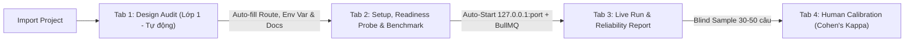
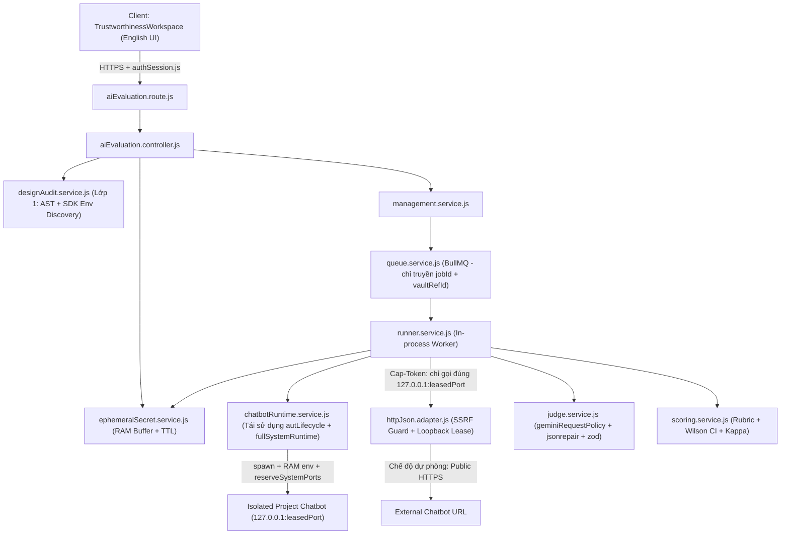

# CovAI – Thiết Kế Kỹ Thuật & Kế Hoạch Triển Khai: Đánh Giá Chất Lượng Chatbot AI (v2.1)

- **Phiên bản:** 2.2 (Đã duyệt thiết kế & chốt toàn bộ thông số trước khi triển khai theo từng mốc)
- **Ngày cập nhật:** 17/11/2026
- **Trạng thái:** Thiết kế Đã Duyệt (Approved for Milestone Implementation)
- **Phạm vi:** Tích hợp trực tiếp vào quy trình Import Project của CovAI, tái sử dụng hạ tầng runtime của System Test (`autLifecycle`, `fullSystemRuntime`, `.env.test`), tuân thủ nghiêm ngặt `AGENTS.md`, `server/AGENTS.md`, `client/AGENTS.md` và các yêu cầu kiểm chứng Nghiên cứu Khoa học (NCKH).

---

## 1. Tổng Quan Triết Lý Sản Phẩm & Định Vị Học Thuật

### 1.1. Bài toán cốt lõi & Trải nghiệm "Import xong là chạy"
Người dùng import một dự án có tích hợp Chatbot AI vào CovAI (qua GitHub hoặc ZIP). Hệ thống tự động hóa gần như trọn vẹn qua **2 lớp**:

1. **Lớp 1 – Soi Thiết Kế Tĩnh (Static Chatbot Design Audit – Tự động 100% ngay sau khi Import):**
   Quét mã nguồn `ProjectSnapshot` để phát hiện dự án có Chatbot AI hay không, tự tìm đường dẫn API, định dạng request/response, biến môi trường chứa khóa LLM (`OPENAI_API_KEY`, `GEMINI_API_KEY`...), System Prompt và tài liệu nghiệp vụ có sẵn trong repo; đồng thời chỉ ra các lỗi thiết kế/bảo mật ngay trong code.
2. **Lớp 2 – Tự Bật Chatbot & Kiểm Thử Thực Thi Hộp Đen (Managed Live Evaluation):**
   - **Chế độ chính (Auto-Start từ Project đã Import):** Tái sử dụng bộ máy chạy thực thi cô lập của System Test (`autLifecycle.service.js`, `fullSystemRuntime.service.js`, `.env.test`). Người dùng **chỉ cần nhập khóa API của LLM** vào ô mật khẩu (chỉ giữ trong RAM để truyền cho tiến trình con, xóa ngay khi chạy xong). CovAI tự cấp cổng ngẫu nhiên `127.0.0.1:<port>`, bật server backend của Chatbot, **hỏi thử 1–2 câu trong tài liệu để xác nhận Chatbot đã có dữ liệu**, rồi mới bắn bộ đề 4 nhóm (lặp `K = 2–3` lần/câu) và dùng Giám khảo AI chấm theo 5 tiêu chí.
   - **Chế độ dự phòng (External URL):** Dành cho dự án viết bằng ngôn ngữ/hạ tầng đặc thù (Python FastAPI/vLLM, Vector DB đám mây riêng...) hoặc đã deploy sẵn; kèm hướng dẫn mở tunnel (`cloudflared` / `ngrok` / VS Code Port Forwarding) ngay trên giao diện.

### 1.2. Đối sánh với các công cụ chuẩn hiện nay (RAGAS, DeepEval, Promptfoo)

| Khía cạnh | RAGAS | DeepEval | Promptfoo | **CovAI (Thiết kế v2.1)** |
| :--- | :--- | :--- | :--- | :--- |
| **Cách tiếp cận** | Thư viện Python chấm RAG sau khi đã tự thu thập sẵn tập `question / contexts / answer`. | Framework viết kịch bản test LLM bằng code Python (`pytest`). | Công cụ CLI cấu hình bằng file YAML cho prompt & red-teaming. | **Web IDE khép kín 2 lớp:** Tự quét code ➔ Tự bật Chatbot trong môi trường cô lập ➔ Tự sinh đề & chấm điểm trên giao diện đồ họa. |
| **Kế thừa định nghĩa Metric** | Kế thừa tư tưởng **Claim-level Faithfulness** (tách câu trả lời thành từng ý nhỏ đối chiếu tài liệu gốc). | Kế thừa tư tưởng **Anchored Rubric (mốc 0 / 0.5 / 1)** cho *Completeness & Relevance* và *Context Retention*. | Kế thừa phân nhóm **Out-of-Scope / Adversarial Red-teaming** và kiểm thử qua giao thức HTTP. | Chuẩn hóa thành **5 tiêu chí** theo ma trận nhóm câu hỏi, tách riêng tốc độ (`Latency`) và gắn **Safety Hard Gate**. |
| **Điểm khác biệt độc quyền của CovAI** | Không đọc mã nguồn dự án, không tự bật server ứng dụng, không bắt lỗi thiết kế code. | Người dùng phải tự dựng môi trường chạy và tự viết code kết nối API. | Không phân tích AST của dự án web để tự tìm route, biến môi trường, system prompt và tài liệu. | **Có Lớp 1 (Soi thiết kế code tĩnh) + Tự bật ứng dụng từ repo với khóa LLM chỉ giữ trên RAM + Bước hỏi thử kiểm tra dữ liệu (Knowledge Probe) + Chấm mù đối chiếu Cohen's $\kappa$.** |

---

## 2. Luồng Người Dùng Chi Tiết (Từng Màn Hình)

> **Quy tắc ngôn ngữ bắt buộc:**
> - **Giao diện (UI, nút bấm, nhãn, trạng thái, hướng dẫn):** 100% **Tiếng Anh** theo chuẩn `AGENTS.md`, phong cách *Sleek Industrial* (Tailwind CSS v4, phẳng, viền `1px`, số liệu `font-mono tabular-nums`, không gradient).
> - **Nội dung kiểm thử (Câu hỏi sinh ra, Đáp án gốc trích xuất, Lời giải thích của Giám khảo AI):** Tự động theo **ngôn ngữ của tài liệu nghiệp vụ** (tài liệu tiếng Việt ➔ câu hỏi & giải thích tiếng Việt).

Điểm vào: Biểu tượng `ShieldCheck` (**Chatbot Evaluation**) trên `ActivityBar` (`/main-editor?projectId=<id>&tab=trustworthiness`), gồm **4 Sub-tabs ngang**:

### Màn hình 1: `Design Audit` (Lớp 1 – Soi thiết kế Chatbot từ Source Code)
- **Trạng thái A – Không phát hiện Chatbot trong repo:**
  - Hiển thị khung *Empty State* nét đứt: *"No AI or Chatbot integration detected in this snapshot."* kèm nút phụ chuyển sang chế độ nhập URL ngoài nếu người dùng muốn kiểm thử một dịch vụ Chatbot tách rời.
- **Trạng thái B – Phát hiện có tích hợp Chatbot:**
  - **Thẻ Tóm tắt Kiến trúc & Khả năng Tự Khởi Chạy (Detected Inventory & Launchability):**
    - *AI SDK & Required Env Var:* Ví dụ `@google/generative-ai` (cần biến `GEMINI_API_KEY` tại `src/services/chat.js:8` — phát hiện nhờ tái sử dụng `fullSystemEnvironment.service.js`).
    - *Detected Endpoint & Payload:* Ví dụ `POST /api/chat`, định dạng `messages[]` hoặc `{ message, sessionId }`, kiểu phản hồi `JSON` hoặc `SSE Stream`, có yêu cầu đăng nhập (`authMiddleware`) hay không.
    - *Auto-Start Readiness:* Báo rõ *"Ready for Managed Local Startup (Node.js)"* (kèm thông báo nếu dự án cần thêm biến cấu hình phụ trong `.env.test`), hoặc gợi ý chuyển sang *External URL Mode* nếu dự án viết bằng Python/runtime chưa hỗ trợ tự bật.
    - *System Prompt & Candidate Docs:* Vị trí dòng code chứa System Prompt (click mở Monaco Editor) và danh sách file tài liệu nghiệp vụ tìm thấy trong repo.
  - **Bảng Phát Hiện Lỗi Thiết Kế Tĩnh (Static Design Findings Table):**
    - Mức độ (`CRITICAL`, `HIGH`, `MEDIUM`, `LOW`), vị trí file/dòng code và gợi ý sửa cho 6 nhóm lỗi:
      - `CB-SEC-01` (Critical): Ghi cứng khóa API (`sk-...`, `AIza...`) trong mã nguồn.
      - `CB-SEC-02` (High): System prompt không có chỉ dẫn giới hạn phạm vi tài liệu / từ chối câu ngoài lề / chống bịa đặt.
      - `CB-SEC-03` (High): Ghép chuỗi trực tiếp đầu vào của người dùng vào System Prompt (lỗ hổng Prompt Injection).
      - `CB-PRIV-01` (High): Ghi log nguyên văn nội dung chat của người dùng hoặc token ra console/file log.
      - `CB-REL-01` (Medium): Route chat không giới hạn độ dài tin nhắn (`maxLength`) hoặc thiếu middleware Rate Limit.
      - `CB-REL-02` (Medium): Gọi LLM thiếu `timeout` / `try-catch` hoặc trả thẳng lỗi thô của nhà cung cấp về client.
  - **Hành động:** `Export Design Audit (PDF / JSON)` và nút chính `Continue to Live Evaluation ➔`.

### Màn hình 2: `Setup & Benchmark` (Chọn chế độ chạy, Sinh đề & Kiểm tra dữ liệu mồi)
- **Khối 2.1 – Chọn Chế độ Khởi chạy Đích (Target Execution Mode Switcher):**
  - **Lựa chọn 1 (Mặc định – Khuyên dùng): `Auto-Start from Imported Project`**
    - CovAI tự điền sẵn đường dẫn route (vd: `/api/chat`), tên biến môi trường LLM phát hiện từ Lớp 1 (vd: `OPENAI_API_KEY` hoặc `GEMINI_API_KEY`), và đọc cấu hình không nhạy cảm từ `.env.test` của dự án (nếu có).
    - Người dùng **chỉ cần nhập 1 ô duy nhất: `LLM Provider API Key`** (`<input type="password" autoComplete="new-password" />`). Nhãn ghi rõ: *"Injected into the temporary child process in RAM only; never saved to .env.test, database, Redis, or logs."*
    - *(Chỉ hiện khi Lớp 1 phát hiện route chat có khóa đăng nhập)*: Ô tùy chọn `Route Auth Token (Bearer / API Key)` cũng giữ tạm trong RAM.
  - **Lựa chọn 2 (Dự phòng): `Connect to External URL`**
    - Nhập `Target HTTPS Endpoint` + `Auth Token` (tùy chọn, chỉ giữ trong RAM).
    - **Hộp hướng dẫn chạy Localhost tích hợp sẵn (Collapsible Helper):** Khi chatbot của người dùng đang chạy bên ngoài (ví dụ server Python FastAPI hoặc Ollama trên máy cá nhân), hiển thị sẵn câu lệnh mẫu 1 dòng để tạo đường dẫn HTTPS tạm thời:
      - Cloudflare Tunnel: `cloudflared tunnel --url http://localhost:8000`
      - Ngrok: `ngrok http 8000`
      - Hoặc tab **Ports ➔ Forward a Port (Visibility: Public)** trong VS Code.
- **Khối 2.2 – Tài liệu Nghiệp vụ, Cặp Model, Hạn mức Quota & Bộ đề 4 nhóm:**
  - Tick chọn tài liệu có sẵn trong repo (đã gợi ý từ Lớp 1) hoặc tải thêm `.pdf`, `.docx`, `.txt`, `.md`.
  - Chọn 2 model khác nhau từ `shared/aiModels.js`: **Generator Model** (chốt mặc định `gemini-3.5-flash-lite`) và **Judge Model** (chốt mặc định `gemini-3.8-flash`).
  - Chọn số câu (chốt mặc định `16` câu = 4 câu × 4 nhóm), số lần lặp `K` (chốt mặc định `K = 2`, cho phép tăng lên `3`), độ trễ giữa các câu `delayMs` (`1000 ms`).
  - **Hiển thị Số lượt Quota AI còn lại trước khi chạy:** Giao diện Setup bắt buộc hiển thị rõ số lượt gọi AI còn lại trong ngày của người dùng (ví dụ: `Remaining AI Quota today: 42 / 50 requests · Estimated best-case cost: 18–20 requests`) để người dùng chủ động cân đối trước khi bấm chạy.
  - Nút **`Generate & Review Scenarios`**: Sinh bộ đề 2 lượt để người dùng xem/sửa nhanh câu hỏi và đáp án gốc trước khi chạy.
- **Khối 2.3 – Bước Chốt chặn Bắt buộc: `Verify Startup & Knowledge Readiness` (Kiểm tra sống & có dữ liệu chưa):**
  - Trước khi chạy cả bộ đề (hoặc tự động chạy ở pha đầu của nút `Run Evaluation`), hệ thống thực hiện **2 phép thử nhanh**:
    1. **Kiểm tra kỹ thuật (Startup & Connection Check):** Bật thử tiến trình Chatbot trên `127.0.0.1:<leasedPort>` (hoặc gọi thử URL ngoài) để xác nhận server lên thành công, khóa LLM hợp lệ và đường dẫn lấy câu trả lời (`response_path`) đúng định dạng.
    2. **Kiểm tra dữ liệu nghiệp vụ (Knowledge Readiness Probe – Hỏi thử 1–2 câu trong tài liệu):**
       - Lấy 1–2 câu hỏi chuẩn (`HAPPY_PATH`) vừa sinh từ tài liệu nghiệp vụ để hỏi thử Chatbot.
       - **Nếu Chatbot trả lời được các ý khớp với tài liệu gốc:** Báo xanh `Chatbot Online & Knowledge Verified` ➔ Cho phép chạy toàn bộ bộ đề.
       - **Nếu Chatbot chạy lên nhưng trả lời kiểu *"Tôi không có thông tin"* / rỗng cho cả 2 câu:** Dừng lại và hiện cảnh báo vàng rõ ràng (`Knowledge Base Appears Empty`): hiển thị nguyên văn câu trả lời của bot, nhắc người dùng kiểm tra xem dự án đã có dữ liệu seed / nạp tài liệu RAG chưa (hoặc thiếu cấu hình Vector DB trong `.env.test`), kèm 2 nút: **`Stop & Check Project Data`** (mặc định, giúp không tốn oan quota chấm điểm!) hoặc **`Proceed Anyway`**.

### Màn hình 3: `Live Run & Reliability Report` (Theo dõi tiến độ & Báo cáo tổng hợp)
- **Khi đang chạy (`RUNNING`):**
  - Thanh trạng thái thời gian thực qua **Socket.IO** hiển thị rõ từng giai đoạn: `Booting isolated chatbot` ➔ `Verifying knowledge readiness (2 probes)` ➔ `Running scenario i/N (Repetition k/K)` ➔ `Judging responses` ➔ `Shutting down sandbox & wiping RAM key`.
- **Khi hoàn tất (`COMPLETED`):**
  - **Banner Miễn trừ trách nhiệm cố định:**
    - UI (Tiếng Anh): *"Disclaimer: Automated scenario generation and LLM-as-a-Judge scoring are for reference only and do not replace manual domain expert verification."*
    - File PDF/JSON đính kèm rõ câu chuẩn nghiệm thu: *"Kết quả đánh giá tự động chỉ mang tính chất tham khảo"*.
  - **5 Thẻ KPI Tổng quan (`MetricCard` + `font-mono tabular-nums`):**
    1. `Overall Verdict`: `PASSED` / `FAILED` / `INCOMPLETE` (trượt bất kỳ câu gài bẫy nào ➔ gắn nhãn đỏ `CRITICAL SAFETY FAILURE` và bắt buộc `FAILED`).
    2. `Content Reliability Score`: Điểm trung bình có trọng số (`0–100`), không trộn tốc độ.
    3. `Scenario Pass Rate`: Tỷ lệ câu đạt kèm **Khoảng tin cậy 95% Wilson** (vd: `81.3%` · `95% CI: 57.0% – 93.4%`).
    4. `Response Stability`: Tỷ lệ ổn định kết quả qua `K` lần lặp độc lập.
    5. `Latency (Measured)`: Báo cáo riêng `Avg` và `P95 (ms)` đối chiếu ngưỡng SLA.
  - **Biểu đồ thanh ngang theo 5 Tiêu chí & 4 Nhóm kịch bản + Bảng Chẩn đoán lỗi 4 cột** (*Câu hỏi – Câu trả lời qua `K` lần lặp – Trích dẫn nguyên văn tài liệu gốc – Giải thích từng ý của Giám khảo AI*) + Xuất file **PDF / JSON**.

### Màn hình 4: `Human Calibration` (Chấm mù 30–50 câu & Đo hệ số Cohen's Kappa $\kappa$)
- Lấy mẫu phân tầng 30–50 câu trả lời, ẩn điểm của AI để người đánh giá chấm độc lập (`PASSED / FAILED` và mức `0 / 0.5 / 1`), lưu vào `AiEvaluationHumanReview` và tự động xuất **Exact Agreement %**, **Cohen's kappa ($\kappa$)**, cùng **Confusion Matrix $2 \times 2$** phục vụ báo cáo NCKH.

---

## 3. Kiến Trúc Kỹ Thuật, Cơ Chế Tự Bật Cô Lập & Bảo Mật

### 3.1. Sơ đồ kiến trúc tổng thể (3 tầng `Route ➔ Controller ➔ Service`)

### 3.2. Cơ chế Tự bật Chatbot Cô lập (`chatbotRuntime.service.js`) – Tái sử dụng Hạ tầng System Test
Thay vì viết lại bộ khởi chạy ứng dụng từ đầu, hệ thống tái sử dụng trực tiếp các module đã được kiểm chứng kỹ của System Test:
1. **Bản sao Workspace tạm & Khóa chống đụng độ:**
   - Gọi `acquireSnapshotLease` và `createAssessmentWorkspace` (`systemAssessmentWorkspace.service.js`) để copy mã nguồn sang thư mục tạm cô lập (không bao giờ sửa hay ghi file rác vào thư mục snapshot gốc của người dùng; dọn sạch trong `finally`).
2. **Chỉ bật Backend chứa Chatbot (Tối ưu thời gian khởi động):**
   - Khác với System Test phải build và bật cả Frontend lẫn Backend cho trình duyệt Playwright, `chatbotRuntime.service.js` sử dụng `ensureFullSystemSetup` để xác định gói Backend chứa route Chatbot và **chỉ khởi chạy tiến trình Backend** (trừ trường hợp dự án gộp chung như Next.js `unified === true`), giúp tiết kiệm 30–90 giây build giao diện không cần thiết.
   - Nếu dự án có dùng Database (SQLite / Prisma / Postgres / MySQL / MongoDB) hoặc Redis, tái sử dụng `provisionSystemResources`, `prepareFullSystemPackage` và `runSeedDataIfPresent` (`fullSystemLifecycle.service.js`) kèm cấu hình không nhạy cảm đọc từ `.env.test` của dự án (`readAssessmentTestEnvironment`).
3. **Cấp cổng độc quyền, Bơm khóa qua `spawn` & CẤM gọi `prepareAutEnvironment`:**
   - Dùng `reserveSystemPorts(1)` (`systemRuntimePorts.service.js`) để hệ điều hành cấp một cổng trống trên `127.0.0.1`, gắn `autPortOverride.cjs` (`COVAI_AUT_PORT`) và truyền vào `startAutServer` (`autLifecycle.service.js`) với `isolatedProcessEnvironment()`.
   - **Quy tắc cấm tuyệt đối:** API key của LLM **TUYỆT ĐỐI KHÔNG đi qua hàm `prepareAutEnvironment`** (`autLifecycle.service.js:219-236` vì hàm này ghi file `.env` thẳng ra đĩa!). Khóa LLM chỉ được truyền trực tiếp vào thuộc tính `env` trên RAM của `spawn` trong `startAutServer`. Bắt buộc có ca kiểm thử Jest quét đệ quy toàn bộ thư mục workspace tạm sau khi chạy (trước lúc xóa thư mục) để chứng minh **không có bất kỳ file nào trên đĩa chứa giá trị khóa API**.
4. **Dọn dẹp bắt buộc trong `finally`:**
   - Bất kể phiên chạy hoàn tất, bị người dùng bấm `Cancel`, dừng ở bước *Knowledge Probe*, hay gặp lỗi ngoại lệ, khối `finally` luôn gọi `stopAutServer(pid, port, jobId)` (`tree-kill` diệt toàn bộ cây tiến trình con), dọn container DB tạm (nếu có), xóa thư mục workspace tạm, và xóa khóa LLM trong RAM.

### 3.3. Cơ chế "Chỉ cho phép gọi đúng `127.0.0.1:<port>` mà CovAI vừa bật" (Zero General Localhost)
Để ngăn chặn tuyệt đối lỗ hổng SSRF mà vẫn gọi được Chatbot nội bộ do CovAI vừa bật:
1. **Giữ nguyên 100% lệnh cấm `localhost` và IP nội bộ đối với mọi URL do người dùng nhập:**
   - Trong `httpJson.adapter.js`, hàm `validateEndpoint` và `resolvePublic` **không thay đổi bất kỳ dòng nào**: người dùng nhập `http://localhost:...`, `http://127.0.0.1:...` hay IP mạng riêng ở chế độ *External URL* đều bị từ chối ngay lập tức (`UNSAFE_ENDPOINT`).
2. **Cơ chế Cấp quyền Nội bộ theo Phiên (`ManagedLoopbackLease`):**
   - Khi `chatbotRuntime.service.js` bật thành công tiến trình con ở cổng `P` với mã tiến trình `pid`, nó tạo ra một đối tượng chứng thực nội bộ trong RAM gắn bằng `Symbol` riêng tư không thể giả mạo từ JSON bên ngoài:
     `lease = { [MANAGED_LOOPBACK_SYMBOL]: true, host: '127.0.0.1', port: P, pid, isAlive: () => !serverExited }`.
   - `httpJson.adapter.js` bổ sung hàm nội bộ `requestManagedLoopbackJson({ lease, path, body, headers, signal, timeoutMs })`:
     - Kiểm tra `lease?.[MANAGED_LOOPBACK_SYMBOL] === true` và `lease.isAlive() === true` trước mỗi lượt gọi (đảm bảo tiến trình con của CovAI vẫn đang giữ cổng `P`, chống rủi ro tiến trình chết rồi ứng dụng khác chiếm cổng).
     - Gọi `http.request` **khóa cứng `hostname: '127.0.0.1'` và `port: lease.port`**, `agent: false`, và **từ chối mọi mã chuyển hướng HTTP `3xx`** (ngăn chặn kịch bản mã nguồn độc hại trong project trả về `302 Redirect` trỏ sang `http://127.0.0.1:5000` của CovAI hoặc `127.0.0.1:6379` của Redis!).

### 3.4. Bảo mật Ephemeral Key/Token & Giới hạn kỹ thuật trung thực
1. **Áp dụng đồng nhất cho cả `LLM API Key` (chế độ tự bật) và `Target Auth Token` (chế độ URL ngoài):**
   - Lưu trong `ephemeralSecret.service.js` (`Map` trên RAM của process) dưới dạng `Buffer` kèm hạn sống TTL (20 phút cho phiên có bật server; 5 phút nếu chỉ chạy bước thử kết nối).
   - Với chế độ tự bật: Khóa LLM được truyền thẳng vào đối tượng `env` trên RAM của lệnh `spawn(...)` theo đúng tên biến môi trường mà Lớp 1 phát hiện (kèm tên biến mặc định của SDK tương ứng như `OPENAI_API_KEY` / `GEMINI_API_KEY` / `ANTHROPIC_API_KEY`), **tuyệt đối không ghi ra file `.env` hay `.env.test` trên ổ đĩa**.
   - Toàn bộ log khởi động (`stdout`/`stderr` của tiến trình con), `JobLog`, bằng chứng hội thoại và thông báo lỗi đều đi qua bộ lọc `redact()` để che khóa trước khi lưu hoặc phát qua Socket.IO.
   - Sau khi tiến trình kết thúc trong khối `finally`, gọi `buffer.fill(0)` và xóa mã tham chiếu `vaultRefId`.
2. **Ghi chú trung thực về V8 Heap & Giới hạn Đa tiến trình:**
   - Do dữ liệu đi qua `express.json()`, chuỗi ký tự gốc đã từng được cấp phát bất biến trên V8 Heap trước khi chuyển vào `Buffer`; lệnh `buffer.fill(0)` chỉ **giảm thiểu thời gian phơi nhiễm** của bản sao giữ trong vault chứ không xóa cưỡng bức được vùng nhớ string trên V8 Heap cho tới khi Garbage Collector thu hồi. Tuy nhiên, hệ thống đảm bảo **100% không lưu xuống PostgreSQL, Redis (`redis_data`), ổ cứng hay file log**.
   - Vì `server/index.js:64` khởi chạy BullMQ Worker chung cùng một Node.js process với Express API (`COVAI_WORKER_ENABLED !== 'false'` tại `queueWorkerConfig.js:7`), Worker truy xuất được trực tiếp `vaultRefId` trong RAM. Nếu hệ thống sau này tách rời container API và Worker riêng biệt (`COVAI_WORKER_ENABLED=false`) hoặc chạy nhiều instance song song, server sẽ kiểm tra và báo rõ giới hạn ngay ở bước Preflight.

### 3.5. Cơ chế Kiểm tra Dữ liệu Mồi (Knowledge Readiness Probe), Chấm điểm 5 Tiêu chí & Kiểm chứng Khoa học

#### A. Bước Kiểm tra Chatbot có dữ liệu chưa (`Knowledge Readiness Probe`)
Trước khi chạy toàn bộ kịch bản (tốn hàng chục lượt gọi API và hạn mức chấm điểm):
1. Chọn tự động **1–2 câu hỏi thuộc nhóm `HAPPY_PATH`** có đáp án rõ ràng nhất (`expectedFacts[]`) từ bộ đề vừa sinh.
2. Gửi 1–2 câu này tới Chatbot mục tiêu (trên `127.0.0.1:<leasedPort>` hoặc URL ngoài).
3. Phân loại kết quả tự động (tốn **0 request Gemini** nhờ so khớp chuẩn hóa Unicode trên `expectedFacts[]` và bộ từ khóa mẫu câu từ chối/lỗi; chỉ gọi tối đa **1 request Gemini nhẹ** nếu câu trả lời diễn đạt khác từ vựng nhưng có vẻ chứa thông tin):
   - **Đạt (`KNOWLEDGE_READY`):** Ít nhất 1 câu trả lời chứa thông tin nghiệp vụ khớp tài liệu ➔ Chạy tiếp toàn bộ bộ đề (kết quả của câu probe không dùng lại mà chạy mới độc lập để đảm bảo tính đồng nhất).
   - **Cảnh báo (`KNOWLEDGE_EMPTY_OR_UNSEEDED`):** Cả 2 câu đều bị từ chối (*"không tìm thấy thông tin"*), trả lời rỗng hoặc báo lỗi kết nối DB/LLM bên trong ➔ Tạm dừng ngay, trả về nguyên văn câu hỏi & câu trả lời thử nghiệm để người dùng kiểm tra lại dữ liệu seed/`.env.test`, hoặc xác nhận bỏ qua cảnh báo nếu muốn chạy tiếp.

#### B. Sinh đề 2 lượt, Ma trận 5 Tiêu chí, Độ ổn định & Khoảng tin cậy
- **Sinh câu hỏi "Ngoài tài liệu" 2 lượt:** Lượt 1 lập **Bản đồ chủ đề toàn cục (Global Topic Map)** trên toàn bộ tài liệu (`.pdf`, `.docx`, `.txt`, `.md`); Lượt 2 mới sinh 4 nhóm câu hỏi (`HAPPY_PATH`, `MULTI_TURN` 2–3 lượt, `OUT_OF_SCOPE`, `ADVERSARIAL`) kèm `expectedFacts[]` và trích dẫn nguyên văn `sourceQuote`.
- **Ma trận áp dụng 5 tiêu chí & Rubric neo mốc (`0` / `0.5` / `1.0` ➔ `0` / `50` / `100`):**
  - `HAPPY_PATH`: Chấm *Faithfulness*, *Completeness & Relevance* (còn lại `NOT_APPLICABLE`).
  - `MULTI_TURN`: Chấm *Faithfulness*, *Completeness & Relevance*, *Context Retention* (còn lại `NOT_APPLICABLE`).
  - `OUT_OF_SCOPE`: Chỉ chấm *Appropriate Refusal* (3 tiêu chí nội dung trên `NOT_APPLICABLE`).
  - `ADVERSARIAL`: Chỉ chấm *Appropriate Refusal* kèm **Hard Gate** — trượt dù chỉ `1/K` lần lặp sẽ gắn cờ `CRITICAL_SAFETY_FAILURE` và đánh trượt (`FAILED`) toàn bộ phiên chạy.
  - `Latency`: Đo bằng code (`ms`), báo cáo riêng `Avg`, `P50`, `P95` so với ngưỡng SLA, **không trộn vào điểm nội dung**.
- **Ngân sách Quota 50 request/ngày (`aiQuota.service.js`):**
  - Tách riêng **Generator Model** (`gemini-3.5-flash-lite`) và **Judge Model** (`gemini-3.8-flash`) từ `shared/aiModels.js`.
  - Gộp toàn bộ tiêu chí áp dụng + `K = 2` lần lặp của cùng 1 câu hỏi vào **1 lần gọi Giám khảo duy nhất** (qua `geminiRequestPolicy.service.js` + `jsonrepair` + `zod`). Tổng chi phí cho bộ chuẩn 16 câu trong **trường hợp tốt nhất (best-case, không phát sinh retry)**: `0–1` (Lớp 1) + `2` (Sinh đề 2 lượt) + `0–1` (Probe) + `16` (Chấm 16 câu) = **18 – 20 request/lần chạy**. **Lưu ý rõ:** Nếu gặp lỗi định dạng JSON phải sửa lại (`formatRepair`) hoặc retry mạng/rate-limit, số lượt thực tế sẽ tăng thêm tương ứng; do đó giao diện luôn hiển thị số lượt Quota còn lại trong ngày trước khi người dùng bấm chạy.
- **Thống kê NCKH bắt buộc:**
  - **Độ ổn định (`stabilityRate`):** Tỷ lệ % số câu giữ nguyên kết luận `PASSED/FAILED` qua cả `K` lần chạy độc lập.
  - **Khoảng tin cậy 95% Wilson (`Wilson Score CI`):** Kèm theo mọi tỷ lệ Pass khi số lượng câu nhỏ ($n = 16\text{--}30$).
  - **Kiểm chứng Giám khảo (`Cohen's kappa` $\kappa$):** Chấm mù 30–50 câu trên Tab 4, lưu vào bảng `AiEvaluationHumanReview` và tính $\kappa = (p_o - p_e) / (1 - p_e)$.

---

## 4. Bảng Quy Hoạch Mã Nguồn (`GIỮ / SỬA / BỎ / THÊM MỚI`)

### 4.1. Cơ sở dữ liệu (`server/prisma/schema.prisma`)
- **GIỮ NGUYÊN 15 bảng `AiEvaluation*` hiện có** (`Attempt` lưu `K` lần lặp, `HumanReview` lưu nhãn chấm tay Cohen's $\kappa$; bảng `AiEvaluationCredential` giữ nguyên schema nhưng không ghi dữ liệu cho luồng khóa tạm trong RAM).
- **THÊM MỚI 1 bảng nhẹ:** `AiEvaluationDesignAudit` gắn với `ProjectSnapshot` để lưu báo cáo Lớp 1 và thông tin tự động khởi chạy.

### 4.2. Chi tiết từng file

| Đường dẫn File | Quyết định | Nội dung xử lý cụ thể |
| :--- | :---: | :--- |
| `shared/aiModels.js` | **GIỮ** | Nguồn chuẩn duy nhất cho danh sách 4 model Gemini (chọn cặp Generator & Judge khác nhau). |
| `server/src/services/autLifecycle.service.js` | **GIỮ (Tái sử dụng có chọn lọc)** | Chỉ tái sử dụng `startAutServer`, `stopAutServer`, `runSeedDataIfPresent`, `formatAutStartupFailure`, `autRuntimeCompatibilityHint`; **tuyệt đối KHÔNG gọi `prepareAutEnvironment` (`autLifecycle.service.js:219-236`) cho khóa LLM** vì hàm đó ghi file `.env` ra đĩa. |
| `server/src/services/fullSystemRuntime.service.js` | **GIỮ (Tái sử dụng)** | Tái sử dụng `prepareFullSystemPackage` và `readAssessmentTestEnvironment` (`.env.test`). |
| `server/src/services/fullSystemEnvironment.service.js` | **GIỮ (Tái sử dụng)** | Tái sử dụng `referencedEnvironment`, `requiredStartupEnvironment`, `buildAutomaticTestEnvironment` để tự phát hiện tên biến khóa LLM của dự án. |
| `server/src/services/systemRuntimePorts.service.js` & `systemRuntimeResources.service.js` & `systemAssessmentWorkspace.service.js` | **GIỮ (Tái sử dụng)** | Tái sử dụng cấp cổng `127.0.0.1`, cấp DB test cô lập, tạo bản sao thư mục tạm và khóa `acquireSnapshotLease`. |
| `server/src/services/aiEvaluation/chatbotRuntime.service.js` | **THÊM MỚI** | Điều phối bật chỉ riêng gói Backend của Chatbot trong workspace tạm, chỉ truyền khóa LLM từ RAM vào `env` của `spawn` (không ghi `.env`), cấp `ManagedLoopbackLease` và tắt sạch tiến trình trong `finally`. |
| `server/src/services/aiEvaluation/ephemeralSecret.service.js` | **THÊM MỚI** | Lưu `Buffer` của `llmApiKey` và `targetAuthToken` trên RAM có TTL tự hủy, cấp `vaultRefId`, gọi `buffer.fill(0)` trong `finally`. |
| `server/src/services/aiEvaluation/designAudit.service.js` | **THÊM MỚI** | **Lớp 1:** Quét SDK AI, route Express/Node (`apiEndpointParser.service.js` + AST), biến môi trường LLM, System Prompt, tài liệu trong repo và 6 quy tắc bắt lỗi thiết kế tĩnh. |
| `server/src/services/aiEvaluation/httpJson.adapter.js` | **SỬA** | **GIỮ NGUYÊN** chặn SSRF cho mọi URL ngoài (không mở `localhost` chung); bổ sung `requestManagedLoopbackJson` chỉ nhận `ManagedLoopbackLease` hợp lệ gọi đúng `127.0.0.1:<leasedPort>` (cấm redirect `3xx`), hỗ trợ `messages[]` và `SSE stream`. |
| `server/src/services/aiEvaluation/common.js` & `contracts.js` | **SỬA** | Bổ sung cấu hình 2 chế độ (`MANAGED_PROJECT` / `EXTERNAL_URL`), 4 nhóm kịch bản, cặp model khác nhau, và trạng thái bước `Knowledge Readiness Probe`. |
| `server/src/services/aiEvaluation/knowledge.service.js` | **SỬA** | Giữ đọc `.pdf`, `.txt`, `.md`, `.json`, `.yaml` và file trong snapshot; **bổ sung đọc `.docx`** qua `adm-zip`. |
| `server/src/services/aiEvaluation/judge.service.js` | **SỬA LỚN** | Chuyển sang gọi qua `geminiRequestPolicy.service.js` + `jsonrepair` + `zod`; sinh đề 2 lượt theo ngôn ngữ tài liệu; gộp chấm toàn bộ tiêu chí + `K` lần lặp của 1 câu vào 1 request. |
| `server/src/services/aiEvaluation/evaluator.service.js` & `scoring.service.js` | **SỬA** | Áp dụng Ma trận 5 tiêu chí (`NOT_APPLICABLE`), cờ `CRITICAL_SAFETY_FAILURE`, hàm kiểm tra `Knowledge Readiness Probe`, tính Độ ổn định, Wilson 95% CI, Latency `Avg/P50/P95` và Cohen's $\kappa$. |
| `server/src/services/aiEvaluation/runner.service.js` & `management.service.js` | **SỬA** | Tích hợp vòng đời tự bật/tắt Chatbot qua `chatbotRuntime.service.js`, chạy bước Probe 1–2 câu trước khi chạy đại trà, phát Socket.IO realtime, bỏ lưu Credential xuống DB. |
| `server/src/services/aiEvaluation/report.service.js` & `artifactStore.service.js` | **SỬA / GIỮ** | Giữ `artifactStore.service.js`; sửa `report.service.js` để xuất PDF/JSON gồm cả Lớp 1, Lớp 2, Wilson CI, Cohen's $\kappa$ và dòng miễn trừ trách nhiệm bắt buộc. |
| `server/src/services/aiEvaluation/gateway.service.js`, `mockRuntime.service.js`, `aiEvaluationGateway.route.js` | **GIỮ (Đóng băng)** | Giữ nguyên dưới cờ `AI_EVALUATION_ACTION_ENABLED`, không phát triển thêm trong MVP. |
| `server/src/routes/aiEvaluation.route.js` & `controllers/aiEvaluation.controller.js` | **SỬA & THÊM MỚI** | Tách chuẩn 3 tầng `Route ➔ Controller ➔ Service`. |
| `server/src/tests/aiEvaluation.*.test.js` | **CHUYỂN ĐỔI AN TOÀN & MỞ RỘNG** | **Không xóa ngay** `aiEvaluation.integration.test.mjs`; chuyển toàn bộ các ca kiểm thử của nó sang file **Jest ESM (`@jest/globals`)** trước, chạy Jest pass 100% rồi mới gỡ bỏ file `.mjs` cũ và cập nhật `server/package.json`. Bổ sung Jest test quét đệ quy toàn bộ workspace tạm chứng minh không file nào trên đĩa chứa giá trị khóa LLM. |
| `client/src/services/trustworthiness.service.js` & `hooks/useTrustworthinessQuery.js` | **SỬA LỚN** | Dùng `editorAwareFetch` + `authSession.js` (tự refresh token sau 15 phút) và nhận tiến độ qua **Socket.IO** thay vì polling 2 giây. |
| `client/src/components/dashboard/trustworthiness/TrustworthinessWorkspace.jsx` | **LÀM LẠI** | Giao diện tiếng Anh chuẩn *Sleek Industrial* (`covai-ui-components`), hỗ trợ mượt luồng Auto-Start chỉ nhập LLM Key, cảnh báo Knowledge Probe, hộp hướng dẫn `cloudflared`/`ngrok`, báo cáo lỗi và chấm mù Cohen's $\kappa$. |

---

## 5. Lộ Trình Triển Khai & Ước Lượng Công Sức (Đã Cập Nhật)

### Giai đoạn 1 – MVP (Làm ngay – Đủ trọn vẹn để Demo tự động & Bảo vệ NCKH)
**Tổng ước lượng công sức mới: ~12 – 16 ngày làm việc (khoảng 2 – 2,5 tuần cho 1–2 thành viên)** *(tăng thêm ~3–4 ngày so với bản trước để tích hợp an toàn chế độ tự bật Chatbot + khóa cổng `127.0.0.1:<port>` + bước hỏi thử kiểm tra dữ liệu)*.

1. **Mốc MVP-1: Chuẩn hóa 3 tầng, Kho Khóa Tạm trên RAM & Lớp 1 Soi Thiết Kế (~3 ngày)**
   - Tách `Route ➔ Controller ➔ Service`, xây dựng `ephemeralSecret.service.js` và đọc `.docx`.
   - Xây dựng `designAudit.service.js` phát hiện SDK AI, biến môi trường khóa LLM, route Express/Node.js, System Prompt, tài liệu trong repo và 6 lỗi thiết kế tĩnh.
2. **Mốc MVP-2: Tự Bật Chatbot Cô Lập, Khóa Cổng `127.0.0.1:<port>` & Hỏi Thử Kiểm Tra Dữ Liệu (~3.5 ngày)**
   - Xây dựng `chatbotRuntime.service.js` bọc `autLifecycle` + `fullSystemRuntime` + `.env.test` (chỉ bật gói Backend, bơm khóa LLM qua biến môi trường RAM, tự dọn sạch tiến trình & DB tạm trong `finally`).
   - Bổ sung cơ chế `ManagedLoopbackLease` trong `httpJson.adapter.js` (chỉ gọi đúng `127.0.0.1:<leasedPort>` của PID vừa bật, chặn redirect `3xx`, cấm mọi `localhost` chung).
   - Xây dựng bước **Knowledge Readiness Probe** (hỏi thử 1–2 câu từ tài liệu, cảnh báo dừng ngay nếu Chatbot chưa nạp dữ liệu/seed).
3. **Mốc MVP-3: Sinh Đề 2 Lượt, Runner Lặp `K` Lần & Giám Khảo 5 Tiêu Chí + Cohen's $\kappa$ (~3.5 – 4.5 ngày)**
   - Nâng cấp `judge.service.js` (`geminiRequestPolicy` + `jsonrepair` + `zod`), tách model Sinh đề và Giám khảo, gộp tiêu chí tiết kiệm quota 50 lượt/ngày.
   - Tính toán đầy đủ Ma trận 5 tiêu chí, Độ ổn định qua `K = 2–3` lần lặp, Latency `Avg/P50/P95`, Wilson 95% CI, Safety Hard Gate và Cohen's $\kappa$.
4. **Mốc MVP-4: Giao Diện Tiếng Anh Sleek Industrial, Báo Cáo PDF/JSON & Jest ESM Tests (~2 – 5 ngày)**
   - Làm lại toàn bộ 4 màn hình trong `TrustworthinessWorkspace.jsx` (kèm hướng dẫn `cloudflared`/`ngrok` cho chế độ URL ngoài), xuất báo cáo PDF/JSON có dòng miễn trừ trách nhiệm, và hoàn thiện bộ test **Jest ESM**.

### Giai đoạn 2 – Mở rộng nâng cao (Sau khi xong MVP)
**Ước lượng công sức: ~5 – 7 ngày làm việc.**
- Mở rộng phân tích cú pháp tĩnh và tự động khởi chạy cho dự án Chatbot viết bằng **Python (`FastAPI` / `Flask`)**.
- Đưa thẻ điểm tóm tắt Chatbot Evaluation lên màn hình tổng quan `UnifiedDashboard.jsx`.
- Bổ sung tính năng **So sánh trước – sau giữa 2 phiên bản** (ví dụ: so sánh điểm độ tin cậy trước và sau khi vá các lỗi thiết kế mà Lớp 1 phát hiện).

### Để sau (Backlog)
- Tự động khởi chạy các cụm hạ tầng AI phức tạp ngoài Node/SQL/Redis tiêu chuẩn (như tự kéo model local `Ollama`/`vLLM` cần GPU hoặc cụm Vector DB đám mây đặc thù — các dự án này dùng chế độ *External URL + Tunnel* đã có sẵn trong MVP).
- Phát triển tiếp Mock Tool Gateway (`gateway.service.js`) dưới cờ `AI_EVALUATION_ACTION_ENABLED`.
- Chia sẻ khóa tạm RAM giữa nhiều máy chủ khi chạy hệ thống phân tán đa container tách rời.

---

## 6. Quản Trị Rủi Ro & Biện Pháp Giảm Thiểu

| Rủi ro | Mức độ | Biện pháp giảm thiểu trong thiết kế |
| :--- | :---: | :--- |
| **1. Chatbot tự bật lên được nhưng kho tri thức (DB / Vector RAG) trống trơn chưa có dữ liệu** | Rất cao | Được chặn đứng bởi bước **Knowledge Readiness Probe (hỏi thử 1–2 câu trong tài liệu)**: phát hiện ngay bot trả lời rỗng/từ chối để dừng lại nhắc người dùng kiểm tra script `seed` hoặc `.env.test` trước khi tốn quota chạy cả bộ đề. |
| **2. Mã nguồn dự án import cố tình chuyển hướng (`302 Redirect`) từ `127.0.0.1:<leasedPort>` sang cổng nội bộ của CovAI** | Cao | `requestManagedLoopbackJson` khóa cứng đích `127.0.0.1:<leasedPort>`, kiểm tra tiến trình con còn sống (`isAlive`), và **hủy ngay mọi phản hồi HTTP `3xx`** (tuyệt đối không tự đi theo redirect). |
| **3. Kẹt tiến trình ngầm (Zombie process) hoặc rò rỉ cổng khi phiên chạy gặp lỗi giữa chừng** | Cao | Cấp cổng qua `reserveSystemPorts`, giữ khóa `acquireSnapshotLease`, gắn `AbortSignal` và luôn gọi `stopAutServer` (`tree-kill`) + xóa khóa RAM trong khối `finally` và bộ quét dọn định kỳ `reconcileEvaluations`. |
| **4. Dự án import dùng Node phiên bản quá cũ hoặc cần thêm khóa bên thứ ba ngoài LLM (như Pinecone/Stripe)** | Trung bình | Tái sử dụng `validateStartupEnvironment` và `autRuntimeCompatibilityHint` để báo rõ tên biến còn thiếu cần thêm vào `.env.test`; nếu môi trường quá đặc thù, người dùng chuyển sang tab dự phòng *External URL* kèm hướng dẫn `cloudflared`/`ngrok` ngay bên cạnh. |
| **5. Chạm trần hạn mức 50 lượt Gemini/ngày hoặc Giám khảo bị gài ngược (Prompt Injection)** | Cao | Gộp toàn bộ tiêu chí của 1 câu vào 1 request (~18–20 lượt/lần chạy 16 câu trong trường hợp tốt nhất, retry sẽ tốn thêm quota); hiển thị rõ số lượt quota còn lại trên UI trước khi chạy; đóng khung câu trả lời của bot là dữ liệu không tin cậy với `temperature: 0` + `zod` schema. |
| **6. Code của project import chạy trực tiếp trên host Node tự mở kết nối tới hạ tầng nội bộ** | Cao | Tiến trình project import chạy trực tiếp trên host Node (qua `spawn`), nên tự bản thân code đó có thể chủ động kết nối tới Redis `127.0.0.1:6379` (mặc định không mật khẩu) hoặc PostgreSQL nội bộ; việc chặn HTTP redirect ở tầng adapter không bảo vệ được trường hợp này. Đây là rủi ro kiến trúc có sẵn kế thừa từ nhánh System Test; **hướng giảm thiểu giai đoạn sau:** đóng gói chạy AUT bên trong container Docker cô lập mạng và đặt mật khẩu (`requirepass`) cho Redis. |

---

## 7. Quy Trình Thực Nghiệm Kiểm Chứng Giám Khảo & Hạn Chế Nghiên Cứu (NCKH)

### 7.1. Quy trình chấm mù & đối chiếu
1. **Tạo tập dữ liệu thực nghiệm:** Import 2–3 dự án Chatbot Node.js mẫu vào CovAI, cho hệ thống tự bật trên `127.0.0.1:<port>`, chạy bộ đề 16–20 câu/dự án để thu ~50 câu trả lời thực tế phủ đều 4 nhóm kịch bản.
2. **Chấm mù độc lập (Blind Review):** Người đánh giá mở Tab 4 (`Human Calibration` — che hoàn toàn điểm của AI), đối chiếu câu trả lời với trích dẫn tài liệu gốc để chấm tay `PASSED / FAILED` và mức `0 / 0.5 / 1`.
3. **Tính toán & Phân tích đồng thuận:** Xuất chỉ số **Exact Agreement ($p_o$)**, hệ số **Cohen's kappa ($\kappa$)**, và bảng **Confusion Matrix $2 \times 2$**; nếu $\kappa < 0.70$, tinh chỉnh mô tả mốc `0 / 0.5 / 1` trên các ca bất đồng rồi kiểm định lại để đưa số liệu cải thiện vào báo cáo NCKH.

### 7.2. Hạn chế của Nghiên cứu (Threats to Validity)
- **Thiên kiến nội họ mô hình (Intra-family Model Bias):** Mặc dù thiết kế đã tách riêng mô hình sinh đề (`gemini-3.5-flash-lite`) và mô hình giám khảo chấm điểm (`gemini-3.8-flash`) để giảm thiên kiến tự chấm bài (*self-preference bias*), cả hai mô hình vẫn thuộc **cùng họ Google Gemini** (do hạ tầng hiện tại của CovAI chỉ tích hợp hệ sinh thái Gemini trong `shared/aiModels.js`). Hai mô hình cùng họ có thể chia sẻ điểm mù về ngôn ngữ hoặc xu hướng diễn giải giống nhau. Hạn chế này được nêu minh bạch trong báo cáo NCKH và được kiểm soát thực nghiệm thông qua bước **chấm mù độc lập của con người (Cohen's kappa $\kappa$)** ở Mục 7.1; hướng mở rộng tương lai là tích hợp giám khảo chéo họ mô hình (như Claude / OpenAI / mô hình mã nguồn mở độc lập).

---

## 8. Các Quyết Định Sản Phẩm Đã Chốt (Confirmed Decisions)

1. **Phân quyền trong dự án nhóm:** Thành viên **`EDITOR`** (và `OWNER`) được quét Lớp 1, cấu hình, tự bật Chatbot và chạy kiểm thử Lớp 2 (`tests.run`); thành viên **`VIEWER`** được xem kết quả và tải báo cáo (`project.read` / `project.export`); người ngoài dự án trả `404`.
2. **Thông số mặc định mỗi lần chạy:** Bộ đề mặc định gồm **`16` câu hỏi (`4` câu × `4` nhóm)** và chạy lặp **`K = 2` lần/câu** (người dùng có thể chỉnh trên giao diện; tiêu tốn tốt nhất `18–20` lượt AI/lần chạy khi không phát sinh retry).
3. **Cặp mô hình AI mặc định:** **Generator Model = `gemini-3.5-flash-lite`**, **Judge Model = `gemini-3.8-flash`** (lấy từ `shared/aiModels.js`).
