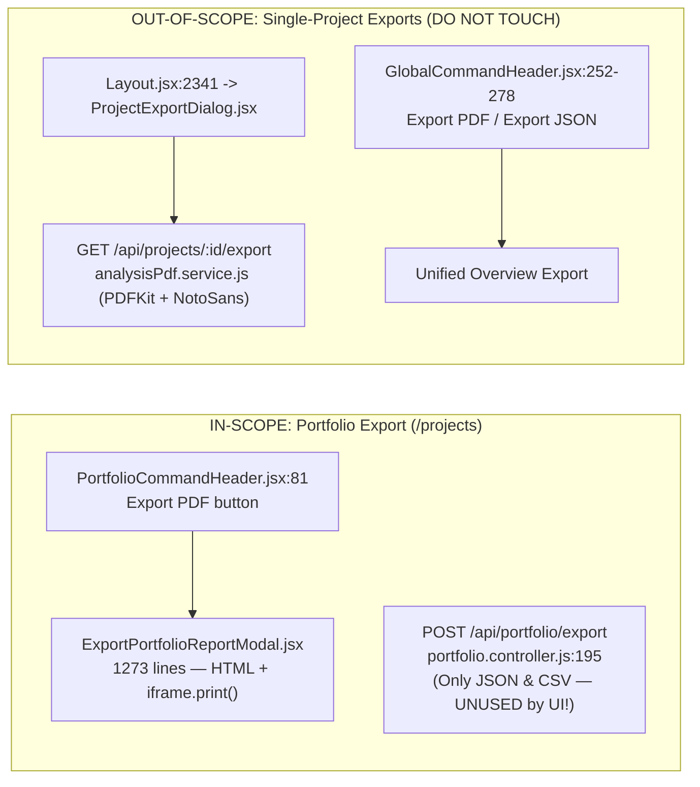
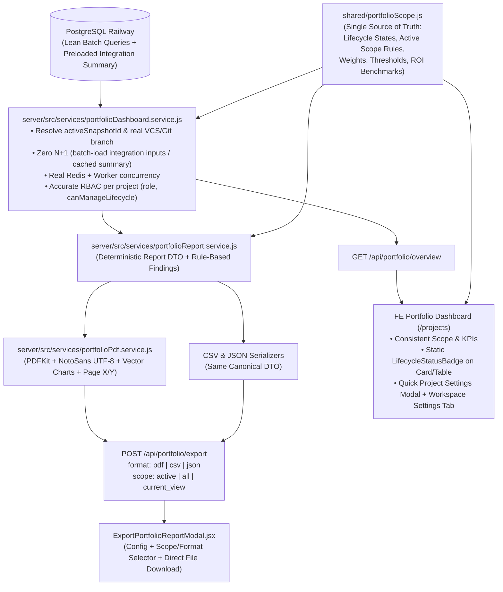

# Kế Hoạch Kiểm Toán Chuyên Sâu & Nâng Cấp Phân Hệ Projects Portfolio Dashboard (`/projects`)

> **Trạng thái:** Approved (`D1–D7` đã chốt ngày 2026-11-27) — Đang triển khai tuần tự theo từng Phase (bắt đầu từ **Phase 0**).  
> **Phạm vi tài liệu:** Deep Audit dựa trên mã nguồn thực tế (evidence-based `file:line`) & Thiết kế kiến trúc nâng cấp cho 3 mục tiêu cốt lõi:
> 1. Nâng cấp **Portfolio Export Report** (chỉ phạm vi `/projects`).
> 2. Tái thiết kế vị trí & luồng quản lý **Lifecycle Tag** (`NOT_STARTED`, `DOING`, `PAUSED`, `COMPLETED`, `CANCELLED`).
> 3. Kiểm toán & chuẩn hóa toàn bộ **Logic đếm (Count), Công thức KPI, Snapshot/Branch Resolution, RBAC và Hiệu năng Truy vấn** của Portfolio Dashboard.

---

## 0. Ranh Giới Phạm Vi (Strict Scope Guardrails)

| Phạm vi | Thành phần / Endpoint | Hành động |
| :--- | :--- | :--- |
| **TRONG PHẠM VI (IN-SCOPE)** | Nút **`Export PDF`** trên trang `/projects` (`client/src/components/dashboard/portfolio/zones/PortfolioCommandHeader.jsx:81-89`, `ExportPortfolioReportModal.jsx`) và API `GET/POST /api/portfolio/export` (`server/src/routes/portfolio.route.js:16-17`, `server/src/controllers/portfolio.controller.js:195-278`) | Thiết kế lại toàn diện thành Portfolio Report chuẩn backend PDFKit + tùy chọn scope & CSV/JSON. |
| **TRONG PHẠM VI (IN-SCOPE)** | Quản lý Lifecycle State trên `/projects`, Topbar Workspace (`Layout.jsx:1520`) và khu vực Project Settings (`SettingsSidebar.jsx`, `Layout.jsx:1878-1899`), cùng `PATCH /api/projects/:id/status` & auto-transition (`job.service.js`, `project.service.js`) | Gỡ dropdown trùng lặp, quy hoạch vào Project Settings + Quick Settings Modal, siết RBAC & sửa lỗi self-healing/cache. |
| **TRONG PHẠM VI (IN-SCOPE)** | Toàn bộ logic tổng hợp số liệu, công thức, truy vấn Prisma, hiệu năng & realtime của `/api/portfolio/overview` và `client/src/services/portfolioDashboard/*` | Chuẩn hóa Single Source of Truth, sửa lỗi công thức/đếm lệch/hardcode/N+1 query. |
| **NGOÀI PHẠM VI (OUT-OF-SCOPE — CẤM ĐỤNG)** | Nút **`Export`** trên Topbar Workspace (`client/src/components/dashboard/ProjectExportDialog.jsx` → `GET /api/projects/:id/export` → `projectExport.controller.js`, `projectExport.service.js`, `analysisPdf.service.js`) | **Giữ nguyên 100%, không chỉnh sửa.** |
| **NGOÀI PHẠM VI (OUT-OF-SCOPE — CẤM ĐỤNG)** | Các nút **`Export PDF` / `Export JSON`** bên trong trang Single-Project Overview (`client/src/components/dashboard/unified/zones/GlobalCommandHeader.jsx:252-278`) và export riêng từng tầng (`report.route.js`, `integrationPdf.service.js`, `systemTestPdf.service.js`, `ExportUnitTestReportModal.jsx`) | **Giữ nguyên 100%, không chỉnh sửa.** |

---

## 1. Báo Cáo Deep Audit Hiện Trạng (Evidence-Based với `file:line`)

### 1.1. Bảng Kiểm Toán Toàn Bộ Công Thức, Nguồn DB & Số Liệu Portfolio Hiện Tại

| # | Chỉ số / Widget | Nguồn DB & Code thực tế | Công thức / Hành vi hiện tại | Kết luận & Rủi ro cụ thể |
| :--- | :--- | :--- | :--- | :--- |
| **1** | **Header `X active` vs Filter `Active (Y)`** | BE: `portfolioDashboard.service.js:876-878,900,969` FE Header: `PortfolioCommandHeader.jsx:19,56` ← `portfolioDashboard.selectors.js:699-701` FE Dropdown: `ProjectDirectoryWorkspaceZone.jsx:210` ← `portfolioDashboard.selectors.js:125,498-505` | - BE `activeScopeProjects` & Header `activeProjectsCount`: chỉ đếm `lifecycleStatus === "DOING"`. - FE Dropdown `Active (Y)` & `filterProjectsByLifecycle("active")`: đếm `DOING + NOT_STARTED`. - `batchRunSuitesController` (`portfolio.controller.js:62`): cũng lọc `["DOING", "NOT_STARTED"]`. | **LỆCH NGỮ NGHĨA NGHIÊM TRỌNG.** Với 2 project `NOT_STARTED` và 0 `DOING`, Header ghi `0 active · 2 snapshots` trong khi ngay bên dưới Dropdown ghi `Active (2)`. Comment ở `portfolioDashboard.service.js:4` & `portfolioTimeRoi.calculator.js:139` cũng tự mâu thuẫn với code dòng 877. |
| **2** | **KPI Scope Isolation (`DOING` vs `NOT_STARTED` vs `PAUSED/COMPLETED/CANCELLED`)** | BE: `portfolioDashboard.service.js:773,876-889` FE: `ProjectsPortfolioDashboard.jsx:61-68`, `portfolioDashboard.selectors.js:618-645`, `portfolioLifecycleSummary.js:10-25`, `lifecycleStatusSelect.utils.js:14-25` | - BE tính `activeKpis` chỉ trên `DOING`, gán `isExcludedFromActiveKpis = lifecycleStatus !== "DOING"`. - **NHƯNG FE `deriveFilteredPortfolioVm` ghi đè hoàn toàn `vm.activeKpis`** bằng `computePortfolioExecutiveKpis(filteredProjects)` (`selectors.js:634`)! Mặc định `filteredProjects` gồm cả `NOT_STARTED` (làm lệch `card1.totalProjects` & `passedPct`). Khi user chọn filter `All States` / `Completed` / `Paused` / `Cancelled`, toàn bộ KPI cards, Radar, Risk Quadrant **tính gộp cả project bị cô lập**. - Trong khi đó `PortfolioExecutiveKpiRow` (`ProjectsPortfolioDashboard.jsx:231`) & `Lifecycle Split` Donut lại hiển thị `allLifecycleCounts` khi `!isFiltered`. | **LỆCH PHẠM VI (4 NƠI 3 ĐỊNH NGHĨA).** Trên cùng màn hình mặc định: • Header: chỉ `DOING` • KPI & Quadrant & Radar: `DOING + NOT_STARTED` (do FE overwrite BE) • Lifecycle Bar & Donut: `All Projects` • `excludedFromActiveCount` (`portfolioLifecycleSummary.js:10-13`): chỉ đếm `COMPLETED + PAUSED + CANCELLED` (không đếm `NOT_STARTED`), mâu thuẫn trực tiếp với `isExcludedFromActiveKpis` (`!== "DOING"`). |
| **3** | **Snapshot Resolution (sau Rollback Snapshot)** | `portfolioDashboard.service.js:158-170,227,325-341,783` `portfolio.controller.js:54,67,75` `project.service.js:348-361,391-401` | - Metrics chính (`coverageSummary`, `coverageFile`, `testRuns`, `systemScenarios`, `integrationWorkspace`) đã lấy `effectiveSnapshotId = p.activeSnapshotId \|\| p.snapshots?.[0]?.id` (`portfolioDashboard.service.js:227`). - **Lệch 1:** `p.snapshots` chỉ query `take: 5` (`:160`), nên nếu user rollback `activeSnapshotId` về snapshot cũ hơn top 5, dòng `:783` không tìm thấy và fallback về `p.snapshots?.[0]` → sai `snapshotLabel` / `snapshotVersion`. - **Lệch 2:** `aiTests` (`:325-334`) và `aiSuggestions` (`:337-341`) lọc theo `projectId` chứ **không lọc theo `snapshotId`**, đếm gộp mọi snapshot lịch sử. - **Lệch 3:** `batchRunSuitesController` (`portfolio.controller.js:54,67,75`) và `listProjects`/`getProjectById` (`project.service.js:348-361`) dùng `snapshots[0]` theo `createdAt desc`, **bỏ qua `activeSnapshotId`**. | **LỆCH MỘT PHẦN.** Metrics chính đã tôn trọng `activeSnapshotId`, nhưng metadata snapshot (>5 versions), AI telemetry, batch-run và `listProjects` self-heal bị lệch sau khi rollback. |
| **4** | **Branch hiển thị trên Project Card & Table** | `portfolioDashboard.service.js:145,795` `ProjectQualityCard.jsx:50,148` `ProjectDirectoryWorkspaceZone.jsx:422` `ExportPortfolioReportModal.jsx:213,335,386` | `branch: p.defaultBranch \|\| "main"`. - Không query `Project.activeVcsBranchId` / `SnapshotVcsBranch` (`schema.prisma:398,524-543`). - Không đọc nhánh Git hiện tại (chỉ đọc `defaultBranch` lưu lúc clone tại `github.controller.js:34,86`). | **HARDCODE / LỆCH THỰC TẾ.** Mọi dự án ZIP (Snapshot VCS) có `defaultBranch = null` (`project.service.js:248`) đều bị ép hiển thị `"main"` bất kể nhánh `SnapshotVcsBranch` đang active là gì; dự án GitHub sau khi checkout sang nhánh khác vẫn hiển thị `defaultBranch` cũ. |
| **5** | **`Health score (0–100)`** | Single: `portfolioDashboard.service.js:599-633`, `unifiedQualityDashboard.service.js:1521-1542` Portfolio: `portfolioDashboard.service.js:1034-1066`, `selectors.js:185-189,237-246` Fallback FE: `portfolioDashboard.adapter.js:141-145` | - Per project: `unitScore = 0.5*unitPassRate + 0.5*unitCov` (tương tự `intScore`, `sysScore`), nhân trọng số cố định `0.5 / 0.3 / 0.2`, trừ phạt `min(15, totalFailed * 2)`. - Portfolio avg: trung bình cộng của riêng project `gateStatus !== "UNTESTED"`. Khi `testedCount === 0`, trả về `0` (hiển thị `0 / 100`). | **ĐÚNG KHÔNG KÉO TỤT UNTESTED, NHƯNG CÓ 3 VẤN ĐỀ:** 1. Project đơn tầng (vd: thư viện thuần chỉ có Unit 100% pass, 100% cov) bị trần cứng `50/100` (Grade C, `AT_RISK`), không bao giờ đạt Grade A/B. 2. Khi chưa có project nào chạy test (`testedCount === 0`), hiển thị `0 / 100` thay vì `—` gây hiểu nhầm điểm chất lượng = 0. 3. Fallback adapter FE (`adapter.js:141-145`) dùng công thức khác (không trừ failure penalty). |
| **6** | **`Unified coverage` (Unit / API / E2E)** | Per project: `portfolioDashboard.service.js:486-596` Portfolio: `portfolioDashboard.service.js:1034-1042,1068-1076`, `selectors.js:199-204,248-266` | - Per project: `0.5*unitCov + 0.3*intCov + 0.2*sysCov` (khi `totalExecuted > 0`). - Portfolio avg: `avgUnitCov`, `avgIntCov`, `avgSysCov` đều chia cho **cùng một mẫu số `testedCovCount`** (số project có bất kỳ test nào chạy). - System E2E (`:571-573`): nếu không có `systemMeasurement`, tự gán **`sysCov = sysPassRate`**! - Integration (`:545`): dùng `coveredEpCount / totalApis` thay vì `coveredApis / totalApis` (`unifiedQualityDashboard.service.js:1029`). | **LỆCH CÔNG THỨC & NGỤY TẠO E2E COVERAGE:** 1. Một project chỉ chạy Unit 100% bị báo `Unified = 50%` (không có chế độ ghi chú tầng N/A hoặc active-layer). 2. Ở cấp Portfolio, project chỉ chạy Unit bị tính `0%` vào mẫu số `avgIntCov` và `avgSysCov`, kéo tụt trung bình API/E2E của cả Portfolio. 3. Gán `sysPassRate` làm `sysCov` khi thiếu instrumentation là **ảo** (1 test pass = 100% E2E coverage!). |
| **7** | **`Executed tests` & `Pass Rate`** | `portfolioDashboard.service.js:283-286,472-485,579-586,1078-1084` `selectors.js:218-227,268-271` | - Lấy latest 1 run/tầng trên `activeSnapshotId` (**không đếm trùng** nhiều lần chạy cùng snapshot). - **NHƯNG `recentTestRuns` (`:286`) có `take: 300` toàn cục** cho mọi project cộng lại! - Per-pillar pass rate dùng `passed / (passed + failed)`, nhưng total pass rate (`:585,1083`) dùng `totalPassed / totalExecuted` (tính cả skipped/flaky vào mẫu số). - BE (`:1080`): `totalFailedTests = totalExecutedTests - totalPassedTests` (gộp nhầm `skipped`/`flaky` vào `failed`!), khác với FE `selectors.js:220` (`sum(failedTests)`). | **LỆCH NHẸ & NGUY CƠ TRUNCATION:** 1. Nếu 1 project chạy nhiều lần, `take: 300` toàn cục có thể làm mất sạch dữ liệu run của các project ít chạy hơn. 2. `totalFailedTests` ở BE đếm sai khi có test skipped/flaky. 3. Lệch mẫu số Pass Rate giữa cấp Pillar và cấp Project/Portfolio. |
| **8** | **`QA time saved (+X.Xh)` & `Generated / Healed / Gaps`** | `portfolioTimeRoi.calculator.js:8-15,47-100,141-193` `portfolioDashboard.service.js:325-341,636-664,1127-1132` `PortfolioExecutiveKpiRow.jsx:48-51,268-281` `TimeSavedRoiChart.jsx:99` | - Hằng số ước lượng: Manual = `Unit×2m + API×5m + E2E×8m`; AI authoring = `15m / (aiGenerated + aiRepaired)`. - Tooltip UI (`TimeSavedRoiChart.jsx:99`) dẫn chiếu `"IEEE 829 / Capers Jones QA baseline"`. - **BUG 1 (`AiTest.metaJson`):** `schema.prisma:789` lưu `metaJson` là `String?`, nhưng `portfolioDashboard.service.js:645` (và `unifiedQualityDashboard.service.js:1268`) truy cập `rec.metaJson?.requests` **không `JSON.parse()`** → nhánh chi tiết `requests` và `healed/repaired` **chết hoàn toàn**! - **BUG 2 (Phồng ảo):** Cộng `AiSuggestion` (gợi ý text chưa sinh test) vào `aiGeneratedCount` (`:641`) rồi nhân 15 phút/item; bản ghi `AiTest` có `status === "APPROVED"` vừa +1 `aiGenerated` (`:654`) vừa +1 `aiRepaired` (`:657`) = **double-count 30 phút**! - **BUG 3 (UI double-count):** `PortfolioExecutiveKpiRow.jsx:48,270` gắn nhãn **`Generated`** nhưng lại render `card4.totalAiTests` (`generated + repaired`) cạnh ô **`Healed`** (`repaired`)! - **BUG 4 (Label sai):** `uncoveredGaps = uncoveredApis + lowBranchUnitFilesCount` (`:664`), nhưng Export Modal (`ExportPortfolioReportModal.jsx:264,798`) gọi nó là `"uncovered APIs"`. | **NGUY CƠ ẢO & NHIỀU BUG NGHIÊM TRỌNG.** Số liệu `Generated`, `Healed`, `QA Time Saved` hiện vừa bị đếm thiếu (do không parse `metaJson`), vừa bị phồng/đếm trùng (do cộng `AiSuggestion`, double-count `APPROVED`, và UI render `totalAiTests` vào ô `Generated`). Ghi chú *"IEEE 829"* thiếu căn cứ kỹ thuật (IEEE 829 là chuẩn test documentation, không định nghĩa 2m/5m/8m). |
| **9** | **`Risk Quadrant` (Coverage × Pass Rate)** | `portfolioDashboard.service.js:1169-1205` `selectors.js:353-393` `RiskQuadrantScatterPlot.jsx` | X = `unifiedCoveragePct` (cutoff 70%), Y = `passRatePct ?? 0` (cutoff 85%). | **LỆCH PHÂN LOẠI `UNTESTED`:** Project chưa chạy test (`gateStatus === "UNTESTED"`, `passRatePct === null`) bị đặt tại `(0, 0)` và **gắn nhãn `"Critical Risk"` (màu đỏ)** (`:1173-1175`), gây báo động giả cho project mới import! |
| **10** | **`Quality Radar (5 Axes)`** | Dashboard: `PortfolioRadarChart.jsx:3-9,38-56,105` Compare API: `portfolio.controller.js:156-174` Efficiency: `portfolioTimeRoi.calculator.js:95-99` | - Dashboard 5 trục: `Unit`, `API`, `E2E`, `Pass`, `Health` (không có giá trị fallback giả khi rỗng — về `0`, nhưng chưa có empty state rõ ràng). - Compare API 5 trục: `Unit`, `API`, `E2E`, `Pass`, `Efficiency`. | **KHÔNG FALLBACK GIẢ, NHƯNG CHƯA CHUẨN:** 1. Dashboard Radar hiển thị `Health (82%)` (`PortfolioRadarChart.jsx:105`) dù Health là điểm `/100`, đồng thời Health là tổ hợp phụ thuộc của chính 4 trục còn lại. 2. Compare API dùng `efficiencyScore` bị méo (1 test fail chạy 50ms → speedup 2400x → efficiency = 100!). |
| **11** | **`Sparkline`, `Delta` & `Runner Status`** | Sparkline/Delta: `portfolioDashboard.service.js:667-696` Runner Infra: `portfolioDashboard.service.js:204-212,957-965`, `PortfolioActivityAndInfraZone.jsx:13-16` Queue thật: `queue.service.js:39,310,379`, `queueWorkerConfig.js:5` | - Sparkline (`:678-686`): khi `runs.length === 0 && healthScore > 0`, **bịa 5 điểm giả** `[h-6, h-4, h-5, h-2, h]`. - Delta (`:689-696`): lấy `runs[0]` trừ `runs[1]` **không kiểm tra cùng `pillar`/`type`** (trừ Unit cho Integration!). - Runner Status (`:958-960`): **hardcode cứng** `runnerStatus: "READY"`, `isRedisConnected: true`, `activeWorkers: 3` (thực tế `COVAI_WORKER_CONCURRENCY` mặc định là `1` và Redis có thể offline!). | **HARDCODE & BỊA DỮ LIỆU.** Phải bỏ synthetic sparkline, sửa delta so sánh cùng tầng (hoặc bỏ nếu < 2 runs cùng tầng), và đọc trạng thái Redis + worker concurrency thật từ `queue.service.js`. |
| **12** | **Pin Project (★)** | FE: `ProjectSelectionPage.jsx:86-102` BE: `schema.prisma:399`, `project.service.js:2058-2060` | FE chỉ lưu vào `localStorage("covai_favorites")`, **không gọi API `PATCH /api/projects/:id/status` `{ isPinned }`**. | **LỆCH ĐỒNG BỘ.** Pin không đồng bộ giữa các trình duyệt/thiết bị và không phản ánh vào DB (`Project.isPinned`) khi export từ Backend. |

---

### 1.2. Hiện Trạng Tính Năng Export PDF của Portfolio vs Single-Project Export

**Kết quả Deep Audit `ExportPortfolioReportModal.jsx` (1,273 dòng) và `portfolio.controller.js:195-278`:**
1. **Cơ chế cũ kỹ, không tạo file `.pdf` thật:** Nút `Export PDF` chỉ tạo chuỗi HTML nội bộ rồi gọi `iframe.contentWindow.print()` (`ExportPortfolioReportModal.jsx:1129-1141`). Người dùng phải tự thao tác hộp thoại in trình duyệt, dễ quên bật *"Background graphics"* (`:1246`), dính URL/ngày in mặc định của trình duyệt, không có số trang `Page X / Y` chuẩn và đầu ra khác nhau tùy trình duyệt/HĐH.
2. **Mất đồng bộ hoàn toàn với Backend & Bug `metadata.isFiltered`:**
   - Modal nhận `vm={filteredVm}` (`ProjectsPortfolioDashboard.jsx:305`), không cho chọn phạm vi `Active Scope` vs `All Projects`.
   - `ExportPortfolioReportModal.jsx:296` kiểm tra `Boolean(metadata.isFiltered)`, nhưng `deriveFilteredPortfolioVm` (`portfolioDashboard.selectors.js:697-705`) **không hề gán field `isFiltered` vào `metadata`**! Do đó báo cáo luôn tự nhận là *"unfiltered / Active Scope"* kể cả khi user đang lọc 1 dự án cụ thể.
   - Backend đã có endpoint `/api/portfolio/export` (`portfolio.controller.js:195-278`), nhưng chỉ xuất JSON/CSV và **không được gọi ở bất kỳ đâu trên UI** (`portfolio.service.js:74` dead code).
3. **Thông tin sai sự thật / trống rỗng / câu chữ sáo rỗng:**
   - **Dữ liệu giả bằng 0:** Dòng `:379-380,438` đọc `i.failureLayers` và `s.failureTypes` không tồn tại trong payload BE (`portfolioDashboard.service.js:836-856`) → luôn in `R:0 M:0 C:0 DB:0 | Sel:0 Tmo:0 Ast:0`.
   - **Khẳng định sai khi dữ liệu = 0:** Khi portfolio có 0 project `DOING` hoặc chưa chạy test nào, dòng `:859` & `:1017` vẫn in *"No critical diagnostic blockers remain open in the active risk register"*; dòng `:498,854` vẫn tôn vinh `"Highest benchmarked repository"` cho project `0/100` điểm!
   - **Ghi nhãn sai & hardcode:** Dòng `:264,438,798` gọi `uncoveredGaps` là `"uncovered APIs"` (dù có cả Unit low-branch files); dòng `:798,1028` in `activeWorkers: 3` & `Redis Online` hardcode; thiếu người xuất báo cáo (User Name/Email), thiếu cột `KPI Scope (Included/Isolated)` và cột `Last Run` trong bảng ma trận chính; cột `Branch` bị hardcode `"main"` cho dự án ZIP.
4. **Rủi ro vỡ bố cục in ấn:**
   - Ép `page-break-before: always` cứng giữa 4 chương (`:870,938,992`) gây trang trống lớn.
   - `.dossier-grid` (`grid-template-columns: 1fr 1fr`, `:679`) dễ bị cắt ngang thẻ khi in đa trang; `buildRepoComparisonSvg` (`:196-241`) nhồi toàn bộ project vào 1 SVG duy nhất gây cắt ngang/thu nhỏ khi có nhiều project.
   - Không nhúng font UTF-8 cố định cho tiếng Việt (trong khi Backend CovAI **đã có sẵn `pdfkit` ^0.20.2 và cặp font `NotoSans-Regular.ttf` + `NotoSans-Bold.ttf`** tại `server/src/assets/fonts/`, đã vận hành ổn định trong `analysisPdf.service.js:28-29`, `integrationPdf.service.js:5`, `systemTestPdf.service.js:12-13`!).

---

### 1.3. Hiện Trạng Lifecycle Tag Dropdowns, Kiến Trúc Settings, Auto-Transition & RBAC

#### a. Phát hiện thực tế: Có tới **3 vị trí** (không chỉ 2) render `LifecycleStatusSelect` chỉnh sửa trực tiếp
1. **Portfolio Grid Card (`/projects`):** `client/src/components/dashboard/portfolio/cards/ProjectQualityCard.jsx:154-163` — không truyền `disabled` (không kiểm tra quyền RBAC).
2. **Portfolio Table View (`/projects`):** `client/src/components/dashboard/portfolio/zones/ProjectDirectoryWorkspaceZone.jsx:427-436` — không truyền `disabled` (không kiểm tra quyền RBAC).
3. **Workspace Topbar (`/main-editor`):** `client/src/components/dashboard/Layout.jsx:1520-1565` — nằm cạnh breadcrumb `Projects / <name>`, có `disabled={!projectAccess.can("files.write")}` (`:1523`).

#### b. Kiến trúc Settings hiện có trong CovAI
- **Đã có sẵn nhóm `PROJECT · {project.name}` trong Workspace Settings!**
  - `client/src/components/dashboard/settings/SettingsSidebar.jsx:17-49`: 6 tab User Preferences (`profile`, `appearance`, `security`, `notifications`, `usage`, `billing`).
  - `client/src/components/dashboard/settings/SettingsSidebar.jsx:158-164` (desktop) & `:74` (mobile tabs): khi mở Workspace có `project?.id`, hiển thị mục **`PROJECT · {project.name}`** với 1 tab duy nhất hiện nay là **`Members & access`** (`activeSetting === "members"` → `ProjectMembersSettings.jsx` tại `Layout.jsx:1886-1898`).
  - URL deep-link đã hỗ trợ sẵn `/main-editor?projectId=<id>&tab=settings&setting=<settingId>` (`Layout.jsx:270-293`).
  - **Chưa có:** Tab **`Project General & Lifecycle`** trong Workspace Settings, và **chưa có** modal Project Settings nhanh trên trang `/projects` (menu `⋮` ở `ProjectQualityCard.jsx:178-206` hiện chỉ có `Analyze with AI` và `Delete workspace`).

#### c. Kiểm toán luồng Auto-Transition (`NOT_STARTED → DOING`) & Hành vi trên `PAUSED / COMPLETED / CANCELLED`
| Sự kiện / Tình huống | Mã nguồn thực tế | Trạng thái hiện tại & Đánh giá |
| :--- | :--- | :--- |
| Tạo / Upload ZIP / Clone GitHub mới | `schema.prisma:400`, `project.service.js:242-254,426-580`, `github.controller.js:14-98` | Mặc định **`NOT_STARTED`**. `INGEST` không nằm trong `TEST_AND_AI_JOB_TYPES` → **ĐÚNG**. |
| Chạy Unit / Integration / System Test hoặc sinh/apply AI Test | `job.service.js:523-567,589-591,720-722`, `coverage.controller.js:4246,4293,6531`, `applyTestSuggestion.service.js:5290`, `systemAssessment.controller.js:109-110`, `project.service.js:1146` | Tự chuyển **`NOT_STARTED → DOING`**. **Kẽ hở nhỏ:** `PLAYWRIGHT_API_COVERAGE` (`schema.prisma:1512`) chưa có trong `TEST_AND_AI_JOB_TYPES`; `createPlaywrightJob` (`job.service.js:1049`) chỉ trigger lúc `markJobRunning`, không trigger lúc enqueue; `AI_EVALUATION` / `ANALYSIS` / `QUALITY_ANALYSIS` hiện không trigger (cần chốt). |
| Chạy test trên project đang **`PAUSED` / `COMPLETED` / `CANCELLED`** | `job.service.js:537-539`, `project.service.js:286`, `portfolioDashboard.service.js:763`, `unifiedQualityDashboard.service.js:1553`, test tại `crossDashboardParity.test.js:46-63` | **GIỮ NGUYÊN** trạng thái thủ công, **KHÔNG** ghi đè thành `DOING` → **ĐÚNG & AN TOÀN**. |
| User tự chuyển project đã từng có test về lại **`NOT_STARTED`** | `portfolioDashboard.service.js:754-772`, `unifiedQualityDashboard.service.js:1544-1561`, `project.service.js:279-327` | **BUG LOGIC (SELF-HEAL LOOP):** Read-time self-healing tự động lật ngược từ `NOT_STARTED → DOING` ngay lần đọc tiếp theo vì `hasProjectActivity === true`! Ngoài ra cả 3 chỗ đều dùng `.catch(() => {})` nuốt lỗi âm thầm (vi phạm `AGENTS.md`). |

#### d. Kiểm toán RBAC & Multi-User Consistency
1. **Lệch quyền giữa Middleware và Service:**
   - `server/src/middlewares/projectEndpointPolicy.js:50`: `PATCH /api/projects/:id/status` yêu cầu `capability = "files.write"` (`OWNER` + `EDITOR`, chặn `VIEWER`).
   - `server/src/services/project.service.js:2051`: `updateProjectLifecycleStatus` lại kiểm tra `capability: "project.read"`! (**Lỗ hổng defense-in-depth**, cho phép `VIEWER` nếu gọi qua service).
2. **Portfolio API thiếu thông tin quyền cho FE:** `portfolioDashboard.service.js:790-805` không trả về `currentUserRole` / `canManageLifecycle` cho từng project → FE trên `/projects` không biết ai là `OWNER` / `EDITOR` / `VIEWER`.
3. **Cache & Socket multi-user chưa đồng bộ:**
   - `project.service.js:2078` chỉ gọi `clearPortfolioCache(userId)` (không xóa cache cho `ownerId` và các `ProjectMember` khác).
   - `emitPortfolioProjectUpdated` (`portfolioSocket.emitter.js:139-142`) emit tới `user:${userId}` và `project:${projectId}`, nhưng trang `/projects` (`usePortfolioSocket.js:67`) chỉ subscribe `user:${userId}` → các thành viên khác của dự án chung sẽ không nhận realtime event khi có người đổi Lifecycle!
4. **Danh sách dự án của User (Owner vs Shared Member):** `portfolioDashboard.service.js:47,135` dùng `membershipWhere(userId)` (`projectAccess.service.js:75-79`) → **ĐÚNG**, hiển thị đủ dự án sở hữu và dự án được chia sẻ.

---

### 1.4. Kiểm Toán Hiệu Năng Prisma & Truy Vấn PostgreSQL (Railway ~300ms RTT/query)

| Mức độ | Vị trí (`file:line`) | Vấn đề hiệu năng thực tế | Tác động ước tính (N = 10 projects trên Railway) |
| :--- | :--- | :--- | :--- |
| **CRITICAL (N+1 Bomb)** | `portfolioDashboard.service.js:379-391` → `integrationWorkspace.service.js:406-417,1277-1337` | Gọi `buildIntegrationWorkspace(sid, { skipAutoScan: true })` **không truyền `preloadedData`**. Mỗi snapshot bắn thêm **7–11 queries** (`testRun` + full `scenarios`, `coverageSummary`, `coverageFile`, `aiTest` + cột `content`, `projectSnapshot`, 100 `job` + `payloadJson`/`resultJson`, và **`projectStructureAnalysis.resultJson`** khổng lồ!). | **70–110 queries** + hàng MB JSON dư thừa trên mỗi cold load (trễ 3–8 giây). |
| **HIGH** | `portfolioDashboard.service.js:113` + `:990` | Gọi `getPortfolioFingerprint` 2 lần trong luồng cache-miss (mỗi lần 5 queries DB). | Thêm +5 queries (~300–600ms) không cần thiết mỗi lần rebuild cache. |
| **HIGH** | `portfolioDashboard.service.js:283-286` | `prisma.testRun.findMany({ where: { snapshotId: { in: snapshotIds } }, take: 300 })` toàn cục thay vì lấy latest run per `(snapshotId, type)`. | Nguy cơ cắt mất dữ liệu run của project khác khi 1 project có nhiều runs; tải dư hàng trăm rows. |
| **MEDIUM** | `portfolioDashboard.service.js:249-251` & `:309-321` | `coverageSummary.findMany` thiếu `select`; `systemRunMeasurements` kéo nguyên cục JSON `systemMeasurement` lớn về Node chỉ để trích xuất `frontend.counters.lines.pct`. | Tốn RAM & băng thông DB không cần thiết (vi phạm quy tắc luôn dùng `select` trong `AGENTS.md`). |
| **LOW** | `portfolioDashboard.service.js:158-169` | Query `snapshots: { take: 5 }` không đảm bảo chứa `activeSnapshotId` và không lấy `vcsBranch` / `Project.activeVcsBranchId`. | Gây sai `snapshotLabel` sau rollback sâu và buộc hardcode `"main"`. |

---

## 2. Đề Xuất Kiến Trúc & Thiết Kế Chi Tiết

### 2.1. Kiến Trúc Single Source of Truth (Shared Constants + Backend Service)

### 2.2. Chuẩn Hóa Logic Đếm, Scope & Công Thức (Backend + Shared + Frontend)

1. **Module dùng chung mới: `shared/portfolioGovernance.js`** (tuân thủ nguyên tắc SSOT trong `AGENTS.md`):
   - Định nghĩa duy nhất:
     - `PROJECT_LIFECYCLE_STATES = ["NOT_STARTED", "DOING", "PAUSED", "COMPLETED", "CANCELLED"]`
     - `KPI_INCLUDED_STATES = ["DOING"]` (chỉ dự án đang triển khai thực sự mới đóng góp vào KPI chất lượng vận hành)
     - `WORKBENCH_OPEN_STATES = ["DOING", "NOT_STARTED"]` (các dự án đang mở / chưa đóng — đổi nhãn dropdown từ `"Active (2)"` gây hiểu nhầm thành **`"Open Workspace (Doing & Not Started)"`** hoặc tách rõ **`"Doing (KPI Scope)"`** vs **`"All Open"`** — xem mục 3.2 để chốt).
     - `LAYER_WEIGHTS = { unit: 0.5, integration: 0.3, system: 0.2 }`
     - `GRADE_THRESHOLDS = { A: 80, B: 65, C: 50 }`
     - `RISK_QUADRANT_CUTOFFS = { coverage: 70, passRate: 85 }`
     - `MANUAL_BENCHMARK_MINUTES = { unit: 2, integration: 5, system: 8 }` & `AI_AUTHORING_MINUTES_PER_TEST = 15` (kèm cờ `isHeuristicEstimate: true` và mô tả minh bạch *"Configurable CovAI Engineering Baseline"*, **gỡ bỏ hoàn toàn trích dẫn sai `"IEEE 829"`**).

2. **Thống nhất 100% KPI & Filter Scope trên `/projects`:**
   - **Header Metadata (`PortfolioCommandHeader.jsx`):** Hiển thị minh bạch 2 con số không thể nhầm lẫn: `{doingCount} doing (KPI scope) · {notStartedCount} not started · {totalSnapshotsCount} snapshots` (hoặc `{doingCount} in KPI scope · {totalCount} total projects`).
   - **Tách bạch KPI Portfolio chuẩn vs Filtered Preview:**
     - Khi ở chế độ mặc định (không filter), KPI Row + Radar + Risk Quadrant hiển thị **đúng 100% `activeKpis` từ Backend (chỉ các project `DOING`)** — FE **không tự ý gộp `NOT_STARTED` vào `card1.totalProjects`/`gateBreakdown`** nữa.
     - Khi user chủ động lọc sang `Completed` / `Paused` / `Cancelled` / `All States` / Search: hiển thị banner cảnh báo rõ ràng `"Filtered View Preview (includes non-KPI lifecycle states)"` và tách rõ badge `KPI Scope: Doing only` vs `View Scope: Filtered`.
   - **Sửa từng công thức sai lệch:**
     - **Snapshot Resolution:**
       - Query riêng `activeSnapshot` bằng `prisma.projectSnapshot.findMany({ where: { id: { in: activeSnapshotIds } }, select: { id, versionNumber, label, contentHash, commitSha, vcsBranchId, vcsBranch: { select: { id, name } }, createdAt } })` để đảm bảo **không bao giờ bị cắt bởi `take: 5`** sau khi rollback sâu.
       - Sửa `batchRunSuitesController` (`portfolio.controller.js:54,67,75`) ưu tiên `project.activeSnapshotId`.
       - Lọc `aiTests` và `aiSuggestions` theo `snapshotId: { in: snapshotIds }` (đồng nhất với `coverageSummary`, `testRuns`, `systemScenarios`, `systemProposals`).
     - **Real Branch Resolution (Bỏ hardcode `"main"`):**
       - Query thêm `activeVcsBranchId`, `vcsBranches` (nhánh đang active hoặc `isDefault`) và `activeSnapshot.vcsBranch.name`.
       - Quy tắc ưu tiên:
         1. Nếu dự án có `repoUrl` (GitHub/Git): dùng nhánh thực tế đã lưu (`project.defaultBranch`) và ghi nguồn `branchSource: "git"`. *(Lưu ý: không chạy `git rev-parse` trên disk cho từng project trong `/api/portfolio/overview` để tránh chậm I/O; nếu cần cập nhật nhánh hiện tại của Git repo, đồng bộ cập nhật `Project.defaultBranch` hoặc 1 trường nhánh lightweight khi checkout trong `git.service.js`.)*
         2. Nếu dự án ZIP / Snapshot VCS có `activeVcsBranch` hoặc `activeSnapshot.vcsBranch`: dùng `vcsBranch.name`, `branchSource: "snapshot_vcs"`.
         3. Nếu dự án ZIP chưa khởi tạo nhánh VCS nào: trả về `branch: null`, hiển thị `"local"` (hoặc `"—"`), **không bịa `"main"`**.
     - **`Health Score` & `Unified Coverage`:**
       - Khi `testedCount === 0`: trả `avgHealthScore: null`, UI hiển thị **`—`** thay vì `0 / 100`.
       - **Portfolio Layer Averages (`avgUnitCov`, `avgIntCov`, `avgSysCov`):** Tính trung bình trên **các project có thực thi ở chính tầng đó** (hoặc báo rõ `x/y projects measured` — xem Decision 3.3 để chốt giữa Fixed-Pyramid 50/30/20 hay Active-Layer Normalized cho single-project & portfolio).
       - **System E2E Coverage (`sysCov`):** Khi `sysRun` không có `systemMeasurement` hợp lệ (không đo coverage thực), trả `coveragePct: null` (`coverageMeasured: false`) và hiển thị `N/A (Pass: X%)` — **ngừng gán `sysPassRate` làm `sysCov`**.
       - **Pass Rate & Failed Tests:** Thống nhất `passRate = passed / (passed + failed)` (bỏ qua skipped) ở cả cấp Pillar, Project và Portfolio; sửa BE `totalFailedTests = sum(failedTests)` (không trừ `totalExecuted - totalPassed` làm gộp nhầm skipped/flaky).
     - **AI Metrics & QA Time Saved:**
       - **Sửa bug parse `AiTest.metaJson`:** Tạo helper `safeParseMetaJson(raw)` (parse JSON string an toàn, có `console.warn` nếu corrupt) dùng chung cho cả `portfolioDashboard.service.js` và `unifiedQualityDashboard.service.js`.
       - **Không cộng `AiSuggestion` (gợi ý text)** vào `aiGeneratedCount` (tách riêng hoặc chỉ tính test thực sự đã sinh/apply để tránh phồng ảo QA Time Saved).
       - **Không double-count `AiTest` có `status === "APPROVED"`** vào cả `generated` lẫn `repaired`.
       - **Sửa bug UI `PortfolioExecutiveKpiRow.jsx:48`:** Ô `Generated` hiển thị `card4.aiGeneratedCount` (không phải `totalAiTests`), ô `Healed` hiển thị `card4.aiRepairedCount`.
       - **Đổi nhãn chính xác cho `Gaps`:** Ghi rõ `Coverage Gaps (Uncovered APIs + Low-Branch Unit Files < 75%)`, hiển thị breakdown chi tiết trong tooltip và PDF report.
     - **Risk Quadrant, Radar, Sparkline, Delta & Runner Status:**
       - **Risk Quadrant:** Project `gateStatus === "UNTESTED"` tách thành nhóm riêng `quadrantId: "untested"` (**"Not Yet Tested"** — màu trung tính `--ps-neutral`), **không gán nhãn `"Critical Risk"`**, không plot chồng vào `(0, 0)` (hoặc liệt kê ở thanh phụ *"Untested projects excluded from risk quadrant"*).
       - **Quality Radar:** Sửa label trục 5 từ `Health (82%)` thành `Health (82/100)` (hoặc đổi trục 5 thành `Branch Cov` / `Gate Score` nếu muốn 5 trục `%` đồng nhất), thêm trạng thái empty rõ ràng khi chưa có dữ liệu.
       - **Sparkline:** Bỏ nhánh bịa `[h-6, h-4, h-5, h-2, h]` (`portfolioDashboard.service.js:678-686`); chỉ vẽ sparkline từ các runs thực tế (nếu < 2 runs thì hiện đường phẳng/empty state).
       - **Delta:** Chỉ tính delta giữa 2 runs gần nhất **cùng một tầng (pillar)** (ưu tiên tầng chạy gần nhất).
       - **Runner Infrastructure:** Export helper `getQueueRuntimeTelemetry()` từ `server/src/services/queue.service.js` trả về `isRedisConnected` thật (`connection.status === 'ready'`), `workerEnabled`, `workerConcurrency` (`queueWorkerConfig().concurrency`), kết hợp `runningJobsCount` & `queuedJobsCount` từ DB.

3. **Tối Ưu Hiệu Năng Truy Vấn PostgreSQL (Xóa bỏ N+1 Bomb):**
   - **Fix #1 (Loại bỏ 7–11 queries × N projects của `buildIntegrationWorkspace`):**
     - Tạo đường dẫn batch lightweight `loadPortfolioIntegrationMetricsBatch(snapshotIds, preloadedMaps)` (tái sử dụng cache in-memory của `integrationWorkspace.service.js` nếu còn ấm; khi miss thì chỉ batch-query 1 lần cho tất cả `snapshotIds` các cột cần thiết từ `testRun` [latest per snapshot], `projectStructureAnalysis` [chỉ lấy khi cần, hoặc đọc summary endpoint đã tính], `coverageFile`, `aiTest` [không `select` cột `content`!]) và truyền `preloadedData` vào `buildIntegrationWorkspace` (đồng thời bỏ query `job.findMany({ take: 100 })` không cần thiết cho portfolio summary).
     - Giảm từ `~70–110 queries` xuống **≤ 12 batch queries cố định `O(1)`** bất kể user có 2 hay 20 projects!
   - **Fix #2 (Thay `testRun.findMany({ take: 300 })` toàn cục):**
     - Dùng 2 query chuẩn:
       1. Latest run per `(snapshotId, type)` bằng `distinct: ["snapshotId", "type"]`, `orderBy: [{ snapshotId: "asc" }, { type: "asc" }, { createdAt: "desc" }]` (đảm bảo **không bao giờ bị truncate** bất kể lịch sử chạy dày cỡ nào!).
       2. `recentActivityRuns` riêng với `take: 25` cho Activity Feed (và chỉ lấy 5 runs gần nhất per snapshot cho Sparkline khi cần).
   - **Fix #3 (Bỏ double fingerprint & thêm `select` đầy đủ):**
     - Tính `currentFp` tối đa 1 lần trong `buildPortfolioOverview` (tái sử dụng khi cache miss thay vì gọi lại ở cuối hàm).
     - Bổ sung `select` rõ ràng cho `coverageSummary.findMany`.
     - Chỉ đọc cột `systemMeasurement` từ `TestRun` khi project thực sự có `PLAYWRIGHT`/`CYPRESS` run mới nhất, và không giữ nguyên cục raw object lớn trong response/cache.
   - **Fix #4 (DB Schema / Index):**
     - Kiểm tra `schema.prisma`: đã có đủ index (`@@index([ownerId, lifecycleStatus])`, `@@index([snapshotId, type, createdAt])`, `@@index([projectId, status, createdAt])`, `@@index([userId])` trên `ProjectMember`). **Không cần thay đổi schema DB** ở đợt này. *(Nếu sau đo thực tế cần thêm index cho `Project(activeSnapshotId)` hoặc `AiTest(snapshotId)`, chỉ dùng `CREATE INDEX CONCURRENTLY IF NOT EXISTS` SQL additive/idempotent, tuyệt đối không dùng `prisma migrate dev/reset/deploy`.)*

---

### 2.3. Thiết Kế Lại Vị Trí & Luồng Quản Lý Lifecycle Tag

#### a. So sánh phương án UX

| Tiêu chí | Phương án A: Chỉ trong Workspace Settings | Phương án B: Hybrid (Khuyến nghị) |
| :--- | :--- | :--- |
| Sạch giao diện `/projects` & Topbar | Rất sạch (0 dropdown) | Rất sạch (0 dropdown chỉnh sửa trực tiếp; chỉ có badge tĩnh read-only trên Card/Table) |
| Tránh bấm nhầm đổi trạng thái | Tốt 100% | Tốt 100% (muốn đổi phải chủ động mở Settings) |
| Nhận diện nhanh trạng thái ở `/projects` | Kém nếu bỏ luôn badge | **Rất tốt** — badge tĩnh (`LifecycleStatusBadge`) giúp phân biệt ngay `Doing` / `Not Started` / `Paused` / `Completed` |
| Quản trị hàng loạt nhiều dự án | **Chậm** (phải mở từng IDE workspace để đổi trạng thái) | **Nhanh & linh hoạt** — menu `⋮` → `Project Settings` trên `/projects` mở modal quản lý ngay, đồng thời vẫn có tab `General & Lifecycle` trong Workspace Settings |
| Đồng bộ kiến trúc Settings | Có 1 nơi | Dùng chung 1 component `ProjectLifecycleEditor` + cùng API `PATCH /api/projects/:id/status` & RBAC |

#### b. Kiến trúc đề xuất (Phương án B — Hybrid)
1. **Xóa bỏ hoàn toàn dropdown `LifecycleStatusSelect` ở cả 3 vị trí:**
   - `ProjectQualityCard.jsx:154-163` → thay bằng **`LifecycleStatusBadge`** (tĩnh, read-only, gọn, sắc nét theo chuẩn Sleek Industrial).
   - `ProjectDirectoryWorkspaceZone.jsx:427-436` (Table view) → thay bằng **`LifecycleStatusBadge`**.
   - `Layout.jsx:1520-1565` (Workspace Topbar) → gỡ dropdown khỏi Topbar (tùy chọn giữ badge tĩnh siêu nhỏ có tooltip hoặc bỏ hẳn cho Topbar thoáng — chờ chốt ở Mục 3.1).
2. **Tạo khu vực `Project Settings → General & Lifecycle` trong Workspace:**
   - Mở rộng `SettingsSidebar.jsx:158-164` (và `variant="tabs"` ở `:74`) dưới nhóm `PROJECT · {project.name}`:
     - **`General & Lifecycle`** (`setting=project-general`, icon `SlidersHorizontal` / `FolderCog`): hiển thị thông tin project (name, repo/source, active branch, active snapshot), phần **Lifecycle State** với 5 lựa chọn dạng radio cards rõ ràng (mô tả rõ tác động lên Portfolio Active KPIs, lưu với nút Save hoặc xác nhận tức thì có trạng thái rõ ràng), toggle Pin (đồng bộ DB), và bảng giải thích quy tắc Auto-transition.
     - **`Members & access`** (`setting=members` — giữ nguyên hiện có).
   - Cập nhật `allowedSettings` tại `Layout.jsx:270-278` thêm `"project-general"` và render `<ProjectGeneralSettings />` tại `Layout.jsx:1886`.
3. **Tạo `QuickProjectSettingsModal.jsx` cho trang `/projects`:**
   - Trong menu `⋮` của `ProjectQualityCard.jsx:178-206` (và cột Actions của Table view), thêm mục **`Project settings`** (mở `QuickProjectSettingsModal`), tái sử dụng trực tiếp component `ProjectLifecycleEditor` + đồng bộ Pin lên DB + link `"Open full settings in workspace ↗"` (`/main-editor?projectId=...&tab=settings&setting=project-general`).
   - Đồng bộ luôn nút Star Pin (★) ở `ProjectSelectionPage.jsx:94-102` gọi `PATCH /api/projects/:id/status` (`{ isPinned }`) thay vì chỉ lưu `localStorage`.
4. **Siết chặt Auto-Transition, Self-Healing & RBAC:**
   - **RBAC:** Đồng bộ capability giữa `projectEndpointPolicy.js:50` và `project.service.js:2051` (không bao giờ để `project.read` ở service!). Trả về `currentUserRole` và `canManageLifecycle` trong `/api/portfolio/overview`.
   - **Auto-Transition:**
     - Giữ nguyên nguyên tắc: upload mới = `NOT_STARTED`; chạy Unit/Integration/System Test hoặc sinh/apply AI Test → tự động `NOT_STARTED → DOING`; **KHÔNG** ghi đè `PAUSED` / `COMPLETED` / `CANCELLED` khi chạy lại test.
     - Bổ sung `PLAYWRIGHT_API_COVERAGE` vào `TEST_AND_AI_JOB_TYPES`, và gọi `autoTransitionProjectToDoingIfNeeded` trong `createPlaywrightJob`.
     - **Sửa lỗi Self-Heal Loop:** Không cho phép read-time self-healing tự lật ngược quyết định thủ công; cụ thể: nếu project đã có hoạt động kiểm thử (`hasProjectActivity === true`), hoặc là **chặn/disable lựa chọn quay lại `NOT_STARTED`** trong UI & Validator (chỉ cho chuyển giữa `DOING`, `PAUSED`, `COMPLETED`, `CANCELLED` sau khi đã có activity — hợp lý về mặt vòng đời thực tế!), hoặc chỉ chạy auto-transition ở **write-time** và gỡ bỏ read-time mutation trong các hàm GET. (Đưa vào Decision 3.1 để chủ dự án chốt.)
     - **Loại bỏ silent catch:** Thay toàn bộ `.catch(() => {})` bằng `console.error` có ngữ cảnh.
   - **Multi-user Cache & Socket Sync:** Khi `updateProjectLifecycleStatus` hoặc `autoTransitionProjectToDoingIfNeeded` cập nhật DB, xóa portfolio cache cho **tất cả thành viên có quyền truy cập project** (owner + `projectMember.userId`) và emit `portfolio:project_updated` tới từng `user:${memberId}` room!

---

### 2.4. Thiết Kế Nâng Cấp Portfolio Export Report (`/projects`)

#### a. Kiến trúc Backend-First PDFKit + Single Source of Truth
- **Tại sao chuyển từ Client `iframe.print()` sang Backend `pdfkit` (`server/src/services/portfolioPdf.service.js`)?**
  1. **Tận dụng hạ tầng đã có sẵn trong CovAI:** `pdfkit` (^0.20.2) và bộ font **`NotoSans-Regular.ttf` / `NotoSans-Bold.ttf`** đã có tại `server/src/assets/fonts/` (chứng minh chạy ổn định UTF-8/Tiếng Việt và `Page X / Y` trong `analysisPdf.service.js`, `integrationPdf.service.js`, `systemTestPdf.service.js`).
  2. **100% nhất quán & file PDF tải xuống trực tiếp:** Không phụ thuộc hộp thoại in trình duyệt, không mất màu nền, không dính header URL localhost, không vỡ CSS Grid khi qua trang.
  3. **Zero Hallucination & Single Source of Truth:** Cả 3 định dạng (`PDF`, `CSV`, `JSON`) đều lấy dữ liệu từ cùng một hàm **`buildPortfolioReportDto({ userId, scope, projectIds, sections })`** gọi trực tiếp `buildPortfolioOverview({ userId })` — đảm bảo số liệu trong báo cáo khớp 100% với Dashboard.

#### b. Cấu trúc 6 phần chuẩn của Portfolio Audit Report (PDF A4 Portrait)
1. **Header & Report Metadata:**
   - Thương hiệu **CovAI — Multi-Project Quality & Coverage Portfolio Report**, mã báo cáo (`PORT-YYYYMMDD-HHMM`), thời gian xuất (UTC+7), **Người xuất (`user.name` & `user.email`)**.
   - **Phạm vi báo cáo minh bạch:** `Active KPI Scope (Doing only)` hoặc `All Accessible Projects` hoặc `Custom Filtered View (X of Y projects)`.
   - Dải tóm tắt Lifecycle Count toàn danh mục (`Doing`, `Not Started`, `Paused`, `Completed`, `Cancelled` — ghi rõ nhóm nào **Included in KPIs** vs **Isolated from KPIs**).
2. **Executive KPI Summary (Minh bạch công thức & xử lý đẹp trạng thái 0 dữ liệu):**
   - 4 thẻ KPI cân đối (`Health Score / Grade`, `Unified Coverage + 3-tier bars vs 80% target`, `Executed Tests & Pass Rate`, `QA Time Saved [Estimated Baseline]`).
   - **Xử lý trung thực khi dữ liệu rỗng / 0 `Doing` projects:** Hiển thị `N/A (No active executions yet)` và 1 callout rõ ràng giải thích nguyên nhân (ví dụ: *"2 projects are currently in Not Started state with 0 executed test runs; KPIs will populate once test suites run"*), tuyệt đối không hiển thị `0/100` mập mờ hay câu khen giả.
   - Footnote công thức ngắn gọn, chính xác (trọng số 50/30/20, quy tắc tính Pass Rate, ghi chú rõ QA Time Saved là ước lượng theo baseline Unit 2m / API 5m / E2E 8m / AI 15m).
3. **Lifecycle & Risk Distribution (Vector vẽ trực tiếp bằng PDFKit primitives — sắc nét ở mọi mức zoom):**
   - **Stacked Horizontal Bar / Donut Legend** cho Lifecycle Distribution.
   - **Risk Quadrant Matrix (Vector Scatter Plot vẽ bằng PDFKit):** Trục X = Unified Coverage (cutoff 70%, target line 80%), Trục Y = Pass Rate (cutoff 85%), đánh số điểm rõ nét kèm chú giải bên cạnh; các project `UNTESTED` liệt kê riêng ở mục *"Not Yet Tested (Excluded from Quadrant)"*, không gán thành `Critical Risk`.
   - **3-Layer Coverage Pyramid vs 80% Target** (Unit / API / E2E).
4. **Consolidated Project Quality Matrix (Bảng chi tiết có auto-repeat table header khi sang trang, không cắt ngang hàng):**
   - Cột: `Project` (tên + framework) | `Branch` (nhánh thật Git/VCS hoặc `local`) | `Lifecycle` | `KPI Scope` (`Included` / `Isolated`) | `Health` | `Unit %` | `API %` | `E2E %` | `Tests & Pass %` | `Last Run`.
   - Tính chiều cao động từng dòng trước khi vẽ (`ensureSpace(rowHeight)`), tự lặp lại header bảng khi sang trang mới giống mẫu `analysisPdf.service.js:60-76`.
5. **Actionable Priority Findings (100% Rule-Based Deterministic từ số liệu thật — Zero AI Hallucination):**
   - Bộ luật ưu tiên rõ ràng, chỉ đích danh tên project & số liệu thực tế:
     - **P0 — CRITICAL (Release Blockers):** Chỉ đích danh project có `failedTests > 0` (`<name>: X failed tests across Unit/API/E2E, pass rate Y%`) hoặc `passRate < 80%`.
     - **P1 — HIGH (Below Coverage Target & Uncovered APIs):** Chỉ đích danh project `DOING` có `unifiedCoveragePct < 80%`, `uncoveredApis > 0` (`<name>: X/Y API endpoints uncovered`), hoặc `lowBranchUnitFilesCount > 0`.
     - **P2 — MEDIUM (Missing Test Layers / Untested Active Projects):** Chỉ đích danh tầng test đang trống (`0 runs` ở Unit, API hoặc E2E) hoặc project `DOING`/`NOT_STARTED` chưa có lần chạy nào.
     - **P3 — GOVERNANCE / INFO (Lifecycle Hygiene):** Ghi chú số project đang `PAUSED`/`COMPLETED`/`CANCELLED` (được cô lập khỏi KPI) hoặc project đã có kết quả chạy cũ quá 30 ngày chưa cập nhật.
   - Khi thực sự đạt chuẩn (có `>= 1` project `DOING` đã test, 0 failure, coverage >= 80% cả 3 tầng): mới in kết luận đạt chuẩn kèm số liệu chứng minh.
6. **Print & Pagination Standards:**
   - Font `NotoSans-Regular.ttf` + `NotoSans-Bold.ttf` (hỗ trợ đầy đủ tiếng Việt có dấu / UTF-8).
   - Không dùng page-break cứng gây trang trống; dùng `ensureSpace(blockHeight)` cho từng card/section/table row.
   - Footer đồng nhất mọi trang với `bufferPages: true`: trái = `CovAI Portfolio Quality Report · <Scope> · <GeneratedAt>`, phải = `Page X / Y`.
   - Giới hạn concurrency xuất PDF (`MAX_ACTIVE_PORTFOLIO_EXPORTS = 2`, giống `projectExport.controller.js:10`) + rate/size safety.

#### c. Đánh giá chọn Phạm vi xuất & Định dạng thô (CSV / JSON)
- **Phạm vi xuất (`scope`):** **RẤT NÊN CHO CHỌN** trong `ExportPortfolioReportModal.jsx`:
  1. `Active KPI Scope (Doing only)` — Mặc định cho báo cáo quản trị chất lượng hiện hành.
  2. `All Projects` — Báo cáo kiểm kê toàn bộ tài khoản (ghi rõ cột `Included` / `Isolated`).
  3. `Current Filtered View` (chỉ bật khi user đang bật filter/search trên trang `/projects`).
- **Định dạng xuất (`format`):** **RẤT NÊN MỞ CẢ `PDF`, `CSV` (Excel-ready với UTF-8 BOM `\uFEFF`), và `JSON`:**
  - Backend `POST /api/portfolio/export` đã có sẵn khung CSV & JSON (`portfolio.controller.js:210-270`), chi phí nâng cấp rất thấp vì dùng chung 1 DTO từ `portfolioReport.service.js`.
  - Giúp kỹ sư/PM vừa có bản PDF gửi lãnh đạo/hội đồng, vừa có CSV phân tích Excel hoặc JSON tích hợp CI/CD mà **không cần đụng gì tới Single-Project Export**.
- **Giao diện Modal (`ExportPortfolioReportModal.jsx`):**
  - Chuyển từ 1,273 dòng chuỗi HTML/SVG nội bộ cồng kềnh sang modal gọn ~250–300 dòng: chọn **Scope**, chọn **Format (`PDF` / `CSV` / `JSON`)**, toggle **Sections** (cho PDF), xem **Live Data Summary Preview** (số project, breakdown Lifecycle, số findings sẽ xuất) và bấm **Download Report** (gọi `POST /api/portfolio/export`, nhận `Blob` binary và trigger download file `.pdf`/`.csv`/`.json` kèm trạng thái loading/error rõ ràng).

---

## 3. Các Điểm Quyết Định Đã Chốt (`D1–D7`)

> Toàn bộ 7 quyết định dưới đây đã được chủ dự án phê duyệt và là ràng buộc bắt buộc cho các Phase triển khai:

| Mã | Chủ đề | Quyết định đã chốt |
| :--- | :--- | :--- |
| **D1** | **Vị trí Lifecycle Tag (Hybrid gọn sạch)** | • Gỡ bỏ hoàn toàn 3 dropdown chỉnh sửa trùng lặp tại: Grid Card (`ProjectQualityCard.jsx`), Table View (`ProjectDirectoryWorkspaceZone.jsx`), và Workspace Topbar (`Layout.jsx`). • Trên `/projects` (Card & Table): chỉ giữ **badge tĩnh read-only** (`LifecycleStatusBadge`) để nhận diện nhanh trạng thái. • Trên Workspace Topbar (`Layout.jsx`): **bỏ hẳn dropdown**; chỉ hiện 1 badge tĩnh nhỏ khi dự án đang bị cô lập khỏi KPI (`PAUSED` / `COMPLETED` / `CANCELLED`), ẩn với `DOING` / `NOT_STARTED` để Topbar gọn. • Tập trung quản lý Lifecycle State vào duy nhất 1 luồng chuẩn: tab **`General & Lifecycle`** (`setting=project-general`) trong nhóm `PROJECT · {name}` của `SettingsSidebar.jsx`, kết hợp lối mở nhanh **`⋮ → Project settings`** (`QuickProjectSettingsModal`) trên `/projects` (dùng chung 1 component, 1 API và logic kiểm tra quyền). |
| **D2** | **Ngữ nghĩa `Active` vs `Doing` vs `Not Started`** | • Tách rạch ròi: **KPI Scope = chỉ `DOING`** (`NOT_STARTED`, `PAUSED`, `COMPLETED`, `CANCELLED` đều bị cô lập khỏi KPI tổng hợp). • Đổi nhãn dropdown lọc danh sách từ `"Active (N)"` sang **`"Open (Doing & Not Started)"`** và cập nhật Header phụ nhất quán (`X doing in KPI · Y total projects`). • Sửa `deriveFilteredPortfolioVm`: 4 thẻ KPI Executive phía trên luôn phản ánh đúng `Active KPI Scope (Doing)`, tuyệt đối không để bộ lọc danh sách phía dưới làm rò dự án `Completed`/`Paused`/`Cancelled`/`Not Started` vào KPI. |
| **D3** | **RBAC & Quy tắc quay lại `NOT_STARTED`** | • Quyền đổi Lifecycle State: **chỉ `OWNER`** (`project.lifecycle.manage`) — đồng bộ chặt ở cả middleware (`projectEndpointPolicy.js`), service (`updateProjectLifecycleStatus`) và FE (`currentUserRole` / `canManageLifecycle` trả về `/projects` để ẩn/disable nút chỉnh sửa với `EDITOR`/`VIEWER`). • **Khóa không cho chuyển ngược về `NOT_STARTED`** khi dự án đã có lịch sử test run / coverage (hiển thị lý do rõ ràng, gợi ý dùng `PAUSED` hoặc `COMPLETED`), và gỡ vòng lặp read-time self-healing bất hợp lý. |
| **D4** | **Công thức số liệu, Parity & Chống dữ liệu ảo** | • Giữ trọng số **50% Unit / 30% API / 20% E2E** đồng bộ với Single-Project Overview (tái chuẩn hóa theo các tầng thực tế đã đo), **bỏ hoàn toàn fallback giả `sysCov = sysPassRate`**. • Trung bình từng tầng cấp Portfolio chỉ tính trên các project trong KPI Scope có đo tầng đó (`X/Y measured`). • Đọc nhánh thật từ Git / `SnapshotVcsBranch` (`activeVcsBranchId`) thay vì hardcode `"main"`; dùng đúng `activeSnapshotId` (kể cả khi `> 5` snapshots, trong `aiTests` và `batchRunSuitesController`); tách `UNTESTED` khỏi góc đỏ `Critical Risk`; sửa `totalFailedTests` không gộp `skipped`/`flaky`; bỏ nhánh bịa điểm ở `sparkline`; đọc trạng thái thật cho `runnerInfrastructure` từ `queue.service.js`. • Xử lý triệt để N+1 query (`buildIntegrationWorkspace` per snapshot) và lỗi cắt dữ liệu `take: 300` toàn cục trên `recentTestRuns`. |
| **D5** | **`QA Time Saved (Est.)`** | • Giữ thẻ **`QA Time Saved (Est.)`** sau khi sửa sạch bug `JSON.parse(metaJson)`, không cộng text `AiSuggestion` vào `aiGeneratedCount`, bỏ double-count `APPROVED`, sửa nhãn `Generated` vs `Healed` vs `Gaps` trên UI, ghi nhãn rõ **`Est. (CovAI Baseline)`** và **xóa trích dẫn sai `"IEEE 829"`**. |
| **D6** | **Portfolio Export Report (`/projects`)** | • Chuyển sang Backend **`pdfkit` + `NotoSans-Regular/Bold.ttf`** (UTF-8 tiếng Việt sạch, `Page X / Y`, không cắt ngang bảng/card), dùng chung 1 canonical DTO (`portfolioReport.service.js`) cho cả **`PDF` + `CSV` (UTF-8 BOM) + `JSON`**. • Modal cho phép chọn Scope: **`Active KPI Scope (Doing)`** (mặc định), **`All Projects`**, và **`Current Filtered View`**. • 100% số liệu & nhận định phải là **rule-based deterministic từ dữ liệu thật** (không gọi LLM, không in câu kết luận tích cực giả khi `0 runs` hoặc `0 Doing`, sửa sạch `failureLayers`/`uncoveredGaps`/`isFiltered`, bổ sung tên người xuất, cột `KPI Scope` & `Last Run`). |
| **D7** | **Auto-Transition bổ sung** | • Bổ sung `PLAYWRIGHT_API_COVERAGE` và `AI_EVALUATION` vào trigger tự chuyển `NOT_STARTED → DOING`, vẫn giữ `INGEST`/`ANALYSIS` không tự chuyển và tuyệt đối không ghi đè `PAUSED`/`COMPLETED`/`CANCELLED`. |

---

## 4. Kế Hoạch Triển Khai Theo Từng Phase (Rõ Ràng, Không Over-Engineer)

### Phase 0: Shared Governance Contract & Audit Baseline Tests
- **Mục tiêu:** Thiết lập Single Source of Truth trong `shared/` và viết regression/contract tests khóa các quy tắc `D1–D7` trước khi sửa BE/FE.
- **File tác động (Deliverables Phase 0):**
  - Tạo mới `shared/portfolioGovernance.js` (Lifecycle constants, Scope predicates, `canManageProjectLifecycle`, `validateLifecycleTransition`, Weights/Thresholds, `computeProjectHealthAndCoverage` tái chuẩn hóa 50/30/20, `classifyRiskQuadrant`, `PORTFOLIO_ROI_BASELINE`, `safeParseMetaJson`, `AUTO_TRANSITION_DOING_JOB_TYPES`, Export contracts).
  - Cập nhật `shared/projectAccess.js`: bổ sung capability `project.lifecycle.manage` chỉ cấp cho `OWNER`.
  - Tạo mới `server/src/tests/portfolioGovernance.test.js`, cập nhật `server/src/tests/projectAccess.test.js`, và tạo mới `client/src/services/portfolioDashboard/portfolioGovernance.contract.test.js`.
- **Tiêu chí kiểm thử:**
  - Server Jest (`portfolioGovernance.test.js`, `projectAccess.test.js`, `crossDashboardParity.test.js`) pass 100%.
  - Client `node --test src/services/portfolioDashboard/*.test.js` pass 100%, `eslint --max-warnings=0` và `vite build` pass 0 warnings/0 errors.

### Phase 1: Backend Portfolio Engine — Accuracy, Snapshot/Branch Resolution, RBAC & Performance (Zero N+1)
- **Mục tiêu:** Sửa toàn bộ sai lệch công thức, loại bỏ dữ liệu hardcode/ảo, khắc phục N+1 query trên PostgreSQL Railway, siết RBAC & đồng bộ cache/socket đa người dùng.
- **File tác động:**
  - `server/src/services/portfolioDashboard.service.js`:
    - Sửa Snapshot resolution (query tường minh `activeSnapshotIds` + `vcsBranch`, không bị cắt bởi `take: 5`).
    - Sửa Branch resolution (ưu tiên `activeVcsBranch` / `activeSnapshot.vcsBranch` / `defaultBranch`, trả `null` / `"local"` thay vì hardcode `"main"`).
    - Thay thế N+1 `buildIntegrationWorkspace` bằng batch loader + `preloadedData` (giảm xuống ≤ 12 batch queries cố định).
    - Thay `testRun.findMany({ take: 300 })` toàn cục bằng `distinct: ["snapshotId", "type"]` + query activity feed riêng.
    - Sửa `safeParseMetaJson`, bỏ `AiSuggestion` khỏi `aiGeneratedCount`, bỏ double-count `APPROVED`, lọc AI tests/suggestions theo `activeSnapshotId`.
    - Bỏ fallback ảo `sysCov = sysPassRate`, sửa `totalFailedTests`, sửa `avgHealthScore = null` khi `testedCount === 0`, bỏ synthetic sparkline, sửa delta theo cùng tầng, tách `UNTESTED` khỏi `Critical Risk`.
    - Đọc `isRedisConnected` & `workerConcurrency` thật từ `queue.service.js`.
    - Trả về `currentUserRole` & `canManageLifecycle` cho mỗi project; xóa double `getPortfolioFingerprint` call và silent `.catch(() => {})`.
  - `server/src/services/queue.service.js`: export `getQueueRuntimeTelemetry()`.
  - `server/src/services/portfolioTimeRoi.calculator.js`: chuẩn hóa công thức, cập nhật metadata minh bạch (bỏ `"IEEE 829"`), fix `efficiencyScore` bị méo khi test fail.
  - `server/src/controllers/portfolio.controller.js`: sửa `batchRunSuitesController` dùng `activeSnapshotId` và kiểm tra quyền `tests.run`.
  - `server/src/services/project.service.js`, `server/src/middlewares/projectEndpointPolicy.js`, `server/src/services/job.service.js`, `server/src/realtime/portfolioSocket.emitter.js`:
    - Đồng bộ RBAC capability cho `PATCH /api/projects/:id/status` (theo Decision D3).
    - Xóa cache & emit `portfolio:project_updated` tới tất cả thành viên có quyền truy cập project.
    - Cập nhật `TEST_AND_AI_JOB_TYPES` (bổ sung `PLAYWRIGHT_API_COVERAGE`, `AI_EVALUATION` theo D7), sửa self-heal loop theo D3, loại bỏ silent catch.
  - `server/src/services/unifiedQualityDashboard.service.js`: đồng bộ `safeParseMetaJson` và xóa silent catch self-heal (giữ 100% parity với Portfolio).
- **Tiêu chí kiểm thử:**
  - **Unit Tests (Jest):**
    - `safeParseMetaJson` parse đúng chuỗi JSON `AiTest.metaJson`, đếm đúng `generated` / `repaired`, không double-count `APPROVED`, không cộng `AiSuggestion`.
    - `sysCov` trả `null` khi không có `systemMeasurement`, không lấy `sysPassRate`.
    - `UNTESTED` project vào `quadrantId: "untested"`, không vào `"critical-risk"`.
    - `activeSnapshotId` sau rollback (snapshot #1 trong 8 snapshots) trả đúng metrics & `snapshotLabel` & `vcsBranch.name`.
    - `PAUSED` / `COMPLETED` / `CANCELLED` không bị ghi đè khi chạy lại test.
  - **Integration Tests:**
    - RBAC: `VIEWER` gọi `PATCH /api/projects/:id/status` trả `403`; role được phép (theo D3) trả `200` và xóa cache cho mọi member.
    - Query count / Latency check: đếm số lần gọi Prisma trong `buildPortfolioOverview` với 10 mocked projects phải là hằng số `O(1)` (≤ 12 calls, không tăng tuyến tính theo N).

### Phase 2: Frontend Portfolio Dashboard Alignment & Lifecycle Settings Refactor
- **Mục tiêu:** Thống nhất ngữ nghĩa Scope/KPI trên toàn bộ UI `/projects`, gỡ bỏ 3 dropdown `LifecycleStatusSelect` trùng lặp, xây dựng `Project General & Lifecycle` trong Workspace Settings và `QuickProjectSettingsModal` trên `/projects`.
- **File tác động:**
  - **Scope & KPI Alignment:**
    - `client/src/services/portfolioDashboard/portfolioDashboard.selectors.js` & `portfolioLifecycleSummary.js` & `portfolioDashboard.adapter.js` & `portfolioDashboard.config.js`: đồng bộ 100% với `shared/portfolioGovernance.js`; fix `metadata.isFiltered`; giữ KPI mặc định khớp 100% với Backend `activeKpis` (`DOING` only); hiển thị rõ banner khi filter gồm trạng thái ngoài KPI.
    - `client/src/components/dashboard/portfolio/zones/PortfolioCommandHeader.jsx`: đồng nhất wording header (`X doing · Y not started · Z snapshots`).
    - `client/src/components/dashboard/portfolio/zones/PortfolioExecutiveKpiRow.jsx`: sửa ô `Generated` dùng `card4.aiGeneratedCount`, hiển thị `—` khi `avgHealthScore === null`, tooltip giải thích rõ `Gaps` và `Estimated QA Time Saved`.
    - `client/src/components/dashboard/portfolio/charts/PortfolioRadarChart.jsx`: sửa nhãn trục 5 (`Health (X/100)`), thêm empty state.
    - `client/src/components/dashboard/portfolio/charts/RiskQuadrantScatterPlot.jsx`: tách nhóm `Untested` khỏi `Critical Risk` với thanh chú thích rõ.
    - `client/src/components/dashboard/portfolio/charts/TimeSavedRoiChart.jsx`: bỏ trích dẫn `"IEEE 829"`, cập nhật tooltip baseline minh bạch.
    - `client/src/components/dashboard/portfolio/zones/PortfolioActivityAndInfraZone.jsx`: hiển thị đúng `activeWorkers` / `isRedisConnected` thật từ API (không default ảo `3`/`true`).
    - `client/src/pages/ProjectSelectionPage.jsx`: nối `toggleFavorite` với `updateProjectLifecycleStatusApi(id, { isPinned })` để đồng bộ DB (kèm optimistic update).
  - **Lifecycle UI & Project Settings Refactor:**
    - Tạo mới `client/src/components/dashboard/portfolio/primitives/LifecycleStatusBadge.jsx` (badge tĩnh read-only, chuẩn Sleek Industrial).
    - Tạo mới `client/src/components/dashboard/settings/ProjectLifecycleEditor.jsx` (component dùng chung quản lý Lifecycle State + giải thích KPI scope + trạng thái auto-transition + kiểm tra RBAC).
    - Tạo mới `client/src/components/dashboard/settings/ProjectGeneralSettings.jsx` (tab `General & Lifecycle` trong Workspace Settings).
    - Tạo mới `client/src/components/dashboard/portfolio/modals/QuickProjectSettingsModal.jsx` (modal nhanh mở từ menu `⋮` trên `/projects`).
    - Cập nhật `client/src/components/dashboard/portfolio/cards/ProjectQualityCard.jsx` & `ProjectDirectoryWorkspaceZone.jsx`: thay `LifecycleStatusSelect` bằng `LifecycleStatusBadge`; thêm mục `Project settings` trong menu `⋮` (và cột Actions ở Table view).
    - Cập nhật `client/src/components/dashboard/Layout.jsx` & `SettingsSidebar.jsx`: gỡ `LifecycleStatusSelect` khỏi Topbar (`Layout.jsx:1520`), thêm mục `General & Lifecycle` (`setting=project-general`) trong nhóm `PROJECT · {project.name}` ở `SettingsSidebar.jsx` và render trong `Layout.jsx`.
    - Kiểm tra nếu `LifecycleStatusSelect.jsx` không còn nơi nào import thì dọn dẹp sạch (không để dead code).
- **Tiêu chí kiểm thử:**
  - **Unit Tests:** Cập nhật & mở rộng `portfolioDashboard.selectors.test.js`, `portfolioLifecycleSummary.test.js`, `portfolioLifecycleCache.test.js` kiểm tra đủ 5 trạng thái lifecycle, scope default vs filtered, `metadata.isFiltered`, `UNTESTED` quadrant.
  - **Build & Lint:** `npm run build` và `npm run lint` trong `client/` đạt 0 error.
  - **Manual / E2E UI Verification:**
    - Xác nhận trên `/projects` (cả Grid và Table) chỉ còn badge tĩnh read-only, không có dropdown đổi trạng thái trực tiếp.
    - Xác nhận trên Topbar Workspace không còn dropdown đổi trạng thái.
    - Đổi Lifecycle qua `⋮ → Project settings` trên `/projects` và qua `Settings → General & Lifecycle` trong Workspace đều đồng bộ tức thì giữa 2 trang & không bị self-heal lật ngược.
    - Kiểm tra tài khoản `VIEWER` thấy trạng thái read-only (disable control kèm giải thích quyền).

### Phase 3: Portfolio Export Report Upgrade (Backend PDFKit + Canonical DTO + Export Modal)
- **Mục tiêu:** Thay thế hoàn toàn cơ chế `iframe.print()` ở `/projects` bằng hệ thống xuất báo cáo Portfolio chuẩn quản trị (PDFKit UTF-8 + CSV + JSON dùng chung Single Source of Truth), **không chạm vào Single-Project Export**.
- **File tác động:**
  - Tạo mới `server/src/services/portfolioReport.service.js`:
    - `buildPortfolioReportDto({ userId, scope, projectIds, includeSections })` tái sử dụng `buildPortfolioOverview({ userId })` + query thông tin người xuất (`prisma.user.findUnique({ select: { name, email } })`).
    - Bộ luật **Rule-Based Deterministic Findings Engine** (`synthesizeDeterministicPortfolioFindings`): chỉ đích danh project/chỉ số thật, phân mức `CRITICAL / HIGH / MEDIUM / INFO`, xử lý trung thực trạng thái 0 runs / 0 `Doing`.
    - Serializers: `formatPortfolioReportCsv(dto)` (UTF-8 BOM `\uFEFF` chuẩn Excel, có đủ cột Branch, KPI Scope, Last Run), `formatPortfolioReportJson(dto)`.
  - Tạo mới `server/src/services/portfolioPdf.service.js`:
    - Render A4 PDF bằng `pdfkit` + `NotoSans-Regular.ttf` / `NotoSans-Bold.ttf` (`server/src/assets/fonts/`).
    - 6 phần chuẩn: Header/Metadata → Executive KPIs → Lifecycle & Vector Risk Quadrant + 3-Tier Pyramid → Consolidated Project Matrix (auto-repeat header, không cắt dòng) → Actionable Priority Findings → Footer `Page X / Y` (`bufferPages: true`).
  - Cập nhật `server/src/controllers/portfolio.controller.js`:
    - Nâng cấp `exportPortfolioReportController` hỗ trợ `format: "pdf" | "csv" | "json"`, `scope: "active" | "all" | "current_view"`, `projectIds`, `sections`, kèm concurrency guard (`MAX_ACTIVE_PORTFOLIO_EXPORTS = 2`) và HTTP headers chuẩn (`Content-Type`, `Content-Disposition`, `Cache-Control: no-store`, `X-Content-Type-Options: nosniff`).
  - Cập nhật `client/src/services/portfolio.service.js`: nâng cấp `exportPortfolioReportApi` xử lý binary Blob download cho cả `pdf`, `csv`, `json` (tự động đọc filename từ `Content-Disposition`, giữ đúng chuẩn `handleUnauthorizedResponse` của `authSession.js`).
  - Refactor `client/src/components/dashboard/portfolio/modals/ExportPortfolioReportModal.jsx`:
    - Gỡ bỏ hoàn toàn ~1,100 dòng HTML string + `iframe.print()`.
    - Giao diện cấu hình xuất gọn chuẩn Sleek Industrial (chọn Format `PDF` / `CSV` / `JSON`, chọn Scope `Active KPI Scope` / `All Projects` / `Current Filtered View`, chọn các mục PDF, hiển thị bản tóm tắt dữ liệu thực tế sẽ xuất, nút `Export Report` tải file trực tiếp).
  - Cập nhật `client/src/components/dashboard/portfolio/ProjectsPortfolioDashboard.jsx`: truyền thêm `allVm={vm}` bên cạnh `filteredVm` và `isFiltered` vào `ExportPortfolioReportModal` để hỗ trợ chọn Scope chính xác.
- **Tiêu chí kiểm thử:**
  - **Unit Tests (Jest):**
    - `portfolioReport.service.test.js`: test rule-based findings cho các kịch bản: (1) 0 projects, (2) chỉ có `NOT_STARTED` (0 `DOING`), (3) có project fail tests, (4) có project < 80% coverage & uncovered APIs, (5) tất cả đạt chuẩn >= 80%; đảm bảo zero hallucination và 100% khớp số liệu `buildPortfolioOverview`.
    - `portfolioPdf.service.test.js`: render PDF binary hợp lệ (`%PDF-`), chứa tiếng Việt UTF-8 không lỗi font (vd: tên dự án `"Hệ thống Quản lý Đơn hàng"`), test với 0 projects, 2 projects và 15 projects (kiểm tra multi-page pagination & không throw).
  - **Integration Tests:**
    - `POST /api/portfolio/export` trả đúng `application/pdf`, `text/csv; charset=utf-8` (có BOM), `application/json` theo từng `scope` (`active`, `all`, `current_view`); xác minh `projectIds` truyền từ client luôn bị giao (intersect) với danh sách dự án user có quyền truy cập (chống IDOR).
  - **Regression Verification:**
    - Xác nhận `git diff` **KHÔNG chạm bất kỳ file nào** của Single-Project Export (`ProjectExportDialog.jsx`, `projectExport.*`, `analysisPdf.service.js`, `GlobalCommandHeader.jsx`, `integrationPdf.service.js`, `systemTestPdf.service.js`).

### Phase 4: End-to-End Verification & Documentation Sync
- **Mục tiêu:** Kiểm thử tích hợp toàn luồng trên trình duyệt & cập nhật tài liệu liên quan.
- **Checklist nghiệm thu cuối cùng:**
  - Chạy toàn bộ Jest tests liên quan phía `server/` và `node:test` + `vite build` + `eslint` phía `client/`.
  - Kiểm tra thực tế tải file PDF Portfolio với cả dữ liệu thật có test, dữ liệu toàn `NOT_STARTED`, và tên dự án tiếng Việt: mở PDF kiểm tra trực quan không lỗi font, biểu đồ sắc nét, không cắt ngang bảng/thẻ, có `Page X / Y`.
  - Cập nhật mục lục `docs/README.md` nếu cần sau khi hoàn tất triển khai.
