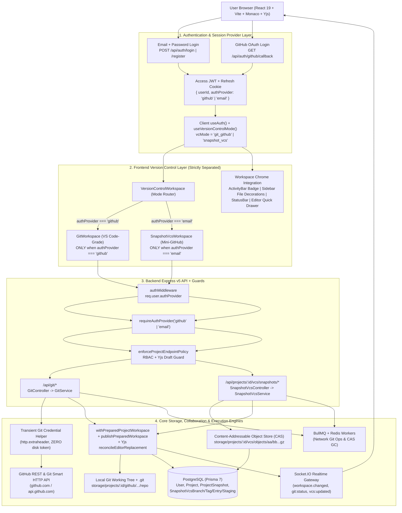
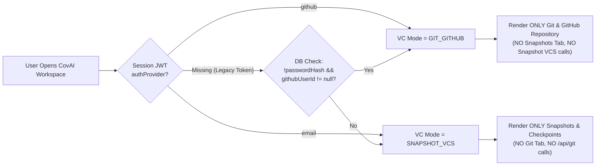
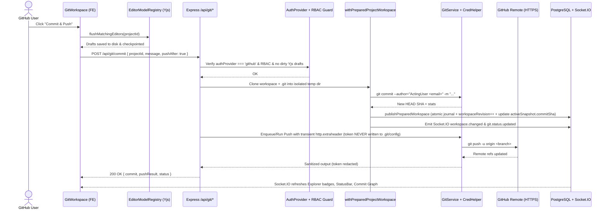
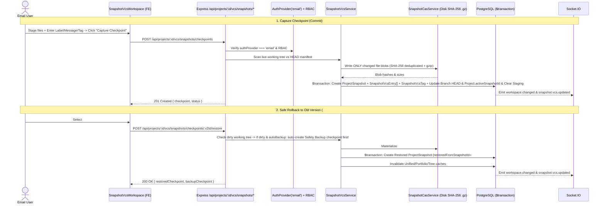

# CovAI — Master Engineering & Implementation Plan: Tách Biệt & Nâng Cấp Toàn Diện Hệ Thống Version Control (VS Code-Grade Git/GitHub & Mini-GitHub Snapshot VCS)

> **Trạng thái tài liệu:** `APPROVED_PLAN (LOCKED DECISIONS) — EXECUTING PHASE BY PHASE`  
> **Ngày lập:** `2026-11-26`  
> **Phạm vi:** Toàn hệ thống CovAI (`shared/`, `server/`, `client/`, `prisma/`, `docker-compose.yml`, `Dockerfile`, `nginx.conf`, `.github/workflows/`)  
> **Tài liệu tham chiếu chuẩn:** `AGENTS.md`, `client/AGENTS.md`, `server/AGENTS.md`, `docs/rules/COVAI_FRONTEND_AGENT_RULES.md`

---

## Mục Lục

1. [Tóm Tắt Điều Hành & Mục Tiêu Sản Phẩm](#1-tóm-tắt-điều-hành--mục-tiêu-sản-phẩm)
2. [Phân Tích Hiện Trạng Sâu (Deep Codebase Audit & Root-Cause Analysis)](#2-phân-tích-hiện-trạng-sâu-deep-codebase-audit--root-cause-analysis)
3. [Kiến Trúc Hệ Thống & Phân Tách Theo Tài Khoản Đăng Nhập](#3-kiến-trúc-hệ-thống--phân-tách-theo-tài-khoản-đăng-nhập)
4. [Đặc Tả Module Dùng Chung (`shared/` — Single Source of Truth)](#4-đặc-tả-module-dùng-chung-shared--single-source-of-truth)
5. [Thiết Kế Cơ Sở Dữ Liệu & Prisma Schema (`server/prisma/`)](#5-thiết-kế-cơ-sở-dữ-liệu--prisma-schema-serverprisma)
6. [Kiến Trúc Backend & Đặc Tả API (`server/`)](#6-kiến-trúc-backend--đặc-tả-api-server)
   - [6.1 Auth Session Provider & Incremental GitHub Scope](#61-auth-session-provider--incremental-github-scope)
   - [6.2 Bảo Mật Git Subprocess & Transient Credential Injection](#62-bảo-mật-git-subprocess--transient-credential-injection)
   - [6.3 Engine 1 — VS Code-Grade Git & GitHub Backend (`/api/git/*`)](#63-engine-1--vs-code-grade-git--github-backend-apigit)
   - [6.4 Engine 2 — Mini-GitHub Snapshot VCS Backend (`/api/projects/:id/vcs/snapshots/*`)](#64-engine-2--mini-github-snapshot-vcs-backend-apiprojectsidvcssnapshots)
7. [Kiến Trúc Frontend & Thiết Kế UI/UX Chuẩn Kỹ Thuật (`client/`)](#7-kiến-trúc-frontend--thiết-kế-uiux-chuẩn-kỹ-thuật-client)
   - [7.1 Phân Tách Tuyệt Đối & Tích Hợp Toàn Workspace](#71-phân-tách-tuyệt-đối--tích-hợp-toàn-workspace)
   - [7.2 Giao Diện VS Code-Grade Git & GitHub Workbench](#72-giao-diện-vs-code-grade-git--github-workbench)
   - [7.3 Giao Diện Mini-GitHub Snapshot & Checkpoints Workbench](#73-giao-diện-mini-github-snapshot--checkpoints-workbench)
   - [7.4 State Management, React Query Caching & Realtime Socket.IO](#74-state-management-react-query-caching--realtime-socketio)
8. [Đồng Bộ Realtime, Yjs Collaborative Editor, BullMQ & Concurrency Safety](#8-đồng-bộ-realtime-yjs-collaborative-editor-bullmq--concurrency-safety)
9. [Kiến Trúc Bảo Mật, RBAC & Kiểm Soát Rủi Ro](#9-kiến-trúc-bảo-mật-rbac--kiểm-soát-rủi-ro)
10. [Docker, Nginx, Hạ Tầng Storage & CI/CD Pipeline](#10-docker-nginx-hạ-tầng-storage--cicd-pipeline)
11. [Lộ Trình Triển Khai Chi Tiết Theo 7 Giai Đoạn (Phase 0 – Phase 6)](#11-lộ-trình-triển-khai-chi-tiết-theo-7-giai-đoạn-phase-0--phase-6)
12. [Kế Hoạch Kiểm Thử (Unit, Integration, E2E) & Tiêu Chí Nghiệm Thu](#12-kế-hoạch-kiểm-thử-unit-integration-e2e--tiêu-chí-nghiệm-thu)
13. [Các Điểm Cần Xác Nhận Trước Khi Code (Open Decisions)](#13-các-điểm-cần-xác-nhận-trước-khi-code-open-decisions)

---

## 1. Tóm Tắt Điều Hành & Mục Tiêu Sản Phẩm

### 1.1 Yêu cầu cốt lõi từ chủ dự án

Hệ thống **Version Control** hiện tại của CovAI đang gộp chung hai tab (`Git & GitHub Repository` và `Snapshots & Checkpoints`) trong cùng một màn hình `VersionControlWorkspace.jsx` bất kể người dùng đăng nhập bằng phương thức nào, đồng thời cả hai chức năng mới chỉ ở mức sơ khai và tồn tại nhiều lỗi nghiêm trọng về dữ liệu, bảo mật và trải nghiệm kỹ sư phần mềm.

Kế hoạch này thiết kế lại **100% toàn diện** chức năng Version Control dựa trên **3 trụ cột tách biệt**:

| Trụ cột | Đối tượng sử dụng | Mục tiêu sản phẩm đạt chuẩn |
| :--- | :--- | :--- |
| **Trụ cột 1: Tách biệt tuyệt đối theo phiên đăng nhập** | Toàn hệ thống (Auth, API, UI, Sidebar, StatusBar, Editor) | - Đăng nhập bằng **GitHub OAuth** (`authProvider = "github"`) ➔ Version Control **CHỈ hiển thị `Git & GitHub Repository`**.<br>- Đăng nhập bằng **Email cá nhân** (`authProvider = "email"`) ➔ Version Control **CHỈ hiển thị `Snapshots & Checkpoints`**.<br>- Không bao giờ hiển thị đồng thời cả 2 tab hay nhãn `UNIFIED`. Thực thi cả trên **Frontend UI** lẫn **Backend Middleware**. |
| **Trụ cột 2: VS Code-Grade Git & GitHub Repository** | Tài khoản đăng nhập bằng **GitHub** | Đạt chuẩn **Visual Studio Code Source Control + Git Graph + GitHub Integration**: theo dõi toàn bộ trạng thái file (`Modified`, `Added`, `Deleted`, `Renamed`, `Untracked`, `Conflicted`, `Unchanged`), Tree/List view, Stage/Unstage theo file/folder/hunk, Discard, Monaco `DiffEditor` (Split/Inline), Commit/Amend/Undo/Commit & Push/Commit & Sync, AI Commit Message, Fetch/Pull/Push/Force-with-lease, Branching/Merge/Rebase, 3-Way Conflict Resolver, Stash, Tags, SVG Commit Graph, Publish dự án ZIP lên GitHub Repo mới, Tạo/Xem Pull Request & CI checks, Git Output Console. |
| **Trụ cột 3: Mini-GitHub Snapshot & Checkpoints VCS** | Tài khoản đăng nhập bằng **Email cá nhân** | Hoạt động như một **"GitHub thu nhỏ" độc lập** lưu trữ nội bộ (Content-Addressable Storage — CAS): theo dõi thay đổi thời gian thực giữa Working Tree và Active Checkpoint (`Modified`, `Added`, `Deleted`, `Renamed`, `Unchanged`), Stage chọn lọc file, Discard từng file/toàn bộ, Monaco `DiffEditor`, Capture Checkpoint (tương đương Commit) có Label/Message/Tag/AI Summary, **Phân nhánh cục bộ (Local Branches / Timelines)**, Merge nhánh, Duyệt cây thư mục & xem mã nguồn ở bất kỳ version cũ nào, So sánh (Compare) giữa 2 checkpoint bất kỳ, Khôi phục 1 file lẻ từ quá khứ, **Rollback/Restore an toàn không mất dữ liệu** (tự động tạo Safety Backup), Pin/Star, Xuất file `.zip` cho bất kỳ version nào, Xóa & dọn rác CAS tự động. |

### 1.2 Ràng buộc tuân thủ kiến trúc CovAI (`AGENTS.md`)

1. **Strict Root Whitelist**: Tuyệt đối không tạo file/folder lạ ở root; mọi tài liệu ở `docs/`, hằng số dùng chung ở `shared/`, temp runtime trong `server/.covai-temp/`.
2. **UI Language**: 100% nhãn giao diện người dùng (UI labels, tooltips, error messages, buttons) viết bằng **Tiếng Anh** chuẩn xác; tài liệu kỹ thuật/plan viết bằng Tiếng Việt.
3. **Sleek Industrial UI (`client/AGENTS.md`)**: Tuyệt đối không dùng gradient, neon glow, glassmorphism mờ đục, hay bo tròn `rounded-full` cho container/nút chính; chỉ dùng CSS variables trong `client/src/index.css`, `rounded-md`/`rounded-lg`, viền 1px sắc nét, `font-mono tabular-nums`, Lucide icons + các component shadcn/ui sẵn có trong `client/src/components/ui/`.
4. **3-Layer Backend (`server/AGENTS.md`)**: Route ➔ Middleware ➔ Controller ➔ Service; Prisma luôn dùng `select` và bọc đa bảng trong `$transaction`; tác vụ nặng/mạng đẩy vào BullMQ hoặc chạy ngoài DB lock; không import chéo giữa `client/` và `server/`.
5. **Tương thích tuyệt đối với các phân hệ hiện hữu**:
   - Không làm hỏng hệ thống **Unit Test / Integration Test / System Test / Coverage / AST / CFG / Chatbot Evaluation**, vốn dùng `ProjectSnapshot.id` làm khóa ngoại (FK).
   - Không phá vỡ kiểm thử bảo mật hiện có (`TC_LOG_23` / `BR02.2` về scope tối thiểu khi đăng nhập GitHub, `gitCollaborationSafety.test.js`, `gitPreparedPublication.integration.test.js`, `projectEndpointPolicy.test.js`).

---

## 2. Phân Tích Hiện Trạng Sâu (Deep Codebase Audit & Root-Cause Analysis)

Qua kiểm tra trực tiếp mã nguồn trên toàn bộ repository `d:\NCKH\CovAI-`, phát hiện **15 vấn đề trọng yếu** (5 Critical, 7 High, 3 Medium) cần được xử lý dứt điểm trong kế hoạch này:

### 2.1 Bảng tổng hợp các lỗi & lỗ hổng hiện tại

| Mã | Mức độ | Vị trí trong mã nguồn hiện tại | Phân tích nguyên nhân gốc rễ (Root Cause) | Tác động thực tế |
| :--- | :---: | :--- | :--- | :--- |
| **C1** | **CRITICAL (Security)** | `server/src/services/githubClone.service.js:45-68`<br>`server/src/services/git.service.js:164, 237, 666, 739` | Ghi trực tiếp OAuth Access Token dạng **plaintext** vào URL remote `https://x-access-token:<TOKEN>@github.com/...` rồi lưu vào `.git/config` trên ổ đĩa qua `git clone` và `git remote set-url`. | Rò rỉ GitHub Access Token của người dùng trên filesystem (`.git/config`), có thể bị xuất ra trong archive/backup hoặc đọc bởi test runner của project người dùng! |
| **C2** | **CRITICAL (Data Loss)** | `server/src/services/projectMutation.service.js:103-110`<br>`server/src/services/project.service.js:872-956` | Khi người dùng sửa file trong Monaco Editor, `mutateProjectWorkspace` ghi đè trực tiếp (**in-place**) lên thư mục của `ProjectSnapshot` hiện tại (`uploads/snapshots/<snap1>/`). Khi chưa có bản sao bất biến, `Snapshot #1` bị ghi đè thành code mới. | **Hỏng hoàn toàn cơ chế Rollback của Snapshots**: quay lại `Initial Ingest` trả về code đã bị sửa thay vì bản gốc; không thể tính diff chính xác giữa Working Tree và Snapshot trước đó! |
| **C3** | **CRITICAL (Bug)** | `server/src/services/project.service.js:1237-1294` | `restoreProjectCheckpoint` tạo `newSnapshot` nhưng: (1) **quên cập nhật `Project.activeSnapshotId = newSnapshot.id`**; (2) không ghi `versionNumber`, `contentHash`, `label` vào DB (để `null`); (3) ghi message tiếng Việt/hardcode locale `vi-VN` chỉ trong `.covai-checkpoint.json`. | Sau khi Rollback, UI và `resolveWorkingSnapshot` vẫn trỏ về snapshot cũ nếu `activeSnapshotId` đã được gán trước đó! |
| **C4** | **CRITICAL (Architecture)** | `server/src/services/auth.service.js:80-88`<br>`server/src/routes/refresh.route.js:74-89`<br>`server/src/middlewares/auth.middleware.js:29-33`<br>`client/src/hooks/useAuth.js:15-20` | JWT Access Token và Refresh Token chỉ mang `{ userId, userEmail, userName }`, **không lưu `authProvider` (`"github"` vs `"email"`)**. API `/api/refresh` cũng không bảo toàn phương thức đăng nhập khi làm mới token. | Không có nguồn sự thật đáng tin cậy để phân tách Version Control theo phương thức đăng nhập hiện tại của phiên làm việc. |
| **C5** | **CRITICAL (UX/Auth)** | `server/src/services/githubOAuth.service.js:214`<br>`server/src/tests/auth.github.integration.test.js:84-86` | GitHub OAuth `mode=login` trước đây chỉ xin scope tối thiểu `read:user user:email` (thiếu `repo`), buộc user đăng nhập GitHub phải xác thực 2 lần mới push được. DB chưa lưu `githubOAuthScopes` để kiểm soát fallback. | **Quyết định chốt (A.3)**: Xin thẳng `repo read:user user:email` ngay lúc login + lưu `githubOAuthScopes` và giữ banner 1-click nâng cấp/xác thực lại quyền cho token cũ hoặc bị thu hồi. |
| **H1** | **HIGH (Bug)** | `server/src/services/git.service.js:69-72`<br>`server/src/services/projectWorkspacePublish.service.js:73`<br>`server/src/services/projectMutation.service.js:38` | Ba dịch vụ lõi đều lấy snapshot bằng `findFirst({ orderBy: { createdAt: 'desc' } })` và kiểm tra `latest?.id !== snapshotId`, bỏ qua `Project.activeSnapshotId`. | Kích hoạt (activate) một snapshot cũ gây lỗi `409 SNAPSHOT_CHANGED` trên mọi thao tác sửa file hoặc thao tác Git. |
| **H2** | **HIGH (Bug)** | `server/src/services/git.service.js:136-138, 617-631` | `ensureGitRepo` và `commit` luôn lấy `project.owner` làm Git Author/Committer thay vì `req.user` (người thực hiện thao tác). | Cộng tác viên commit bị ghi sai tên/email thành chủ project; khi tài khoản GitHub dùng private email sẽ không link avatar trên GitHub commit history. |
| **H3** | **HIGH (Bug)** | `server/src/services/git.service.js:392-478` | Parser dùng `git status --porcelain=v1` không có `-z`: hỏng hoàn toàn với file có dấu cách/Unicode bị quote, file đổi tên (`R old -> new`), file copy (`C`), xung đột merge (`UU/AA/DD/AU/UA/DU/UD`), trạng thái Detached HEAD, Merge/Rebase/Cherry-pick đang dở dang. | Hiển thị sai danh sách file thay đổi, không thể giải quyết xung đột merge, lỗi crash khi tên file chứa ký tự đặc biệt. |
| **H4** | **HIGH (UX)** | `server/src/services/git.service.js:937-950`<br>`client/src/components/dashboard/VersionControlWorkspace.jsx:1175-1195` | `git diff` trả rỗng với file Untracked (`??`), không phân biệt file binary/quá lớn; FE dùng thẻ `<pre>` thô thay vì Monaco `DiffEditor` (dù `monaco-editor` + `@monaco-editor/react` `DiffEditor` đã có sẵn trong `client/package.json` và dùng ở `DiffReviewModal.jsx`). | Không xem được nội dung file mới tạo, không có Split/Inline diff, không tô sáng cú pháp, không stage/revert theo hunk. |
| **H5** | **HIGH (UI/Separation)** | `client/src/components/dashboard/VersionControlWorkspace.jsx:543-623`<br>`client/src/components/dashboard/Editor.jsx:486, 1352-1367`<br>`client/src/components/dashboard/Sidebar.jsx:780-785`<br>`client/src/components/dashboard/Layout.jsx:10, 2246-2249` | - `VersionControlWorkspace` gộp cứng 2 tab & fetch cả 2 API.<br>- `Editor.jsx` nhúng nổi `GitPanel` cho mọi user.<br>- `Sidebar.jsx:783-784` hardcode cứng `main` và `↑ 2 commits`!<br>- `Layout.jsx:2248` hardcode cứng `main` trên thanh trạng thái! | Sai hoàn toàn trải nghiệm tách biệt, dữ liệu giả (hardcoded) gây hiểu lầm nghiêm trọng cho người dùng. |
| **H6** | **HIGH (RBAC)** | `client/src/components/dashboard/VersionControlWorkspace.jsx:222, 846, 863`<br>`server/src/middlewares/projectEndpointPolicy.js:75`<br>`shared/projectAccess.js` | Frontend kiểm tra `projectAccess.can("files.write")` (EDITOR có), nhưng Backend kiểm tra `integrations.write` (chỉ OWNER có). | EDITOR nhìn thấy nút Commit/Stage/Capture sáng nhưng bấm vào bị 403 Forbidden. |
| **H7** | **HIGH (Collab UX)** | `server/src/middlewares/projectEndpointPolicy.js:107-112`<br>`client/src/services/editorAwareRequest.js` | Khi Yjs Collaborative Editor còn buffer chưa checkpoint xuống đĩa, mọi lệnh POST vào `/api/git` hoặc `/snapshots` bị chặn cứng `409 EDITOR_DRAFT_CONFLICT`, trong khi `editorAwareFetch` chưa hỗ trợ flush tự động cho Version Control. | Người dùng vừa sửa code ở tab Editor sang tab Version Control commit liền bị báo lỗi khó hiểu. |
| **M1** | **MEDIUM (Infra/Perf)** | `client/nginx.conf:4-11`<br>`server/src/services/git.service.js:652-788` | Nginx không cấu hình `proxy_read_timeout` (mặc định 60s); các lệnh Git mạng (`push`, `pull`, `fetch`, `publish`) chạy đồng bộ không timeout chuẩn hoặc streaming tiến độ. | Repo lớn hoặc mạng chậm tới GitHub bị Nginx cắt kết nối `504 Gateway Timeout`. |
| **M2** | **MEDIUM (Storage)** | `server/src/services/project.service.js:594-639, 949` | Mỗi lần nhấn `Capture Checkpoint` copy toàn bộ thư mục source code (`copyDirRecursive`), nhân bản dung lượng ổ đĩa tuyến tính $O(N \times M)$. | Tạo 20 checkpoints cho project 50MB tiêu tốn 1GB đĩa cứng lãng phí. |
| **M3** | **MEDIUM (Dead Code / Schema Drift)** | `server/src/controllers/webhook.controller.js:77-82`<br>`server/prisma/schema.prisma` | `webhook.controller.js` truy vấn `webhookEnabled` và `webhookSecretEnc` trên `Project`, nhưng các cột này không còn tồn tại trong `schema.prisma`. | Tính năng auto-sync webhook GitHub sẽ crash runtime nếu được gọi. |

### 2.2 Hiện trạng các thành phần tốt có thể tái sử dụng ngay

- **Monaco Editor & `DiffEditor`**: Đã cấu hình worker đầy đủ trong `client/src/lib/monacoSetup.js` và dùng thành công trong `client/src/components/dashboard/DiffReviewModal.jsx`.
- **Thư viện `diff` v8.0.4**: Đã cài sẵn ở cả `client/package.json` và `server/package.json`.
- **shadcn/ui + Radix Primitives**: Đã có sẵn `button`, `badge`, `card`, `tabs`, `tooltip`, `sheet`, `input`, `table` trong `client/src/components/ui/` và `cn()` trong `client/src/lib/utils.js`.
- **Atomic Workspace Publication & Yjs Bridge**: `withPreparedProjectWorkspace`, `publishPreparedWorkspace`, `mutateProjectWorkspace`, `reconcileEditorReplacement`, `projectEvent.service.js` là nền tảng đồng bộ đa người dùng cực kỳ chắc chắn — chỉ cần sửa bug `activeSnapshotId` và mở rộng đúng hợp đồng.
- **Crypto AES-256-GCM**: `server/src/utils/crypto.js` đã sẵn sàng mã hóa/giải mã token.
- **Gemini AI + Quota Tracker**: `gemini.service.js`, `aiQuota.service.js`, `geminiTokenTracker.service.js` có thể tái sử dụng ngay cho **AI Generate Commit Message** (GitHub) và **AI Generate Checkpoint Summary** (Email).

---

## 3. Kiến Trúc Hệ Thống & Phân Tách Theo Tài Khoản Đăng Nhập

### 3.1 Tổng quan kiến trúc hệ thống (System Context & Component Architecture)



### 3.2 Ma trận quyết định phân tách phiên làm việc (Session Mode Resolution Matrix)

Quy tắc vàng: **Phương thức đăng nhập của phiên làm việc hiện tại (`session.authProvider`) là yếu tố quyết định DUY NHẤT chế độ Version Control hiển thị cho người dùng.**



#### Bảng xử lý toàn bộ 6 tình huống biên (Edge Case Handling Matrix)

| # | Tình huống (Scenario) | `authProvider` phiên | Chế độ VC hiển thị | Hành vi hệ thống thiết kế chi tiết |
| :---: | :--- | :---: | :---: | :--- |
| **1** | Tài khoản đăng nhập bằng **GitHub** mở dự án import từ **GitHub** | `github` | **ONLY Git & GitHub** | Hoạt động VS Code Git đầy đủ ngay lập tức. Nếu token chỉ có scope `read:user user:email` (chưa có `repo`), hiện banner 1-click **"Authorize Repository Write Access"** (incremental OAuth `mode=connect`) để mở khóa Push / Private Pull / PR. |
| **2** | Tài khoản đăng nhập bằng **GitHub** mở dự án trước đó upload từ **ZIP** (chưa có `.git` / `repoUrl`) | `github` | **ONLY Git & GitHub** | **KHÔNG hiện tab Snapshots** và **KHÔNG báo lỗi cụt đường "Git Is Not Available"**! Thay vào đó hiển thị màn hình khởi tạo chuẩn VS Code: **(a) Publish to New GitHub Repository** (tạo repo Public/Private mới qua GitHub API + `git init` + initial commit + push `main`), **(b) Link Existing GitHub Repository**, hoặc **(c) Initialize Local Git Repository**. |
| **3** | Tài khoản đăng nhập bằng **Email cá nhân** mở dự án upload từ **ZIP** | `email` | **ONLY Snapshots & Checkpoints** | Hoạt động **Mini-GitHub Snapshot VCS** 100%: tự động bootstrap CAS baseline cho dự án cũ nếu chưa có, theo dõi Working Tree diff, staging, capture checkpoint, branch/merge, browse history, compare, rollback an toàn. |
| **4** | Tài khoản đã liên kết cả Email + GitHub (`confirmGithubAccountLink`), nhưng phiên hiện tại **đăng nhập bằng Email & Password** | `email` | **ONLY Snapshots & Checkpoints** | Tôn trọng tuyệt đối cách đăng nhập phiên hiện tại: chỉ hiện `Snapshots & Checkpoints`. Nếu người dùng muốn dùng Git & GitHub, họ đăng xuất và đăng nhập bằng nút **"Continue with GitHub"**. |
| **5** | Tài khoản đăng nhập bằng **Email** được mời làm cộng tác viên (Collaborator) trên dự án do chủ sở hữu **GitHub** tạo | `email` | **ONLY Snapshots & Checkpoints** | Người dùng Email vẫn quản lý phiên bản qua `Snapshots & Checkpoints` (theo quyền RBAC của họ trên dự án). Khi OWNER dùng Git commit/push hoặc khi cộng tác viên capture checkpoint, cả hai đều đi qua `workspaceRevision` + `ProjectEvent` nên không ghi đè mất dữ liệu của nhau. |
| **6** | Tài khoản đăng nhập bằng **Email** ở modal `ImportLayout` (thêm dự án mới) | `email` vs `github` | Theo tài khoản | **Quyết định chốt (A.2)**:<br>- **Tài khoản GitHub**: Dùng cả 2 luồng (GitHub OAuth Repo Picker/URL + Upload ZIP/RAR, kèm 1-click *"Initialize Git & Publish to GitHub"* trong Git Workbench).<br>- **Tài khoản Email**: Mặc định Upload ZIP/RAR + tùy chọn dán **Public Git URL** (nhập 1 lần tạo Snapshot khởi đầu), **ẩn hoàn toàn** kết nối GitHub OAuth & trình duyệt repo GitHub để nhất quán tuyệt đối. |

### 3.3 Tách biệt tầng dữ liệu nội bộ (`ProjectSnapshot`) vs tầng Version Control

> [!IMPORTANT]
> Trong CovAI, bảng `ProjectSnapshot` là **khóa ngoại trung tâm** cho toàn bộ hệ thống kiểm thử & phân tích: `CoverageSummary`, `CoverageFile`, `CoverageFunction`, `Cfg`, `Cyclomatic`, `TestRun`, `SystemScenario`, `ProjectStructureAnalysis`, `QualityReport`, `AiTest`, `AiEvaluationDesignAudit`.

Vì vậy:
- **KHÔNG xóa hay phá vỡ `ProjectSnapshot` đối với dự án GitHub!**
- Với **GitHub mode (`git_github`)**:
  - Người dùng chỉ làm việc với Git (branch, commit, push, pull, merge, stash, tag).
  - Mỗi khi thực hiện `git commit`, `git pull`, `git checkout`, `git merge`, `git reset`, backend cập nhật đồng bộ metadata trên `activeSnapshot` (`commitSha`, `contentHash`, `workspaceRevision`) — **không tạo spam các dòng snapshot giả trong giao diện** — giúp Coverage, AST, CFG, Unit/Integration/System Test luôn nhận đúng mã nguồn mới nhất mà không làm mất lịch sử báo cáo không cần thiết.
- Với **Email mode (`snapshot_vcs`)**:
  - Mỗi **Checkpoint** gắn 1-1 với một bản ghi `ProjectSnapshot` mới + tập `SnapshotVcsEntry` trỏ tới các blob bất biến trong **CAS**.
  - Các bài test/coverage chạy trên từng checkpoint được gắn chặt với `snapshotId` đó, cho phép người dùng **xem lại lịch sử độ phủ (coverage) đi kèm từng version** khi quay lại bản cũ!

### 3.4 Luồng tuần tự cốt lõi (Core Sequence Diagrams)

#### Luồng A: VS Code Git Commit & Push (GitHub Account + Yjs Draft Flush + Transient Credentials)



#### Luồng B: Mini-GitHub Snapshot Capture & Safe Rollback (Email Account + Immutable CAS)



---

## 4. Đặc Tả Module Dùng Chung (`shared/` — Single Source of Truth)

Tuân thủ nguyên tắc SSOT của `AGENTS.md`, toàn bộ hằng số, enum và hàm phân giải chung giữa `client/` và `server/` đặt trong `shared/`:

### 4.1 Tạo mới `shared/versionControlMode.js`

```javascript
export const AUTH_PROVIDERS = Object.freeze({
  GITHUB: "github",
  EMAIL: "email",
});

export const VC_MODES = Object.freeze({
  GIT_GITHUB: "git_github",
  SNAPSHOT_VCS: "snapshot_vcs",
});

// Quy tắc lọc/ignore dùng chung cho cả Snapshot CAS & Git (chống rác test runner / Docker / secrets)
export const VCS_IGNORED_DIRECTORIES = new Set([
  "node_modules", ".git", "coverage", ".nyc_output", "test-results",
  "playwright-report", ".playwright", ".covai-temp", ".covai-system-test",
  ".covai-collaboration", ".covai_journal", ".covai_test_versions",
  "dist", "build", ".next", ".nuxt", ".output", ".svelte-kit",
  ".turbo", ".parcel-cache", ".cache", ".vite", "__MACOSX",
]);
export const VCS_IGNORED_FILES = new Set([".DS_Store", "Thumbs.db", ".covai-checkpoint.json"]);
export const VCS_IGNORED_PATH_PREFIXES = Object.freeze(["cypress/videos", "cypress/screenshots"]);

export function resolveVersionControlMode(authProvider) {
  return authProvider === AUTH_PROVIDERS.GITHUB
    ? VC_MODES.GIT_GITHUB
    : VC_MODES.SNAPSHOT_VCS;
}
```
Kèm các helper chuẩn hóa: `normalizeAuthProvider`, `isGitHubAuthSession`, `parseGithubScopes`, `hasGithubRepoWriteScope`, `isVcsSecretFileName`, `isVcsIgnoredRelativePath`.

### 4.2 Tạo mới `shared/gitProtocol.js`

Định nghĩa thống nhất cho toàn bộ Git Workbench:
- `GIT_FILE_STATUS`: `{ MODIFIED: "M", ADDED: "A", DELETED: "D", RENAMED: "R", COPIED: "C", UNTRACKED: "U", IGNORED: "I", CONFLICTED: "!", UNCHANGED: " " }`
- `GIT_CONFLICT_CODES`: `["DD", "AU", "UD", "UA", "DU", "AA", "UU"]`
- `GIT_REPO_OPERATION_STATE`: `{ IDLE: "IDLE", MERGING: "MERGING", REBASING: "REBASING", CHERRY_PICKING: "CHERRY_PICKING", REVERTING: "REVERTING" }`
- `GIT_LIMITS`: `{ MAX_DIFF_BYTES: 1024 * 1024, MAX_LOG_LIMIT: 200, MAX_BRANCH_NAME: 200, MAX_COMMIT_MSG: 10000, MAX_TAG_NAME: 120 }`
- `GIT_SOCKET_EVENTS`: `{ STATUS_UPDATED: "git:status_updated", OPERATION_PROGRESS: "git:operation_progress", OPERATION_COMPLETED: "git:operation_completed" }`
- Regex hợp lệ cho tên branch (`validateGitBranchName`), tên tag (`validateGitTagName`), và GitHub repo name (`validateGithubRepoName`).

### 4.3 Tạo mới `shared/snapshotVcsProtocol.js`

Định nghĩa thống nhất cho Mini-GitHub Snapshot VCS:
- `SNAPSHOT_CHANGE_STATUS`: `{ MODIFIED: "M", ADDED: "A", DELETED: "D", RENAMED: "R", UNCHANGED: " " }`
- `SNAPSHOT_VCS_LIMITS`: `{ MAX_LABEL_LENGTH: 120, MAX_MESSAGE_LENGTH: 4000, MAX_TAG_LENGTH: 48, MAX_BRANCH_NAME: 80, MAX_DIFF_FILE_BYTES: 1024 * 1024, MAX_FILES_PER_CHECKPOINT: 20000, DEFAULT_BRANCH: "main" }`
- `SNAPSHOT_RESTORE_POLICIES`: `{ AUTO_BACKUP: "AUTO_BACKUP", DISCARD_DIRTY: "DISCARD_DIRTY", FAIL_IF_DIRTY: "FAIL_IF_DIRTY" }`
- `SNAPSHOT_SOCKET_EVENTS`: `{ UPDATED: "snapshot_vcs:updated", GC_COMPLETED: "snapshot_vcs:gc_completed" }`

### 4.4 Cập nhật `shared/projectAccess.js` (RBAC Matrix chuẩn hóa — Option B Cải Tiến LOCKED)

Phân tách rạch ròi giữa thao tác **cục bộ an toàn** (`vcs.local` cho `OWNER` + `EDITOR`) và thao tác **remote / phá hủy / đổi toàn bộ workspace** (`integrations.write`, `snapshot.restore` chỉ cho `OWNER`):

| Capability | `OWNER` | `EDITOR` | `VIEWER` | Phạm vi áp dụng |
| :--- | :---: | :---: | :---: | :--- |
| `project.read` | ✅ | ✅ | ✅ | Xem Git status, diff, log, branches, stashes, tags, PRs; xem Snapshot timeline, diff, browse files cũ, compare |
| `files.write` | ✅ | ✅ | ❌ | Sửa file trong Monaco Editor, File Explorer, khôi phục 1 file lẻ từ snapshot |
| `vcs.local` *(LOCKED)* | ✅ | ✅ | ❌ | **Git local**: `stage`, `unstage`, `stage-hunk`, `unstage-hunk`, `revert-hunk`, `discard`, `commit` (ghi đúng author name/email của acting user), `stash`, `gitignore`, `conflicts/resolve`.<br>**Snapshot local**: `stage`, `unstage`, `discard`, `capture checkpoint` (gắn `authorId` của acting user), `restore-file`, `add tag`, `edit checkpoint label/message/pin`. |
| `integrations.write` | ✅ | ❌ | ❌ | **Git remote & branch ops**: `push`, `pull`, `fetch`, `sync`, `checkout`, `merge`, `rebase`, `reset`, `revert`, `cherry-pick`, `publish-github`, `remote`, delete branch/tag, create PR. |
| `snapshot.restore` | ✅ | ❌ | ❌ | **Snapshot workspace ops**: `rollback/restore` toàn bộ workspace, xóa checkpoint, chuyển/xóa/merge branch Snapshot. |

> [!IMPORTANT]
> **Quy tắc cách ly GitHub Token tuyệt đối**: Tuyệt đối **KHÔNG** cho phép `EDITOR` mượn GitHub OAuth token của `OWNER` để thực hiện `push` hay thao tác GitHub API! Chỉ `OWNER` được phép `push`, hoặc mọi thao tác remote push phải xác thực bằng **chính GitHub token của `req.user.id`** (acting user).
> Các test hợp tác (`projectAccess.test.js`, `projectEndpointPolicy.test.js`, `gitCollaborationSafety.test.js`, `gitPreparedPublication.integration.test.js`) sẽ được cập nhật đồng bộ theo ma trận chuẩn này.

### 4.5 Cập nhật `shared/authValidation.js`

Bổ sung các mã lỗi chuẩn vào `AUTH_ERROR_CODES` và thông báo vào `AUTH_MESSAGES`:
- `AUTH_PROVIDER_MISMATCH`: `"This Version Control feature requires signing in with GitHub / Personal Email."`
- `GITHUB_REPO_SCOPE_REQUIRED`: `"Repository write permission ('repo' scope) is required to push or manage GitHub repositories. Please authorize repository access."`
- `GITHUB_TOKEN_REVOKED`: `"Your GitHub access token has expired or been revoked. Please reconnect GitHub."`

---

## 5. Thiết Kế Cơ Sở Dữ Liệu & Prisma Schema (`server/prisma/`)

### 5.1 Sơ đồ ERD mở rộng cho Version Control

```mermaid
erDiagram
    User ||--o{ Project : owns
    User ||--o{ ProjectSnapshot : authors
    User ||--o{ SnapshotVcsBranch : creates
    User ||--o{ SnapshotVcsTag : creates
    User ||--o{ SnapshotVcsStaging : stages

    Project ||--o{ ProjectSnapshot : has
    Project ||--o{ SnapshotVcsBranch : has
    Project ||--o{ SnapshotVcsTag : has
    Project ||--o{ SnapshotVcsStaging : has
    Project ||--o{ SnapshotVcsBlobRef : tracks

    SnapshotVcsBranch ||--o{ ProjectSnapshot : contains
    SnapshotVcsBranch }o--o| ProjectSnapshot : headSnapshot
    SnapshotVcsBranch }o--o| ProjectSnapshot : baseSnapshot

    ProjectSnapshot ||--o{ ProjectSnapshot : parentSnapshot
    ProjectSnapshot ||--o{ ProjectSnapshot : restoredFrom
    ProjectSnapshot ||--o{ SnapshotVcsEntry : manifestEntries
    ProjectSnapshot ||--o{ SnapshotVcsTag : taggedBy

    User {
        string id PK
        string email UK
        string githubUserId UK
        string githubLogin "NEW"
        string githubOAuthScopes "NEW"
        string lastAuthProvider "NEW"
    }

    Project {
        string id PK
        string ownerId FK
        string repoUrl
        string defaultBranch
        string activeSnapshotId
        string activeVcsBranchId "NEW"
        int workspaceRevision
    }

    ProjectSnapshot {
        string id PK
        string projectId FK
        enum source "ZIP | GITHUB"
        string commitSha
        string contentHash
        string label
        string commitMessage "NEW"
        int versionNumber
        string parentSnapshotId FK "NEW"
        string restoredFromSnapshotId FK "NEW"
        string authorId FK "NEW"
        string vcsBranchId FK "NEW"
        json statsJson "NEW"
        boolean isPinned "NEW"
        boolean isAutoBackup "NEW"
        boolean casMaterialized "NEW"
    }

    SnapshotVcsBranch {
        string id PK
        string projectId FK
        string name
        string description
        string headSnapshotId FK
        string baseSnapshotId FK
        boolean isDefault
        string createdById FK
        datetime createdAt
        datetime updatedAt
    }

    SnapshotVcsTag {
        string id PK
        string projectId FK
        string snapshotId FK
        string name
        string description
        string color
        string createdById FK
        datetime createdAt
    }

    SnapshotVcsEntry {
        string id PK
        string snapshotId FK
        string relativePath
        string blobSha256
        int byteSize
        boolean isBinary
        string mode
    }

    SnapshotVcsStaging {
        string id PK
        string projectId FK
        string userId FK
        string relativePath
        datetime stagedAt
    }

    SnapshotVcsBlobRef {
        string projectId PK_FK
        string sha256 PK
        int byteSize
        boolean isBinary
        boolean compressed
        datetime createdAt
    }
```

### 5.2 Chi tiết thay đổi Prisma Schema (`server/prisma/schema.prisma`)

#### (1) Mở rộng bảng `User`
```prisma
model User {
  // ... các trường hiện có giữ nguyên ...
  githubLogin          String?
  githubOAuthScopes    String?   // Ví dụ: "read:user,user:email" hoặc "repo,read:user,user:email"
  lastAuthProvider     String?   // "github" | "email" (telemetry + fallback)

  // Relations mới
  authoredSnapshots    ProjectSnapshot[]    @relation("SnapshotAuthor")
  vcsBranchesCreated   SnapshotVcsBranch[]  @relation("VcsBranchCreator")
  vcsTagsCreated       SnapshotVcsTag[]     @relation("VcsTagCreator")
  vcsStagedFiles       SnapshotVcsStaging[]
}
```

#### (2) Mở rộng bảng `Project`
```prisma
model Project {
  // ... các trường hiện có giữ nguyên ...
  activeVcsBranchId    String?

  // Relations mới
  vcsBranches          SnapshotVcsBranch[]
  vcsTags              SnapshotVcsTag[]
  vcsStagedFiles       SnapshotVcsStaging[]
  vcsBlobRefs          SnapshotVcsBlobRef[]
}
```

#### (3) Mở rộng bảng `ProjectSnapshot`
```prisma
model ProjectSnapshot {
  // ... các trường hiện có giữ nguyên ...
  commitMessage          String?
  parentSnapshotId       String?
  restoredFromSnapshotId String?
  authorId               String?
  vcsBranchId            String?
  statsJson              Json?     // { filesTotal, totalBytes, filesAdded, filesModified, filesDeleted, insertions, deletions }
  isPinned               Boolean   @default(false)
  isAutoBackup           Boolean   @default(false)
  casMaterialized        Boolean   @default(false) // true khi đã có đầy đủ SnapshotVcsEntry + CAS blobs

  author                 User?               @relation("SnapshotAuthor", fields: [authorId], references: [id], onDelete: SetNull)
  parentSnapshot         ProjectSnapshot?    @relation("SnapshotParent", fields: [parentSnapshotId], references: [id], onDelete: SetNull)
  childSnapshots         ProjectSnapshot[]   @relation("SnapshotParent")
  restoredFromSnapshot   ProjectSnapshot?    @relation("SnapshotRestoredFrom", fields: [restoredFromSnapshotId], references: [id], onDelete: SetNull)
  restoredBySnapshots    ProjectSnapshot[]   @relation("SnapshotRestoredFrom")
  vcsBranch              SnapshotVcsBranch?  @relation("BranchSnapshots", fields: [vcsBranchId], references: [id], onDelete: SetNull)
  branchHeads            SnapshotVcsBranch[] @relation("BranchHeadSnapshot")
  branchBases            SnapshotVcsBranch[] @relation("BranchBaseSnapshot")
  vcsEntries             SnapshotVcsEntry[]
  vcsTags                SnapshotVcsTag[]

  @@index([projectId, vcsBranchId, createdAt])
  @@index([projectId, versionNumber])
}
```

> [!WARNING]
> Chú ý ràng buộc hiện hữu `@@unique([projectId, commitSha])` trên `ProjectSnapshot` (dòng 485 của `schema.prisma`)!
> Khi người dùng GitHub `git checkout` hoặc `git reset` quay lại một `commitSha` đã từng tồn tại trong `ProjectSnapshot` trước đó, hoặc commit rồi revert về commit cũ, nếu cố cập nhật `commitSha` trùng sẽ văng lỗi `P2002 Unique constraint violation`.
> **Giải pháp trong migration**: Chuyển `@@unique([projectId, commitSha])` thành `@@index([projectId, commitSha])` (giữ `commitSha` được đánh index nhanh nhưng cho phép cập nhật/tái kích hoạt tự do, không bao giờ gây crash `P2002` khi checkout/reset!).

#### (4) Thêm 5 bảng mới cho Mini-GitHub Snapshot VCS
```prisma
model SnapshotVcsBranch {
  id             String           @id @default(cuid())
  projectId      String
  name           String
  description    String?
  headSnapshotId String?
  baseSnapshotId String?
  isDefault      Boolean          @default(false)
  createdById    String?
  createdAt      DateTime         @default(now())
  updatedAt      DateTime         @updatedAt

  project        Project          @relation(fields: [projectId], references: [id], onDelete: Cascade)
  headSnapshot   ProjectSnapshot? @relation("BranchHeadSnapshot", fields: [headSnapshotId], references: [id], onDelete: SetNull)
  baseSnapshot   ProjectSnapshot? @relation("BranchBaseSnapshot", fields: [baseSnapshotId], references: [id], onDelete: SetNull)
  createdBy      User?            @relation("VcsBranchCreator", fields: [createdById], references: [id], onDelete: SetNull)
  snapshots      ProjectSnapshot[] @relation("BranchSnapshots")

  @@unique([projectId, name])
  @@index([projectId])
}

model SnapshotVcsTag {
  id          String          @id @default(cuid())
  projectId   String
  snapshotId  String
  name        String
  description String?
  color       String?         @default("indigo")
  createdById String?
  createdAt   DateTime        @default(now())

  project     Project         @relation(fields: [projectId], references: [id], onDelete: Cascade)
  snapshot    ProjectSnapshot @relation(fields: [snapshotId], references: [id], onDelete: Cascade)
  createdBy   User?           @relation("VcsTagCreator", fields: [createdById], references: [id], onDelete: SetNull)

  @@unique([projectId, name])
  @@index([snapshotId])
}

model SnapshotVcsEntry {
  id           String          @id @default(cuid())
  snapshotId   String
  relativePath String
  blobSha256   String
  byteSize     Int
  isBinary     Boolean         @default(false)
  mode         String          @default("100644")

  snapshot     ProjectSnapshot @relation(fields: [snapshotId], references: [id], onDelete: Cascade)

  @@unique([snapshotId, relativePath])
  @@index([snapshotId])
  @@index([blobSha256])
}

model SnapshotVcsStaging {
  id           String   @id @default(cuid())
  projectId    String
  userId       String
  relativePath String
  stagedAt     DateTime @default(now())

  project      Project  @relation(fields: [projectId], references: [id], onDelete: Cascade)
  user         User     @relation(fields: [userId], references: [id], onDelete: Cascade)

  @@unique([projectId, userId, relativePath])
  @@index([projectId, userId])
}

model SnapshotVcsBlobRef {
  projectId  String
  sha256     String
  byteSize   Int
  isBinary   Boolean  @default(false)
  compressed Boolean  @default(true)
  createdAt  DateTime @default(now())

  project    Project  @relation(fields: [projectId], references: [id], onDelete: Cascade)

  @@id([projectId, sha256])
  @@index([projectId])
}
```

#### (5) Mở rộng `enum JobType`
Thêm các loại job nền vào `JobType`:
- `GIT_PUSH`
- `GIT_PULL`
- `GIT_FETCH`
- `GIT_PUBLISH_REPO`
- `SNAPSHOT_CAS_GC`

### 5.3 Chiến lược Migration & Dọn dẹp Cascade

1. **Migration SQL Additive & Idempotent (`B.4`)**: `server/prisma/migrations/20261127000000_version_control_separation_and_snapshot_vcs/migration.sql`
   - 100% **additive & idempotent**: `CREATE TABLE IF NOT EXISTS`, `ADD COLUMN IF NOT EXISTS`, `CREATE INDEX IF NOT EXISTS`, `ALTER TYPE ... ADD VALUE IF NOT EXISTS`, mọi FK constraint bọc trong `DO $$ BEGIN IF NOT EXISTS (SELECT 1 FROM pg_constraint ...) THEN ... END IF; END $$;`.
   - Tuyệt đối không dùng `prisma migrate reset` trên DB production; cung cấp script `server/scripts/applyVersionControlMigration.mjs` (`--dry-run` / `--apply`) an toàn cho PostgreSQL thật đã có dữ liệu.
2. **Script Backfill Idempotent** (`server/scripts/backfillVersionControlV2.mjs`):
   - Quét toàn bộ thư mục `storage/projects/*/github/*/repo/.git/config` hiện có để **tẩy sạch plaintext `x-access-token:...` cũ** về URL sạch `https://github.com/owner/repo.git`.
   - Với các `ProjectSnapshot` cũ thiếu `versionNumber`, đánh số tuần tự theo `createdAt ASC`, cập nhật `Project.activeSnapshotId` nếu đang `null`.
   - CAS cho các dự án Email cũ sẽ được **lazy-bootstrap** ngay lần đầu mở Version Control (hoặc chạy qua script backfill nếu muốn pre-warm).
3. **Cập nhật Cascade Deletion**:
   - Cập nhật khối manual cascade fallback trong `server/src/services/project.service.js` (`deleteProject` dòng 1536–1610) xóa thêm `snapshotVcsStaging`, `snapshotVcsTag`, `snapshotVcsEntry`, `snapshotVcsBlobRef`, clear `headSnapshotId`/`baseSnapshotId`/`parentSnapshotId`/`restoredFromSnapshotId`, xóa `snapshotVcsBranch`.
   - `server/src/services/projectStorageCleanup.service.js`: Thư mục CAS nằm trong `storage/projects/<projectId>/vcs/objects/` nên đã tự động nằm trong `projectStorageTargets` (`storage/projects/<projectId>`) — bổ sung unit test xác nhận 100% dọn sạch không để rác!

---

## 6. Kiến Trúc Backend & Đặc Tả API (`server/`)

### 6.1 Auth Session Provider & Incremental GitHub Scope

#### A. Đóng dấu `authProvider` xuyên suốt vòng đời phiên (Session Lifecycle)
1. **`server/src/services/auth.service.js`**:
   - Cập nhật `issueSessionTokensForUser(user, extraUserUpdates = {}, options = {})` nhận `authProvider = "email" | "github"`:
     - Access Token JWT payload: `{ userId: user.id, userEmail: user.email, userName: user.name, authProvider }`.
     - Refresh Token JWT payload: `{ userId: user.id, authProvider }`.
     - Đồng thời ghi `lastAuthProvider: authProvider` vào `User` (không bắt buộc dùng cho logic phiên, chỉ làm fallback cho legacy JWT cũ).
   - `register()` và `login()` luôn truyền `{ authProvider: "email" }` và trả thêm `authProvider: "email"` trong JSON response.
2. **`server/src/services/githubOAuth.service.js`**:
   - `exchangeGithubCodeForToken()`: trả thêm `scope` (từ `tokenData.scope`, ví dụ `"read:user,user:email"` hoặc `"repo,read:user,user:email"`).
   - `handleGithubLoginCallback()` và `confirmGithubAccountLink()`:
     - Lưu `githubLogin: userData.login || null` và `githubOAuthScopes: normalizedScopes` vào `User`.
     - Gọi `issueSessionTokensForUser(user, {}, { authProvider: "github" })`.
     - Trả thêm `authProvider: "github"`, `githubLogin`, `githubScopes` trong response của `oAuthGithub` và `confirmGithubLink`.
   - `connectGithubForUser()` (luồng `mode=connect`):
     - Cập nhật `githubLogin`, `githubAccessTokenEnc`, `githubOAuthScopes` (bây giờ đã bao gồm `repo`!).
     - **Xin thẳng scope `repo read:user user:email` khi login (A.3)**: `createGithubOAuthState("login")` và `createGithubOAuthState("connect")` đều xin `"repo read:user user:email"` để user GitHub vào là push/branch/PR được ngay. Cập nhật lại `TC_LOG_23` cho khớp scope mới, đồng thời **vẫn giữ** kiểm tra `githubOAuthScopes` + `GET /api/auth/github/capabilities` + banner 1-click fallback nếu token cũ thiếu quyền hoặc bị thu hồi.
3. **`server/src/routes/refresh.route.js`**:
   - Đọc `payload.authProvider` từ refresh token cookie.
   - Nếu là legacy refresh token (chưa có `authProvider`): fallback truy vấn `user.passwordHash` & `user.githubUserId` (`!user.passwordHash && user.githubUserId ? "github" : "email"`).
   - Bảo toàn `authProvider` khi ký Access Token mới VÀ khi thực hiện sliding renewal Refresh Token!
   - Trả `{ accessToken, authProvider }` trong response.
4. **`server/src/middlewares/auth.middleware.js`**:
   - Bóc tách `authProvider` từ JWT payload ➔ gán `req.user = { id, name, email, authProvider }`.
   - Nếu JWT legacy chưa có `authProvider`, gắn cờ `req.user.authProvider = null` để middleware `resolveSessionAuthProvider` tự suy diễn 1 lần từ DB (cached ngắn hạn).
5. **`server/src/middlewares/requireAuthProvider.middleware.js` *(mới)***:
   - `requireAuthProvider("github")` gắn vào toàn bộ `/api/git/*`: nếu `req.user.authProvider !== "github"` ➔ trả `403 { success: false, code: "AUTH_PROVIDER_MISMATCH", expectedProvider: "github", actualProvider: "email", message: "Git & GitHub Repository requires signing in with a GitHub account." }`.
   - `requireAuthProvider("email")` gắn vào toàn bộ `/api/projects/:id/vcs/snapshots/*`: nếu `req.user.authProvider !== "email"` ➔ trả `403 { success: false, code: "AUTH_PROVIDER_MISMATCH", expectedProvider: "email", actualProvider: "github", message: "Snapshots & Checkpoints Version Control is dedicated to personal email accounts." }`.
   - **Lưu ý ngoại lệ cần thiết**: `GET /api/projects/:id/snapshots` (read-only danh sách snapshot nội bộ phục vụ chọn snapshot cho Unit/Integration/System Test Dashboard) vẫn giữ cho mọi user có quyền `project.read`; chỉ các endpoint VCS quản lý phiên bản mới khóa theo `authProvider`!
6. **`server/src/services/user.service.js` & `GET /api/users/me`**:
   - Trả thêm: `authProvider` (từ `req.user.authProvider`), `vcMode` (`resolveVersionControlMode(authProvider)`), `githubLogin`, `githubScopes: string[]`, `hasGithubRepoWriteScope: boolean`.
7. **Endpoint kiểm tra năng lực GitHub mới**: `GET /api/auth/github/capabilities`:
   - Kiểm tra token hiện có bằng gọi nhẹ `HEAD/GET https://api.github.com/user` (cached 60s theo userId), đọc header `x-oauth-scopes`, cập nhật DB nếu scope đã đổi (ví dụ user revoke token trên GitHub!), trả `{ connected, valid, login, scopes, hasRepoScope, rateLimitRemaining }`.

---

### 6.2 Bảo Mật Git Subprocess & Transient Credential Injection

Tạo mới **`server/src/services/gitCredentialHelper.service.js`** để giải quyết dứt điểm lỗ hổng **C1** và chuẩn hóa thực thi Git:

1. **Tuyệt đối không lưu token trong `.git/config`**:
   - Mọi remote `origin` trên đĩa luôn là URL sạch: `https://github.com/<owner>/<repo>.git`.
   - Khi chạy lệnh có giao tiếp mạng (`clone`, `fetch`, `pull`, `push`, `ls-remote`), tạo header xác thực tạm thời chỉ tồn tại trong bộ nhớ của tiến trình con:
     ```javascript
     const basicToken = Buffer.from(`x-access-token:${decryptedToken}`, "utf8").toString("base64");
     // Truyền qua args: ["-c", `http.https://github.com/.extraheader=AUTHORIZATION: basic ${basicToken}`]
     ```
     *(Lưu ý bảo mật nâng cao trên Linux: vì command-line args có thể nhìn thấy trong `/proc/<pid>/cmdline` trên cùng host, ưu tiên dùng **ephemeral env-based `GIT_CONFIG_PARAMETERS` hoặc `GIT_ASKPASS` script ngắn đọc token từ biến môi trường tiến trình con `COVAI_GIT_TOKEN`**, sau đó xóa ngay khỏi bộ nhớ! Trên Windows & Linux Docker cả hai đều hoạt động sạch và không lộ qua `ps aux`!)*
2. **Sanitizer chống rò rỉ bí mật (`redactGitOutput`)**:
   - Scrub toàn bộ `stdout`, `stderr`, `error.message`, và log console: xóa mọi chuỗi `gho_*`, `ghp_*`, `github_pat_*`, `x-access-token:*@`, `AUTHORIZATION: basic ...` trước khi trả về client hay ghi log.
3. **Chống Command Injection & Git Hook Execution**:
   - 100% lệnh gọi qua `execFile("git", argsArray, opts)` — **CẤM `exec()` chuỗi shell** (sửa cả `githubClone.service.js` đang dùng `exec()`!).
   - Luôn truyền:
     - `"-c", "core.hooksPath=/dev/null"` (chống mã độc trong `.git/hooks` của repo người dùng!)
     - `"-c", "credential.helper="` (chống dùng nhầm credential của máy chủ!)
     - `"-c", "protocol.file.allow=never"` (chống SSRF/local file leak qua git submodule/clone!)
     - `"-c", "safe.directory=*"`
     - `"-c", "core.quotepath=false"` (hiển thị chính xác tên file UTF-8/tiếng Việt!)
     - `env: { GIT_TERMINAL_PROMPT: "0", LC_ALL: "C" }` (đảm bảo output Git luôn bằng tiếng Anh nhất quán cho parser!)
4. **Timeout & Stale Lock Recovery**:
   - Lệnh local (`status`, `diff`, `add`, `commit`, `log`, `branch`, `stash`): timeout `15,000ms`, `maxBuffer: 16MB`.
   - Lệnh mạng (`fetch`, `pull`, `push`, `clone`): timeout `120,000ms` (configurable qua `GIT_NETWORK_TIMEOUT_MS`).
   - Tự động kiểm tra `.git/index.lock` mồ côi quá 2 phút (do crash bất ngờ trước đó) trong workspace tạm và trả mã lỗi `GIT_INDEX_LOCKED` kèm hướng dẫn xử lý an toàn.
5. **Tách `server/src/services/gitPorcelainParser.service.js`**:
   - Dùng `git status --porcelain=v2 --branch --untracked-files=all -z` (phân tách bằng byte `\0` ➔ an toàn 100% với file có khoảng trắng, dấu ngoặc kép, ký tự Unicode!).
   - Trích xuất chuẩn xác:
     - Branch header: `# branch.oid`, `# branch.head` (nhận diện `(detached)`), `# branch.upstream`, `# branch.ab +ahead -behind`.
     - Loại `1` (Ordinary changed): phân loại chính xác `staged` (cột X) và `unstaged` (cột Y).
     - Loại `2` (Renamed/Copied): giữ đủ `{ path, origPath, score, status: "R" | "C" }`.
     - Loại `u` (Unmerged / Conflict): trả vào mảng riêng `conflicts: [{ path, xy, statusText }]` (ví dụ `UU` Both Modified, `AA` Both Added, `DU` Deleted by Us...).
     - Loại `?` (Untracked): trả vào `untracked: [{ path, status: "U" }]`.
     - Trạng thái repo đặc biệt bằng kiểm tra file metadata trong `.git/`: `MERGE_HEAD` (`MERGING`), `rebase-merge`/`rebase-apply` (`REBASING`), `CHERRY_PICK_HEAD` (`CHERRY_PICKING`), `REVERT_HEAD` (`REVERTING`).

---

### 6.3 Engine 1 — VS Code-Grade Git & GitHub Backend (`/api/git/*`)

#### A. Cấu trúc file Backend cho Git Engine (3-Layer Clean Architecture)
- `server/src/routes/git.route.js` — gắn `authMiddleware`, `requireAuthProvider("github")`, `enforceProjectEndpointPolicy("git")`, rate limiters.
- `server/src/validators/git.validation.js` *(mới)* — Zod schemas validate 100% query & body cho mọi endpoint Git.
- `server/src/controllers/git.controller.js` — bóc tách HTTP, gọi validator, điều phối service, chuẩn hóa `{ success: true, data }`.
- `server/src/services/git.service.js` — core Git working tree / index / commit / branch / merge / rebase / stash / tag / diff / log.
- `server/src/services/gitCredentialHelper.service.js` *(mới)* — transient auth, scrubbing, safe subprocess runner.
- `server/src/services/gitPorcelainParser.service.js` *(mới)* — parser `-z --porcelain=v2`, parser unified diff hunks, parser commit graph.
- `server/src/services/gitHunkPatch.service.js` *(mới)* — tạo unified patch chính xác cho 1 hunk chọn lọc và chạy `git apply --cached --unidiff-zero` / `--reverse`.
- `server/src/services/githubPlatform.service.js` *(mới)* — tương tác GitHub REST API v3: tạo repo mới (`POST /user/repos`), tạo/liệt kê Pull Request (`GET/POST /repos/:owner/:repo/pulls`), lấy commit check-runs/statuses (`GET /repos/:owner/:repo/commits/:sha/status`), kiểm tra quyền push trên repo (`permissions.push`).
- `server/src/services/gitAiCommit.service.js` *(mới)* — gom staged/unstaged diff (giới hạn token budget), gọi `gemini.service.js` + `aiQuota.service.js` để sinh Conventional Commit message (subject + optional body).

#### B. Danh mục đầy đủ REST API Endpoints (`/api/git/*`)

| Nhóm | Method & Endpoint | Capability | Async/Sync | Mô tả & Payload / Response cốt lõi |
| :--- | :--- | :---: | :---: | :--- |
| **Status & Inspect** | `GET /api/git/status?projectId=&includeTracked=` | `project.read` | Sync | Trả `{ hasGit, isGitHubLinked, repoUrl, branch, headOid, detached, tracking, ahead, behind, operationState, staged[], unstaged[], untracked[], conflicts[], unchangedCount, trackedFiles?[], clean, stashCount, githubCapabilities, activeSnapshotId, workspaceRevision }`. |
| **Setup & Publish** | `POST /api/git/init` | `integrations.write` | Sync | Khởi tạo `.git` cho **mọi project** (kể cả project upload từ ZIP khi user đăng nhập GitHub), cấu hình default branch `main`, `.gitignore` mặc định an toàn (`node_modules/`, `.env*`, `.covai-*`), tùy chọn tạo Initial Commit. |
| | `POST /api/git/publish-github` | `integrations.write` | Sync/Job | Tạo GitHub repo mới (`{ projectId, name, description, isPrivate, defaultBranch, initialCommitMessage }`) qua `POST /user/repos`, gán `origin`, commit toàn bộ file hiện có và `push -u origin main`, cập nhật `Project.repoUrl` & `defaultBranch`. |
| | `POST /api/git/remote` | `integrations.write` | Sync | Gán/cập nhật URL remote `origin` sạch (hỗ trợ chọn từ danh sách repo của user hoặc nhập URL HTTPS GitHub), tự động `fetch` nhẹ nếu có quyền. |
| **Staging & Tree** | `POST /api/git/stage` | `integrations.write` | Sync | `{ projectId, files: string[] \| "all", folder?: string }` ➔ `git add` theo file, thư mục, hoặc tất cả. |
| | `POST /api/git/unstage` | `integrations.write` | Sync | `{ projectId, files: string[] \| "all", folder?: string }` ➔ `git restore --staged` (fallback `git reset HEAD` / `git rm --cached` khi repo chưa có commit đầu tiên!). |
| | `POST /api/git/stage-hunk` | `integrations.write` | Sync | `{ projectId, filePath, hunkIndex }` ➔ Stage đúng 1 hunk cụ thể vào Git Index bằng `git apply --cached --unidiff-zero`. |
| | `POST /api/git/unstage-hunk` | `integrations.write` | Sync | `{ projectId, filePath, hunkIndex }` ➔ Unstage đúng 1 hunk từ Index bằng `git apply --cached --reverse --unidiff-zero`. |
| | `POST /api/git/revert-hunk` | `integrations.write` | Sync | `{ projectId, filePath, hunkIndex }` ➔ Hoàn tác đúng 1 hunk trong Working Tree. |
| | `POST /api/git/discard` | `integrations.write` | Sync | `{ projectId, files: [{ path, isUntracked }] \| "all", includeUntracked?: boolean }` ➔ Khôi phục file tracked (`git restore`) / xóa file untracked an toàn (qua path sanitizer). |
| | `POST /api/git/gitignore` | `integrations.write` | Sync | `{ projectId, pattern }` ➔ Thêm dòng vào `.gitignore` (tránh trùng lặp) — giống hệt menu chuột phải "Add to .gitignore" của VS Code! |
| **Diff & Blobs** | `GET /api/git/diff-pair?projectId=&filePath=&mode=working\|staged\|commit&commitHash=&parentHash=` | `project.read` | Sync | Trả `{ filePath, language, status, isBinary, isTooLarge, originalLabel, modifiedLabel, originalContent, modifiedContent, stats: { insertions, deletions }, hunks: [{ index, header, oldStart, oldLines, newStart, newLines, patch }], unifiedDiff }`. Hỗ trợ cả file **Untracked** (`original=""`, `modified=disk`), **Deleted** (`original=HEAD`, `modified=""`), **Renamed** (`origPath` vs `newPath`). |
| | `GET /api/git/file-at-ref?projectId=&filePath=&ref=` | `project.read` | Sync | Đọc nội dung file ở ref bất kỳ (`HEAD`, `:0:`, `:1:` base, `:2:` ours, `:3:` theirs, hoặc `<commitSha>`). |
| **Commit & AI** | `POST /api/git/commit` | `integrations.write` | Sync | `{ projectId, message, description?, amend?: boolean, stageAll?: boolean, pushAfter?: boolean, syncAfter?: boolean, authorName?, authorEmail? }`. Dùng danh tính của **acting `req.user`** (fix H2!). Cập nhật `activeSnapshot.commitSha` & `contentHash`. |
| | `POST /api/git/undo-commit` | `integrations.write` | Sync | `git reset --soft HEAD~1` (giữ toàn bộ thay đổi ở trạng thái Staged, chỉ cho phép nếu commit chưa push hoặc người dùng xác nhận). |
| | `POST /api/git/ai-commit-message` | `ai.use` | Sync | Phân tích diff đang staged (hoặc unstaged nếu chưa stage), gọi Gemini sinh `{ subject, body, type, scope }` theo chuẩn Conventional Commits, tính quota qua `aiQuota.service.js`. |
| **History & Graph** | `GET /api/git/log?projectId=&branch=&search=&author=&filePath=&skip=0&limit=50` | `project.read` | Sync | Trả danh sách commit đầy đủ `parents[]`, `refs[]` (`HEAD -> main`, `origin/main`, `tag: v1.0`), `author`, `email`, `dateIso`, `relativeDate`, `subject`, `body`, `shortstat`, `hasMore` để dựng **SVG Git Graph** chính xác! |
| | `GET /api/git/commits/:hash?projectId=` | `project.read` | Sync | Trả chi tiết commit: metadata đầy đủ + danh sách `files: [{ path, origPath?, status, insertions, deletions, isBinary }]`. |
| | `POST /api/git/commits/:hash/revert` | `integrations.write` | Sync | `git revert --no-edit <hash>` (nếu xung đột trả `409 GIT_CONFLICT` + danh sách conflict để giải quyết!). |
| | `POST /api/git/commits/:hash/cherry-pick` | `integrations.write` | Sync | `git cherry-pick <hash>` (xử lý conflict tương tự). |
| | `POST /api/git/reset` | `integrations.write` | Sync | `{ projectId, targetRef, mode: "soft" \| "mixed" \| "hard" }`. |
| **Branches** | `GET /api/git/branches?projectId=` | `project.read` | Sync | Trả `{ current, detached, defaultBranch, local: [{ name, oid, upstream, ahead, behind, lastCommitDate, lastCommitSubject }], remote: [{ name, fullName, oid, lastCommitDate }] }`. |
| | `POST /api/git/checkout` | `integrations.write` | Sync | `{ projectId, branch, createNew?, fromRef?, stashDirty? }` ➔ Chuyển nhánh / tạo nhánh mới từ HEAD hoặc ref bất kỳ; nếu có thay đổi chưa commit hỗ trợ tùy chọn auto-stash. |
| | `POST /api/git/branches/rename` | `integrations.write` | Sync | `{ projectId, oldName, newName }` ➔ `git branch -m`. |
| | `DELETE /api/git/branches/:name` | `integrations.write` | Sync | `{ projectId, force?: boolean, deleteRemote?: boolean }` ➔ Chặn xóa nhánh hiện tại hoặc nhánh default (`main`/`master`) trừ khi có cờ xác nhận rõ. |
| **Merge, Rebase & Conflicts** | `POST /api/git/merge` | `integrations.write` | Sync | `{ projectId, sourceBranch, mode: "merge" \| "no-ff" \| "squash" }` ➔ Trả `{ merged: true }` hoặc `{ merged: false, conflicted: true, conflicts[] }` (KHÔNG làm sập request với 500!). |
| | `POST /api/git/merge/abort` & `/continue` | `integrations.write` | Sync | Hủy bỏ (`git merge --abort`) hoặc hoàn tất merge (`git commit --no-edit`) sau khi giải quyết hết xung đột. |
| | `POST /api/git/rebase` & `/abort` & `/continue` | `integrations.write` | Sync | Rebase nhánh hiện tại lên target branch, hỗ trợ abort/continue. |
| | `GET /api/git/conflicts?projectId=` | `project.read` | Sync | Trả danh sách file xung đột kèm nội dung 3 chiều (`base`, `ours`, `theirs`, `working` với markers `<<<<<<< / ======= / >>>>>>>`). |
| | `POST /api/git/conflicts/resolve` | `integrations.write` | Sync | `{ projectId, filePath, resolution: "ours" \| "theirs" \| "both" \| "manual", manualContent? }` ➔ Ghi nội dung đã giải quyết và tự động `git add <filePath>`. |
| **Remote Sync** | `POST /api/git/fetch` | `integrations.write` | Sync/Async | `{ projectId, prune?: true, tags?: true }` ➔ Dùng transient credentials, cập nhật `ahead`/`behind` thực tế. |
| | `POST /api/git/pull` | `integrations.write` | Sync/Async | `{ projectId, branch?, rebase?: boolean }` ➔ Nếu xung đột chuyển sang trạng thái Conflict Resolver sạch sẽ. |
| | `POST /api/git/push` | `integrations.write` | Sync/Async | `{ projectId, branch?, setUpstream?: true, forceWithLease?: boolean, tags?: boolean }` ➔ Kiểm tra `repo` scope trước khi push; cấm `--force` thô, chỉ hỗ trợ `--force-with-lease` có modal xác nhận cảnh báo. |
| | `POST /api/git/sync` | `integrations.write` | Sync/Async | Tương đương nút **Sync Changes** kinh điển của VS Code: `fetch --prune` ➔ `pull` (nếu `behind > 0`) ➔ `push -u` (nếu `ahead > 0` hoặc chưa có upstream). |
| **Stash & Tags** | `GET/POST /api/git/stashes`, `GET/POST/DELETE /api/git/stashes/:index` | `project.read` / `integrations.write` | Sync | Full lifecycle: List, Push (`message`, `includeUntracked`, `stagedOnly`), Show diff, Apply, Pop, Drop. |
| | `GET/POST /api/git/tags`, `DELETE /api/git/tags/:name` | `project.read` / `integrations.write` | Sync | Full lifecycle: List, Create (lightweight/annotated), Push tag lên GitHub, Delete local & remote tag. |
| **GitHub API** | `GET/POST /api/git/github/pulls` | `project.read` / `integrations.write` | Sync | Xem danh sách PR đang mở của repo & Tạo Pull Request mới trực tiếp từ nhánh hiện tại lên `main` (chọn base, head, title, body, draft). |
| | `GET /api/git/github/checks?projectId=&ref=` | `project.read` | Sync | Lấy trạng thái CI/GitHub Actions (`success` / `pending` / `failure`) của commit mới nhất trên GitHub. |

#### C. Sửa lỗi đồng bộ `activeSnapshotId` trong `GitService` & `projectWorkspacePublish`
- Thay toàn bộ truy vấn `findFirst({ orderBy: { createdAt: "desc" } })` trong `git.service.js`, `projectWorkspacePublish.service.js`, và `projectMutation.service.js` thành hàm chuẩn duy nhất **`resolveActiveProjectSnapshot(tx, projectId)`**:
  1. Nếu `project.activeSnapshotId` tồn tại và snapshot đó hợp lệ trên đĩa ➔ dùng `activeSnapshotId`.
  2. Nếu không ➔ fallback về snapshot mới nhất theo `createdAt DESC`.
- Mọi thao tác Git làm thay đổi cây thư mục (`discard`, `checkout`, `pull`, `merge`, `rebase`, `reset`, `revert`, `cherry-pick`, `stash apply/pop`) tiếp tục chạy qua `withPreparedProjectWorkspace({ includeGitMetadata: true })`, tự động gọi `reconcileEditorReplacement` (đồng bộ Monaco + Yjs) và cập nhật `ProjectSnapshot.commitSha` + `contentHash` + invalidation cache Coverage/Tree/Unified Dashboard!

---

### 6.4 Engine 2 — Mini-GitHub Snapshot VCS Backend (`/api/projects/:id/vcs/snapshots/*`)

#### A. Thiết kế Content-Addressable Storage (CAS) — Giải quyết triệt để lỗi C2 & M2

Thư mục lưu trữ trên server:
```text
server/storage/projects/<projectId>/
├── snapshots/                     # Working directories được materialize cho active/restored snapshots
│   └── <snapshotId>/              # Live Mutable Working Tree (Editor, AI Apply, Test Runners đọc/ghi ở đây)
└── vcs/
    └── objects/                   # Content-Addressable Immutable Blob Store (KHÔNG BAO GIỜ BỊ GHI ĐÈ!)
        ├── 0a/
        │   └── 0a9f3c...8e12.gz   # Gzipped text blob (hoặc .bin cho file nhị phân)
        └── ff/
            └── ff21ab...90c4.gz
```

**Cơ chế hoạt động của `server/src/services/snapshotCas.service.js` *(mới)***:
1. **Immutable Write (Atomic & Deduplicated)**:
   - Tính `sha256` của nội dung file.
   - Kiểm tra file `vcs/objects/<sha[0..1]>/<sha>.gz` đã tồn tại chưa ➔ nếu đã có, bỏ qua bước ghi đĩa (**tiết kiệm 90%+ dung lượng đĩa** vì giữa 2 checkpoints thường chỉ đổi vài file!).
   - Nếu chưa có: nén gzip (level 6 cho file text; không nén thêm cho ảnh/zip/nhị phân đã nén), ghi vào tệp tạm `.tmp.<uuid>`, rồi `fs.rename()` nguyên tử sang đích.
   - Ghi/upsert metadata vào `SnapshotVcsBlobRef` (`{ projectId, sha256, byteSize, isBinary, compressed }`).
2. **Binary Detection & Secret Filtering**:
   - Kiểm tra 8KB đầu chứa NUL byte (`0x00`) để gán `isBinary = true`.
   - Áp dụng bộ lọc nhất quán với `captureWorkspaceFiles`: bỏ qua `node_modules`, `.git`, `.covai-temp`, `.covai-collaboration`, `.covai_journal`, `coverage`, `dist`, `build`, `.env*`, `*.pem`, `*.key`, `.covai-checkpoint.json`.
3. **Instant Read & Diff**:
   - Đọc nội dung bất kỳ file nào tại bất kỳ checkpoint lịch sử nào trong $O(1)$ từ `SnapshotVcsEntry` ➔ `vcs/objects/<2>/<62>.gz` ➔ giải nén stream!
   - So sánh Working Tree với `HEAD` Checkpoint hoặc so sánh Checkpoint A vs Checkpoint B:
     - Chỉ cần so sánh hai `Map<relativePath, blobSha256>` trong RAM (< 15ms cho project 2,000 file!):
       - Có ở B, không ở A ➔ `Added (A)` (hoặc `Renamed (R)` nếu có file bị xóa ở A có **cùng `blobSha256`**!).
       - Có ở A, không ở B ➔ `Deleted (D)`.
       - Có ở cả A & B nhưng `sha256` khác nhau ➔ `Modified (M)`.
       - Cùng `sha256` ➔ `Unchanged`.
4. **Lazy Bootstrap cho dự án hiện hữu**:
   - Khi một dự án Email cũ chưa có `casMaterialized = true` lần đầu gọi `/vcs/snapshots/status`:
     - Trong lock `withProjectGuard`, chụp toàn bộ cây thư mục hiện tại vào CAS, tạo `SnapshotVcsBranch` mặc định tên `"main"`, gán `headSnapshotId = activeSnapshot.id`, `Project.activeVcsBranchId = mainBranch.id`, chèn `SnapshotVcsEntry[]`, đánh dấu `casMaterialized = true`.
   - Với **mọi dự án mới upload ZIP** (`project.service.js:uploadProjectZip`): ngay khi giải nén xong `Initial Ingest`, tự động gọi `bootstrapInitialSnapshotVcs()` **trước khi người dùng có thể sửa bất kỳ dòng code nào** ➔ Đảm bảo `v1 (Initial Ingest)` **bất biến 100% mãi mãi**!
5. **Materialize an toàn khi Rollback / Switch Branch**:
   - Tạo thư mục snapshot mới `storage/projects/<projectId>/snapshots/<newSnapId>/`, giải nén toàn bộ `SnapshotVcsEntry[]` của checkpoint đích từ CAS ra đĩa (song song theo batch 32 file), giữ lại `node_modules` bằng symlink/cache hoặc tái dùng `projectDependencyCache.service.js` nếu `package-lock.json` không đổi!
   - Cập nhật đồng bộ `Project.activeSnapshotId = newSnap.id`, `Project.workspaceRevision++`, `SnapshotVcsBranch.headSnapshotId`, gọi `reconcileEditorReplacement` cho mọi Yjs doc đang mở, invalidate cache, phát `workspace.changed` + `snapshot_vcs:updated`!
6. **Garbage Collection (BullMQ `SNAPSHOT_CAS_GC`)**:
   - Khi người dùng xóa một checkpoint cũ (không active, không pinned, không phải HEAD của branch nào), đẩy job `SNAPSHOT_CAS_GC` tìm các `SnapshotVcsBlobRef` không còn được tham chiếu bởi bất kỳ `SnapshotVcsEntry` nào của dự án ➔ xóa an toàn khỏi ổ đĩa và bảng `SnapshotVcsBlobRef`.

#### B. Cấu trúc file Backend cho Snapshot VCS Engine
- `server/src/routes/snapshotVcs.route.js` *(mới)* — mount tại `/api/projects/:projectId/vcs/snapshots` với `authMiddleware`, `requireAuthProvider("email")`, `enforceProjectEndpointPolicy("snapshot-vcs")`.
- `server/src/validators/snapshotVcs.validation.js` *(mới)* — Zod schemas đầy đủ.
- `server/src/controllers/snapshotVcs.controller.js` *(mới)*.
- `server/src/services/snapshotCas.service.js` *(mới)* — CAS object store, compression, materialization, GC.
- `server/src/services/snapshotVcs.service.js` *(mới)* — Working tree diff, staging, capture checkpoint, compare, browse files, restore file, rollback, branch/merge, tags, pin, rename, export ZIP, delete.
- `server/src/services/snapshotVcsAi.service.js` *(mới)* — AI tự động tóm tắt thay đổi cho Checkpoint bằng Gemini.

#### C. Danh mục đầy đủ REST API Endpoints (`/api/projects/:projectId/vcs/snapshots/*`)

| Nhóm | Method & Endpoint | Capability | Mô tả & Payload / Response cốt lõi |
| :--- | :--- | :---: | :--- |
| **Status & Working Tree** | `GET .../status?includeUnchanged=` | `project.read` | Trả `{ initialized, activeBranch, headCheckpoint, branchesCount, checkpointsCount, staged[], unstaged[], unchangedCount, unchangedFiles?[], clean, stats: { added, modified, deleted, renamed }, workspaceRevision }`. |
| **Staging & Discard** | `POST .../stage` | `integrations.write` | `{ files: string[] \| "all", folder?: string }` ➔ Lưu danh sách file staged vào `SnapshotVcsStaging`. |
| | `POST .../unstage` | `integrations.write` | `{ files: string[] \| "all", folder?: string }` ➔ Xóa khỏi `SnapshotVcsStaging`. |
| | `POST .../discard` | `integrations.write` | `{ files: string[] \| "all" }` ➔ Khôi phục nội dung từng file (hoặc toàn bộ) trong Working Tree về đúng bản bất biến trong `HEAD` Checkpoint qua `mutateProjectWorkspace` / `publishPreparedWorkspace` (hỗ trợ cả khôi phục file đã xóa và xóa file mới tạo!). |
| **Diff & Compare** | `GET .../diff-pair?filePath=&baseSnapshotId=&targetSnapshotId=` | `project.read` | So sánh 1 file: `baseSnapshotId` (mặc định `HEAD`) vs `targetSnapshotId` (mặc định `"WORKING_TREE"`), trả `{ originalContent, modifiedContent, language, isBinary, isTooLarge, stats, hunks }` cho Monaco `DiffEditor`. |
| | `GET .../compare?baseSnapshotId=&targetSnapshotId=` | `project.read` | So sánh **toàn bộ cây file giữa 2 checkpoint bất kỳ** (ví dụ `#v1` ↔ `#v5`, hoặc nhánh `main` ↔ `experiment`), trả danh sách file thay đổi + tổng `+insertions / -deletions`. |
| **Checkpoints (Commits)** | `GET .../checkpoints?branchId=&search=&tag=&pinnedOnly=&page=&limit=` | `project.read` | Lịch sử timeline / DAG đầy đủ: `id`, `versionNumber`, `shortHash`, `label`, `commitMessage`, `parentSnapshotId`, `restoredFromSnapshotId`, `vcsBranch`, `author`, `tags[]`, `isPinned`, `isAutoBackup`, `isCurrent`, `statsJson`, `createdAt`, kèm thông tin tóm tắt **Test/Coverage score** của checkpoint đó (nếu đã từng chạy test)! |
| | `POST .../checkpoints` | `integrations.write` | `{ label, message?, tag?, stageOnly?: boolean, branchId? }` ➔ Chụp checkpoint mới từ các file đã stage (hoặc toàn bộ nếu chưa stage gì). Trả `409 SNAPSHOT_UNCHANGED` nếu không có thay đổi thực tế. |
| | `POST .../ai-summary` | `ai.use` | Gọi Gemini đọc diff đang thay đổi để gợi ý `{ label, message, suggestedTag }`. |
| | `PATCH .../checkpoints/:snapshotId` | `integrations.write` | Sửa `label`, `commitMessage`, hoặc bật/tắt `isPinned` (bảo vệ checkpoint quan trọng khỏi xóa nhầm). |
| | `DELETE .../checkpoints/:snapshotId` | `snapshot.restore` | Xóa checkpoint không active, không pinned, không là HEAD của nhánh nào + đẩy job `SNAPSHOT_CAS_GC` dọn blob dư. |
| **Time Travel & File Restore** | `GET .../checkpoints/:snapshotId/tree` | `project.read` | Lấy toàn bộ cây thư mục bất biến tại checkpoint quá khứ (từ `SnapshotVcsEntry`). |
| | `GET .../checkpoints/:snapshotId/file?path=` | `project.read` | Đọc nội dung mã nguồn của 1 file ở checkpoint quá khứ từ CAS (Read-Only). |
| | `POST .../checkpoints/:snapshotId/restore-file` | `files.write` | `{ filePath }` ➔ **Khôi phục duy nhất 1 file** từ checkpoint cũ ghi đè vào Working Tree hiện tại (qua `mutateProjectWorkspace`, giữ nguyên các file khác!). |
| | `POST .../checkpoints/:snapshotId/restore` | `snapshot.restore` | `{ dirtyPolicy: "AUTO_BACKUP" \| "DISCARD_DIRTY" \| "FAIL_IF_DIRTY", customLabel? }` ➔ **Rollback toàn bộ workspace** về checkpoint cũ một cách an toàn tuyệt đối (tự tạo backup checkpoint nếu working tree đang dirty và `AUTO_BACKUP`), cập nhật `activeSnapshotId` + `workspaceRevision`, đồng bộ Yjs & invalidate caches! |
| | `GET .../checkpoints/:snapshotId/export-zip` | `project.export` | Stream tạo tệp `.zip` từ CAS blobs của checkpoint quá khứ để người dùng tải về máy tính (giống "Download ZIP" trên GitHub!). |
| **Branches & Merge** | `GET .../branches` | `project.read` | Liệt kê tất cả local branches kèm `headCheckpoint`, số checkpoint, `isActive`, `isDefault`. |
| | `POST .../branches` | `integrations.write` | `{ name, fromSnapshotId?, description?, checkout?: true }` ➔ Rẽ nhánh timeline mới từ checkpoint hiện tại hoặc bất kỳ checkpoint cũ nào! |
| | `POST .../branches/:branchId/checkout` | `snapshot.restore` | `{ dirtyPolicy: "AUTO_BACKUP" \| "DISCARD_DIRTY" \| "FAIL_IF_DIRTY" }` ➔ Chuyển đổi sang nhánh khác, materialize `headSnapshot` của nhánh đó làm Working Tree. |
| | `PATCH .../branches/:branchId` | `integrations.write` | Đổi tên / sửa mô tả branch. |
| | `DELETE .../branches/:branchId` | `snapshot.restore` | Xóa branch không active & không phải `default` branch. |
| | `POST .../branches/merge` | `snapshot.restore` | `{ sourceBranchId, targetBranchId?, message?, resolutions?: Record<path, content> }` ➔ Tính tổ tiên chung gần nhất (LCA) trên DAG checkpoint, thực hiện **3-way merge** tự động bằng thuật toán `diff3` (hoặc trả về `409 SNAPSHOT_MERGE_CONFLICT` kèm danh sách file xung đột `{ path, base, ours, theirs }` để người dùng chọn/sửa trong Monaco Conflict Resolver rồi gọi lại với `resolutions`!). |
| **Tags / Releases** | `POST .../checkpoints/:snapshotId/tags` | `integrations.write` | `{ name, description?, color? }` ➔ Gắn tag phiên bản (`v1.0.0`, `stable`, `release`). |
| | `DELETE .../tags/:tagId` | `integrations.write` | Gỡ tag khỏi checkpoint. |

---

## 7. Kiến Trúc Frontend & Thiết Kế UI/UX Chuẩn Kỹ Thuật (`client/`)

Tuân thủ tuyệt đối `client/AGENTS.md`: **Flat Solid Dark/Light Surface (`--color-bg`, `--color-surface`, `--color-surface-secondary`, `--color-border`)**, viền sắc nét `1px`, `rounded-md`/`rounded-lg`, font `Inter` + `JetBrains Mono tabular-nums`, **KHÔNG gradient**, **KHÔNG neon glow**, **100% UI English**.

### 7.1 Phân Tách Tuyệt Đối & Tích Hợp Toàn Workspace

#### A. Hook trung tâm mới
1. **`client/src/hooks/useAuth.js`** (cập nhật):
   - Decode `authProvider` (`"github"` | `"email"`) từ Access Token JWT + đồng bộ với `/api/users/me`.
   - Trả thêm `{ authProvider, isGitHubSession, isEmailSession, vcMode }`.
2. **`client/src/hooks/useVersionControlSummary.js`** *(mới)*:
   - Hook siêu nhẹ dùng React Query (`staleTime: 15_000`) chạy theo đúng `vcMode`:
     - Nếu `vcMode === "git_github"` ➔ gọi duy nhất `GET /api/git/status?projectId=...` (KHÔNG BAO GIỜ gọi API snapshot!).
     - Nếu `vcMode === "snapshot_vcs"` ➔ gọi duy nhất `GET /api/projects/:id/vcs/snapshots/status` (KHÔNG BAO GIỜ gọi `/api/git`!).
   - Trả về object đồng nhất cho toàn workspace chrome:
     ```javascript
     {
       mode: "git_github" | "snapshot_vcs",
       branchLabel: "main",                  // Git branch HOẶC Snapshot branch
       versionBadge: "↑2 ↓0" | "#v4",        // Ahead/behind HOẶC active checkpoint #vN
       dirtyCount: 3,                         // Tổng số file thay đổi (hiện trên ActivityBar!)
       conflictCount: 0,
       fileStatusMap: Map<relativePath, "M"|"A"|"D"|"R"|"U"|"!">, // Cho Sidebar Explorer!
       folderHasChanges: Set<folderPath>,     // Chấm màu báo thư mục có file thay đổi!
       isReady: boolean,
       refetch: () => void,
     }
     ```
   - Tự động `invalidateQueries` mỗi khi Socket.IO nhận `workspace.changed`, `git:status_updated`, hoặc `snapshot_vcs:updated`!

#### B. Tích hợp 5 điểm chạm toàn Workspace (Workspace-Wide Integration)
1. **`VersionControlWorkspace.jsx`** (Refactor thành Mode Router gọn nhẹ ~60 dòng):
   - Xóa bỏ hoàn toàn nhãn `UNIFIED` và thanh 2 tab `Git & GitHub Repository` / `Snapshots & Checkpoints`.
   - Lazy-load (`React.lazy` + `Suspense`) để code bundle tách sạch:
     - `vcMode === "git_github"` ➔ `<GitWorkspace projectId={projectId} project={project} onSync={onSync} onOpenFile={onOpenFile} />`
     - `vcMode === "snapshot_vcs"` ➔ `<SnapshotVcsWorkspace projectId={projectId} project={project} onSync={onSync} onOpenFile={onOpenFile} />`
2. **`ActivityBar.jsx`**:
   - Biểu tượng Version Control đổi nhãn tooltip linh hoạt:
     - GitHub session: `"Git & GitHub"` (icon `GitBranch`)
     - Email session: `"Snapshots & Checkpoints"` (icon `Layers` / `History`)
   - Hiển thị **Badge số lượng thay đổi chuẩn VS Code** (góc dưới-phải icon, màu `var(--color-primary)` hoặc `var(--color-danger)` nếu có merge conflict, font `font-mono tabular-nums`, hiển thị tối đa `99+`).
3. **`Sidebar.jsx` (File Explorer)**:
   - **Xóa dòng hardcode `main` và `↑ 2 commits` (dòng 780-785)** ➔ thay bằng footer động đọc từ `useVersionControlSummary`:
     - GitHub: chấm trạng thái + tên branch thật + `↑N ↓M` thật (hoặc `Clean`) — click mở thẳng tab Version Control!
     - Email: chấm trạng thái + tên branch snapshot + `#vN` + `N modified` (hoặc `Up to date`) — click mở thẳng tab Version Control!
   - **VS Code Explorer File Decorations**:
     - File `M`: tên file đổi sang `text-amber-400`, badge `M` bên phải.
     - File `U` / `A`: tên file đổi sang `text-emerald-400`, badge `U` / `A` bên phải.
     - File `!` (Conflict): tên file đổi sang `text-rose-400`, badge `!` bên phải.
     - Thư mục có file con đang thay đổi: hiện chấm tròn nhỏ `w-1.5 h-1.5 rounded-full bg-amber-400` bên phải tên thư mục.
4. **`Layout.jsx` (Status Bar đáy màn hình)**:
   - **Xóa dòng hardcode `<span>main</span>` (dòng 2248)** ➔ thay bằng **`VersionControlStatusBarItem`**:
     - GitHub: nút bấm hiện `<GitBranch /> {branch} {ahead/behind} {sync icon}` — click mở Quick Branch Switcher hoặc nhảy sang Version Control!
     - Email: nút bấm hiện `<Layers /> {branch} · #{versionNumber} ({dirtyCount} changes)` — click mở Quick Checkpoint Switcher hoặc nhảy sang Version Control!
   - Xóa import thừa `GitPanel` ở dòng 10.
5. **`Editor.jsx` (Code Editor)**:
   - Xóa việc nhúng cứng `<GitPanel>` cho mọi tài khoản (dòng 1352-1367).
   - Nút Source Control nhanh trên thanh công cụ Editor mở `<GitQuickDrawer>` (nếu `git_github`) hoặc `<SnapshotQuickDrawer>` (nếu `snapshot_vcs`), kèm nút "Open Diff" trực tiếp cho file đang mở!

---

### 7.2 Giao Diện VS Code-Grade Git & GitHub Workbench (`GitWorkspace`)

#### Sơ đồ bố cục (IDE 3-Zone Responsive Layout)

```text
┌───────────────────────────────────────────────────────────────────────────────────────────────┐
│ TOP COMMAND BAR (48px, bg: --color-surface, border-b: --color-border)                         │
│ [GitBranch main v] [github: owner/repo ↗] │ [↓ Fetch] [↓ Pull] [↑ Push] [⟳ Sync ↓0 ↑2] │ [PRs] [Console] [↻] │
├───────────────────────────────────────────────────────────────────────────────────────────────┤
│ [Optional Banner: "Grant GitHub Repository Write Scope (repo)" -> Button: Authorize Access]    │
│ [Optional Banner: "2 unsaved collaborative drafts in Editor" -> Button: Save All & Continue]   │
├───────────────────────────────────────┬───────────────────────────────────────────────────────┤
│ LEFT SOURCE CONTROL PANE (340-400px)  │ RIGHT WORKBENCH PANE (Flex-1, min-w-0)                │
│ ┌───────────────────────────────────┐ │ Sub-tabs: [Diff Editor] [Commit Graph] [Branches]     │
│ │ Commit Message Input (Ctrl+Enter) │ │           [Stashes (2)] [Tags] [Pull Requests]        │
│ │ [Conventional Chips] [✨ AI Gen]  │ ├───────────────────────────────────────────────────────┤
│ │ [ ✓ Commit (3 staged)      | v ] │ │ DIFF EDITOR TOOLBAR:                                  │
│ │   └ Dropdown: Commit & Push       │ │ src/controllers/cartController.js  [Working Tree]     │
│ │               Commit & Sync       │ │ [+14 -5] [Split | Inline] [↑ Prev] [↓ Next] [Open ↗]  │
│ │               Amend Last Commit   │ │ [Stage Hunk] [Revert Hunk] [Stage File] [Discard]     │
│ │               Undo Last Commit    │ ├───────────────────────────────────────────────────────┤
│ └───────────────────────────────────┘ │                                                       │
│ [Filter files...       ] [Tree|List]  │  MONACO DIFF EDITOR (vs-dark / vs theme-synced)       │
│                                       │  ┌──────────────────────┬──────────────────────────┐  │
│ ▼ MERGE CHANGES (0) [if conflict]     │  │ 12  const a = 1;     │ 12  const a = 2;         │  │
│ ▼ STAGED CHANGES (2)       [-]        │  │ 13  return a;        │ 13  return a * 2;        │  │
│   M  src/controllers/cart.js   [↺][-] │  │                      │ 14  // validated         │  │
│   A  src/utils/format.js       [-]    │  └──────────────────────┴──────────────────────────┘  │
│ ▼ CHANGES (3)              [↺][+]     │                                                       │
│   M  server/index.js       [↺][+]     │  (HOẶC khi ở tab Commit Graph: SVG Branch Lanes +     │
│   U  src/newHelper.js      [🗑][+][⊘] │   Commit Rows + Split Commit Files Inspector!)        │
│   D  oldConfig.js          [↺][+]     │                                                       │
│ ▶ UNCHANGED FILES (42) [lazy expand]  │                                                       │
├───────────────────────────────────────┴───────────────────────────────────────────────────────┤
│ COLLAPSIBLE GIT OUTPUT CONSOLE (140px when open):                                             │
│ 14:42:05 $ git status --porcelain=v2 -b -uall -z               (18ms) [OK]                    │
│ 14:42:12 $ git commit -m "feat(cart): validate quantity"       (92ms) [OK] 9f2a1d8            │
│ 14:42:15 $ git push -u origin main                             (1.4s) [OK] main -> main       │
└───────────────────────────────────────────────────────────────────────────────────────────────┘
```

#### Cấu trúc thư mục Component (`client/src/components/dashboard/versionControl/git/`)
- `GitWorkspace.jsx`: Container chính, quản lý panel resizer ngang (dùng lại `PanelResizer.jsx`) và trạng thái sub-tabs.
- `GitTopToolbar.jsx`: Branch selector popover (tìm kiếm nhánh, tạo nhánh mới, chuyển nhánh, dấu hiệu ahead/behind), link GitHub repo, các nút `Fetch`, `Pull`, `Push`, `Sync Changes`, `PRs`, `Console`, `Refresh`.
- `GitNoRepoSetup.jsx`: Trạng thái chuẩn VS Code khi user GitHub mở project upload từ ZIP — 3 thẻ hành động phẳng: **Publish to New GitHub Repository**, **Link Existing GitHub Repo** (chọn từ danh sách repo qua `getGithubRepositoriesApi` hoặc dán URL), **Initialize Local Git Only**.
- `GitScopeUpgradeBanner.jsx`: Banner cảnh báo mềm (`bg-amber-500/10 border-amber-500/20`) khi thiếu `repo` scope ➔ nút 1-click gọi `fetchGithubAuthorizeUrlApi("connect")`, lưu `covai.githubConnectReturn = currentUrl` để quay về đúng màn hình Version Control!
- `GitCommitBox.jsx`: Ô nhập commit hỗ trợ Conventional Commit prefix pills (`feat:`, `fix:`, `refactor:`, `test:`, `docs:`), bộ đếm độ dài dòng tiêu đề `0/72`, nút **AI Generate Commit Message** (có pulsing dot khi đang gọi Gemini), Split button (`Commit`, `Commit & Push`, `Commit & Sync`, `Amend Last Commit`, `Undo Last Commit`).
- `GitChangesTree.jsx`: Hỗ trợ cả **Tree View** (gom nhóm thư mục gọn gàng như VS Code, có nút Stage/Unstage nguyên thư mục) và **Flat List View**, ô filter tìm nhanh, các nhóm **Merge Changes**, **Staged Changes**, **Changes**, và mục thu gọn **Unchanged Tracked Files** (đáp ứng trực tiếp yêu cầu "modified, unchanged, ..."). Mỗi dòng có hover toolbar: `Open File`, `Discard` (có `ConfirmDialog`), `Stage`/`Unstage`, `Add to .gitignore` (với file untracked).
- `GitDiffWorkbench.jsx`: Bọc `@monaco-editor/react` `<DiffEditor>` (sử dụng `monacoSetup.js` và `ThemeContext` để đồng bộ `vs-dark` / `vs`), nút chuyển Split/Inline, nút nhảy Next/Prev diff, danh sách Hunk có nút **Stage Hunk / Unstage Hunk / Revert Hunk**, xử lý đẹp file Binary/Image/Large (>1MB), nút **"Open in Code Editor"** mở file tại đúng dòng đang xem.
- `GitConflictResolver.jsx`: Tự động bật khi `conflicts.length > 0`. Hiển thị từng khối conflict với 4 nút chuẩn VS Code: `Accept Current (Ours)`, `Accept Incoming (Theirs)`, `Accept Both Changes`, `Open Manual Editor`, cùng nút `Mark Resolved & Stage`, `Complete Merge` / `Abort Merge`.
- `GitCommitGraph.jsx`: Vẽ đồ thị nhánh bằng **SVG thuần** (tính làn lane theo `parents[]` trên client, không cài thêm thư viện ngoài!), hiển thị badge ref (`HEAD`, `main`, `origin/main`, tags), tìm kiếm theo message/author/SHA/file, click 1 commit mở panel chi tiết danh sách file thay đổi + click file xem Monaco Diff, cùng menu thao tác: `Copy SHA`, `Create Branch Here`, `Create Tag`, `Cherry-Pick`, `Revert Commit`, `Reset Branch Here (Soft/Mixed/Hard)`.
- `GitBranchesView.jsx`, `GitStashView.jsx`, `GitTagsView.jsx`, `GitPullRequestsView.jsx`, `GitOutputConsole.jsx`.

---

### 7.3 Giao Diện Mini-GitHub Snapshot & Checkpoints Workbench (`SnapshotVcsWorkspace`)

#### Sơ đồ bố cục (Mini-GitHub Experience cho Tài Khoản Email Cá Nhân)

```text
┌───────────────────────────────────────────────────────────────────────────────────────────────┐
│ TOP COMMAND BAR (48px, bg: --color-surface, border-b: --color-border)                         │
│ [Layers Snapshot VCS] [Branch: main v] [Active: #v4 • a9c31f2] │ [Capture] [Export ZIP] [↻]  │
├───────────────────────────────────────┬───────────────────────────────────────────────────────┤
│ LEFT CHANGES & CAPTURE PANE (350px)   │ RIGHT WORKBENCH PANE (Flex-1, min-w-0)                │
│ ┌───────────────────────────────────┐ │ Sub-tabs: [Working Diff] [History & Graph (6)]        │
│ │ Capture New Checkpoint            │ │           [Compare Versions] [Browse Files @ v4]      │
│ │ Label: [v1.2 Refactor Cart      ] │ ├───────────────────────────────────────────────────────┤
│ │ Notes: [Fixed edge cases in ... ] │ │ WHEN TAB = HISTORY & GRAPH (Mini-GitHub Commits):     │
│ │ Tag:   [v1.2.0 (optional)       ] │ │ [Search checkpoints...] [Branch: All v] [★ Pinned]    │
│ │ [✨ AI Summary] [✓ Capture #v5  ] │ │ ┌───────────────────────────────────────────────────┐ │
│ └───────────────────────────────────┘ │ │ ● #v4  a9c31f2  [ACTIVE] [main] [tag: v1.1-beta]  │ │
│ [Filter files...       ] [Tree|List]  │ │ │ Fix checkout validation & add unit tests        │ │
│                                       │ │ │ +48 -12 · 4 files · Coverage 84.2% · 10m ago    │ │
│ ▼ STAGED FOR CHECKPOINT (2)    [-]    │ │ │ [Browse Files] [Diff] [Branch] [Tag] [ZIP]      │ │
│   M  src/cartService.js     [↺][-]    │ │ ├───────────────────────────────────────────────────┤ │
│   A  src/discount.js        [-]       │ │ │ ● #v3  7b10de4  ★ Pinned                        │ │
│ ▼ MODIFIED / NEW FILES (1)  [↺][+]    │ │ │ Implement cart controller                       │ │
│   M  src/app.js             [↺][+]    │ │ │ +120 -8 · 6 files · Coverage 71.0% · 2h ago     │ │
│ ▶ UNCHANGED FILES (38) [lazy expand]  │ │ │ [Browse] [Compare vs Active] [↺ Rollback to #v3]│ │
│                                       │ │ ├───────────────────────────────────────────────────┤ │
│ ┌───────────────────────────────────┐ │ │ ● #v1  3e8a91c  Initial Ingest (ZIP)              │ │
│ │ ACTIVE CHECKPOINT CARD            │ │ │ Uploaded from compressed archive · 42 files       │ │
│ │ #v4 · 45 files · 218 KB           │ │ └───────────────────────────────────────────────────┘ │
│ │ Branch: main · Base: #v3          │ │ (Tab "Compare Versions": Dropdown [Base v1] ↔ [v4]    │
│ └───────────────────────────────────┘ │  + danh sách file thay đổi + Monaco DiffEditor!)      │
│                                       │ (Tab "Browse Files": Cây file lịch sử + Code Viewer   │
│                                       │  + nút "Restore This File to Workspace"!)             │
└───────────────────────────────────────┴───────────────────────────────────────────────────────┘
```

#### Cấu trúc thư mục Component (`client/src/components/dashboard/versionControl/snapshots/`)
- `SnapshotVcsWorkspace.jsx`: Container chính cho Email account.
- `SnapshotTopToolbar.jsx`: Branch switcher (chuyển nhánh / tạo nhánh từ checkpoint bất kỳ / merge nhánh), Active Checkpoint pill (`#v4 • a9c31f2`), nút `Export Active ZIP`, `Refresh`.
- `SnapshotCaptureBox.jsx`: Form chụp Checkpoint mới (Label, Description/Message, Tag tùy chọn, nút **AI Generate Summary**, nút Capture hiển thị số file staged hoặc toàn bộ thay đổi; tự động disable kèm tooltip `"Working tree matches Active Checkpoint"` khi không có thay đổi!).
- `SnapshotChangesTree.jsx`: Cây thay đổi thời gian thực giữa Working Tree và `HEAD` Checkpoint (`Staged`, `Modified / Added / Deleted / Renamed`, `Unchanged`), hỗ trợ Tree/List view, Stage/Unstage từng file/folder/all, Discard 1 file hoặc Discard All về đúng `HEAD`!
- `SnapshotDiffWorkbench.jsx`: Dùng chung component lõi `VersionDiffViewer.jsx` (Monaco `DiffEditor`, Split/Inline toggle, nhảy thay đổi, open in editor).
- `SnapshotHistoryGraph.jsx`: Timeline & SVG DAG nhánh cho toàn bộ lịch sử checkpoints, hiển thị:
  - Phiên bản `#vN`, short hash 7 ký tự (`contentHash.slice(0, 7)`), badge `ACTIVE`, `AUTO-BACKUP`, `RESTORED FROM #vX`, `★ Pinned`, Branch badge, Release Tag pills (`v1.0.0`).
  - Thống kê `+insertions / -deletions`, số file thay đổi, **chỉ số Coverage %** (nếu snapshot đó từng chạy test!).
  - Nút hành động: `Browse Files`, `Compare with Active`, `Branch from Here`, `Add Tag`, `Pin/Unpin`, `Edit Info`, `Download ZIP`, **`Rollback to This`**, `Delete`.
- `SnapshotCompareView.jsx`: Chọn 2 phiên bản bất kỳ (`Base` vs `Target`, kể cả `Current Working Tree`), hiển thị danh sách file thay đổi bên trái và Monaco `DiffEditor` bên phải (giống hệt giao diện `/compare/v1...v4` của GitHub!).
- `SnapshotFileBrowser.jsx`: Duyệt toàn bộ cây file ở bất kỳ checkpoint cũ nào ở chế độ Read-Only, xem code bằng Monaco read-only, và nút **"Restore This File to Current Workspace"** để khôi phục chọn lọc 1 file duy nhất!
- `SnapshotRollbackDialog.jsx`: Modal xác nhận Rollback chuyên nghiệp:
  - Hiển thị xem trước số file sẽ bị thay đổi/thêm/xóa so với Working Tree hiện tại.
  - Checkbox mặc định BẬT: **`Auto-capture a Safety Backup Checkpoint of current unsaved work before rolling back`**.
  - Thông báo rõ rằng lịch sử checkpoints cũ KHÔNG bị xóa (có thể quay lại bất cứ lúc nào).
- `SnapshotBranchModal.jsx` & `SnapshotMergeModal.jsx`: Tạo/đổi tên/xóa nhánh cục bộ và giải quyết xung đột 3 chiều khi merge nhánh!

#### Component dùng chung giữa 2 Workbench (`client/src/components/dashboard/versionControl/shared/`) — Bắt buộc chuẩn VS Code (`B.3`)
- `VcsMonacoDiffEditor.jsx`: Wrapper chuẩn hóa cho Monaco `DiffEditor` (dọn dẹp model an toàn tránh memory leak giống `DiffReviewModal.jsx:234-251`, hỗ trợ Split/Inline, ngôn ngữ tự động theo extension, fallback cho binary/image/file >1MB).
- `VcsChangesTree.jsx`: Cây file thay đổi + danh sách phẳng dùng chung cho cả Git và Snapshot VCS (hiển thị badges `M/A/D/R/U/!`, hover actions Stage/Unstage/Discard, lọc artifact rác).
- `VcsCommitGraph.jsx`: Renderer SVG lane đồ thị DAG thuần (nhận mảng `{ id, parents[], refs[], colorIndex }`) dùng chung cho cả Git Commit Graph và Snapshot DAG!
- `VcsConflictResolver.jsx`: Trình giải quyết xung đột 3 chiều (`Accept Current`, `Accept Incoming`, `Accept Both`, `Manual Edit`) dùng chung cho Git Merge/Rebase và Snapshot Branch Merge!
- `VcsStatusBar.jsx`: Thanh trạng thái góc dưới đáy (`Layout.jsx`) & footer `Sidebar.jsx` — xóa 100% hardcode `main` / `↑ 2 commits`, hiển thị nhánh thật + sync (`↓/↑`) bấm đổi nhánh nhanh (GitHub) hoặc nhánh/checkpoint Snapshot active (Email).
- `FileStatusBadge.jsx` & `UnsavedDraftsBanner.jsx`: Badge phẳng đồng nhất và banner cảnh báo Yjs editor drafts chưa lưu kèm nút 1-click **"Save All Open Drafts"**.

> **Bổ sung đồng bộ Real-time IDE (`B.2`) & Header Badge (`B.3`)**:
> - Xóa nhãn `UNIFIED` ở header, đổi thành `GIT & GITHUB` (khi login GitHub) hoặc `SNAPSHOT VCS` (khi login Email).
> - Khi user lưu file trong Monaco Editor hoặc bấm `Apply Single / Apply All` (Unit/Integration/System AI Test Generation), ActivityBar badge, Explorer file decorations (`M/U/A/D/C`) và Version Control panel **tự động refresh real-time** qua `workspace.changed` & query invalidation.
> - Khi `Checkout branch`, `Pull`, `Discard`, hoặc `Rollback Snapshot`, Editor tự động reload file đang mở (cảnh báo nếu có draft chưa lưu) và đồng bộ `activeSnapshotId` cho toàn hệ thống test.

---

### 7.4 State Management, React Query Caching & Realtime Socket.IO

- **Service Layer mới/cập nhật**:
  - `client/src/services/git.service.js`: Nâng cấp đầy đủ toàn bộ endpoint mới, đi qua `editorAwareFetch` (hoặc explicit Yjs flush trước mutation) và chuẩn hóa error code (`err.code`, `err.details`).
  - `client/src/services/snapshotVcs.service.js` *(mới)*: Toàn bộ API client cho `/api/projects/:projectId/vcs/snapshots/*`.
- **Query Keys chuẩn hóa (`@tanstack/react-query`)**:
  - Git mode: `["vc", "git", "status", projectId]`, `["vc", "git", "branches", projectId]`, `["vc", "git", "log", projectId, filters]`, `["vc", "git", "stashes", projectId]`, `["vc", "git", "tags", projectId]`, `["vc", "git", "prs", projectId]`, `["vc", "git", "diff", projectId, filePath, mode]`.
  - Snapshot VCS mode: `["vc", "snap", "status", projectId]`, `["vc", "snap", "checkpoints", projectId, filters]`, `["vc", "snap", "branches", projectId]`, `["vc", "snap", "compare", projectId, baseId, targetId]`, `["vc", "snap", "tree", projectId, snapshotId]`.
- **Socket.IO Invalidation**:
  - `useProjectEvents` trong `Layout.jsx` và trong từng Workspace lắng nghe:
    - `workspace.changed` ➔ invalidate `["vc", "git", "status", projectId]` (nếu GitHub) HOẶC `["vc", "snap", "status", projectId]` (nếu Email), đồng thời invalidate `fileContentCache` và `projectTree`!
    - `git:status_updated` / `git:operation_progress` ➔ cập nhật tiến độ realtime (Fetch/Pull/Push/Publish) mà không cần polling!
    - `snapshot_vcs:updated` ➔ làm mới danh sách checkpoints/branches ngay lập tức cho mọi tab đang mở!

---

## 8. Đồng Bộ Realtime, Yjs Collaborative Editor, BullMQ & Concurrency Safety

### 8.1 Tương tác trơn tru với Yjs Collaborative Editor
- **Vấn đề hiện tại**: `projectEndpointPolicy.js:111` chặn mọi request ghi Git/Snapshot bằng `409 EDITOR_DRAFT_CONFLICT` khi có `ProjectEditorDocument` mà `revision !== checkpointRevision`.
- **Giải pháp toàn diện**:
  1. **Client-side Pre-flight Flush**: Trước khi thực hiện các lệnh ghi Version Control (`commit`, `stage`, `discard`, `checkout`, `pull`, `merge`, `capture checkpoint`, `restore`), gọi `flushAllProjectEditors(projectId)` (mở rộng từ `client/src/lib/editor/editorModelRegistry.js`) để lưu toàn bộ tab đang mở của người dùng hiện tại xuống đĩa trước.
  2. **Multi-user Draft Conflict Recovery**: Nếu *một cộng tác viên khác* đang giữ bản nháp chưa lưu trên server, backend vẫn giữ chốt chặn `409 EDITOR_DRAFT_CONFLICT` kèm `details: { paths: [...], dirtyUsers: [...] }`. Frontend bắt mã lỗi này và hiện `UnsavedDraftsBanner` liệt kê rõ file đang có người sửa dở (thay vì thông báo lỗi chung chung!).
  3. **Post-Mutation Reconciliation**: Sau khi Git `checkout`/`pull`/`discard`/`merge` hoặc Snapshot `restore`/`discard`/`switch-branch` thay đổi file trên đĩa:
     - `publishPreparedWorkspace` gọi `reconcileEditorReplacement` tăng `generation` và cập nhật `stateBytes` của mọi `ProjectEditorDocument` bị ảnh hưởng.
     - Client nhận `workspace.changed`, gọi `invalidateFileContentCache(projectId)` và reload các Monaco tab đang mở một cách mượt mà!

### 8.2 Phân tách Sync vs BullMQ Async Worker
| Tác vụ | Chế độ chạy | Lý do & Cơ chế |
| :--- | :---: | :--- |
| `git status`, `diff-pair`, `log`, `stage`, `unstage`, `stage-hunk`, `commit`, `branch`, `stash`, `tag`, `discard` | **Synchronous HTTP** (trong `withPreparedProjectWorkspace`, timeout 15s) | Thực thi cục bộ trên ổ đĩa, hoàn tất trong 20–400ms, cần phản hồi tức thì chuẩn IDE. |
| `git fetch`, `pull`, `push`, `sync`, `publish-github` | **Hybrid (Fast-path + Streaming Progress / BullMQ Job)** | Mặc định hỗ trợ timeout 120s + phát Socket.IO `git:operation_progress` theo từng phase (`Authenticating` ➔ `Transferring objects` ➔ `Updating refs` ➔ `Publishing workspace`). Nếu cờ `async=true` hoặc thao tác clone/publish lớn, đẩy vào BullMQ (`GIT_PUSH`/`GIT_PULL`/`GIT_FETCH`/`GIT_PUBLISH_REPO`) trả `202 Accepted` + `jobId`. |
| Snapshot `status`, `diff-pair`, `stage`, `discard`, `capture`, `compare`, `browse`, `restore` | **Synchronous HTTP** (CAS delta write chỉ ghi file thay đổi, < 500ms) | Trải nghiệm tức thì như Git local. Riêng `restore` cho project > 2,000 file hiển thị progress bar qua Socket.IO. |
| `SNAPSHOT_CAS_GC` (dọn rác blob mồ côi) | **BullMQ Background Job** (`queue.service.js`) | Chạy ngầm không bao giờ chặn thao tác xóa checkpoint của người dùng; có khóa lock theo `projectId` tránh race condition với thao tác capture đồng thời! |

### 8.3 Bảo vệ Concurrency & Per-Project Lock (`B.3`)
- Mọi mutation Git và Snapshot VCS đều đi qua **per-project async mutex lock** (`server/src/services/vcsLock.service.js`) kết hợp **`withProjectGuard`** (PostgreSQL transactional advisory lock `pg_advisory_xact_lock` theo `projectId` + kiểm tra `workspaceRevision` lạc quan), ngăn chặn hoàn toàn race condition và lỗi hỏng `.git/index.lock`.
- Khi Git commit trên mode GitHub, luôn truyền `user.name` và `user.email` của acting user (fallback `<githubLogin>@users.noreply.github.com`) để không bao giờ gặp lỗi `Author identity unknown`.
- **Không bao giờ chạy lệnh mạng Git bên trong DB transaction!** Luôn thực thi mạng trong workspace cách ly (`withPreparedProjectWorkspace`), rồi mới mở transaction ngắn để publish thay đổi + tăng `workspaceRevision` (giữ nguyên nguyên tắc kiến trúc tuyệt vời hiện có của CovAI).
- **Bảo vệ chống lỗi `MUTATION_TOO_LARGE`**: Khi `git checkout` hoặc `git pull` chuyển nhánh lớn (thay đổi > 2,000 file), nâng giới hạn publication có kiểm soát cho `includeGitMetadata: true` (hoặc hỗ trợ atomic directory swap có journal fallback cho branch switch cực lớn) và thông báo rõ ràng nếu vượt ngưỡng 512MB.

---

## 9. Kiến Trúc Bảo Mật, RBAC & Kiểm Soát Rủi Ro

| Hạng mục bảo mật | Biện pháp kỹ thuật bắt buộc |
| :--- | :--- |
| **1. Bảo vệ GitHub Access Token** | - Lưu DB mã hóa **AES-256-GCM** (`server/src/utils/crypto.js`).<br>- **CẤM tuyệt đối** ghi token vào `.git/config`, URL remote, tham số dòng lệnh log được, hay trả về client.<br>- Dùng transient `GIT_ASKPASS` / `http.extraheader` + bộ lọc `redactGitOutput` trên toàn bộ stdout/stderr/errors.<br>- Chạy script dọn dẹp 100% `.git/config` cũ trên đĩa. |
| **2. Chống RCE & Command Injection** | - 100% lệnh Git gọi `execFile("git", args)` không qua shell.<br>- Luôn gắn `-c core.hooksPath=/dev/null`, `-c protocol.file.allow=never`, `-c core.fsmonitor=false`.<br>- Xóa bỏ hoặc khóa chặt endpoint generic `POST /api/git/command` (chỉ cho phép lệnh read-only an toàn như `gitCollaborationSafety.test.js` đã test).<br>- Validate branch/tag/commit hash/path bằng Zod + strict allowlist regex. |
| **3. Chống Path Traversal & Symlink Escape** | - Mọi `filePath` trong cả Git và Snapshot VCS đi qua `resolveContainedProjectPath` + `fs.realpathSync` containment check.<br>- Từ chối mọi symlink, đường dẫn chứa `..`, tên thiết bị Windows (`CON`, `PRN`, `NUL`, `COM1`...), và cấm ghi trực tiếp vào `.git/` qua file API thường. |
| **4. Ngăn rò rỉ file bí mật (Secret Guard)** | - Bộ lọc `.env`, `.env.*`, `*.pem`, `*.key`, `*.p12`, `*service-account*` được áp dụng đồng bộ trên: `captureWorkspaceFiles`, `snapshotCas.service.js`, và tự động tạo `.gitignore` mẫu khi `git init` / `publish-github`.<br>- Hiển thị cảnh báo trên UI nếu người dùng cố stage file có tên nhạy cảm. |
| **5. Thực thi phân tách Auth Provider ở Server** | - Không chỉ ẩn tab ở Frontend! Middleware `requireAuthProvider("github")` và `requireAuthProvider("email")` chặn cứng ở tầng HTTP API (`403 AUTH_PROVIDER_MISMATCH`) chống bypass qua DevTools/Postman. |
| **6. GitHub OAuth Scopes & Fallback** | - Xin thẳng `repo read:user user:email` ngay lúc đăng nhập GitHub (`TC_LOG_23` đã cập nhật) để clone/commit/push/branch/PR mượt mà ngay từ đầu.<br>- Vẫn giữ kiểm tra `githubOAuthScopes` + banner 1-click fallback (`mode=connect`) cho token cũ hoặc trường hợp quyền bị thu hồi; bảo vệ CSRF bằng HttpOnly `covai_oauth_state` cookie với `crypto.timingSafeEqual`. |
| **7. Rate Limiting** | - Gắn rate limiter riêng cho các endpoint gọi GitHub API (`publish-github`, `push`, `pull`, `fetch`, `github/pulls`) và AI endpoints (`ai-commit-message`, `ai-summary`) để chống spam & cạn kiệt GitHub API rate limit / Gemini quota. |

---

## 10. Docker, Nginx, Hạ Tầng Storage & CI/CD Pipeline

### 10.1 Cập nhật Docker & `docker-compose.yml`

1. **`server/Dockerfile`**:
   - Xác minh cài đặt `git` phiên bản `>= 2.39` (hỗ trợ đầy đủ `--porcelain=v2`, `git restore`, `git switch`, `safe.directory`), bổ sung `ca-certificates` đảm bảo HTTPS tới `github.com` không bao giờ lỗi chứng chỉ SSL.
   - Tạo sẵn cấu trúc thư mục: `RUN mkdir -p storage/projects uploads/snapshots .covai-temp`.
   - Cấu hình git global mặc định an toàn trong container:
     ```dockerfile
     RUN git config --global --add safe.directory "*" && \
         git config --global core.quotepath false && \
         git config --global init.defaultBranch main && \
         git config --global pull.rebase false
     ```
2. **`docker-compose.yml`**:
   - Đảm bảo persistence cho `storage/projects` (nơi chứa `.git` repos & CAS `vcs/objects/`) và `uploads/snapshots`:
     - Ở môi trường local dev (đang bind-mount `./server:/app`), dữ liệu đã bền vững trên host; bổ sung ghi chú rõ trong file compose cho bản production (dùng named volume `covai_storage:/app/storage` và `covai_uploads:/app/uploads` để không mất lịch sử Git/Snapshots khi recreate container!).
   - Bổ sung các biến môi trường cấu hình trong `server` service (kèm giá trị mặc định an toàn):
     ```yaml
     - GIT_LOCAL_TIMEOUT_MS=15000
     - GIT_NETWORK_TIMEOUT_MS=120000
     - SNAPSHOT_CAS_COMPRESS=true
     - SNAPSHOT_MAX_CHECKPOINTS_PER_PROJECT=100
     - VC_SEPARATION_ENABLED=true
     ```
   - Kiểm tra đồng bộ `GIT_CONFIG_COUNT` (đã có `safe.directory=*`).
3. **`client/Dockerfile` & `client/nginx.conf`**:
   - `client/Dockerfile` đã copy `shared/` vào `/shared/` và `../shared/` ➔ đảm bảo các module mới `shared/versionControlMode.js`, `shared/gitProtocol.js`, `shared/snapshotVcsProtocol.js` được đóng gói tự động khi `vite build`.
   - **Cập nhật quan trọng trong `client/nginx.conf`** (giải quyết lỗi **M1**):
     ```nginx
     location /api/ {
         proxy_pass http://server:5000/api/;
         proxy_http_version 1.1;
         proxy_set_header Host $host;
         proxy_set_header X-Real-IP $remote_addr;
         proxy_set_header X-Forwarded-For $proxy_add_x_forwarded_for;
         proxy_set_header X-Forwarded-Proto $scheme;
         client_max_body_size 50m;
         proxy_connect_timeout 30s;
         proxy_send_timeout 180s;
         proxy_read_timeout 180s;
     }

     location /socket.io/ {
         proxy_pass http://server:5000/socket.io/;
         proxy_http_version 1.1;
         proxy_set_header Upgrade $http_upgrade;
         proxy_set_header Connection "upgrade";
         proxy_set_header Host $host;
         proxy_set_header X-Real-IP $remote_addr;
         proxy_set_header X-Forwarded-For $proxy_add_x_forwarded_for;
         proxy_read_timeout 3600s;
         proxy_send_timeout 3600s;
     }
     ```
4. **Tính tương thích đa nền tảng Windows 11 (Dev) ↔ Linux Container (Docker/VPS)**:
   - Mọi đường dẫn tương đối lưu trong `SnapshotVcsEntry.relativePath` và Git API luôn chuẩn hóa dấu gạch chéo xuôi POSIX (`/`).
   - Xử lý độ phân biệt hoa/thường trên Windows (case-insensitive NTFS) vs Linux (case-sensitive ext4) bằng `resolveContainedProjectPath(..., { canonicalPath: true })`.
   - Khi chạy Git trên Windows host: truyền `windowsHide: true` trong `execFile` và xử lý chuẩn line-ending (`core.autocrlf=false` trong repo do CovAI quản lý để tránh hiện hàng trăm file modified giả do chuyển đổi `CRLF` ↔ `LF`!).

### 10.2 Kế hoạch CI/CD Pipeline (`.github/workflows/`)

Hiện tại repo chỉ có `.github/workflows/deploy.yml` (SSH deploy khi push lên `main`), **chưa có workflow CI kiểm thử tự động trên Pull Request**. Kế hoạch bổ sung hoàn chỉnh:

1. **Tạo mới `.github/workflows/ci.yml`** (chạy trên mọi `pull_request` vào `develop` / `main` và `push` vào `develop`):
   - **Job 1 — `lint-and-build-client`**:
     - `npm ci --prefix client`
     - `npm run lint --prefix client`
     - `npm test --prefix client`
     - `npm run build --prefix client` (xác minh bundle Monaco `DiffEditor` + `shared/` imports thành công 100%).
   - **Job 2 — `server-tests-and-prisma`**:
     - Service containers: `postgres:16-alpine` + `redis:7-alpine`.
     - `npm ci --prefix server`
     - `npx prisma validate` & `npx prisma migrate deploy` (trên Postgres CI).
     - Chạy các bộ test Jest ESM:
       - Auth & Session Provider tests (`auth.login.integration.test.js`, `auth.github.integration.test.js`, `auth.providerSeparation.test.js`)
       - Git Safety, Porcelain Parser, Credential Redaction & Real-Repo Integration tests (`gitCollaborationSafety.test.js`, `gitPorcelainParser.test.js`, `gitCredentialHelper.test.js`, `gitFullWorkflow.integration.test.js`, `gitPreparedPublication.integration.test.js`)
       - Snapshot CAS & Mini-GitHub VCS tests (`snapshotCas.service.test.js`, `snapshotVcs.integration.test.js`, `snapshotVersioningAndDashboardVisual.test.js`)
       - Endpoint Policy & RBAC tests (`projectEndpointPolicy.test.js`)
   - **Job 3 — `security-and-hygiene-gate`**:
     - Kiểm tra Root Whitelist (không có file lạ ở root ngoài 7 file + 5 folder được phép).
     - Kiểm tra không có token/secret cứng và không có lệnh `git remote set-url` kèm token trong `server/src/`.
2. **Nâng cấp quy trình Production Deploy (`.github/workflows/deploy.yml` & `deploy.sh`)**:
   - Bước 1: Backup nhẹ schema/metadata DB trước khi migrate.
   - Bước 2: Build image mới (`docker compose build`).
   - Bước 3: Chạy `npx prisma migrate deploy` trong container server.
   - Bước 4: Chạy idempotent maintenance script `node scripts/backfillVersionControlV2.mjs` (tẩy sạch `.git/config` chứa token cũ + đồng bộ `activeSnapshotId`/`versionNumber`).
   - Bước 5: Restart services (`docker compose up -d`) và kiểm tra `/api/health` trả HTTP 200 trong vòng 30s; nếu thất bại thì cảnh báo & rollback container tag trước đó!

---

## 11. Lộ Trình Triển Khai Chi Tiết Theo 7 Giai Đoạn (Phase 0 – Phase 6)

> [!IMPORTANT]
> **Quy trình triển khai chặt chẽ theo từng Phase (`B.5`)**:
> Thực hiện tuần tự từng Phase (Phase 0 ➔ Phase 6). **Dừng lại sau mỗi Phase**, chạy đầy đủ unit/integration test & build verify cho Phase đó, báo cáo rõ danh sách file đã sửa và kết quả test pass/fail để chủ dự án xác nhận trước khi sang Phase kế tiếp. Không tự động `git commit` hay `git push`.

### Phase 0: Nền Tảng Chung, Schema Database & Phân Tách Auth Provider
- **Tạo mới**:
  - `shared/versionControlMode.js`
  - `shared/gitProtocol.js`
  - `shared/snapshotVcsProtocol.js`
  - `server/prisma/migrations/20261127000000_version_control_separation_and_snapshot_vcs/migration.sql`
  - `server/src/middlewares/requireAuthProvider.middleware.js`
  - `server/scripts/backfillVersionControlV2.mjs`
- **Cập nhật**:
  - `shared/authValidation.js`, `shared/projectAccess.js`
  - `server/prisma/schema.prisma`
  - `server/src/services/auth.service.js`, `server/src/services/githubOAuth.service.js`, `server/src/controllers/auth.controller.js`, `server/src/routes/auth.route.js`, `server/src/routes/refresh.route.js`, `server/src/middlewares/auth.middleware.js`, `server/src/services/user.service.js`, `server/src/controllers/user.controller.js`
  - `client/src/hooks/useAuth.js`, `client/src/lib/authSession.js`, `client/src/components/auth/AuthForm.jsx`, `client/src/pages/GithubCallbackPage.jsx`
- **Tiêu chí hoàn thành (Gate 0)**:
  - `npx prisma validate` & `migrate` thành công.
  - Đăng nhập Email ➔ JWT & `/api/users/me` trả `authProvider: "email"`, `vcMode: "snapshot_vcs"`.
  - Đăng nhập GitHub ➔ JWT & `/api/users/me` trả `authProvider: "github"`, `vcMode: "git_github"`, lưu đúng `githubLogin` & `githubOAuthScopes`.
  - Refresh token giữ nguyên `authProvider` sau khi access token hết hạn.
  - Toàn bộ test auth cũ (`TC_LOG_15`–`TC_LOG_26`) tiếp tục pass 100%.

### Phase 1: Backend Bảo Mật & Engine VS Code-Grade Git/GitHub
- **Tạo mới**:
  - `server/src/services/gitCredentialHelper.service.js`
  - `server/src/services/gitPorcelainParser.service.js`
  - `server/src/services/gitHunkPatch.service.js`
  - `server/src/services/githubPlatform.service.js`
  - `server/src/services/gitAiCommit.service.js`
  - `server/src/validators/git.validation.js`
- **Cập nhật**:
  - `server/src/services/git.service.js` (sửa toàn bộ C1, H1, H2, H3, H4 + thêm đầy đủ tính năng branch/merge/rebase/conflict/stash/tag/sync/publish/hunk/diff-pair/commit-detail)
  - `server/src/services/githubClone.service.js` (chuyển sang `execFile` + transient credential, cấm lưu token trên `.git/config`, đặt `core.autocrlf=false`)
  - `server/src/controllers/git.controller.js`, `server/src/routes/git.route.js` (gắn `requireAuthProvider("github")`)
  - `server/src/services/projectWorkspacePublish.service.js`, `server/src/services/projectMutation.service.js` (sửa H1 dùng `activeSnapshotId`)
  - `server/src/middlewares/projectEndpointPolicy.js` (cập nhật policy cho các route mới)
  - `server/src/services/queue.service.js` (hỗ trợ job `GIT_PUSH`/`GIT_PULL`/`GIT_FETCH`/`GIT_PUBLISH_REPO` nếu chạy async)
- **Tiêu chí hoàn thành (Gate 1)**:
  - Xác nhận `.git/config` không bao giờ chứa `x-access-token` sau clone/push/pull/fetch.
  - Bộ test tích hợp trên Git repo thật + bare local remote test đủ: status v2, untracked diff, hunk stage/unstage, commit (acting author), amend, undo commit, branch create/switch/rename/delete, merge + 3-way conflict resolution, stash push/pop, tag create/push, push/pull/sync, publish repo mock!
  - Email session gọi `/api/git/*` bị từ chối `403 AUTH_PROVIDER_MISMATCH`.

### Phase 2: Backend "Mini-GitHub" Snapshot & Checkpoints VCS Engine
- **Tạo mới**:
  - `server/src/services/snapshotCas.service.js`
  - `server/src/services/snapshotVcs.service.js`
  - `server/src/services/snapshotVcsAi.service.js`
  - `server/src/validators/snapshotVcs.validation.js`
  - `server/src/controllers/snapshotVcs.controller.js`
  - `server/src/routes/snapshotVcs.route.js`
- **Cập nhật**:
  - `server/index.js` (mount `snapshotVcs.route.js`)
  - `server/src/services/project.service.js` (auto-bootstrap CAS khi `uploadProjectZip`, sửa bug C3 trong `restoreProjectCheckpoint`, cập nhật `deleteProject` manual cascade)
  - `server/src/middlewares/projectEndpointPolicy.js` (thêm family `snapshot-vcs`)
  - `server/src/services/queue.service.js` (thêm worker `SNAPSHOT_CAS_GC`)
- **Tiêu chí hoàn thành (Gate 2)**:
  - Upload ZIP ➔ `v1` bất biến trong CAS ➔ sửa file trong Editor ➔ `/vcs/snapshots/status` phát hiện đúng `M/A/D/R` ➔ `v1` trên CAS vẫn giữ nguyên 100% nội dung gốc!
  - Partial staging, discard single/all, capture checkpoint, compare 2 checkpoint bất kỳ, browse file lịch sử, restore 1 file lẻ, rollback có auto-backup cập nhật đúng `Project.activeSnapshotId`, branch & merge 3-way, export ZIP, delete + GC blob đều pass 100%!
  - GitHub session gọi `/api/projects/:id/vcs/snapshots/*` bị từ chối `403 AUTH_PROVIDER_MISMATCH`.

### Phase 3: Frontend Tách Biệt Tuyệt Đối & Tích Hợp Workspace Chrome
- **Tạo mới**:
  - `client/src/hooks/useVersionControlSummary.js`
  - `client/src/services/snapshotVcs.service.js`
  - `client/src/components/dashboard/versionControl/shared/` (`VersionDiffViewer.jsx`, `FileStatusBadge.jsx`, `FileTreeListToggle.jsx`, `CommitGraphSvg.jsx`, `UnsavedDraftsBanner.jsx`)
- **Cập nhật**:
  - `client/src/services/git.service.js`
  - `client/src/lib/editor/editorModelRegistry.js` (thêm `flushAllProjectEditors(projectId)`)
  - `client/src/components/dashboard/VersionControlWorkspace.jsx` (refactor thành Mode Router thuần)
  - `client/src/components/dashboard/ActivityBar.jsx` (tooltip động + badge số thay đổi thật)
  - `client/src/components/dashboard/Sidebar.jsx` (xóa hardcode `main`/`↑ 2 commits`, thêm VS Code Explorer file decorations + footer động)
  - `client/src/components/dashboard/Layout.jsx` (xóa hardcode `main` trên StatusBar, xóa unused `GitPanel`, kết nối realtime Socket.IO events)
  - `client/src/components/dashboard/Editor.jsx` (thay `<GitPanel>` nổi bằng drawer đúng theo `vcMode`)
- **Tiêu chí hoàn thành (Gate 3)**:
  - Đăng nhập GitHub ➔ không có bất kỳ UI hay network call nào của Snapshots; Explorer/ActivityBar/StatusBar hiện thông tin Git thật.
  - Đăng nhập Email ➔ không có bất kỳ UI hay network call nào của Git; Explorer/ActivityBar/StatusBar hiện thông tin Snapshot VCS thật.

### Phase 4: Frontend VS Code-Grade `<GitWorkspace />`
- **Tạo mới** (`client/src/components/dashboard/versionControl/git/`):
  - `GitWorkspace.jsx`, `GitTopToolbar.jsx`, `GitNoRepoSetup.jsx`, `GitScopeUpgradeBanner.jsx`
  - `GitCommitBox.jsx`, `GitChangesTree.jsx`, `GitDiffWorkbench.jsx`, `GitConflictResolver.jsx`
  - `GitCommitGraph.jsx`, `GitBranchesView.jsx`, `GitStashView.jsx`, `GitTagsView.jsx`, `GitPullRequestsView.jsx`, `GitOutputConsole.jsx`, `GitQuickDrawer.jsx`
- **Dọn dẹp**: Deprecate/thay thế `client/src/components/dashboard/GitPanel.jsx` cũ sau khi `GitQuickDrawer.jsx` hoạt động hoàn hảo.
- **Tiêu chí hoàn thành (Gate 4)**:
  - Toàn bộ thao tác hàng ngày của lập trình viên trên VS Code đều làm được mượt mà ngay trên CovAI (sửa code ➔ thấy `M` ➔ xem Monaco Split Diff ➔ stage hunk/file ➔ AI gen commit message ➔ commit & push lên `main` ➔ tạo branch ➔ tạo PR ➔ xem Commit Graph ➔ giải quyết conflict khi pull).

### Phase 5: Frontend Mini-GitHub `<SnapshotVcsWorkspace />`
- **Tạo mới** (`client/src/components/dashboard/versionControl/snapshots/`):
  - `SnapshotVcsWorkspace.jsx`, `SnapshotTopToolbar.jsx`, `SnapshotCaptureBox.jsx`
  - `SnapshotChangesTree.jsx`, `SnapshotDiffWorkbench.jsx`, `SnapshotHistoryGraph.jsx`
  - `SnapshotCompareView.jsx`, `SnapshotFileBrowser.jsx`, `SnapshotRollbackDialog.jsx`
  - `SnapshotBranchModal.jsx`, `SnapshotMergeModal.jsx`, `SnapshotQuickDrawer.jsx`
- **Tiêu chí hoàn thành (Gate 5)**:
  - Tài khoản Email có trải nghiệm Mini-GitHub hoàn chỉnh: sửa code ➔ thấy danh sách file thay đổi + Monaco Diff ➔ chọn lọc stage hoặc capture checkpoint ➔ gắn tag/pin ➔ xem lịch sử DAG ➔ duyệt code bản cũ ➔ khôi phục 1 file hoặc Rollback toàn dự án (có auto-backup) ➔ rẽ nhánh thử nghiệm & merge ➔ tải ZIP version bất kỳ.

### Phase 6: Docker, Nginx, CI/CD, Testing Toàn Diện & Tài Liệu
- **Cập nhật / Tạo mới**:
  - `server/Dockerfile`, `docker-compose.yml`, `client/nginx.conf`
  - `.github/workflows/ci.yml`, rà soát `.github/workflows/deploy.yml`
  - `client/src/components/dashboard/guidance/platformGuidanceData.js` (cập nhật hướng dẫn Version Control theo 2 chế độ tách biệt)
  - `docs/README.md` (đăng ký plan & spec mới)
  - Hoàn thiện bộ test Unit + Integration + Playwright E2E + kiểm thử trên cả Windows Host lẫn Docker Compose 3-service!

---

## 12. Kế Hoạch Kiểm Thử (Unit, Integration, E2E) & Tiêu Chí Nghiệm Thu

### 12.1 Ma trận kiểm thử cốt lõi

| Nhóm Test | File Test dự kiến | Các kịch bản kiểm thử trọng tâm (Test Cases) |
| :--- | :--- | :--- |
| **Auth Separation** | `server/src/tests/auth.providerSeparation.test.js` | `TC_VC_01`: Email login tạo JWT `authProvider="email"`.<br>`TC_VC_02`: GitHub login tạo JWT `authProvider="github"` & lưu `githubOAuthScopes`.<br>`TC_VC_03`: `/api/refresh` bảo toàn `authProvider` (kể cả sliding renewal).<br>`TC_VC_04`: Linked account đăng nhập bằng Email ➔ `email`; đăng nhập bằng GitHub ➔ `github`.<br>`TC_VC_05`: Legacy JWT không có claim fallback đúng.<br>`TC_VC_06`: Email token gọi `/api/git/status` ➔ `403 AUTH_PROVIDER_MISMATCH`; GitHub token gọi `/vcs/snapshots/status` ➔ `403 AUTH_PROVIDER_MISMATCH`. |
| **Git Security & Parser** | `server/src/tests/gitCredentialHelper.test.js`<br>`server/src/tests/gitPorcelainParser.test.js` | `TC_VC_07`: Token không bao giờ xuất hiện trong `.git/config`, stdout, stderr hay lỗi trả về.<br>`TC_VC_08`: Parse `-z --porcelain=v2` chuẩn cho file có dấu cách, tiếng Việt, renamed (`R`), copied (`C`), conflicted (`UU/AA/DU`), untracked (`?`), detached HEAD.<br>`TC_VC_09`: Từ chối `../`, symlink, `.git/hooks`, tên branch injection `--upload-pack=...`. |
| **Git Full Lifecycle Integration** | `server/src/tests/gitFullWorkflow.integration.test.js` | Dùng **Git bare repo cục bộ làm remote `origin`** để test thật 100% không phụ thuộc mạng:<br>`TC_VC_10`: Init + Stage file + Stage hunk + Unstage hunk + Discard.<br>`TC_VC_11`: Commit ghi đúng acting user, Amend, Undo last commit (`--soft HEAD~1`).<br>`TC_VC_12`: Push lên `main`, Pull từ remote có commit mới, Sync Changes.<br>`TC_VC_13`: Create branch ➔ Commit ➔ Merge thành công & Merge xung đột ➔ Conflict Resolver (`ours`/`theirs`/`both`/`manual`) ➔ Complete Merge.<br>`TC_VC_14`: Stash push/apply/pop/drop; Tag create/push/delete; Revert & Cherry-pick.<br>`TC_VC_15`: `activeSnapshotId` luôn được cập nhật đồng bộ sau checkout/commit/pull. |
| **Snapshot CAS & Mini-GitHub Integration** | `server/src/tests/snapshotCas.service.test.js`<br>`server/src/tests/snapshotVcs.integration.test.js` | `TC_VC_16`: CAS deduplication (chụp 5 checkpoint chỉ sửa 1 file ➔ blob không nhân bản).<br>`TC_VC_17`: **Regression C2**: Sửa file in-place trong Editor ➔ `v1` trong CAS vẫn nguyên vẹn 100%, diff hiển thị đúng dòng sửa.<br>`TC_VC_18`: Partial staging + Discard single/all file.<br>`TC_VC_19`: Compare `v1` ↔ `v4`; Browse file tree & read file tại `v1`; Restore single file từ `v1`.<br>`TC_VC_20`: **Regression C3**: Full Rollback về `v1` tự tạo Auto-Backup checkpoint, cập nhật đúng `Project.activeSnapshotId`, không mất `v4`.<br>`TC_VC_21`: Branch fork từ `v2` ➔ sửa file ➔ chuyển đổi qua lại giữa `main` & `feature` ➔ 3-way merge + xử lý conflict.<br>`TC_VC_22`: Export ZIP checkpoint cũ giải nén ra đủ file khớp SHA-256.<br>`TC_VC_23`: Delete checkpoint cũ + `SNAPSHOT_CAS_GC` chỉ xóa blob không còn tham chiếu, giữ nguyên blob đang dùng. |
| **Frontend & E2E (Playwright)** | `client/src/services/versionControl.test.js`<br>`e2e/versionControl.spec.js` | `TC_VC_24`: Login GitHub ➔ Mở Version Control ➔ CHỈ thấy `Git & GitHub Repository`, KHÔNG tồn tại text/tab `Snapshots & Checkpoints`.<br>`TC_VC_25`: Login Email ➔ Mở Version Control ➔ CHỈ thấy `Snapshots & Checkpoints`, KHÔNG tồn tại text/tab `Git & GitHub Repository`.<br>`TC_VC_26`: Sửa code trong Monaco Editor ➔ ActivityBar hiện badge `1`, Explorer hiện chữ `M` vàng, DiffEditor hiện đúng thay đổi.<br>`TC_VC_27`: Kiểm tra cả Dark Mode & Light Mode, desktop 1440px và tablet/mobile responsive, không tràn layout, không dùng gradient. |

### 12.2 Ngưỡng hiệu năng & chất lượng (Non-Functional Benchmarks)
- `GET /api/git/status` (repo 1,000 files): **< 250ms** (p95).
- `GET /api/projects/:id/vcs/snapshots/status` (project 1,000 files): **< 200ms** (p95).
- `GET .../diff-pair` (file 1,000 dòng): **< 100ms** (p95).
- Tiết kiệm dung lượng đĩa Snapshot CAS so với copy full cũ (trung bình 10 checkpoints): **≥ 80%**.
- Zero `console.error` / uncaught exceptions / Monaco disposed model warnings trên trình duyệt.

---

## 13. Các Quyết Định Sản Phẩm Đã Chốt (LOCKED DECISIONS)

Chủ dự án đã phê duyệt và chốt chính thức 3 quyết định dưới đây làm chuẩn bắt buộc cho toàn bộ quá trình triển khai từ **Phase 0** đến **Phase 6**:

1. **Quyền thao tác của Cộng tác viên (`EDITOR`) trong Version Control — LOCKED: Option B Cải Tiến**:
   - `EDITOR` **được phép** thao tác cục bộ (`vcs.local`): `stage/unstage`, `discard`, tạo `commit` cục bộ (ghi đúng `author name/email` của chính `EDITOR`), và tạo Snapshot Checkpoint mới (gắn `authorId` của `EDITOR`).
   - `OWNER` **độc quyền** các thao tác phá hủy/thay đổi lớn trên workspace (`snapshot.restore`, xóa branch/tag, Force Push) và thao tác đẩy lên remote GitHub (**tuyệt đối không để `EDITOR` mượn GitHub token của `OWNER` để push**; chỉ `OWNER` push hoặc bắt buộc xác thực bằng chính GitHub token của acting user).
   - Cập nhật đồng bộ các test hợp tác liên quan (`projectAccess.test.js`, `projectEndpointPolicy.test.js`, `gitCollaborationSafety.test.js`, `gitPreparedPublication.integration.test.js`).
2. **Màn hình Import dự án mới (`ImportLayout.jsx`) cho tài khoản Email vs GitHub — LOCKED: Option A Thông Minh Theo Tài Khoản**:
   - **Tài khoản đăng nhập GitHub**: Dùng được cả 2 luồng (Import từ GitHub OAuth Repo Picker/URL và Upload ZIP/RAR — kèm luồng 1-click *"Initialize Git & Publish to GitHub"* ngay trong Git Workbench nếu project ban đầu là ZIP).
   - **Tài khoản đăng nhập Email**: Mặc định Upload ZIP/RAR + tùy chọn dán **Public Git URL** (chỉ nhập 1 lần tạo Snapshot khởi đầu), nhưng **ẩn hoàn toàn** phần kết nối GitHub OAuth / duyệt repo GitHub để trải nghiệm nhất quán, không gây nhầm lẫn.
3. **Phạm vi GitHub OAuth `login` Scope — LOCKED: Option B + Fallback An Toàn**:
   - Xin thẳng scope `repo read:user user:email` ngay lúc đăng nhập bằng GitHub để vào là clone/commit/push/branch/PR được ngay.
   - Cập nhật lại `TC_LOG_23` (và các test auth liên quan) theo scope mới.
   - **Vẫn giữ** logic kiểm tra `githubOAuthScopes` + `GET /api/auth/github/capabilities` + banner 1-click nâng cấp/xác thực lại quyền trong Git Workbench làm fallback an toàn cho token cũ hoặc trường hợp quyền bị thu hồi.
