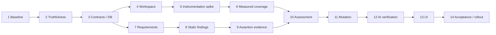

# System Test Evidence Assessment & AI Improvement — Implementation Plan

> **For agentic workers:** REQUIRED SUB-SKILL: Use superpowers:subagent-driven-development (recommended) or superpowers:executing-plans to implement this plan task-by-task. Steps use checkbox (`- [ ]`) syntax for tracking.
>
> Ghi chú thực thi trong repository này: các sub-skill trên chưa có trong danh sách skill của phiên hiện tại. Header là mẫu của writing-plans, không phải xác nhận đã cài các skill đó. Không tự dispatch agent hoặc dừng công việc vì một skill phụ không tồn tại. Người dùng đã yêu cầu triển khai; công việc được thực hiện tuần tự. Không tạo commit hoặc migrate database đang dùng trong lượt này.

**Goal:** Đánh giá system test bằng coverage thực đo, bằng chứng assertion so với yêu cầu đã xác nhận, kết quả chạy lặp lại và mutation có kiểm soát; AI bổ sung test dựa trên khoảng trống và chỉ công bố cải thiện sau xác minh.

**Architecture:** Giữ pipeline snapshot → job/queue → AUT/runner → TestRun/evidence hiện có. Thêm các module riêng cho measurement contract, isolated workspace, coverage adapter, requirement registry, assertion evidence, assessment và mutation; dữ liệu có run ID, scope, hash và phiên bản evaluator. Booster tạo candidate trong workspace riêng, chạy baseline/candidate trên cùng source và cấu hình, rồi trả proposal/diff cùng phép so sánh có bằng chứng.

**Tech Stack:** React 19/Vite, Express ES modules, Prisma/PostgreSQL, Redis/BullMQ, Playwright/Cypress, Babel AST, Istanbul instrumentation/coverage/source maps; Gemini chỉ dùng để đề xuất. Không chốt phiên bản dependency mới trước kiểm tra tương thích ở Task 5.

**Trạng thái:** Người dùng đã cho phép triển khai ngày 13/10/2026; implementation và verification được ghi ở mục 12. Căn cứ baseline HEAD `834c0a9`. Database đang dùng chưa được migrate hoặc bật flags.

## 1. Global Constraints

- Yêu cầu bắt buộc của người dùng: “đảm bảo test ‘Bao phủ’ với ‘chất lượng’ là phải đúng bao phủ với chất lượng thiệt, k có kiểu tự suy đoán”.
- Không suy line/branch/function/statement coverage từ pass rate, số scenario, tiêu đề, route hoặc component name.
- Không đưa ra accuracy %, quality score tổng hợp, confidence % do AI tự chấm hay trọng số tự đặt.
- Coverage đo mức thực thi của ứng dụng, không đo code của file test và không chứng minh nghiệp vụ đúng.
- Expected result nghiệp vụ cần yêu cầu/contract được owner xác nhận. Source là bằng chứng implementation; AI suy ra từ source chỉ là draft.
- Mọi số phải đi kèm numerator, denominator, phạm vi, nguồn, run và hash. Không có mẫu số hợp lệ thì `pct: null`, không trả 0 hoặc 100 thay thế.
- Tách frontend/backend, frontend/full, runner/browser, source coverage/requirement coverage, execution/verification/mutation.
- Dữ liệu unit/integration coverage không nhập vào phép đo system test; không cộng phần trăm của nhiều bộ coverage.
- Không giả vờ có instrumentation nếu AUT không hỗ trợ. Trả `UNSUPPORTED` hoặc `NOT_MEASURED` kèm lý do.
- Không giảm assertion, đổi expected value, thêm skip/only/fixme, nuốt lỗi, dùng mock backend để làm Full Stack xanh.
- Review ownership qua `req.user.id` cho snapshot, run, requirement, assessment, proposal và scenario. Không tin ID người dùng/room gửi từ client.
- Source và test gốc không được thay đổi khi đánh giá/generate candidate/mutate. Apply proposal là hành động riêng có kiểm tra hash và revision.
- Không có secret trong prompt, báo cáo, artifacts hoặc log. Không đưa `.env`, credential JSON, cookie/token request vào context AI.
- Cleanup chỉ process/container/workspace do chính job sở hữu; xác minh absolute path và realpath trước recursive delete trên Windows.
- Theo `AGENTS.md`: ES modules; client 2 spaces, server theo formatting cục bộ; route → controller → service; API client nằm trong `client/src/services/`.
- Không migrate DB trước khi review schema và SQL. Dùng `npm.cmd`/`npx.cmd` trên PowerShell.
- Mỗi task có regression behavior-focused; chỉ chạy rộng thêm khi có sửa đổi/rủi ro chưa được giải quyết.

## 2. Hiện trạng và những lỗi phải xử lý trước

| Căn cứ trong code | Vấn đề | Task xử lý |
|---|---|---|
| `systemCoverageEngine.service.js` | Synthetic coverage, floor 10%, route có thể >100%, statement bị dùng làm line, chia contribution theo số scenario | 2, 6 |
| `systemTestAnalysisJob.service.js` | Persist synthetic %; nguồn `coverageAvailable` không thống nhất; đọc artifact không gắn run provenance | 2, 3, 6 |
| `coverage.controller.js` | Summary coi numeric field là chứng cứ coverage; `featureCoverage: null`; scenario lookup của booster chưa scope vào snapshot | 2, 3, 12 |
| `systemTestBooster.service.js` | Đọc sai `frontendContext`; thêm 2–3 case chung; fallback assert body; fix làm assertion yếu đi; chưa chạy xác minh | 2, 12 |
| `SystemTestEditorModal.jsx` | Đọc `code/content` trong khi API trả `optimizedCode`; optimize/run đọc file trên disk khi editor còn unsaved | 2, 13 |
| `systemTestQuality.service.js` | Quality gate về cấu trúc, chưa chứng minh expected result; smoke assertion vẫn được chấp nhận | 8, 9 |
| `verifiedSystemGeneration.service.js` | Có hai lần chạy fresh DB và bảo toàn intent; cần dùng lại cơ chế, không dùng “hai lần pass” làm chứng minh đúng hoàn toàn | 10, 12 |
| `fullSystemLifecycle.service.js` | Database disposable trong Docker; frontend/backend và runner có đường chạy host | 4, 11 |

Kiểm tra ở lượt nghiên cứu trước: 5 suite, 41 pass/3 fail; Jest báo open handles. Failures: evidence route 404, empty-state response expectation lệch contract, stack trace snippet trả null. Đây là baseline đã quan sát, không phải kết quả test sau triển khai; Task 1 xác nhận lại và ghi nguyên nhân riêng.

## 3. Phạm vi và các lựa chọn kiến trúc

### 3.1 Lựa chọn

1. **Chỉ thêm AI review file:** nhanh nhưng không đáp ứng coverage/quality có chứng cứ. Loại khỏi hướng triển khai.
2. **Coverage thực + requirement evidence + targeted mutation:** đáp ứng mục tiêu và có thể chia thành các milestone độc lập. Chọn hướng này.
3. **Coverage/mutation mọi framework và mọi stack ngay:** quá rộng; khó kiểm chứng compatibility. Không đưa vào tiêu chí hoàn tất bản đầu.

### 3.2 Phạm vi hỗ trợ bản đầu

- Measurement adapter ưu tiên: frontend Vite React JS/TS/JSX/TSX qua Istanbul với source map, backend Node JavaScript ESM/CJS trong workspace copy. Adapter phải vượt Task 5 trước khi được bật.
- Playwright có managed fixture và requirement assertion evidence. Cypress vẫn có execution result; coverage chỉ bật khi plugin/instrumentation đã kiểm chứng; requirement verification không được tự gắn nếu chưa có evidence adapter.
- Next/Nuxt/Vue/Svelte, backend TS runtime/transpiler khác, web worker/service worker, custom fixture import chain, remote AUT: không cam kết source coverage đầy đủ bản đầu. Hiển thị support status và scope omissions; không âm thầm loại file để tăng %.
- Frontend mode có thể dùng API mocks và chỉ xác minh frontend contract. Full Stack cần backend/database thật trong môi trường test; nhãn frontend verification không chuyển thành full-system verification.
- Mutation bản đầu: tập hữu hạn do owner chọn từ source JS của các hành vi quan trọng, chạy Full Stack Playwright; không mutate cả repo tự động.
- Mọi metric chỉ mô tả scope đã ghi nhận. Không có trạng thái “project hoàn toàn chính xác” hoặc “đảm bảo 100% không còn bug”.

### 3.3 Các milestone

| Milestone | Task | Kết quả review được |
|---|---|---|
| M0 — Chặn số liệu sai | 1–3 | UI/API không nhận synthetic %; schema provenance và dữ liệu legacy rõ ràng |
| M1 — Đo coverage thật | 4–6 | Hai tier đo độc lập, có file inventory/source maps và artifact run-specific |
| M2 — Xác minh theo yêu cầu | 7–10 | Requirement được xác nhận, assertion review/execution evidence, repeated run results |
| M3 — Kiểm thử khả năng bắt lỗi | 11 | Mutation results có phân loại và bằng chứng lỗi được test phát hiện |
| M4 — AI/UI hoàn chỉnh | 12–14 | Gap → proposal → verification → diff → apply; regression và rollout |

Có thể giao M0/M1 sớm, nhưng không gọi đó là hoàn thành toàn bộ đánh giá chất lượng khi M2/M3 chưa có.

Thứ tự triển khai mặc định là tuần tự; dependency kỹ thuật để review:



## 4. Hợp đồng bằng chứng và cách tính

### 4.1 Source coverage

```js
// server/src/services/systemAssessmentContract.service.js
export const MEASUREMENT_STATUSES = Object.freeze([
  'MEASURED', 'PARTIAL', 'NOT_MEASURED', 'UNSUPPORTED', 'INVALID', 'LEGACY_UNVERIFIED'
]);

// Một counter; 0/0 không có phần trăm.
export const counter = (covered, total) => ({
  covered,
  total,
  pct: total > 0 ? Number((100 * covered / total).toFixed(2)) : null,
});
```

`covered/total` phải là integer, finite, `0 <= covered <= total`; vi phạm là `INVALID`, không clamp để che lỗi.

```json
{
  "schemaVersion": 1,
  "status": "MEASURED",
  "tier": "frontend",
  "provider": "istanbul",
  "measurementId": "uuid",
  "testRunId": "run-id",
  "sourceHash": "sha256",
  "testHash": "sha256",
  "scopeHash": "sha256",
  "scope": {
    "root": "client",
    "include": ["src/**/*.{js,jsx,ts,tsx}"],
    "exclude": ["**/*.test.*", "**/*.spec.*", "**/*.d.ts"],
    "eligibleFiles": 24,
    "instrumentedFiles": 24,
    "unmappedFiles": [],
    "omittedFiles": [],
    "window": "AUT_LIFECYCLE",
    "startupIncluded": true
  },
  "counters": {
    "lines": {"covered": 40, "total": 80, "pct": 50},
    "branches": {"covered": 6, "total": 12, "pct": 50},
    "functions": {"covered": 4, "total": 8, "pct": 50},
    "statements": {"covered": 44, "total": 88, "pct": 50}
  },
  "artifactManifestHash": "sha256",
  "reasonCodes": []
}
```

Các số trong JSON là ví dụ contract, không phải kết quả hiện tại của CovAI.

- Dùng Istanbul library để merge counters và tính line; không lấy statement count làm line count.
- Instrument toàn bộ eligible inventory, kể cả module/chunk chưa load; seed zero counters từ map của adapter. File không load khác với file không instrument được.
- File không instrument/map được: `PARTIAL`, liệt kê lý do; không có “overall source pct” cho full scope. Có thể hiện % của measured subset với mẫu số subset rõ ràng.
- Coverage thu cả startup trong bản đầu. Nhãn “AUT lifecycle coverage” ghi rõ startupIncluded; không gọi là “chỉ do scenario thực thi”. Không reset chung trong parallel workers.
- Coverage frontend/backend không gộp thành một % mặc định. Nếu sau này gộp phải dùng counters và cùng phạm vi đã công bố, không trung bình hai %.
- Không dùng screenshot, request log, DOM hay title làm bằng chứng code coverage.
- Không đọc `coverage-summary.json` có sẵn rồi tin đó là run hiện tại. Artifact phải nằm trong run workspace và match manifest/hash/session.
- File test breakdown chỉ có execution counts. Nếu owner chạy riêng một file có AUT mới thì có measurement của selected-file run, ghi rõ startupIncluded; không chia contribution từ suite tổng cho scenario/file.
- Flaky/retry/failure không làm giảm source hit counter bằng hệ số. Attempts lưu riêng; suite coverage có thể union hits của attempts, manifest ghi rõ retries included.

### 4.2 Requirement coverage và tính đúng của assertion

- `RequirementRevision`: owner xác nhận danh sách acceptance criteria, expected outcome, source/document reference, priority. Revision bất biến; edit tạo revision mới.
- `AssertionBinding`: liên kết criterion ID → scenario stable ID → assertion site/hash và target/expected contract; owner review binding trước khi được tính verified.
- AST findings là phát hiện cú pháp có thể kiểm tra, ví dụ missing await/hard-coded constant/catch nuốt lỗi. Không suy “assertion đúng nghiệp vụ” chỉ từ AST.
- Runtime assertion event phải ghi đúng binding đã review, matcher, expected contract hash, outcome và run/attempt. Metadata do AI tự attach hoặc test title chứa criterion ID không đủ.
- Không phải test hợp lệ nào cũng tự instrument được: custom helper/dynamic expect/custom matcher trả `LINK_UNVERIFIED`, vẫn chạy bình thường nhưng không tính verified.
- Owner review và runtime proof là hai loại bằng chứng riêng. Owner-confirmed expected result không phải sự thật tuyệt đối; báo cáo dùng nhãn “đạt theo yêu cầu revision X đã xác nhận”.

Mẫu số bao gồm mọi criterion được xác nhận và nằm trong selected requirement scope; không loại criterion thiếu test/không map được khỏi denominator.

```
designCoverage = số criterion có binding được review / số criterion trong revision scope
verifiedCoverage = số criterion có đủ binding bắt buộc chạy đạt, không skip/flaky / cùng mẫu số
```

Criterion fail vẫn có design coverage, nhưng không có verified coverage. Mỗi criterion đếm tối đa một lần trong project union. Nếu criterion yêu cầu nhiều assertion/scenario thì phải đạt tất cả binding bắt buộc. Không có requirement revision đã xác nhận: `NOT_MEASURED`, numerator/denominator/pct null. Không có tiêu chuẩn verified link thì không dựng % từ AI mapping.

### 4.3 Stability

- UI trình bày số lần chạy, số attempt pass/fail/flaky/skip và seed/browser/environment hash; không lấy một lần pass rate làm “stability score”.
- Candidate bắt buộc 2 lần chạy fresh database, retries = 0; điều đó chỉ là “2/2 lần xác minh đạt”.
- Mutation baseline bắt buộc 3 lần fresh database, retries = 0. Không bảo đảm statistical stability từ 3 lần; baseline fail/flaky thì mutation `BLOCKED_BASELINE`.
- Project nào chưa chạy lặp lại thì “Chưa có bằng chứng chạy lặp lại”.

### 4.4 Mutation

Trạng thái mỗi mutation: `KILLED_ASSERTION`, `SURVIVED`, `NOT_EXERCISED`, `INVALID_MUTANT`, `TIMEOUT`, `INFRA_ERROR`, `AMBIGUOUS`. Ghi operator, vị trí diff, baseline, test failure/stack, target assertion và environment.

- Chỉ `KILLED_ASSERTION` khi AUT startup/health hoàn tất, mutation activation được chứng minh, test thất bại tại assertion được review liên quan. Startup crash/timeout không tự coi là chất lượng test tốt.
- `NOT_EXERCISED` cần coverage ở target chứng minh không được chạm; không có evidence thì `AMBIGUOUS`, không suy từ title.
- Chỉ hiện tỷ lệ phát hiện trong **tập đã đánh giá**: `KILLED_ASSERTION / (KILLED_ASSERTION + SURVIVED + NOT_EXERCISED)`.
- Hiện riêng toàn bộ excluded/ambiguous/timeout/invalid/infra và tổng requested; không công bố tỷ lệ trên tập đã đánh giá là tỷ lệ toàn tập nếu còn unresolved.
- Tên UI: “Lỗi có kiểm soát đã phát hiện: K/E”; không tên “accuracy” hoặc chất lượng tổng thể. Không tự phân loại equivalent mutant; kết luận thủ công có owner/reason và lưu audit.

## 5. Cấu trúc file và interfaces

### 5.1 Tạo mới

| File | Trách nhiệm |
|---|---|
| `server/src/services/systemAssessmentContract.service.js` | Validate trạng thái, counter, scope/comparison; không phụ thuộc runner |
| `server/src/services/systemAssessmentWorkspace.service.js` | Copy source, hash inventory, locks, run directory và cleanup ownership |
| `server/src/services/systemCoverageInstrumentation.service.js` | Adapter discovery và instrumentation của từng tier |
| `server/src/services/systemCoverageCollector.service.js` | Collect/session-bound artifacts, merge/map/validate measurement |
| `server/src/services/systemRequirement.service.js` | Revision, criterion, approval và binding review |
| `server/src/services/systemTestStaticAnalysis.service.js` | Findings AST có vị trí và rule, trạng thái unsupported |
| `server/src/services/systemAssertionEvidence.service.js` | Managed assertion capture + parser đối chiếu reviewed bindings |
| `server/src/services/systemAssessment.service.js` | Build report từ evidence, không tự phán nghiệp vụ |
| `server/src/services/systemAssessmentJob.service.js` | Orchestrate assessment job và repeat runs |
| `server/src/services/systemMutation.service.js` | Mutation inventory, activation/diff, classification |
| `server/src/services/systemMutationJob.service.js` | Disposable baseline/mutant runner và budgets |
| `server/src/services/systemTestImprovementJob.service.js` | Gap-based candidate, verify, compare và proposal persistence |
| `server/src/controllers/systemAssessment.controller.js` | HTTP orchestration/ownership; không nhét logic mới vào coverage controller |
| `server/src/routes/systemAssessment.route.js` | Routes mới và middleware |
| `server/src/validators/systemAssessment.validator.js` | Zod requests, limits, IDs, mode và file selection |
| `client/src/components/dashboard/system/SystemTestAssessmentPanel.jsx` | Evidence summaries và states |
| `client/src/components/dashboard/system/SystemRequirementReview.jsx` | Criterion/binding approval, references và revisions |
| `client/src/components/dashboard/system/SystemTestGapList.jsx` | Gap ID/source/status/selected action |
| `client/src/components/dashboard/system/SystemTestImprovementReview.jsx` | Diff, verification/comparison, apply |
| `server/src/tests/fixtures/system-assessment/` | Small Vite+Node AUT, explicit requirements và expected ground truth |
| `tools/verify-system-assessment.mjs` | Browser acceptance script sau khi UI và runtime có sẵn |
| `docs/system-test-evidence-assessment.md` | Runbook, metric definitions, support và rollback |

Tên test mới được ghi cụ thể trong từng task, nằm trong `server/src/tests/`. Backend test không đọc source UI để giả lập rằng behavior UI đã được kiểm thử; UI kiểm chứng bằng browser acceptance.

### 5.2 Interfaces dùng chung

```js
// Contract signatures; object fields mô tả ở Sections 4 và 6.
validateMeasurement(measurement); // -> valid measurement hoặc ServiceError 422
canCompareAssessments(before, after); // -> { comparable, reasonCodes }

createAssessmentWorkspace({ snapshotId, rootDir, selectedFiles, operationId });
// -> { rootDir, originalHashes, sourceHash, testHash, scopeHash, release() }

prepareSystemCoverage({ workspace, coverageScope, measurementId });
// -> { capabilities, instrumentedRoots, zeroCoverageMaps, manifest, collectorConfig }
collectSystemCoverage({ preparation, runtimeArtifacts, testRunId });
// -> { tiers: { frontend, backend }, manifest }

analyzeSystemTestFile({ content, filePath, framework });
// -> { findings, assertionSites, scenarioSites, unsupportedFeatures }
verifyAssertionEvents({ bindings, events, testRun, testHash });
// -> { criterionEvidence, rejectedEvents, unsupportedBindings }
buildSystemAssessment({ identity, coverage, requirements, staticAnalysis, runs, mutations });
// -> reportJson schemaVersion 1; dữ liệu chưa có phải dùng status rõ ràng.

compareSystemAssessments({ baseline, candidate });
// -> { comparable, coverageDelta, newlyVerifiedCriterionIds, regressions, limitations }
```

`canCompareAssessments` yêu cầu cùng sourceHash, scopeHash, requirementRevisionId, runner/browser, executionMode, adapter/tool versions, configHash, seed/data policy; testHash được khác vì chính đó là thay đổi cần so sánh. Không so frontend với full hay đo Istanbul với một nguồn semantics khác.

`scenarioId` trong binding là stable execution identity của test (file/location/parameter/project), không phải foreign key tới một `TestScenario` chỉ tồn tại sau một lần chạy. Report lưu thêm `testScenarioRecordId` khi mapping với DB execution record; không dùng title để join.

## 6. Dữ liệu, API, concurrency

### 6.1 Schema bổ sung

Không tái sử dụng field % legacy làm truth. Các record chi tiết dạng JSON có schemaVersion được service validate; relation và identity dùng Prisma fields/index.

| Model/field | Nội dung |
|---|---|
| `TestRun.systemMeasurement Json?` | Coverage per-tier/provenance mới; null nghĩa legacy chưa xác minh |
| `SystemRequirementRevision` | id, snapshotId, revisionNumber, status DRAFT/CONFIRMED, contentHash, contentJson, approvedByUserId?, approvedAt?, createdAt |
| `SystemAssertionBinding` | id, revisionId, criterionId, testFile, scenarioId, assertionId, testHash, bindingJson, status DRAFT/APPROVED, reviewedByUserId?, reviewedAt? |
| `SystemTestAssessment` | id, snapshotId, jobId unique, testRunId?, requirementRevisionId?, sourceHash, testHash, scopeHash, runner, executionMode, status, reportJson, createdAt |
| `SystemTestProposal` | id, snapshotId, assessmentId, jobId unique, filePath, baseTestHash, candidateTestHash, requirementRevisionId?, state, proposedContent, verificationJson, appliedAt?, appliedByUserId? |
| `SystemMutationRun` | id, assessmentId, jobId unique, state, manifestJson, resultJson, createdAt |

Unique: `(snapshotId, revisionNumber)` cho revision; binding identity `(revisionId, assertionId, testHash)`; proposal/testRun constraints theo actual schema conventions. Index snapshot/time và assessment/state. Các model có FK cascade theo snapshot nhưng migration review phải đối chiếu project deletion/export. Các relation reverse thêm vào models hiện có. User approval relation dùng tên relation rõ ràng.

`JobType`: thêm `SYSTEM_TEST_ASSESSMENT`, `SYSTEM_TEST_IMPROVEMENT`, `SYSTEM_TEST_MUTATION`; cập nhật whitelist, long-running heartbeat, queue switch và quota paths. Không coi mutation queue completed là test verified.

Legacy: API diễn giải `systemMeasurement == null` thành `LEGACY_UNVERIFIED`; legacy floats giữ nguyên trong DB để forensic/rollback, nhưng không xuất dưới measured coverage. Không backfill bằng inference. Re-run là cách chuyển sang evidence mới.

### 6.2 API đề xuất

Mount `systemAssessment.route.js` ở `/api/coverage` để dùng URL snapshot hiện có. Mọi route dùng authMiddleware và resolveOwnedSnapshot/Project phù hợp.

| Method/path sau `/api/coverage/:snapshotId/system` | Request/result |
|---|---|
| `POST /assessments` | `{ testFiles, runner, executionMode, requirementRevisionId?, coverageScope, repeatRuns: 2 }` → 202 `{ jobId, assessmentId }` |
| `GET /assessments/:assessmentId` | Report + freshness; chỉ owned snapshot |
| `POST /requirements` | Tạo draft content gồm criteria/expected outcome/references → 201 revision |
| `POST /requirements/:revisionId/confirm` | `{ expectedContentHash }` → confirmed immutable revision; conflict 409 |
| `POST /requirements/:revisionId/bindings` | Draft bindings có assertion identity và expected contract |
| `POST /bindings/:bindingId/approve` | `{ expectedTestHash, expectedBindingHash }` → approval; changed content 409 |
| `POST /improvements` | `{ assessmentId, filePath, gapIds, expectedTestHash, instruction? }` → 202 `{ jobId, proposalId }` |
| `GET /proposals/:proposalId` | Candidate/diff metadata/verification/comparison |
| `POST /proposals/:proposalId/apply` | `{ expectedCurrentTestHash, expectedCandidateTestHash }` → atomic apply; stale 409 |
| `POST /assessments/:assessmentId/mutations` | `{ targetIds, maxMutants: 10 }` → 202 `{ jobId, mutationRunId }` |
| `GET /mutations/:mutationRunId` | Classification và evidence |

Limits v1: ≤20 selected test files; mỗi file ≤256 KiB; instruction ≤2,000 characters; requirement revision ≤100 criteria; criterion ≤10 required bindings; mutation ≤10 selected targets/job; max job wall time 20 phút; max one assessment/improvement/mutation execution per snapshot at a time. Đây là resource limits, không phải quality thresholds. Validate file paths qua containedPath + realpath; reject external URL dùng làm artifact path. Body source/content không nhận userId.

Shared locking: Redis lease `system-assessment:snapshot:<id>` TTL 60s, heartbeat 15s, owner-token compare-and-delete khi release. Writer endpoints cho test content và proposal apply dùng cùng lease/revision check; lease lost → abort, không publish result/apply. Source/test/config hashes kiểm tra trước và sau job. Idempotency request key ngăn double click tạo hai jobs. DB status compare-and-set bảo vệ retry/finalization.

Artifacts: `.covai-system-test/assessment/<operationId>/` trong execution workspace; manifest relative paths + hashes + tier/run/attempt. DB giữ normalized reports không giữ host absolute path. Retention mặc định 14 ngày sau terminal state; không dọn active lease, confirmed proposal chưa apply không tự xóa trước hết retention; nếu artifact đã purge UI giữ metadata và ghi evidence unavailable. Candidate/report tối đa 50 MiB/job; quá giới hạn → explicit truncation/invalid evidence, không silently verified.

## 7. Kế hoạch theo task

### Task 1 — Xác lập baseline và fixture ground truth

**Files:** Create `server/src/tests/fixtures/system-assessment/README.md`, `requirements.json`, `client/` và `server/` fixture; create `docs/system-test-evidence-assessment.md`. Inspect 5 existing suites nêu ở Section 2.

**Consumes:** code HEAD và test environment hiện có. **Produces:** baseline log và fixture có expected counters/behaviors độc lập evaluator.

- [ ] Ghi git status/HEAD, Node/npm versions, Docker capability; không đọc hoặc in secrets.
- [ ] Chạy lại 5 suites: `npm.cmd test --prefix server -- --runInBand --runTestsByPath src/tests/systemExecutionAndCoverageEngine.test.js src/tests/systemTestQuality.service.test.js src/tests/systemTestEditorAndBooster.test.js src/tests/verifiedSystemGeneration.test.js src/tests/systemTestSummary.route.test.js`.
- [ ] Phân loại 3 failure trước đây; sửa regression trực tiếp trong phạm vi feature nếu là code bug, cập nhật stale expectation chỉ khi contract mới đã xác nhận. Không đánh đồng baseline failures với lỗi của implementation mới.
- [ ] Fixture: Vite React form tạo item; Node API với valid/blank/boundary input; item persistence; một module không import; lazy-loaded route chưa visit; hai statement trên một line; hai nhánh khác nhau.
- [ ] Requirement JSON có expected outcome explicit, ví dụ `CREATE_VALID`: sau submit đúng tên hiển thị, reload vẫn còn; `REJECT_BLANK`: không tạo item và error theo contract. Runtime API 500 là criterion frontend error-state riêng, không giả backend full-system health.
- [ ] Record manual/oracle expected values bằng đọc instrumented map; không dùng chính aggregation service đang kiểm thử để tạo expected result.
- [ ] Dọn open handles trong các tests liên quan (server close, Redis quit, timers clear); không dùng `--forceExit` để che.

**Deliverable:** fixture có thể chạy uninstrumented và requirement ground truth; baseline có lỗi phân loại rõ ràng.

### Task 2 — Loại bỏ synthetic metrics và sửa booster contract

**Modify:** `systemCoverageEngine.service.js`, `systemTestAnalysisJob.service.js`, `coverage.controller.js`, `systemTestBooster.service.js`, `client/.../SystemTestEditorModal.jsx`, `SystemTestMetricsCards.jsx`, `SystemTestReportView.jsx`.
**Tests:** Create `server/src/tests/systemCoverageTruthfulness.test.js`; modify `systemExecutionAndCoverageEngine.test.js`, `systemTestEditorAndBooster.test.js`, `systemTestSummary.route.test.js`.

**Produces:** measurement missing là null/unknown; booster response đúng; không có fallback pretend-improvement.

- [ ] Viết regression trước:

```js
it('never fabricates source coverage from a passing smoke test', () => {
  const result = calculateSystemCoverage({
    scenarios: [{ title: 'body visible', status: 'passed' }],
    harvestedContext: { routes: ['/'], uiActions: [] },
  });
  expect(result.status).toBe('NOT_MEASURED');
  expect(result.summary.linesPct).toBeNull();
  expect(result.scenarioContributions).toEqual({});
});
```

- [ ] Thêm empty run, all failed, all skipped, `/login` không `/`, duplicate title fixtures; không trả route synthetic coverage, không chia contribution.
- [ ] Chạy `npm.cmd test --prefix server -- --runInBand --runTestsByPath src/tests/systemCoverageTruthfulness.test.js`; expect fail trên code cũ.
- [ ] Chuyển calculateSystemCoverage thành compatibility wrapper chỉ dùng verified collector output hoặc unknown. Bỏ phần regex/title-based inference và formulas. Artifact không manifest không tự được measured.
- [ ] Summary không suy available từ floats; expose legacy status và null. Job log không ghi “Measuring coverage” nếu chưa đo.
- [ ] Sửa editor đọc `res.data.optimizedCode`; booster đọc top-level context. Chặn optimize/run khi editor dirty hoặc yêu cầu save ngay trong flow; không tự overwrite edits.
- [ ] AI unavailable → 503 provider state; invalid candidate → 422 candidate validation; không tạo fallback body-visible hay tự relax expected matcher.
- [ ] Scope scenario lookup theo snapshot/testRun và path file; reject scenario khác project hoặc khác target file.
- [ ] Chạy các suite đã sửa và build client. Commit suggestion: `fix: stop publishing synthetic system coverage`.

### Task 3 — Schema, evidence contracts và legacy migration

**Create:** `systemAssessmentContract.service.js`, `systemAssessment.validator.js`; tests `systemAssessmentContract.test.js`, `systemAssessmentMigration.test.js`.
**Modify:** `server/prisma/schema.prisma`; create reviewed migration under `server/prisma/migrations/<timestamp>_system_assessment_evidence/migration.sql`; job type lists/queue.

**Consumes:** Section 4/6. **Produces:** persisted identity/status/provenance, no destructive backfill.

- [ ] Write tests for 0/0 → null, negative/out-of-range/nonfinite → 422, missing scopeHash → invalid, cross-mode compare → false.

```js
expect(counter(0, 0)).toEqual({ covered: 0, total: 0, pct: null });
expect(() => validateMeasurement({ status: 'MEASURED', counters: {
  lines: { covered: 3, total: 2, pct: 150 }
}})).toThrow();
expect(canCompareAssessments(
  { sourceHash: 's', scopeHash: 'a', executionMode: 'full' },
  { sourceHash: 's', scopeHash: 'a', executionMode: 'frontend' }
).comparable).toBe(false);
```

- [ ] Implement validation for all contract fields/status/counter and comparison identity.
- [ ] Add models/relations/indexes and enum values in Section 6; JSON validation version maintained in one module.
- [ ] Generate SQL for review without applying production migration; inspect cascade, unique and legacy records retained. Existing TestRun with null measurement maps LEGACY_UNVERIFIED.
- [ ] From `server/`: `npx.cmd prisma validate`, `npx.cmd prisma generate`.
- [ ] Apply reviewed migration only to disposable test database; verify old rows readable, new records FK ownership valid, delete project cascade verified, duplicate apply/job writes rejected.
- [ ] Commit suggestion: `feat: add system assessment evidence contracts`.

### Task 4 — Workspace, immutable identity và execution lease

**Create:** `systemAssessmentWorkspace.service.js`; tests `systemAssessmentWorkspace.test.js`.
**Modify:** test content write path, lifecycle dependency injection to accept execution root/measurement preparation; reuse `snapshotWorkspace.js` repository root discovery.

**Produces:** createAssessmentWorkspace interface và shared lease.

- [ ] Tests: two concurrent jobs same snapshot → one 409; different snapshots independent; symlink escape rejected; copied source hash same; original fixture remains byte-identical after mutation/cleanup; expired lease owner cannot delete successor lease.
- [ ] Copy eligible repo source/config/tests into operation workspace, exclude secrets/build/artifacts/.git; original read-only. Dependencies only share immutable tool caches; mutable generated client/build/node_modules state stays workspace-owned.
- [ ] Startup credentials lấy từ server-managed runtime configuration bằng đường riêng, không copy `.env` vào source inventory hoặc prompt. Test database URL luôn là URL disposable do lifecycle tạo. Nếu startup yêu cầu credential chưa được cấu hình thì fail rõ lý do; không dùng production DB để đánh giá.
- [ ] Define canonical sorted SHA-256 inventory for source/test/config/scope. Include transitive helpers/config relevant to execution; exclude timestamp/generated output to prevent false freshness.
- [ ] Manifest records omitted files and why; symlink outside repo, missing file or unreadable declared source → invalid/partial.
- [ ] Implement heartbeat and compare-token release; existing content writers cooperate with same lease. CAS against base hash on publish/apply.
- [ ] Cleanup try/finally, resolved path under workspace root, process/container owner tokens; timeout/cancel cleanup tested. Không dùng path do client cung cấp cho deletion.
- [ ] Commit suggestion: `feat: isolate system assessment workspaces`.

### Task 5 — Compatibility spike cho instrumentation (gating task)

**Create:** `scratch/system-assessment-spike/` prototype and `docs/system-test-evidence-assessment-instrumentation.md`; test fixture harness `server/src/tests/systemCoverageInstrumentation.compatibility.test.js`.
**Consumes:** fixture Task 1/workspace Task 4. **Produces:** verified adapter capabilities/dependency versions and exact transform order.

- [ ] Install candidate instrumentation deps only inside scratch workspace: `istanbul-lib-instrument`, `istanbul-lib-coverage`, `istanbul-lib-source-maps`, `babel-plugin-istanbul`; chọn versions từ official package/docs và lock kết quả tương thích.
- [ ] Prototype Vite React pipeline: TS/JSX transform → instrumentation → serving, compose source maps back to original file; instrument code trước khi eval, không sau load. Verify React Fast Refresh không thay semantics/counters.
- [ ] Backend JS ESM/CJS: instrument execution copy preserving import/module semantics, exclude dependencies/generated Prisma/test/config; flush counters via managed control channel. Không dùng stdout của app làm coverage payload.
- [ ] Validate unvisited module/lazy chunk present with zero; line count differs from statements; actual branches per source mapping; browser reload/new page; Windows path; zero hits baseline before browser opens.
- [ ] Run instrumented and uninstrumented fixture with same seed/tests; functional results must agree. Compare map against manually checked fixture expected counters.
- [ ] Cypress prototype validates coverage plugin hooks and flush, custom config composition; no support badge until actual fixture pass.
- [ ] Write success matrix: supported runtime/build/browser; unsupported features and exact reason. Nếu TS sourcemap hoặc Node ESM semantics không pass, mark that adapter unsupported and narrow scope explicitly; không làm ước lượng thay thế.
- [ ] Gate: Task 6 production adapter chỉ dùng branches của spike đã pass; failed capabilities remain disabled. Không claim Playwright native browser coverage tương đương Istanbul branches. Commit suggestion: `docs: verify system coverage adapter compatibility`.

### Task 6 — Collect coverage thật theo run và tier

**Create:** `systemCoverageInstrumentation.service.js`, `systemCoverageCollector.service.js`; tests `systemCoverageCollector.test.js`, `systemCoverageInstrumentation.service.test.js`.
**Modify:** `server/package.json`/lock after spike; `systemTestRunner.service.js`, `systemTestEvidence.service.js`, `fullSystemLifecycle.service.js`, `fullSystemRuntime.service.js`, `systemTestAnalysisJob.service.js`.

**Consumes:** workspace + verified adapter. **Produces:** collectSystemCoverage and TestRun.systemMeasurement.

- [ ] Tests first: stale artifact with recent mtime rejected; manifest hash mismatch; imported test/dependency source excluded; unloaded eligible file remains denominator; multiple statements one line counted correctly; two overlapping attempts union counters; tier collision rejected.

```js
it('does not trust an artifact from another run', async () => {
  const result = await collectSystemCoverage({
    preparation: fixturePreparation({ measurementId: 'run-a' }),
    runtimeArtifacts: fixtureArtifacts({ measurementId: 'run-b' }),
    testRunId: 'test-run-a',
  });
  expect(result.tiers.frontend.status).toBe('INVALID');
  expect(result.tiers.frontend.reasonCodes).toContain('RUN_ID_MISMATCH');
});
```

- [ ] Helpers fixturePreparation/fixtureArtifacts defined in `server/src/tests/helpers/systemAssessmentTestUtils.js` in this task; create valid defaults from Section 4 schema.
- [ ] Prepare zero maps, eligible inventory and source map manifest before AUT starts. Use measurement run token/config from server-managed workspace, not request body.
- [ ] Browser fixture collects page/context counters before navigation/page close plus afterEach, including iframe only where adapter supports; de-duplicate captures by page/document ID. Validate navigation reset cannot silently lose previous document.
- [ ] Backend collect graceful flush before stop, final artifact in run directory, control listener local/authenticated; runtime crash/lost flush → PARTIAL/INVALID. Never expose control endpoint on production backend.
- [ ] Map and merge using Istanbul libraries; reject unmapped external paths/map mismatches; count scope completeness before status MEASURED.
- [ ] Keep overall source pct null for partial full scope; measured subset has own counters/label. Artifact upload failure means evidence unavailable, not pass/coverage = 0.
- [ ] Persist measurement + manifest hash to TestRun after final flush, not before. API/job outputs share the same truth contract.
- [ ] Integration run fixture Full Stack, verify frontend/backend separate, failed tests can still hit source, retries do not invent contribution; no changes in shared unit coverage tables.
- [ ] Commit suggestion: `feat: collect measured system source coverage`.

### Task 7 — Requirement revisions và owner-reviewed bindings

**Create:** `systemRequirement.service.js`; tests `systemRequirement.service.test.js`, `systemRequirement.authorization.test.js`.

**Consumes:** schema, owned snapshot and test hash. **Produces:** immutable confirmed requirements/approved bindings.

- [ ] Test draft never in denominator; confirmed criteria all stay denominator including missing test; edit confirmed produces new revision; another owner cannot approve; changed testHash invalidates binding.
- [ ] Implement CRUD/create revision/confirm contract; source refs repository-relative, document refs text/URL treated as data. Không auto-fetch private URL hoặc để instruction trong doc override evaluator.
- [ ] Binding captures criterionId, scenario stable identity `file + location + project/browser`, assertion AST location/hash, matcher/expected contract and mandatory flag; duplicate titles không đè nhau.
- [ ] Expected contract describes actual intended value/state; reject constants like `expect(true)` as behavior verification, but keep legitimate constants in expected value (e.g. count=0).
- [ ] AI draft suggestions saved DRAFT with source references, never confirmed automatically. Owner review includes assertion code/expected result and limitations.
- [ ] Empty confirmed scope → null percentage with reason EMPTY_SCOPE; explicit criterion removals create revision/audit, never silent omission by evaluator.
- [ ] Commit suggestion: `feat: record confirmed system requirements and bindings`.

### Task 8 — Static analysis chỉ báo cáo findings kiểm chứng được

**Create:** `systemTestStaticAnalysis.service.js`; test `systemTestStaticAnalysis.test.js`.
**Modify:** `systemTestQuality.service.js` to separate generation gate from reporting.

**Produces:** findings/assertionSites/scenarioSites with line evidence, no aggregate quality score.

- [ ] Add tests for missing await, .only/.skip/.fixme, hard wait, literal actual assertion, caught error without rethrow, conditional absence that avoids behavior, global positional button, test ordering/shared mutable state markers.
- [ ] Support direct test/test.describe/it aliases proven by import binding, test.each/parameterized code only when identity is statically/resolution supported. Unknown helpers/custom fixtures → unsupportedFeatures, not “no problems”.
- [ ] Classify `body visible` as smoke-purpose finding when bound to business criterion; do not globally ban legitimate smoke test. Show snippet and exact rule.
- [ ] Awaited assertion existence doesn't prove expected business outcome; no automatic quality approval from AST.
- [ ] Existing generated-test gate remains syntax/mechanics policy. Tests show a valid smoke test can be generation-valid while requirement binding unverified.
- [ ] Commit suggestion: `feat: report evidence-based system test findings`.

### Task 9 — Runtime assertion evidence và criterion verification

**Create:** `systemAssertionEvidence.service.js`; tests `systemAssertionEvidence.test.js`.
**Modify:** `systemTestEvidence.service.js`, `systemTestResultParser.service.js`, `systemTestExecutionDetails.service.js`.

**Consumes:** approved bindings/testHash; **Produces:** verifyAssertionEvents and per-criterion proof.

- [ ] Test title containing criterion ID alone remains unverified; forged attachment missing managed event rejected; matching source assertion but not executed remains unverified; failed matcher cannot be counted verified.
- [ ] Instrument execution-copy supported assertion expression while preserving exact matcher/expected/negation/timeout and control flow. Wrapper must execute original awaited assertion; write event only after it settles; rethrow failures. Record soft assertion failure explicitly.

```js
// Conceptual generated wrapper, emitted only for reviewed supported AST sites.
await managedAssertion({ bindingId, assertionId, expectedContractHash }, async () => {
  await expect(itemRow).toHaveText(expectedName);
});
// managedAssertion belongs to CovAI fixture; candidate cannot redefine/import it.
```

- [ ] Capture assertion event from managed reporter/control channel outside test-generated attachments, scoped to run/attempt/site/source hash. This prevents accidental metadata masquerading as proof; it is not a cryptographic defense against malicious AUT in a shared host process.
- [ ] For request assertions/UI observations, binding review validates target/expected against confirmed criterion; matcher allowlist excludes tautologies and unsupported custom semantics. Expression instrumentation cannot evaluate expression twice.
- [ ] Verify no events dropped on assertion failure, teardown failure, timeout or soft expectations. Incomplete channel → unverified, no optimistic pass.
- [ ] Runtime only confirms execution of reviewed assertions, not universal semantic correctness. UI displays review provenance and expected contract.
- [ ] Cypress/dynamic unsupported links retain design binding but verified=false with reason; do not fabricate evidence.
- [ ] Commit suggestion: `feat: capture reviewed system assertion execution evidence`.

### Task 10 — Assessment API/job và repeated evidence

**Create:** `systemAssessment.service.js`, `systemAssessmentJob.service.js`, `systemAssessment.controller.js`, `systemAssessment.route.js`; tests `systemAssessment.service.test.js`, `systemAssessmentJob.test.js`, `systemAssessment.route.test.js`.
**Modify:** `server/index.js`, queue/job lists; project export/delete paths for new evidence models.

**Consumes:** Task 3–9 interfaces. **Produces:** buildSystemAssessment report + endpoints Section 6.

- [ ] Test criterion fail keeps design numerator but not verified; duplicate scenarios union criterion once; missing required assertion prevents criterion verified; skipped/flaky/partial evidence separately visible; no requirements → NOT_MEASURED.
- [ ] Build report only from raw measurement, reviewed binding events and actual runs; static/AI findings cannot increment counters.
- [ ] Queue two fresh runs with same source/config, retries=0, record testRun IDs, seeds/environment/capabilities; hash source before/after. External dependency failures are infra, not test defects inferred by AI.
- [ ] Heartbeat every 15s through existing job progress model, cancellation check at step boundaries, lease lost abort; retries reuse operation identity and don't duplicate TestRun publication.
- [ ] GET report computes freshness from current source/test/revision hashes; stale evidence remains historical and cannot be basis for new proposal apply.
- [ ] Route tests 401/404 foreign snapshot/foreign assessment/foreign run, path traversal, excessive payload, mismatched runner/mode, hash 409; no secret/host path in output.
- [ ] Summary compatibility API can expose latest assessment link but must not conflate assessment queue success with test passing.
- [ ] Commit suggestion: `feat: orchestrate verifiable system test assessments`.

### Task 11 — Targeted mutation có activation và classification proof

**Create:** `systemMutation.service.js`, `systemMutationJob.service.js`; tests `systemMutation.service.test.js`, `systemMutationJob.test.js`; fixture known faults Task 1.

**Consumes:** owned current assessment, confirmed criteria/bindings, isolated workspace. **Produces:** SystemMutationRun report.

- [ ] Implement bounded AST operators for supported Node JS business paths: flip equality/comparison, boundary `<`↔`<=`, negate validation condition. Enumerate exact file/location/original/replacement; do not mutate test/config/instrumentation/control channels/imports.
- [ ] Invalid syntax candidates `INVALID_MUTANT`; owner-selected IDs only. Max 10 mutants, one-at-a-time, 20min overall, 90s per mutant verification after startup (startup has separate existing lifecycle timeout, overall budget still applies).
- [ ] Test clean suite baseline 3 times on fresh DB with retries=0; fail/skip/flaky or missing evidence → BLOCKED_BASELINE, no score.
- [ ] Each mutant uses disposable source copy and fresh AUT/DB. Save mutant diff/hash and target executed evidence to prove running code has mutation; no live server/module cache reuse.
- [ ] Test expected classification: blank acceptance fault → KILLED_ASSERTION; deliberately weak smoke test → SURVIVED; untouched branch → NOT_EXERCISED; app startup crash → INFRA_ERROR/INVALID_MUTANT with evidence; unexpected unrelated assertion → AMBIGUOUS; timeout separate.

```js
expect(classifyMutation({
  startupHealthy: false, assertionFailures: [], timedOut: true
}).status).toBe('INFRA_ERROR');
expect(classifyMutation({
  startupHealthy: true, activated: true, targetExecuted: true,
  assertionFailures: [{ bindingId: 'approved-target-binding' }],
  approvedTargetBindingIds: ['approved-target-binding']
}).status).toBe('KILLED_ASSERTION');
```

- [ ] `classifyMutation` defined/exported in systemMutation.service.js; returns `{status, reasonCodes, evidenceRefs}`. Assert raw failure is matched to approved target, not just exitCode !=0.
- [ ] Mutation execution limited to trusted local fixture/import workflows with explicit runtime capability report. Existing DB container does not sandbox host frontend/backend. Untrusted remote multi-user mutation must stay disabled unless process/container boundary disallows host credentials/network/files; don't claim existing host runner provides isolation.
- [ ] No Stryker adoption required for bounded v1 operators. Record operator/version; future Stryker integration needs command-runner compatibility/activation pilot before production. Do not label custom ratio as standard Stryker mutation score.
- [ ] Store assessed count and exclusions, target coverage proof; no automatic equivalent mutant classification; no complete quality label when mutation absent.
- [ ] Commit suggestion: `feat: measure targeted system test fault detection`.

### Task 12 — AI improvement theo gap và kiểm tra trước/sau

**Create:** `systemTestImprovementJob.service.js`; tests `systemTestImprovementJob.test.js`, `systemTestProposalApply.test.js`.
**Modify:** `systemTestBooster.service.js`, reuse verification/repair primitives in `verifiedSystemGeneration.service.js`, validators/routes/controller Task 10.

**Consumes:** current assessment + selected gap IDs; **Produces:** proposal with candidate/evidence/comparison.

- [ ] Gap sources allowed: uncovered measured source locations, confirmed criterion missing/failed verification, explicit static finding, survived/NOT_EXERCISED mutation target. Label each source distinctly; AI-created gap never masquerades as measured one.
- [ ] Require current testHash and revision; ambiguous requirement → NEEDS_REQUIREMENT_REVIEW before generation; instrumentation unavailable doesn't prevent draft generation but prevents measured coverage-increase claim.
- [ ] Prompt includes relevant full source slices with references, expected contract, existing tests/helpers/config, actual failures; omitted context explicit. No .env, secret/raw auth/request bodies. Provider errors typed, no offline smoke fallback.
- [ ] Preserve existing scenario and assertion AST semantics, titles/identities and imports; add tests for selected gap. Initial v1 excludes rewriting existing business expected values; unsupported dynamic preservation → manual-review proposal not auto VERIFIED.
- [ ] Analyze syntax/mechanics/full backend rules and AST preservation. Missing await, skip/only, broad catch swallowing failure, conditional skip, weakened existing matcher → REJECTED.
- [ ] New requirement bindings remain DRAFT until owner reviews assertion/expected contract. Candidate may be execution-verified before binding approval, but cannot be called newly requirement-verified yet.
- [ ] Run baseline and candidate separately on same source/scope/config/browser/seed and fresh DB; candidate 2 runs retries=0; existing suite must remain passing where baseline passes. Baseline known application failures retained and reported; do not auto “repair” expected outcome.
- [ ] Coverage delta only if both measurements comparable/complete; add test showing 1% increase under different scope is NOT_COMPARABLE. Newly verified criteria only after approved binding and matching runtime proof.
- [ ] So sánh repeated runs theo cùng aggregation policy (union của đúng 2 runs, cùng attempts/retries); báo từng run riêng. Coverage tăng do background/startup paths chỉ được gọi “AUT lifecycle execution coverage tăng”, không suy assertion tốt hơn hoặc nghiệp vụ được xác minh thêm. Chỉ gắn VERIFIED_IMPROVEMENT vào loại bằng chứng thực sự đã cải thiện và nêu tên loại đó.
- [ ] If selected mutation gap targeted, rerun same mutation set for before/after; only claim fault detection increase with identical valid set/comparable environment, exclusions reported.
- [ ] Candidate results: DRAFT, VERIFYING, EXECUTION_VERIFIED, NEEDS_BINDING_REVIEW, VERIFIED_IMPROVEMENT, NO_MEASURED_IMPROVEMENT, FAILED_VERIFICATION, PROVIDER_UNAVAILABLE, STALE, APPLIED. Valid state transitions server-owned.
- [ ] Apply checks current original hash, exact verified candidate hash, source/revision freshness and lease; write temp file + atomic rename, transaction metadata, recovery journal for file/DB partial failure. Restore original on failed metadata transaction or mark RECOVERY_REQUIRED and block further apply; no false APPLIED response.
- [ ] Direct editor edits to proposal invalidate verification; rerun before verified apply. Proposal cannot overwrite unsaved editor buffer.
- [ ] Tests: AI output claims 100% without artifacts ignored; candidate passes but zero delta → NO_MEASURED_IMPROVEMENT; assertion relaxation rejected; unrelated project scenario rejected; source changed → 409; double apply idempotent.
- [ ] Commit suggestion: `feat: verify AI system test improvements against evidence`.

### Task 13 — UI assessment/requirement/diff và truthful reporting

**Create:** components Section 5; **Modify:** `client/src/services/systemTest.service.js`, `SystemTestDashboard.jsx`, `SystemTestMetricsCards.jsx`, `SystemTestScenarioList.jsx`, `SystemTestEditorModal.jsx`, `SystemTestReportView.jsx`; create browser verification script Section 5.

**Consumes:** API/report contract, never infer metrics client-side. **Produces:** actionable evidence UI.

- [ ] Add per-file “Đánh giá test” action và dashboard “Đánh giá suite”; dirty editor state blocks old disk assessment/run with clear Save action.
- [ ] Show source coverage two tier cards: counter covered/total, scope, measurement status, browser, run, timestamp, startup/retry notes; null rendered “Chưa đo”, partial subset explicit.
- [ ] Show requirement design/verified separately with revision, owner-confirmation and required assertion references. Missing requirement set gets create/review action, not zero coverage.
- [ ] Show execution counts and repeat runs; remove Stability Score computed from pass rate. Display pass rate only as pass rate with denominator policy stated.
- [ ] Static findings show code location/rule; no score stars/quality badge inferred from absence of warnings. Mutation table shows K/E, selected targets and excluded counts with raw evidence.
- [ ] Gaps have checkbox/action/priority/source. Button “AI bổ sung test theo khoảng trống” only enabled with current assessment; no “đảm bảo đầy đủ” copy.
- [ ] Improvement review displays candidate diff + baseline/candidate scope and counters + verification runs + new bindings requiring approval; direct modified diff invalidates verified status.
- [ ] Apply only exact candidate with accepted current revision; failure remains visible. Queue accepted text “Đã xếp hàng”, not “Test đã pass”. Cancellation, timeout, provider unavailable, unsupported adapter, stale, evidence purged all have distinct states.
- [ ] Browser acceptance: AI optimizedCode appears in diff, saved/unsaved behavior, unknown vs measured zero, foreign/stale errors, two concurrent clicks, selected runner/mode pinned, keyboard/focus modal, mobile 390px and desktop 1280px, light/dark, exported JSON/print semantics same as screen.
- [ ] Commands: `npm.cmd run lint --prefix client`, `npm.cmd run build --prefix client`; capture screenshots of fixture UI. Don't claim lint proves UX behavior.
- [ ] Commit suggestion: `feat: show system test assessment and verified AI proposals`.

### Task 14 — Nghiệm thu, rollout và rollback

**Create:** `server/src/tests/systemAssessmentAcceptance.test.js`; complete `docs/system-test-evidence-assessment.md`, `api.http` examples; use `tools/verify-system-assessment.mjs`.

**Consumes:** M0–M4 integrated feature. **Produces:** evidence package and go/no-go release result.

- [ ] Run focused changed service/API suites; then `npm.cmd test --prefix server -- --runInBand`. Failures classified; don't say all green if baseline unrelated failures remain.
- [ ] Run actual Vite+Node+disposable DB Full Stack fixture with known coverage counters, strong vs weak assertions, mutation faults and AI stub/live candidate. Mocked Jest orchestration tests don't substitute actual runner/instrumentation evidence.
- [ ] Repeat fixture with Windows ESM/CJS/TS frontend paths supported by spike; Cypress support report only after its runtime acceptance succeeds.
- [ ] Verify unit/integration coverage tables unchanged by new system jobs; legacy rows never displayed as measured; report equality UI/API/JSON/print; original imported source unchanged before apply.
- [ ] Verify cleanup on cancel/kill/lease loss, invalid paths/symlink, malicious metadata/foreign IDs, lost collector/manifest artifacts, changed test/revision, apply recovery.
- [ ] Record timing, peak artifact size, number AUT/database startups and AI calls. Limits are resource bounds; performance results must be measured, not estimated claims.
- [ ] Rollout flags: `SYSTEM_ASSESSMENT_ENABLED=false`, `SYSTEM_MEASURED_COVERAGE_ENABLED=false`, `SYSTEM_MUTATION_ENABLED=false`, `SYSTEM_AI_IMPROVEMENT_ENABLED=false` by default until fixture acceptance. Enable sequentially in test environment, then owned pilot snapshots. Server capability response exposes enabled/supported separately.
- [ ] Rollback disables job admission/new UI actions and cancels owned active jobs safely; retains evidence/approved revisions; legacy API still reports unknown. Never rollback by restoring synthetic formulas. DB additive fields remain; removing enum/models requires separate reviewed migration.
- [ ] Deliver report links/artifact manifest/test results and state limitations. Implementation complete only when all acceptance gates below satisfied for declared v1 supported scope.
- [ ] Commit suggestion: `test: verify system assessment evidence and rollout`.

## 8. Acceptance gates bắt buộc

| ID | Kiểm chứng | Task |
|---|---|---|
| AC01 | Không test/không artifact → null/NOT_MEASURED; không positive coverage tự sinh | 2, 3 |
| AC02 | Một smoke pass không trở thành 100% coverage bằng suy diễn | 2, 6 |
| AC03 | Coverage có actual hit counters, zero map cho source chưa load, source-map verified | 5, 6 |
| AC04 | Lines/branches/statements/functions tính đúng trên fixture độc lập; không thay lines bằng statements | 1, 6 |
| AC05 | Legacy/stale/foreign artifact không được đo hoặc so sánh | 3, 6, 10 |
| AC06 | Requirement draft/title/AI mapping không tăng verified coverage | 7, 9, 10 |
| AC07 | Assertion phải được owner review và chạy thực; fail/skip/soft failure/incomplete event không verified | 7, 9 |
| AC08 | Denominator confirmed criteria không mất case chưa map; criterion union không đếm trùng | 7, 10 |
| AC09 | Pass rate không gọi stability/quality; repeat evidence số lần cụ thể | 10, 13 |
| AC10 | Weak suite survived fault; strong suite kills relevant fault; crash/timeout không tính detected | 11 |
| AC11 | Candidate không đổi expected/matcher để làm test xanh; AI response không được tự chấm | 12 |
| AC12 | Chỉ so before/after cùng source/scope/config/runtime; no delta không claim improved | 3, 12 |
| AC13 | Assessment/mutation/generation không sửa original source; apply hash-checked và recoverable | 4, 12 |
| AC14 | Ownership mọi derived ID; no secrets/host paths; shared lease/CAS chống ghi đè | 4, 7, 10, 12 |
| AC15 | Unsupported/partial capabilities hiện đúng; không bật support badge bằng mocks | 5, 6, 13, 14 |
| AC16 | Browser UI diff đúng optimizedCode; queue state khác execution success; exports cùng semantics | 2, 13 |
| AC17 | Không ghi system coverage vào unit/integration metrics; historical evidence versioned | 6, 14 |
| AC18 | Rollback không đưa synthetic số liệu trở lại | 14 |

## 9. Những điều plan không hứa và điều kiện cần từ project nhập vào

- Không thể chứng minh expected result nghiệp vụ đúng chỉ bằng source hiện tại. Cần owner xác nhận requirements/bindings; không có thì chỉ báo measured source execution/static findings/execution outcomes.
- Coverage có thể cao nhưng assertion yếu; mutation có thể tốt trên tập đã thử nhưng vẫn bỏ sót loại lỗi khác. Report phải cho thấy cả hai, không tổng hợp thành accuracy %.
- Adapter đo có thể thay đổi timing; fixture instrumented/uninstrumented parity là điều kiện cần và project failures vẫn phải được ghi nhận. Không che timing differences bằng tăng timeout tự động.
- Full Stack cần startup/config/database schema hợp lệ; external services ngoài scope phải nêu rõ. Không mock external API rồi gọi là đã xác minh dịch vụ thật.
- Per-scenario backend coverage chính xác dưới parallel execution không thuộc v1. Không dùng chia đều, reset global hay request count thay cho nó.
- Requirement revision/binding review là công việc thực sự của owner. AI giảm công tìm source/gap, không thay thế xác nhận expected behavior.
- Mutation multi-user với AUT không tin cậy cần sandbox process/container phù hợp; nếu chưa đạt, tính năng mutation disabled cho scope đó. Đây là giới hạn do runner hiện tại dùng host, không phải đã có bảo đảm cách ly.

## 10. Tài liệu kỹ thuật đã đối chiếu

- [Playwright Coverage](https://playwright.dev/docs/api/class-coverage): native page coverage chỉ Chromium; không tự bao gồm backend. Không dùng native V8 branch semantics trộn với Istanbul của plan.
- [Playwright Assertions](https://playwright.dev/docs/test-assertions): web assertions auto-retry cần await; áp dụng vào mechanics findings, không dùng làm chứng minh nghiệp vụ.
- [Cypress code coverage](https://docs.cypress.io/app/tooling/code-coverage): cần instrumentation và collection hooks; hỗ trợ AUT coverage không đồng nghĩa plugin tự xác minh requirement.
- [Istanbul nyc README](https://github.com/istanbuljs/nyc/blob/main/README.md): file include/exclude/all ảnh hưởng denominator; plan yêu cầu eligible inventory và zero maps thay vì loaded-files-only report.
- [StrykerJS configuration](https://stryker-mutator.io/docs/stryker-js/configuration/): command runner dựa exit code và có performance penalty. Plan không dùng exit code đơn lẻ chứng minh fault detected; bounded mutation v1 có activation/target assertion proof riêng.

Các lựa chọn adapter/limits/schema/UI trong tài liệu là thiết kế của CovAI, không được các tài liệu vendor tự chứng minh tương thích; Task 5 và runtime acceptance phải xác nhận.

## 11. Self-review và handoff

- [x] Bao phủ yêu cầu người dùng: không inference coverage, không quality score tự đặt, có requirement truth/execution/mutation evidence, AI verified improvement.
- [x] Đã map các yêu cầu tới task và acceptance gate; điểm unsupported/partial không bị ẩn.
- [x] Interface tên thống nhất: createAssessmentWorkspace, prepareSystemCoverage, collectSystemCoverage, analyzeSystemTestFile, verifyAssertionEvents, buildSystemAssessment, compareSystemAssessments, classifyMutation.
- [x] Các phase có dependency và deliverable riêng; production adapter bị gate bằng compatibility spike.
- [x] Đã ghi migration/legacy, locks/hash/apply recovery, resource budgets, cleanup, retention, auth, exports và rollback.
- [x] Khi lập plan chỉ tạo tài liệu. Sau khi người dùng yêu cầu triển khai, đã chỉnh code và kiểm chứng; không tạo commit hoặc migrate database đang dùng.

Handoff: review plan trước triển khai. Khi được yêu cầu triển khai, bắt đầu Task 1, đi tuần tự M0→M4; mỗi task ghi test evidence và trạng thái checkbox. Không dừng ở UI có thêm button khi collector/verification chưa hoàn thành.


## 12. Implementation checkpoint — 13/10/2026

- [x] Synthetic metrics/contributions và stability-from-pass-rate đã bị loại; legacy floats không được xuất như measured truth.
- [x] Hợp đồng measurement, additive schema/migration và Prisma validate/generate; migration chạy vào disposable PostgreSQL dựng từ schema trước thay đổi.
- [x] Workspace copy, canonical source/test/config hashes, Redis lease/heartbeat, writer cooperation, cancellation và bounded artifact handling.
- [x] Original-source Istanbul instrumentation: Node JS ESM/CJS và Vite JSX/TSX; zero maps cho unloaded files, counters/map validation, AUT nonce identity, navigation capture.
- [x] Confirmed requirement revisions, owner-reviewed bindings, managed assertion events, repeated verification; unsupported link không tự verified.
- [x] Targeted AST mutation + activation markers và separate infra/timeout/unrelated-failure classification.
- [x] Gap-based AI proposal, preservation of assertions/infrastructure, real baseline/candidate verification, same-scope comparison, hash-checked atomic apply/recovery.
- [x] Panel/UI file/suite assessment, requirement review, gap selection, proposal diff/apply và trusted mutation review. Desktop/mobile/light/dark review; axe main scope 0 violations.
- [x] System regression checkpoint: 32 suites / 282 tests passed. Build client, focused lint new UI, Prisma checks passed.
- [x] Actual runtime: baseline 2/2 passes, frontend/backend measured, 2/2 confirmed criteria verified; activated mutation killed by strong assertion and survived by weak assertion; TSX runtime 2/2 passes; controlled AI candidate 2/2 passes with measured backend line-hit increase and no invented newly verified requirement.
- [ ] Bật migration/flags vào database và instance đang dùng: chưa thực hiện. Deployment là bước riêng; default flags giữ disabled cho đến khi chọn DB/schema đúng và bật cấu hình.

Refinements so với thiết kế: instrumentation làm trên original TS/JSX syntax trước Vite transform để counters/source locations trỏ thẳng source; Cypress evidence adapter, backend TS/build outputs và custom/dynamic assertion links vẫn unsupported rõ ràng. Custom mutation dùng operators có giới hạn; không gọi là standard Stryker score. Full Stack database disposable không biến host AUT thành sandbox cho code không tin cậy.

Full repository test run có baseline failures ngoài feature. Bảy suite lỗi được chạy trên source HEAD trước thay đổi và vẫn có 41 failures; một suite unit refinement còn timeout trong full run. Không công bố toàn repo green. Xem [runbook](../../system-test-evidence-assessment.md) và `temp/system-assessment-*` cho bằng chứng kiểm tra local.
