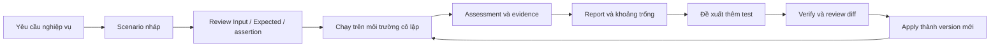

# Rà soát System Test và phạm vi cập nhật đề xuất

Ngày: 05/11/2026. Trạng thái: đề xuất để chủ dự án xem xét, chưa triển khai.

Đối tượng: chủ dự án và người triển khai CovAI. Mục tiêu: chuyển góp ý sau review thành phạm vi sửa có căn cứ, xác định vấn đề ngoài góp ý và phân biệt điều đã có với điều cần xây thêm.

## 1. Kết luận chính

Nên tiếp thu cả bốn hướng góp ý: cải thiện sinh testcase, giảm tải giao diện, làm report trực quan, và tách version của system test khỏi snapshot toàn dự án. Tuy nhiên, ưu tiên cao nhất hiện tại là **tính trung thực của kết quả**. Một số component đang đưa dữ liệu Todo mẫu vào màn hình kết quả thật và suy diễn mức coverage từ việc có verdict. Nếu chỉ làm đẹp, biểu đồ mới sẽ khuếch đại những kết luận sai này.

Đề xuất nâng cấp theo sáu nhóm:

1. Loại dữ liệu mẫu, thống nhất định danh assessment/run/version và sửa trạng thái.
2. Chuẩn hóa pipeline sinh testcase theo yêu cầu nghiệp vụ, ngữ cảnh và chế độ chạy.
3. Xây lịch sử version cho những thay đổi system test được Apply.
4. Thu gọn UI theo công việc, có chuyển động nhẹ và trạng thái đầy đủ.
5. Làm report tổng quan + biểu đồ + chi tiết bằng chứng từ cùng dữ liệu bất biến.
6. Bổ sung kiểm thử hồi quy cho tính đúng số liệu, version, UI và xuất report.

Không cần viết lại toàn bộ runner. Các phần isolation, kiểm tra hash, lease, assertion evidence và đo Istanbul hiện có là nền tảng nên giữ.

## 2. Phạm vi và mức độ kiểm chứng

Đã lần theo các luồng FE → API → controller → job/queue → service → Prisma → evidence → FE/report, cùng điểm giao với editor, quyền dự án, file mutation và snapshot. [Danh mục source và test](system-test-review-2026-11-05-inventory.md) lập chỉ mục 241 file, gồm 147 file source/schema/migration và 94 file test/fixture, tổng 37.501 dòng. Danh mục là bản đồ phạm vi, không có nghĩa 241 file đều được kiểm chứng động hoặc mọi dòng đã qua một cuộc audit độc lập.

Đọc sâu các điểm quyết định behavior: dashboard/workflow, generation/repair, readiness/review, measurement/verdict, improvement/apply, persistence, evidence, PDF, workspace mutation và snapshot restore. Với các helper phụ trợ, dùng import graph, điểm gọi và tìm kiếm source để xác định ảnh hưởng. Không lấy các bản `temp/system-assessment-baseline` hay tài liệu thiết kế làm bằng chứng rằng source hiện hành đã đúng.

Đã chạy 11 Jest suites tập trung, đạt **58/58 tests**: prompt budget, testcase quality, verified generation, cold-start generation, scenario catalog/verdict, PDF, proposal apply, improvement policy, workflow endpoints và coverage truthfulness. Các test đang có chưa bao phủ những lỗi UI nêu dưới đây.

Giới hạn: chưa chạy toàn stack với database/Redis/browser thật, chưa gọi Gemini để so sánh chất lượng prompt, chưa kiểm tra UI đang render trên trình duyệt và chưa render PDF thành ảnh để duyệt layout. Do đó, nhận định về logic dưới đây dựa trên source và test tập trung; đánh giá thẩm mỹ là định hướng đề xuất. Không khẳng định đã audit bảo mật toàn repo hay chứng minh không còn lỗi.

## 3. Bản đồ chức năng hiện hành

| Khối | Điểm vào và trách nhiệm |
|---|---|
| FE workspace | `Layout.jsx` mount `SystemTestDashboard.jsx`; quản lý framework, run, tab, job, summary, scenario và report |
| Thư viện scenario | `SystemTestWorkflow`, catalog, Flow/Input/Expected, confirm/review, chọn test; generator/editor cho sinh và sửa code |
| Kết quả và evidence | `SystemTestAssessmentPanel`, `SystemTestDimensionsTable`, `SystemTestScenarioLibrary`, execution detail, screenshot, gap navigator, comparison |
| Live | `SystemTestLiveRun`, Socket.IO, event replay, job polling, frame, checkpoint và Stop |
| API | `coverage.route.js`, `systemAssessment.route.js`, `coverage.controller.js`, `systemAssessment.controller.js`, validator và endpoint policy |
| Sinh test | `systemGenerationContext`, `systemTestPromptBudget`, `verifiedSystemGeneration`, `automaticSystemTests`, `systemTestBooster`, quality/static validators |
| Thực thi | runner, managed Playwright adapter, full-system setup/config/runtime/environment/resources/ports/lifecycle; runner cũ và assessment mới cùng tồn tại |
| Đánh giá | instrumentation/collector, assertion evidence, requirement/binding, verdict, quality score, mutation và improvement policy |
| Lưu và Apply | assessment persistence, proposal review/apply, project operation workspace, project mutation, editor reconciliation |
| Version toàn dự án | checkpoint/restore trong `project.service.js`; tạo snapshot mới từ workspace của snapshot được chọn |
| Report | HTML/JSON trong `SystemTestReportView`, PDFKit trong `systemTestPdf.service.js` |
| Data | `SystemRequirementRevision`, `SystemAssertionBinding`, `SystemScenario`, `SystemTestAssessment`, `SystemTestProposal`, `SystemRunEvent`, `SystemRunArtifact`, `TestRun`, `TestScenario`, `ProjectFileVersion`, `ProjectMutation` |

Luồng chuẩn cần giữ:

## 4. Phát hiện cần sửa ngoài góp ý

P0: sửa trước khi dùng màn hình/report làm bằng chứng review. P1: cần có trong đợt nâng cấp. P2: cải tiến tiếp sau.

### F01 — P0: coverage nghiệp vụ, route và API đang chứa dữ liệu mẫu

Nguồn: `client/src/components/dashboard/system/SystemTestDimensionsTable.jsx:34`, `:102`, `:123`, `:148`, `:166`.

- Requirement cố định sáu tính năng Todo; đánh dấu covered theo tag trong title hoặc vị trí verdict, không theo requirement/assertion binding đã xác minh.
- Journey dùng số scenario pass làm coverage; mẫu số rỗng được thay bằng 6. Pass rate của những test đã viết không đo mức đủ của toàn bộ user journey.
- Route chỉ có `/`, tự đánh dấu visited khi có verdict.
- API cố định bốn endpoint `/api/todos`; `Math.max(invokedSet.size, verdicts.length > 0 ? 4 : 0)` khiến có verdict là đủ 4/4 dù không có API evidence. Từng endpoint cũng có fallback tương tự.

Ví dụ theo logic source: một ứng dụng khác Todo có một verdict FAIL và không có API call vẫn có thể được hiển thị API coverage 100%. Đây là suy luận trực tiếp từ điều kiện code, chưa phải kết quả chạy UI thật.

Sửa: requirement lấy từ revision đã confirm + evidence binding; journey có danh mục hành trình được xác nhận; route/API chỉ tính với inventory có phạm vi và quan sát runtime. Nếu inventory không đầy đủ, ghi rõ “đã quan sát N endpoint”, không tính phần trăm toàn hệ thống. Phân biệt **đã gọi** với **đã assert đúng**.

### F02 — P0: scenario detail đang tạo bằng chứng Todo không thu từ runtime

Nguồn: `SystemTestScenarioLibrary.jsx:34–158`; component được dùng trong assessment panel.

Flow, input, expected, API response/duration, đường dẫn code và thay đổi DB được gán theo tag READ/CREATE/UPDATE/DELETE/TOGGLE/CANCEL. Ví dụ POST `/api/todos` 28ms, ID bản ghi và dòng controller là literal trong FE. Có verdict bất kỳ là đủ bật nhiều chi tiết mẫu. Đây không phải adapter đo runtime.

Sửa: lấy Flow/Input/Expected từ catalog đã lưu; actual/API từ run evidence; code path chỉ khi có tương quan đo được; DB chỉ khi có adapter test DB. Không có evidence thì hiện “Chưa thu thập”. Demo data chỉ được tồn tại trong fixture/demo có nhãn rõ ràng.

Cùng component đang match verdict bằng `title OR scenarioKey`, có thể ghép sai giữa hai file trùng title. WEAK/BLOCKED bị đưa về “NOT RUN”. Cần join bằng identity ổn định và giữ đủ trạng thái.

### F03 — P0: chạy test đang tự thay thế thao tác review Expected

Nguồn: `SystemTestDashboard.jsx:239–279`, `:336–377`; `SystemTestWorkflow.jsx:185–195`, `:316`, các nhãn Verified.

Run có nhánh tạo Expected `The asserted value is visible` khi thiếu, rồi gọi confirm-expected để vượt blocker. Nút Confirm All cũng có cơ chế tương tự. Workflow có lúc báo `ready: true` ngay khi có file runnable, trước readiness thực tế. EXPECTED_CONFIRMED lại được gọi Verified ở một số nhãn UI.

Sửa: Run kiểm tra readiness nhưng không tự xác nhận thay người dùng. Bulk review vẫn được phép khi người dùng đã nhìn thấy danh sách Expected thật và chủ động duyệt. Tách rõ: Nháp → Đã xác nhận kỳ vọng → Đã review assertion → Đã thực thi xác minh. Không ép mọi lần chạy khám phá phải review đầy đủ; có thể cho chạy thăm dò, nhưng kết quả phải mang nhãn chưa xác minh nghiệp vụ.

### F04 — P0: PDF và gap UI có kết luận vượt bằng chứng

Nguồn: `systemTestPdf.service.js:174–190`, `:285`; `SystemTestGapNavigator.jsx:68`, `:94`.

- PDF dùng không có flaky ở run đầu để in `100% Deterministic`; câu `All outcomes deterministic` luôn được ghi ở phần so sánh khi đủ hai run, kể cả outcome khác nhau.
- Failed tests được gọi `Defects Caught`; một test fail có thể do locator, fixture, timeout hoặc môi trường, chưa chắc là lỗi sản phẩm và cũng không tương đương số bug duy nhất.
- UI không có gap thì kết luận đạt 100% edge-case/source coverage; danh sách gap rỗng có thể do chưa đo, không có scope hỗ trợ hoặc chưa phân tích.
- Một đoạn mô tả dimension mặc định ghi `100% passed` thay vì lấy số liệu.

Sửa: dùng verdict/stability đã tính, ghi “Kết quả giống nhau trong 2 lần chạy” khi đúng; ghi chưa đủ dữ liệu khi thiếu run. Đổi KPI thành “Scenario thất bại”, phân loại nguyên nhân bằng bằng chứng. Không đồng nhất coverage cao với không còn lỗi.

### F05 — P1: UI, JSON và PDF có thể không cùng lần đánh giá

Nguồn: `SystemTestDashboard.jsx:58`, `:496`; `SystemTestAssessmentPanel.jsx:121`; `SystemTestReportView.jsx:23–82`; endpoint `latest` trong assessment controller.

- Dashboard cố định executionMode `frontend`, trong khi BE có Full Stack.
- Assessment panel trả report gần nhất dù runner/mode không khớp nhờ fallback `report || null`.
- HTML report dùng summary/testFiles của run đã chọn; PDF dùng active/latest assessment ID được quản lý riêng.
- API latest không lọc runner/mode; HTML ghi Repeat-run evidence “Not measured” cố định dù assessment có thể đã đo.
- PDF lỗi thì âm thầm mở Print; người dùng dễ hiểu bản in fallback là cùng report chính thức.

Sửa: report mở theo **assessmentId cụ thể**, cùng source/test/suite version, runner, mode và run IDs. HTML, JSON và PDF dùng chung report view model từ persisted assessment. Chọn latest completed đúng filter; vẫn cho xem failed/in-progress bằng lựa chọn rõ ràng. Giữ kết quả cũ khi run mới đang chạy, gắn nhãn lịch sử/stale. Frontend-only và Full Stack phải được chọn hoặc được giải thích rõ.

### F06 — P1: Live có thể báo hoàn tất sau run 1 trong assessment hai run

Nguồn: `SystemTestLiveRun.jsx:179–183`, `:221`, `:278`; `systemAssessmentJob.service.js` phát RUN_ENDED trong vòng lặp repeatRuns.

`events.find(RUN_ENDED)` khiến event kết thúc run đầu làm `isAllFinished = true`, hiển thị hoàn tất và vô hiệu Stop khi run 2 vẫn có thể đang chạy. Listener frame còn lọc snapshot mà không kiểm tra assessment ID tại FE.

Sửa: tách kết thúc một lượt khỏi kết thúc assessment/job; hiện lượt 1/2, 2/2. Stop theo job terminal state. Frame/event phải khớp assessment/run và bỏ dữ liệu cũ khi chuyển context; reload/reconnect phục hồi bằng cursor có sẵn. Không thêm Pause chỉ vì mockup có nút: pause an toàn ở ranh giới scenario cần hỗ trợ thật ở scheduler.

### F07 — P1: chưa có lịch sử restore của bộ system test

Nguồn: routes assessment, `SystemTestProposal` schema, `applySystemProposal`, `projectMutation.service.js:90–145`.

Đã có proposedContent, base/candidate hash và metadata Apply. `ProjectFileVersion` quản lý revision hiện tại để chống ghi đè. Journal có before bytes cho recovery nhưng xóa sau commit; không thể coi journal là lịch sử version lâu dài. Chưa có API/UI history/compare/restore riêng cho system suite. Proposal cũng chưa phải snapshot đầy đủ của nhiều test file/helper.

Sửa theo thiết kế mục 7. Không dùng restore snapshot toàn dự án để hoàn tác một lần Apply test.

### F08 — P1: tiêu chí “cải thiện” đang quá lệ thuộc code coverage

Nguồn: `systemImprovementPolicy.service.js:33–43`, `systemTestImprovementJob.service.js:77`; đối chiếu design contract 21/10.

Policy hiện yêu cầu baseline/candidate đều pass hai lần, không regression và phải tăng counter coverage. Test mới xác minh một requirement trước đó chưa được assert có thể bị loại do `NO_COVERAGE_GAIN`. Cùng source path có thể cần nhiều expected outcome; code đã được chạy không đồng nghĩa nghiệp vụ đã được kiểm chứng.

Nên phân biệt:

- Cải thiện code coverage: giữ điều kiện tăng measurement so sánh được.
- Bổ sung xác minh requirement: chấp nhận tăng criterion/assertion coverage đã review dù code delta = 0; thêm test không làm yếu baseline.
- Tái hiện lỗi: cho lưu draft/reproducer thất bại có bằng chứng, không xuất bản như suite pass hoặc tự đổi assertion để xanh.

Baseline đang fail thì không được quảng bá “improvement verified”, nhưng vẫn cần đường dẫn xem lỗi, tạo reproducer, phân loại lỗi app/test/infra. Không xóa test lỗi để mở khóa optimizer.

### F09 — P1: prompt đã có nhiều bảo vệ, nhưng ngữ cảnh và các nhánh chưa nhất quán

Nguồn: `systemGenerationContext`, `systemTestPromptBudget`, `verifiedSystemGeneration`, `systemTestBooster`, `SystemTestGeneratorModal`.

Điểm tốt: retained file đầy đủ, khai báo file bỏ qua, JSON schema ở một số nhánh, AST validation, rule độc lập dữ liệu, không làm yếu assertion, fresh DB và hai lượt verify ở verified generation. Không nên quảng bá “thêm JSON schema” hay “thêm verify” như thể chưa có.

Khoảng trống:

- Context đi từ scan theo file name/regex, ưu tiên page/route/controller; focus theo gap chỉ tìm import tương đối. Routes được truyền trong instruction chưa được dùng để ưu tiên source theo route một cách rõ ràng.
- Thu thập context không tự mang confirmed business brief/criteria vào prompt generation; phải nối hợp đồng requirement chủ động.
- Prompt booster dài với nhiều chỉ dẫn sửa icon, Todo/edit-form rất cụ thể; khó đánh giá rule nào hữu ích, dễ quá khớp một app mẫu.
- Cold-start frontend cho phép API mocking; Full Stack cấm mocking. Generator modal hiện gọi service mà không truyền executionMode, nhận mặc định frontend.
- Cold-start chủ yếu kiểm tra tĩnh trước khi lưu, khác mức verified generation. UI cần nói rõ generated draft và runtime verified.
- Ngân sách đang tính character và request; log đã nói không phải billed tokens. Nên lưu usage thật khi provider có, không suy token chính xác từ ký tự.

Sửa theo mục 6; đánh giá chất lượng bằng corpus nhiều dự án, không chỉ Todo.

### F10 — P1/P2: bằng chứng lịch sử và khả năng đọc report cần bền vững hơn

Nguồn: `SystemRunArtifact` schema; `persistRunArtifacts`; `scenarioEvidence` controller; PDF renderer; `systemAssessmentWorkspace` purge.

- Artifact persistence nhận runIndex nhưng schema không có runIndex/attempt/step, gây khó liên kết chính xác hai lượt chạy và checkpoint. Screenshot live/final có thể cần phân biệt khi chấm mức đầy đủ evidence.
- Endpoint evidence còn yêu cầu scenario tồn tại trong catalog hiện tại; sync có thể xóa scenario biến mất khỏi source, trong khi assessment lịch sử vẫn cần xem evidence của nó.
- PDF lấy số liệu run đầu, hiện tối đa 15 gap và 15 artifact, chưa có chart, chưa nhúng screenshot minh họa; cần ghi rõ số bị rút gọn và appendix/export đủ dữ liệu.
- Purge thư mục assessment sau 14 ngày chưa thay thế một retention contract cho mọi screenshot/trace: phải thống nhất file, DB manifest và trạng thái hết hạn.
- Managed Playwright đặt `slowMo:450` mặc định. Nên chỉ bật chậm cho chế độ quan sát; cần benchmark trước khi chọn mức, không tăng số worker khi DB chưa đảm bảo độc lập giữa test.

Nên có artifact manifest mang assessment/run/attempt/scenario/step, integrity + retention status; artifact hết hạn không làm report biến thành “chưa từng có evidence”. Kiểm tra lại việc che dữ liệu nhạy cảm trong screenshot/trace trước khi mở rộng chia sẻ report; metadata API đã có giới hạn nhưng binary evidence cần chính sách riêng.

## 5. Phản biện và làm rõ bốn góp ý

| Góp ý | Đồng ý | Điều cần điều chỉnh |
|---|---|---|
| Tối ưu prompt sinh testcase | Cần, đặc biệt context và oracle nghiệp vụ | Không đo bằng prompt ngắn hơn, nhiều case hơn hoặc pass rate cao hơn đơn thuần. Test phát hiện lỗi thật có thể fail đúng. Expected lấy từ source chỉ mô tả implementation, không tự chứng minh nghiệp vụ đúng |
| Ít chữ, đẹp, có hiệu ứng | Cần giảm nhãn lặp, đoạn giải thích và mật độ thông tin | Không bỏ Expected/Actual, phạm vi đo, lý do blocked/stale hay cảnh báo chưa có evidence. Đưa chi tiết xuống drawer/tab phụ. Motion phục vụ chuyển trạng thái và hỗ trợ reduced motion |
| Report đẹp, trực quan bằng biểu đồ | Rất hợp lý, giúp trả lời nhanh tình trạng chất lượng | Chart phải có nguồn, mẫu số, trạng thái đo. Pass rate, requirement coverage và source coverage là ba đại lượng riêng. Không đưa chúng vào một radar “chất lượng tổng thể” dễ gây hiểu nhầm |
| Version system Apply riêng; snapshot cả dự án/ba level | Hợp lý và nên thực hiện | Version riêng khôi phục test artifacts thuộc system, không sửa source ứng dụng hay unit/integration. Snapshot khôi phục mã nguồn/cấu hình/test của cả workspace; không phải time travel DB ứng dụng, cloud data hoặc tự phục hồi toàn bộ kết quả lịch sử vào snapshot mới |

Đặc biệt, hai lần pass chỉ cho biết tính lặp đã quan sát trong hai môi trường chạy đó, không đủ tuyên bố “ổn định 100%”.

## 6. Phạm vi tối ưu sinh testcase

### 6.1. Hợp đồng đầu vào và đầu ra

Đầu vào gồm: confirmed brief/criteria nếu có, actors/auth, scope, frontend/full mode, scenario/test baseline, runtime capability, source references và known gaps. Phần thiếu phải được ghi unknown; không tự bịa credentials, seed, endpoint hay expected business rule.

Tách thành các bước có thể kiểm tra:

1. Chọn hành vi/rủi ro cần kiểm thử và yêu cầu liên quan.
2. Lập scenario có preconditions, test data, actions, expected observable result và source references.
3. Sinh executable test đúng framework/mode/capability.
4. Kiểm tra schema/AST/safety/quality rồi verify runtime khi môi trường hỗ trợ.
5. Phân loại lỗi, chỉ repair khi có bằng chứng lỗi cơ chế test; giữ nguyên assertion khi nghi lỗi ứng dụng.
6. Người dùng review rồi Apply vào version mới.

Đây là các ranh giới xử lý, không bắt buộc sáu lần gọi AI; có thể gộp plan + code trong một response có cấu trúc để hạn chế latency/cost.

Đầu ra nên có scenario ID, requirement IDs, preconditions, inputs, steps, expected, assertions, file references, unsupported/unknown và code. Validate ngữ nghĩa sau JSON Schema; output đúng JSON chưa chắc đúng nghiệp vụ. Schema có thể triển khai trên nền structured output hiện có.

### 6.2. Context và chiến lược test

- Retrieve theo feature/route/criterion và dependencies; ưu tiên component tương tác, API contract, validation, data model, auth, existing helper thay vì toàn bộ repo theo thứ tự tên file.
- Ưu tiên role/label/testId; CSS dựa source/DOM chỉ là fallback có căn cứ. Không đoán icon class hoặc phụ thuộc nth toàn cục.
- Bao phủ happy path, negative, boundary, auth/permission, persistence, navigation và error state khi có yêu cầu/source hỗ trợ. Không ép mọi app đều CRUD.
- Giữ nguyên baseline, chỉ append theo gap ở improvement. Có diff rõ cho sửa test hiện có, luôn ghi lý do.
- Phân biệt dùng API để dựng dữ liệu Setup với hành vi chính được kiểm thử qua browser; không gọi đó là kiểm chứng hoàn toàn bằng UI.
- Frontend mock phải có fixture đúng contract và nhãn giới hạn; Full Stack dùng backend/DB thật cô lập. Không gộp hai loại evidence thành một kết luận.

### 6.3. Đánh giá prompt

Lưu promptVersion, model, contextHash, budget/usage, số repair, thời gian và kết quả. So sánh trước/sau trên corpus có Todo, auth, bảng CRUD, nhiều route, form validation và source cố ý có bug. Cần nhiều lần sinh để giảm ảnh hưởng ngẫu nhiên.

Theo dõi: parse/schema success, compile/static quality, tỷ lệ test chạy được, tỷ lệ assertion có ý nghĩa, requirement được xác minh, duplicate/weak cases, flaky quan sát được, lỗi đã cài có được bắt không, chi phí/latency. Đặt ngưỡng sau khi có baseline đo thật; không cam kết tăng một phần trăm tùy ý.

## 7. Version System Test và snapshot toàn dự án

### 7.1. Semantics đề xuất

| Hành động | Phạm vi | Kết quả |
|---|---|---|
| Xem version system | Bộ test system đã Apply trong cùng dòng lịch sử/snapshot tương thích | Xem file/scenario diff, metadata người Apply, requirement/source hash và assessment tương ứng |
| Kiểm tra version cũ | Chạy bản test được chọn trong workspace cô lập | Assessment mới, không thay đổi suite hiện hành; chỉ so sánh khi source/runtime/scope phù hợp |
| Khôi phục version system | Chỉ các file system-owned trong manifest | Tạo version mới từ nội dung cũ, giữ lịch sử; không lùi source app/unit/integration |
| Khôi phục snapshot | Workspace mã nguồn + cấu hình + tests của toàn dự án | Snapshot mới theo cơ chế hiện có; kết quả đo mới phải được tạo hoặc liên kết có kiểm tra identity |

“Kiểm tra version” nên hỗ trợ cả xem diff và chạy thử, vì chỉ nhìn code không trả lời bộ test cũ còn tương thích với source hiện tại hay không.

### 7.2. Dữ liệu cần có

Đề xuất suite revision bất biến: project/snapshot lineage, parent revision, action APPLY/RESTORE, actor/time/reason, source/config/requirement identity, proposal/assessment IDs và manifest file path/hash/content blob. Manifest lưu trạng thái đầy đủ của các file system-owned; storage có thể dùng content-addressed blob/delta để tránh copy toàn repo.

Phạm vi gồm spec và fixture/helper chỉ phục vụ system test, artifact thêm/xóa/đổi tên bởi Apply. File config/helper/package dùng chung với level khác phải được phát hiện trước; không âm thầm rollback file chung. Nếu version chỉ chứa một vài phần test trong file dùng chung, cần conflict review thay vì ghi đè nguyên file.

Bản baseline đầu tiên ghi nội dung trước lần Apply đầu. Draft chưa Apply không thành version chính thức. Chỉnh tay system file làm working tree “có thay đổi chưa ghi nhận”, phải diff/checkpoint hoặc resolve trước restore. Không hứa phục hồi những byte lịch sử chưa từng được lưu.

### 7.3. Quy trình restore

1. Chọn version, xem file diff/scenario diff và mức tương thích source.
2. Chạy thử tùy chọn trong disposable workspace; lỗi app thật không được “sửa” bằng cách nới assertion.
3. Khi thực hiện restore, kiểm tra quyền, active job, editor drafts, current suite/file/workspace hashes và exact manifest scope.
4. Áp dụng nguyên tử nhiều file với journal/recovery; retry không tạo duplicate version. Dùng hạ tầng mutation/operation hiện có nhưng bổ sung transaction cho cả suite.
5. Tạo revision mới có `restoredFromVersionId`; catalog/review/binding/assessment hiện hành được đánh dấu stale hoặc tái liên kết khi identity đúng. Report lịch sử bất biến.

Kiểm thử bắt buộc: hashes source ứng dụng/unit/integration trước và sau restore bằng nhau; handles create/delete/rename; conflict với edit tay; crash giữa file/DB; chạy song song; phân quyền; restore version có source khác; snapshot restore làm thay active lineage. Không cho restore từ project khác.

Khi migrate: backfill current baseline được; version cũ chỉ dựng lại khi có đủ content/evidence. Proposal hash một mình không tái tạo nội dung trước Apply.

## 8. Định hướng UI

Ba khu vực chính: **Kịch bản**, **Đang chạy**, **Kết quả**. Version là drawer/mục lịch sử từ toolbar; coverage/gaps nằm trong Kết quả. Phần cài đặt runner/mode/headed nâng cao đưa vào popover, vẫn có badge mode dễ thấy.

- Toolbar chỉ giữ một primary action theo trạng thái: tạo kịch bản khi chưa có test; review khi thiếu phê duyệt; chạy khi đủ điều kiện; xem kết quả khi xong.
- Scenario list hiển thị tên nghiệp vụ, nhãn trạng thái, requirement và thời gian gần nhất. Detail chia Input → Expected → Actual → Evidence; code ở tab phụ.
- Live: lượt 1/2 hoặc 2/2, bước hiện tại, elapsed time và Stop. Tiến độ không giả độ chính xác; tách chuẩn bị môi trường khỏi chạy scenario. Headed window chỉ hữu ích khi browser chạy trên máy người dùng/host phù hợp.
- Results ưu tiên fail/blocked/weak, có bộ lọc và mở screenshot/trace. Không gom hết vào đỏ hoặc xanh.
- Chuyển động ngắn khi mở panel, đổi tab, cập nhật tiến độ; giảm/bỏ chuyển động theo hệ điều hành. Không chạy nhiều shimmer/pulse khi đang đọc lỗi.
- Giảm đoạn mô tả lặp, badge phụ, ALL CAPS/monospace không cần thiết và gradient dày. Dùng khoảng trắng, hierarchy, typography và màu trạng thái nhất quán; kiểm tra light/dark, keyboard và mobile.

Chưa duyệt layout thị giác trong lượt audit này; nên chốt mockup với dữ liệu thật và đủ empty/loading/error/stale/unsupported trước khi implement.

## 9. Report đề xuất

### 9.1. Trang tổng quan trả lời bốn câu

1. Đang đánh giá bản source/test nào, bằng chế độ và môi trường nào?
2. Những scenario nào pass, fail, blocked; assertion nào còn yếu?
3. Requirement nào đã xác minh và phần nào chưa có test/evidence?
4. Nên xử lý gì tiếp theo, với bằng chứng nào?

Chọn assessment/version ở đầu. KPI có số tuyệt đối và mẫu số: scenario pass/đã chọn, requirement verified/confirmed, kết quả hai lượt lặp, thời gian chạy. Trạng thái chất lượng assertion là chiều riêng, không cộng đè vào execution counts.

### 9.2. Biểu đồ có giá trị

| Biểu đồ | Ý nghĩa | Điều kiện |
|---|---|---|
| Thanh stacked theo execution status | Phân bố pass/fail/skip/blocked/canceled; drill-down danh sách | Trạng thái loại trừ lẫn nhau; weak/assertion quality hiển thị riêng khi chồng lấn |
| Thanh requirement coverage | Designed / verified / còn thiếu | Có confirmed criteria và mapping; không có mẫu số thì N/A |
| Thanh ngang FE/BE | Line/branch/function/statement covered/total | Có measurement status; partial scope có nhãn |
| Ma trận scenario × run | Pass/fail theo lượt 1, lượt 2; thấy khác biệt ngay | Dùng stable identity, không chỉ title |
| Before/after theo version | Thay đổi coverage bằng điểm phần trăm và requirement newly verified | Cùng source/runtime/scope/denominator; khác thì ghi không so sánh được |
| Xu hướng lịch sử | Flaky quan sát, thời gian, coverage | Chỉ bổ sung khi đủ dữ liệu; chia nhóm khi identity thay đổi |

Mỗi chart có nhãn số và bảng thay thế; không dựa riêng vào màu. Không dùng donut cho mọi chỉ số hoặc thêm radar thiếu mẫu số chuẩn.

### 9.3. Chi tiết và xuất bản

PDF mở đầu bằng tổng quan dễ đọc, sau đó lỗi và hành động ưu tiên; appendix chứa scenario, Expected/Actual, run/step, source/spec reference, screenshot chọn lọc, trace/artifact references, hashes và giới hạn. Không nhồi toàn bộ code/log vào trang đầu.

HTML/JSON/PDF phải dùng cùng report contract và cùng assessment. Freeze dữ liệu lịch sử; version renderer/export có provenance. File PDF có metadata thời điểm chạy, thời điểm xuất và múi giờ. Link evidence phải kiểm tra quyền khi truy cập, không đưa token vào URL; phương án xuất offline cần đóng gói có kiểm soát và báo rõ phần đã loại/redact.

Duyệt PDF bằng render thật: tiếng Việt, tên test dài, error stack dài, bảng sang trang, empty/large suites, nhiều ảnh và artifact hết hạn. Test hiện tại chỉ kiểm tra `%PDF-`/kích thước không đủ bảo đảm nội dung hay layout.

## 10. Lựa chọn cách triển khai

| Phương án | Lợi ích | Hạn chế |
|---|---|---|
| A. Chỉnh chữ, CSS, prompt hiện có | Ít ảnh hưởng, nhanh có hình mới | Không xử lý dữ liệu mẫu, report lệch run và suite version; không đáp ứng đủ góp ý |
| B. Nâng cấp trên pipeline hiện có — đề xuất | Giữ isolation/hash/measurement; sửa semantics, version và report có thứ tự | Cần schema/API/UI/test liên quan, phải kiểm soát migration |
| C. Viết lại toàn bộ System Test | Có thể thống nhất kiến trúc từ đầu | Phạm vi lớn, nguy cơ mất bảo vệ đã có, chưa có căn cứ cần rewrite |

Khuyến nghị B, theo các đợt có thể review độc lập:

| Đợt | Nội dung | Tiêu chí hoàn thành |
|---|---|---|
| 1. Độ đúng | F01–F06, chung identity và status/report model | App không phải Todo không xuất hiện Todo; thiếu evidence không thành 100%; HTML/PDF/JSON cùng assessment; run 1 kết thúc không chặn Stop run 2 |
| 2. Generation | Context theo criterion, draft/verified modes, prompt version/eval, phân loại repair và improvement policy | Test bắt được lỗi đã cài; không bịa requirement/fixture; không nới assertion; chấp nhận requirement gain hợp lệ có code delta 0 |
| 3. Version | Baseline, apply revision, history/diff, kiểm tra bản cũ và restore suite | Restore chỉ đổi manifest system-owned; conflict/idempotency/crash recovery được kiểm thử; unit/integration/source giữ hash |
| 4. UI/report | UI gọn, biểu đồ thật, history selector, PDF có ảnh và appendix | Đọc được kết quả và bước xử lý từ tổng quan; đầy đủ states, accessibility/mobile/light/dark; PDF được render duyệt |
| 5. Hardening | Artifact run/attempt IDs, historical evidence, retention, perf benchmark | Xem được assessment cũ dù catalog đổi; evidence hết hạn có nhãn; đo được latency/cost và cải thiện dựa số liệu |

Các đợt có dependency nên không trang trí hoàn chỉnh trước khi chốt dữ liệu. Không cần đợi đợt 5 mới sửa các lỗi hiển thị P0.

## 11. Bộ kiểm thử cần bổ sung khi triển khai

- App ngoài Todo: auth/multi-route/catalog khác; không có literal Todo/endpoint mẫu trong production detail.
- Verdict tồn tại nhưng API evidence rỗng; inventory thiếu/partial; denominator = 0; requirement chưa confirm; toàn skip/blocked; code coverage partial.
- Confirm Expected không đồng nghĩa verified; Run không ghi Expected thay người dùng; bulk review có exact hash.
- Một run fail, run kia pass, thiếu một scenario, retry fail→pass; status không bị biến thành NOT RUN; quality score không trở thành xác suất đúng.
- Cùng title khác file/suite; map đúng verdict/artifact/run. Reload, đổi snapshot/framework/mode; async response cũ không ghi vào context mới.
- Job nhiều lượt, Stop trong lượt 2, cancel/setup failure, socket disconnect/replay và frame cũ.
- HTML/JSON/PDF cùng assessment/run/version; failed download hiển thị lỗi thay vì âm thầm thay report; PDF content assertions và visual pagination.
- Apply/restore nhiều file, CAS/hash conflict, shared helper, dirty editor, permission revoked, retry và crash recovery.
- Report và artifact lịch sử sau đổi/xóa scenario; retention state; redaction theo policy.
- Prompt benchmark nhiều loại app, có cố ý cài bug, không chỉ snapshot string của prompt.

Chạy test phù hợp thay đổi, client lint/build, targeted backend suites và E2E trên môi trường test cô lập. Prisma validate/generate sau schema; migration/cascade review trước khi áp dụng. Không chạy migration vào DB đang dùng chỉ để hoàn thành audit.

## 12. Các điểm cần chốt trước implementation

Đề xuất mặc định để tránh mở rộng không cần thiết:

1. “Version trong khuôn khổ system apply” = suite version tạo khi Apply/Restore; chỉnh tay là trạng thái working changes, chưa tự động lưu mọi phím gõ.
2. “Kiểm tra version” = xem diff và chạy bản đó trong workspace cô lập; không đổi suite hiện hành.
3. Snapshot = mã nguồn/cấu hình/tests toàn workspace, không rollback dữ liệu production hay viết lại lịch sử assessment.
4. Playwright là đường evidence đầy đủ trước; Cypress vẫn có runner riêng nhưng báo unsupported capability chính xác, chưa cam kết parity toàn bộ trong đợt này.
5. Report chính dùng hai lượt độc lập đang có; tăng số lượt là lựa chọn cho khảo sát flaky, không mặc định nhân chi phí.

Ngoài phạm vi: rewrite unit/integration, thay toàn bộ thiết kế dashboard dự án, visual regression testing cho mọi AUT, hỗ trợ mọi framework/browser/DB, tự sửa source app hoặc tự deploy. Mutation testing nâng cao dùng nền đã có, chưa mở rộng thành hạng mục bắt buộc của đợt nâng cấp.

## 13. Nguồn nghiên cứu và đối chiếu

- [Playwright Best Practices](https://playwright.dev/docs/best-practices): hành vi người dùng, isolation, locator và web-first assertions; làm căn cứ cho strategy generation/repair.
- [Playwright Locators](https://playwright.dev/docs/locators): ưu tiên locator gần cách người dùng nhận diện UI, tránh selector vị trí dễ vỡ.
- [Playwright Retries](https://playwright.dev/docs/test-retries): tách passed/flaky/failed; không xóa lần thất bại khi retry pass.
- [Gemini structured outputs](https://ai.google.dev/gemini-api/docs/structured-output): đầu ra theo JSON Schema. Việc kiểm chứng đúng nghiệp vụ vẫn là trách nhiệm pipeline CovAI.
- [W3C Complex Images](https://www.w3.org/WAI/tutorials/images/complex/): chart cần nội dung mô tả/bảng dữ liệu thay thế.
- [W3C Animation from Interactions](https://www.w3.org/WAI/WCAG21/Understanding/animation-from-interactions): motion tương tác không thiết yếu có thể tắt; dùng làm tiêu chí reduced motion, không khẳng định mọi animation đều vi phạm chuẩn.
- [Design contract System Test 21/10](superpowers/specs/2026-10-21-system-test-workflow-redesign-design.md): tài liệu đề xuất trong repo, hữu ích đối chiếu mục tiêu; source hiện hành có các lệch nêu ở F01–F10.

## 14. Kết quả của lượt review này

Chỉ thêm báo cáo và danh mục source; chưa thay đổi production code, schema hay dữ liệu. Chưa commit. Các đề xuất trên là phạm vi cần cập nhật để chủ dự án quyết định bước thiết kế/triển khai tiếp theo, không phải danh sách thay đổi đã hoàn thành.
