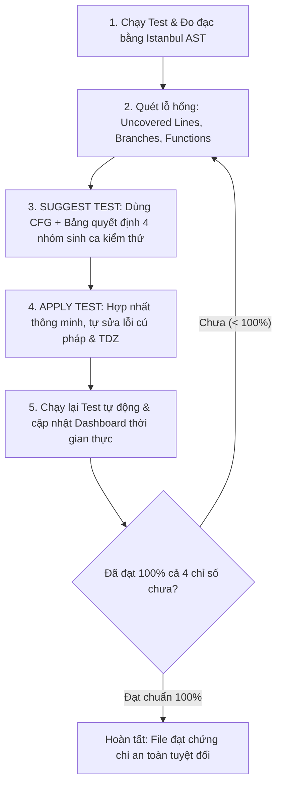
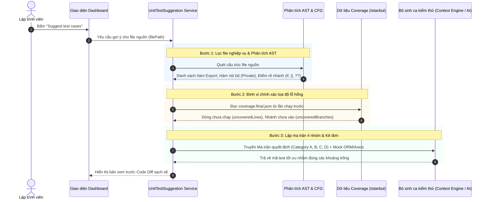
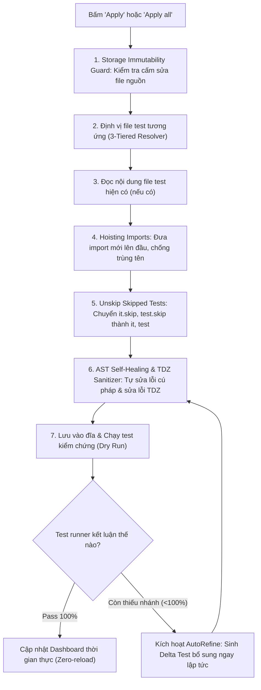

# TỔNG QUAN CƠ CHẾ SUGGEST & APPLY TEST CASE TRONG CovAI-
> **Tài liệu hướng dẫn thuyết trình, báo cáo nghiên cứu và giải thích kỹ thuật**  
> *Dành cho việc trình bày đồ án, giải thích cho giảng viên, hội đồng khoa học hoặc đồng nghiệp một cách trực quan, dễ hiểu nhất.*

---

## MỤC LỤC
1. [Bức tranh tổng quan (The Big Picture)](#1-bức-tranh-tổng-quan-the-big-picture)
2. [Ẩn dụ trực quan: "Bác sĩ chẩn đoán & Kíp mổ tự động"](#2-ẩn-dụ-trực-quan-bác-sĩ-chẩn-đoán--kíp-mổ-tự-động)
3. [Cơ chế SUGGEST TEST: Cách hệ thống "Bắt bệnh & Kê đơn"](#3-cơ-chế-suggest-test-cách-hệ-thống-bắt-bệnh--kê-đơn)
4. [Cơ chế APPLY TEST: Cách hệ thống "Phẫu thuật nội soi an toàn"](#4-cơ-chế-apply-test-cách-hệ-thống-phẫu-thuật-nội-soi-an-toàn)
5. [Các thuật toán cốt lõi (Giải thích dễ hiểu & Bản chất khoa học)](#5-các-thuật-toán-cốt-lõi-giải-thích-dễ-hiểu--bản-chất-khoa-học)
   - [5.1. Thuật toán đo 4 chỉ số Coverage: Statements, Branches, Functions, Lines (Istanbul AST Instrumentation)](#51-thuật-toán-đo-4-chỉ-số-coverage-statements-branches-functions-lines-istanbul-ast-instrumentation)
   - [5.2. Thuật toán Đồ thị Luồng điều khiển & McCabe Cyclomatic Complexity](#52-thuật-toán-đồ-thị-luồng-điều-khiển--mccabe-cyclomatic-complexity)
   - [5.3. Thuật toán Ma trận Bảng quyết định 4 nhóm (4-Category Decision Table Matrix)](#53-thuật-toán-ma-trận-bảng-quyết-định-4-nhóm-4-category-decision-table-matrix)
   - [5.4. Thuật toán Duyệt ngược Đồ thị Gọi hàm (Call Graph Backtracking)](#54-thuật-toán-duyệt-ngược-đồ-thị-gọi-hàm-call-graph-backtracking)
   - [5.5. Thuật toán Tự chữa lành lỗi cú pháp & Vùng chết thời gian (TDZ Healing)](#55-thuật-toán-tự-chữa-lành-lỗi-cú-pháp--vùng-chết-thời-gian-tdz-healing)
   - [5.6. Thuật toán Vòng lặp Bất biến 100% (Continuous 100% Invariant Loop)](#56-thuật-toán-vòng-lặp-bất-biến-100-continuous-100-invariant-loop)
6. [Kịch bản 3 phút giúp bạn thuyết trình tự tin cho người khác nghe](#6-kịch-bản-3-phút-giúp-bạn-thuyết-trình-tự-tin-cho-người-khác-nghe)
7. [Bộ 5 câu hỏi thường gặp khi bảo vệ đề tài (FAQs & Defending Guide)](#7-bộ-5-câu-hỏi-thường-gặp-khi-bảo-vệ-đề-tài-faqs--defending-guide)
8. [Bảng tra cứu nhanh thuật ngữ (Glossary & Cheat Sheet)](#8-bảng-tra-cứu-nhanh-thuật-ngữ-glossary--cheat-sheet)

---

## 1. BỨC TRANH TỔNG QUAN (THE BIG PICTURE)

### 1.1. Nỗi đau thực tế của ngành phần mềm
Trong phát triển phần mềm hiện đại:
- **Viết code tính năng** luôn được ưu tiên, trong khi **viết Unit Test** tốn từ $30\% - 50\%$ thời gian nhưng thường bị lập trình viên trì hoãn hoặc viết qua loa.
- Hậu quả là **Code Coverage** (độ bao phủ kiểm thử) thường rất thấp, đặc biệt là các nhánh rẽ điều kiện (`if-else`, toán tử `||`, `??`), các trường hợp ngoại lệ (lỗi mạng, dữ liệu rỗng, database chết), dẫn đến lỗi lọt vào môi trường Production.
- Các công cụ AI thông thường (ChatGPT, Copilot) nếu chỉ "sinh code chung chung" thì thường gặp 3 lỗi chí mạng:
  1. **Sinh ảo (Hallucination):** Import sai hàm nội bộ, giả định sai hàm thư viện.
  2. **Ghi đè phá hủy:** Khi thêm test mới thì vô tình xóa mất test cũ của lập trình viên.
  3. **Không đo lường được:** Sinh xong không biết đã cover được dòng nào, nhánh nào còn thiếu.

### 1.2. Giải pháp của CovAI-
CovAI- xây dựng một **vòng tuần hoàn khép kín tự động (Closed Autonomous Loop)**:
$$\text{Đo lường (Measure)} \longrightarrow \text{Định vị lỗ hổng (Detect Gaps)} \longrightarrow \text{Gợi ý chính xác (Suggest)} \longrightarrow \text{Áp dụng an toàn (Apply)} \longrightarrow \text{Đo lường lại (Re-measure)}$$
Vòng tuần hoàn này chỉ dừng lại khi mã nguồn đạt **100% độ bao phủ trên cả 4 thước đo: Statements, Branches, Functions, Lines**.



---

## 2. ẨN DỤ TRỰC QUAN: "BÁC SĨ CHẨN ĐOÁN & KÍP MỔ TỰ ĐỘNG"

> **Cách giải thích cho người nghe dễ hình dung nhất:**  
> Hãy tưởng tượng mã nguồn của bạn là một **cơ thể bệnh nhân**:

| Thành phần trong CovAI- | Hình tượng đời thực tương đương | Nhiệm vụ thực hiện |
| :--- | :--- | :--- |
| **Istanbul AST Instrumentation** | **Máy chụp MRI / CT toàn thân** | Quét xuyên qua từng dòng code, đánh dấu chính xác dòng nào đã chạy (mô khỏe) và nhánh nào chưa từng chạm tới (khối u / vùng tối). |
| **SUGGEST TEST (Gợi ý)** | **Bác sĩ hội chẩn & Kê đơn thuốc** | Đọc phim chụp MRI, không kê đơn bừa bãi mà lập ra phác đồ (4 nhóm: Ca chuẩn, Ca biên, Ca đảo nhánh, Ca xử lý sốc phản vệ) nhắm thẳng vào đúng ổ bệnh. |
| **APPLY TEST (Áp dụng)** | **Kíp mổ nội soi vi phẫu** | Rạch vết mổ cực nhỏ để đưa code test mới vào, **tuyệt đối không đụng vào cơ quan nội tạng (Mã nguồn dự án - Storage Immutability)**, khâu lại vết mổ gọn gàng, tự làm lành vết rách cú pháp (AST Healing). |
| **Continuous Invariant Loop** | **Máy theo dõi sinh hiệu liên tục** | Đo nhịp tim, huyết áp sau mổ. Nếu chỉ số nào chưa đạt chuẩn $100\%$, tự động đưa ra liều bổ sung (Delta Test) cho tới khi bệnh nhân khỏe hoàn toàn. |

---

## 3. CƠ CHẾ SUGGEST TEST: CÁCH HỆ THỐNG "BẮT BỆNH & KÊ ĐƠN"

Khi người dùng bấm nút **"Suggest test cases"** trên Dashboard, chuỗi sự kiện sau diễn ra trong vòng vài trăm mili-giây:



### Các bước cụ thể:
1. **Lọc file nghiệp vụ (Business Logic Guard):**
   - Chỉ gợi ý cho các file chứa logic thực tế: `services`, `controllers`, `utils`, `helpers`, `models`, `middlewares`.
   - Tự động bỏ qua các file cấu hình, giao diện tĩnh (`.jsx`, `.tsx`), file route trung gian để tránh lãng phí tài nguyên.
2. **Bóc tách AST bằng Babel Parser:**
   - Đọc cây cú pháp để biết file xuất ra (export) những hàm/lớp nào.
   - Nhận diện các hàm ẩn (unexported private helpers) để chuẩn bị chiến lược kích hoạt gián tiếp.
3. **Đối chiếu bản đồ Coverage Istanbul:**
   - Lấy danh sách chính xác: dòng số mấy chưa chạy? Nhánh số mấy (`true` hay `false`) chưa bao giờ được rẽ vào? Hàm nào chưa bao giờ được gọi?
4. **Lập ma trận quyết định 4 nhóm (4-Category Decision Table):**
   - Không sinh test vu vơ. Hệ thống bắt buộc sinh ra 4 nhóm kiểm thử có kỷ luật công nghệ phần mềm:
     - **Nhóm A (Happy Path):** Dữ liệu hợp lệ chuẩn.
     - **Nhóm B (Boundary Values):** Biên số $0, -1$, chuỗi rỗng `""`, mảng rỗng `[]`, object rỗng `{}`.
     - **Nhóm C (Branch Toggling):** Lật ngược nhánh logic (`true` vs `false/null/undefined`).
     - **Nhóm D (Error Handling):** Giả lập ngoại lệ, lỗi database, promise reject để kích hoạt block `catch` và `throw`.

---

## 4. CƠ CHẾ APPLY TEST: CÁCH HỆ THỐNG "PHẪU THUẬT NỘI SOI AN TOÀN"

Nhiều công cụ AI hiện nay gặp lỗi: khi người dùng bấm "Apply", nó đè nguyên file mới vào làm mất sạch các test cũ, hoặc sinh sai cú pháp làm gãy toàn bộ test runner. **CovAI- giải quyết triệt để vấn đề này qua quy trình 7 bước an toàn tuyệt đối:**



### Các chốt chặn an toàn trong Apply:
1. **Bảo vệ mã nguồn bất biến (Strict Storage Guard):**
   - Hệ thống **tuyệt đối không bao giờ ghi đè vào file code nguồn nghiệp vụ trong `storage/`**. Mọi sự gia tăng độ phủ phải đến từ việc viết test case chuẩn mực, không được "ăn gian" bằng cách sửa code nguồn.
2. **Kỹ thuật kéo Import lên đầu (Import Hoisting):**
   - Các gói thư viện mới (`import` hoặc `require`) được tự động nhấc lên đầu file test, kiểm tra xem biến đó đã được khai báo trước đó chưa để tránh lỗi cú pháp `Identifier 'x' has already been declared`.
3. **Chống trùng tên khối Test (Describe Title De-collision):**
   - Nếu bạn đã có khối `describe('Calculator')`, test mới sinh ra sẽ tự động đổi tên thành `describe('Calculator - Additional Coverage')` để kiểm thử song song, **bảo toàn $100\%$ các test case sẵn có của bạn**.
4. **Đánh thức các bài test bị bỏ quên (Unskip Engine):**
   - Tự động tìm các câu lệnh `it.skip()`, `test.skip()`, `xit()`, `xtest()` mà lập trình viên từng "tạm tắt" trong quá khứ và kích hoạt lại chúng để phục hồi độ phủ.
5. **Bộ tự sửa lỗi cú pháp AST (AST Syntax Self-Healing):**
   - Tự động phát hiện và vá lỗi: lệch dấu nháy đơn `'` với backtick `` ` ``, chuỗi nhiều dòng chưa đóng, object literal thiếu dấu ngoặc nhọn `}`.
6. **Tự sửa lỗi Vùng chết thời gian (TDZ ReferenceError Healing):**
   - Nếu gặp lỗi kinh điển của JavaScript: `ReferenceError: Cannot access 'X' before initialization` (do lệnh gán lỗi như `const path = path;`), hệ thống tự động bóc tách và chuyển thành `const path = require('path');` chuẩn CommonJS/ESM.
7. **Đồng bộ giao diện thời gian thực (Zero-reload Synchronization):**
   - Ngay khi test chạy xong, hệ thống hủy bộ nhớ cache (`invalidateCoverageQueries`) và phát tín hiệu cho Dashboard cập nhật ngay lập tức các con số % và các dòng xanh/đỏ mà không cần người dùng F5 tải lại trang.

---

## 5. CÁC THUẬT TOÁN CỐT LÕI (GIẢI THÍCH DỄ HIỂU & BẢN CHẤT KHOA HỌC)

Khi giải thích cho người khác nghe, đây là phần đắt giá nhất chứng minh hàm lượng công nghệ (Technical Depth) của đề tài.

### 5.1. Thuật toán đo 4 chỉ số Coverage: Statements, Branches, Functions, Lines (Istanbul AST Instrumentation)
*Làm sao máy tính biết được một dòng code đã chạy hay chưa mà không làm chậm hệ thống?*

- **Nguyên lý:** Sử dụng kỹ thuật **AST Code Rewriting (Chèn mã trước khi chạy)**. Trước khi file test thực thi, Istanbul duyệt cây AST và chèn các "cảm biến tí hon" (counters) vào bộ nhớ RAM:
  
  ```javascript
  // 1. Mã nguồn gốc của bạn:
  function isAdult(age) {
      if (age >= 18) {
          return true;
      }
      return false;
  }

  // 2. Mã nguồn sau khi được chèn cảm biến (Instrumented Code trong RAM):
  function isAdult(age) {
      cov().f[0]++; // Cảm biến Function 0 kích hoạt!
      cov().s[0]++; // Cảm biến Statement 0 kích hoạt!
      
      // Cảm biến Branch 0 chia làm 2 nhánh [True, False]:
      if (cov().b[0][0]++, age >= 18) {
          cov().s[1]++; // Cảm biến Statement 1 kích hoạt!
          return true;
      } else {
          cov().b[0][1]++; // Nhánh False kích hoạt (kể cả code gốc không có else)!
      }
      cov().s[2]++; // Cảm biến Statement 2 kích hoạt!
      return false;
  }
  ```

#### Bảng công thức tính toán 4 chỉ số:
| Chỉ số | Tên tiếng Anh | Công thức toán học | Bản chất đo lường dễ hiểu |
| :--- | :--- | :--- | :--- |
| **Câu lệnh** | Statements Coverage ($C_{stmt}$) | $$C_{stmt} = \frac{\text{Số câu lệnh đã chạy ít nhất 1 lần}}{\text{Tổng số câu lệnh}} \times 100\%$$ | Từng hành động độc lập (gán biến, return, throw) có được chạy qua không? |
| **Nhánh rẽ** | Branches Coverage ($C_{branch}$) | $$C_{branch} = \frac{\text{Số ngả rẽ đã đi qua}}{\text{Tổng số ngả rẽ nhị phân}} \times 100\%$$ | Tại mỗi ngã ba đường (`if`, `?:`, `\|\|`), xe có đi qua cả 2 hướng (đúng & sai) không? |
| **Hàm** | Functions Coverage ($C_{func}$) | $$C_{func} = \frac{\text{Số hàm được gọi}}{\text{Tổng số hàm khai báo}} \times 100\%$$ | Từng hàm, từng method trong class có từng được gọi đến không? |
| **Dòng mã** | Lines Coverage ($C_{line}$) | $$C_{line} = \frac{\text{Số dòng có ít nhất 1 statement chạy}}{\text{Tổng số dòng mã khả thi}} \times 100\%$$ | Bản đồ tọa độ dòng: Dòng nào trên màn hình hiển thị màu xanh, dòng nào màu đỏ? |

---

### 5.2. Thuật toán Đồ thị Luồng điều khiển & McCabe Cyclomatic Complexity
*Làm sao biết cần viết bao nhiêu bài test là đủ cho một hàm?*

- CovAI- dựng một **Đồ thị Luồng điều khiển (Control Flow Graph - CFG)** cho từng hàm:
  - **Node ($N$):** Các khối lệnh tuần tự.
  - **Edge ($E$):** Các đường đi chuyển tiếp giữa các lệnh.
- Sử dụng định lý toán học nổi tiếng của **Thomas J. McCabe**:
  $$M = E - N + 2P$$
  *(Với $P=1$ là số thành phần liên thông của một hàm).*

> **Ý nghĩa thực tế:** Số $M$ chính là **số lượng ca kiểm thử độc lập tối thiểu bắt buộc phải có** để đi qua hết tất cả các ngóc ngách của hàm đó.  
> *Ví dụ:* Một hàm có 3 câu lệnh `if` lồng nhau thì $M = 4$. CovAI- sẽ biết chắc chắn rằng nếu sinh dưới 4 test case thì không thể nào đạt $100\%$ coverage!

---

### 5.3. Thuật toán Ma trận Bảng quyết định 4 nhóm (4-Category Decision Table Matrix)
Để không bị sót trường hợp, CovAI- phân loại kiểm thử thành ma trận 4 chiều:

```
                  ┌───────────────────────────────────────────────┐
                  │    MA TRẬN QUYẾT ĐỊNH 4 NHÓM CỦA CovAI-       │
                  └───────────────────────┬───────────────────────┘
                                          │
         ┌──────────────────┬─────────────┴─────────────┬──────────────────┐
         ▼                  ▼                           ▼                  ▼
   [CATEGORY A]       [CATEGORY B]                [CATEGORY C]       [CATEGORY D]
    Happy Path       Boundary Values             Branch Toggling    Error Handling
  (Dữ liệu chuẩn)    (Giá trị cực biên)         (Lật nhánh logic)  (Xử lý sự cố/Lỗi)
   • Chuỗi hợp lệ     • Số 0, -1, Max Int         • if (true/false)  • throw new Error
   • ID tồn tại       • Chuỗi rỗng ""             • a || fallback    • DB Timeout / 500
   • Object đầy đủ    • Mảng rỗng []              • obj?.prop ?? def • Promise.reject
```

1. **Category A (Đường thuận):** Kiểm tra chức năng hoạt động đúng khi người dùng nhập dữ liệu chuẩn chỉnh.
2. **Category B (Giá trị biên):** Kiểm tra khả năng chịu tải với các giá trị mép: $0$, $-1$, `Number.MAX_SAFE_INTEGER`, mảng rỗng `[]`, chuỗi rỗng `""`.
3. **Category C (Lật nhánh logic):** Ép các biểu thức logic rẽ sang nhánh còn lại. Ví dụ `const name = req.body.name || 'Anonymous'`, test 1 truyền tên để vào nhánh chính, test 2 bỏ trống tên để ép vào nhánh `'Anonymous'`.
4. **Category D (Bắt lỗi ngoại lệ):** Cố tình truyền tham số sai hoặc giả lập database bị sập để kiểm tra xem hệ thống có bắt được lỗi (block `catch`) hay bị crash server.

---

### 5.4. Thuật toán Duyệt ngược Đồ thị Gọi hàm (Call Graph Backtracking)
*Làm sao kiểm thử được một hàm Helper nội bộ bị giấu kín (không `export`)?*

- **Vấn đề:** Nếu AI viết `import { helperKhongExport } from './service'`, chương trình sẽ báo lỗi ngay lập tức: `TypeError: helperKhongExport is not a function`.
- **Giải pháp của CovAI-:** Thuật toán **Call Graph Backtracking**:
  1. Quét AST xem hàm nội bộ này được gọi bởi hàm public nào ở bên ngoài:
     $$\text{PublicCaller} \longrightarrow \text{InternalHelper}$$
  2. Tính toán điều kiện đầu vào của `PublicCaller` để dòng điều khiển chảy vào đúng hàm `InternalHelper`.
  3. Kích hoạt toàn bộ logic của hàm nội bộ **một cách gián tiếp và hợp lệ tuyệt đối** từ bên ngoài.

---

### 5.5. Thuật toán Tự chữa lành lỗi cú pháp & Vùng chết thời gian (TDZ Healing)
Trong JavaScript, một biến khai báo bằng `const` hoặc `let` không thể được truy cập trước khi được khởi tạo giá trị. Hiện tượng này gọi là **Temporal Dead Zone (TDZ)**.
- Khi AI sinh code, đôi khi gặp lỗi tự gán: `const path = path;` hoặc `const fs = fs;`.
- Khi Jest/Vitest chạy file này, nó sẽ ném ra lỗi chết người:
  ```
  ReferenceError: Cannot access 'path' before initialization
  ```
- **CovAI- giải quyết tự động:**
  Hệ thống trang bị bộ lọc AST Sanitizer. Khi bắt được tín hiệu `ReferenceError` này, nó tự động phân tích identifier: nếu nhận diện đây là module chuẩn của Node.js (`path`, `fs`, `crypto`, `http`, `os`), nó tự động sửa code thành:
  ```javascript
  // Tự động chữa lành thành:
  const path = require('path');
  ```
  Nhờ đó, toàn bộ quy trình chạy test diễn ra mượt mà, không bao giờ bị dừng giữa chừng.

---

### 5.6. Thuật toán Vòng lặp Bất biến 100% (Continuous 100% Invariant Loop)
Định nghĩa toán học về sự bao phủ toàn diện của CovAI-:

$$\text{Hoàn thành 100%} \iff \begin{cases} 
C_{stmt} = 100\% & \text{và không còn câu lệnh nào chưa chạy} \\
C_{branch} = 100\% & \text{và không còn nhánh rẽ nào bị bỏ sót} \\
C_{func} = 100\% & \text{và mọi hàm/phương thức đều được gọi} \\
C_{line} = 100\% & \text{và 0 dòng lỗi, 0 dòng đỏ} 
\end{cases}$$

Nếu kết quả chạy test cho thấy Statements đạt $100\%$, Lines đạt $100\%$ nhưng Branches mới đạt $87.5\%$ (còn thiếu 1 nhánh fallback `|| []`), hệ thống **không dừng lại** mà tự động tạo ngay một lượt gợi ý tăng cường (**Targeted Delta Test**) nhắm trúng nhánh còn thiếu đó cho đến khi tất cả các con số đều chạm mốc $100\%$.

---

## 6. KỊCH BẢN 3 PHÚT GIÚP BẠN THUYẾT TRÌNH TỰ TIN CHO NGƯỜI KHÁC NGHE

> **Bạn có thể đọc hoặc trình bày nguyên văn phần này khi đứng trước giảng viên hoặc hội đồng:**

### Phút 1: Đặt vấn đề & Khái quát ý tưởng (The Hook)
> *"Kính thưa quý thầy cô / các bạn, trong phát triển phần mềm, viết unit test là công việc vô cùng quan trọng nhưng lại tốn nhiều thời gian và dễ bị bỏ sót. Nếu dùng các công cụ AI thông thường như ChatGPT hay Copilot, chúng chỉ sinh code một cách ước chừng và không đo lường được kết quả, thậm chí còn ghi đè làm mất test cũ của lập trình viên.*  
> *Đó là lý do chúng em phát triển **CovAI-**: một giải pháp tự động hóa toàn diện từ khâu **Gợi ý (Suggest)** đến **Áp dụng (Apply)** test case theo một chu trình khép kín, hướng tới mục tiêu tối thượng: **Đạt 100% độ bao phủ trên cả 4 chỉ số Statements, Branches, Functions và Lines**."*

### Phút 2: Trình bày cơ chế hoạt động (The Core Mechanism)
> *"Cơ chế của CovAI- gồm hai trụ cột chính:*  
> *Thứ nhất là **Suggest Test**: Hệ thống không sinh test ngẫu nhiên. Chúng em sử dụng **Babel AST** để phân tích cú pháp mã nguồn và đối chiếu với bản đồ coverage động của **Istanbul**. Nhờ đó, hệ thống định vị chính xác tới từng số dòng, từng nhánh rẽ còn thiếu và áp dụng **Ma trận quyết định 4 nhóm** (Happy Path, Boundary, Branch Toggling và Error Handling) để sinh đúng các ca kiểm thử còn khuyết.*  
> *Thứ hai là **Apply Test**: Đây là khâu đột phá của CovAI-. Chúng em áp dụng nguyên tắc **Storage Immutability** – bảo vệ tuyệt đối không can thiệp vào mã nguồn dự án; đồng thời áp dụng kỹ thuật **Smart Merge & AST Hoisting** để ghép test mới vào file test cũ mà không gây trùng lặp tên hay xóa mất code cũ của lập trình viên. Đặc biệt, hệ thống có cơ chế **AST Self-Healing** tự sửa lỗi cú pháp và lỗi vùng chết thời gian TDZ nếu có."*

### Phút 3: Kết luận & Giá trị học thuật (The Value & Impact)
> *"Sau khi test được áp dụng vào ổ đĩa, hệ thống sẽ tự động kích hoạt runner chạy kiểm chứng và phản hồi kết quả lên Dashboard thời gian thực mà không cần reload trang. Nếu phát hiện chỉ số nào chưa đạt 100%, hệ thống sẽ tự động kích hoạt vòng lặp gợi ý bổ sung cho đến khi phủ kín hoàn toàn.*  
> *Nhờ sự kết hợp giữa lý thuyết đồ thị luồng điều khiển CFG, độ phức tạp McCabe và công nghệ chèn mã AST động, CovAI- biến việc viết unit test từ một gánh nặng thủ công trở thành một quy trình tự động hóa đáng tin cậy, chính xác và có cơ sở khoa học vững chắc."*

---

## 7. BỘ 5 CÂU HỎI THƯỜNG GẶP KHI BẢO VỆ ĐỀ TÀI (FAQS & DEFENDING GUIDE)

Dưới đây là 5 câu hỏi "hóc búa" mà giảng viên hoặc người phản biện thường hỏi nhất, kèm theo câu trả lời mẫu chuẩn xác:

### Câu hỏi 1: "Tại sao phải phân tích AST và Istanbul mà không gửi thẳng code cho AI sinh test?"
- **Trả lời:**  
  Nếu gửi thẳng code cho AI mà không có AST và Istanbul, AI sẽ bị "mù thông tin ngữ cảnh" (Context Blindness). Nó không thể biết nhánh nào đã chạy, nhánh nào chưa, dẫn đến việc sinh trùng lặp các test case đã có hoặc sinh thiếu các nhánh ẩn. Nhờ có Istanbul, hệ thống cung cấp tọa độ chính xác (ví dụ: *Dòng 42, nhánh False của biểu thức `customer.isVip` chưa chạy*), giúp AI tập trung sinh đúng ca kiểm thử lấp vào chỗ trống đó.

### Câu hỏi 2: "Nếu AI sinh code bị lỗi cú pháp thì khi bấm Apply có làm hỏng file test cũ của dự án không?"
- **Trả lời:**  
  Dạ không thể hỏng được. CovAI- có 3 lớp bảo vệ:
  1. **Smart Merge:** Giữ nguyên toàn bộ các block `describe` và `test` cũ của người dùng.
  2. **AST Syntax Healing:** Quét và cân bằng lại các dấu ngoặc `{}` bị thiếu, sửa dấu nháy đơn/kép bị lỗi.
  3. **Dry-run Runner:** Hệ thống chạy thử nghiệm ngay trong môi trường sandbox. Nếu file test bị lỗi cú pháp, nó sẽ tự động kích hoạt pipeline phục hồi và báo cáo chẩn đoán chứ không làm mất mát dữ liệu của dự án.

### Câu hỏi 3: "Hệ thống có tự ý sửa code nguồn của dự án để ép test chạy qua (Pass) không?"
- **Trả lời:**  
  Dạ tuyệt đối không. Đây là nguyên tắc cốt lõi mang tên **Strict Storage Immutability Guard** của chúng em. Toàn bộ mã nguồn nghiệp vụ trong thư mục dự án là bất biến (Read-only). Độ phủ $100\%$ phải đạt được hoàn toàn bằng sự chuẩn mực và độ bao quát của các ca unit test, không được phép can thiệp vào code gốc để gian lận độ phủ.

### Câu hỏi 4: "Làm thế nào để kiểm thử các hàm Helper nội bộ không được export ra ngoài?"
- **Trả lời:**  
  Chúng em sử dụng thuật toán **Call Graph Backtracking (Duyệt ngược đồ thị gọi hàm)**. Thay vì cố gắng import trực tiếp (gây lỗi runtime), hệ thống tìm ra hàm public bên ngoài có gọi đến hàm helper này, sau đó tính toán bộ tham số đầu vào đặc biệt để luồng điều khiển đi xuyên qua hàm public và kích hoạt trọn vẹn các nhánh bên trong hàm helper nội bộ.

### Câu hỏi 5: "Làm sao hệ thống khẳng định một file đã đạt 100% thực sự chứ không phải con số ảo?"
- **Trả lời:**  
  Hệ thống áp dụng **Quy tắc Bất biến 100% trên cả 4 trục đo lường đồng thời**:
  $Statements \ge 100\%$, $Branches \ge 100\%$, $Functions \ge 100\%$, $Lines \ge 100\%$, đồng thời mảng các dòng chưa cover (`uncoveredLines`) và nhánh chưa cover (`uncoveredBranches`) phải bằng $0$. Chỉ cần 1 trong 4 chỉ số $< 100\%$, hệ thống vẫn đánh giá là chưa đạt và tiếp tục kích hoạt chu trình gợi ý bổ sung.

---

## 8. BẢNG TRA CỨU NHANH THUẬT NGỮ (GLOSSARY & CHEAT SHEET)

| Thuật ngữ | Viết tắt | Ý nghĩa kỹ thuật | Cách giải thích đơn giản |
| :--- | :--- | :--- | :--- |
| **Abstract Syntax Tree** | **AST** | Cây cú pháp trừu tượng thể hiện cấu trúc mã nguồn dưới dạng cây đối tượng. | Giống như sơ đồ phân tích ngữ pháp câu: chủ ngữ, vị ngữ, mệnh đề phụ. |
| **Control Flow Graph** | **CFG** | Đồ thị luồng điều khiển thể hiện tất cả các con đường mà chương trình có thể đi qua. | Bản đồ giao thông các ngã ba, ngã tư trong code. |
| **Cyclomatic Complexity** | **$M$** | Độ phức tạp chu trình của McCabe: $M = E - N + 2P$. | Số lượng bài test tối thiểu cần viết để đi hết bản đồ code. |
| **Dynamic Instrumentation** | - | Kỹ thuật chèn các biến đếm vào mã nguồn trước khi thực thi trong RAM. | Đặt camera giám sát ở từng góc cua để đếm lượt xe chạy qua. |
| **Temporal Dead Zone** | **TDZ** | Vùng chết thời gian trong JS khi biến `let`/`const` được khai báo nhưng chưa gán giá trị. | Gọi tên một người trước khi người đó bước vào phòng họp. |
| **Hoisting** | - | Cơ chế đưa các khai báo lên đầu phạm vi (scope) trong JavaScript. | Gom tất cả đồ nghề, nguyên liệu đặt lên mặt bàn trước khi bắt tay vào nấu ăn. |
| **Strict Invariant** | - | Điều kiện bất biến bắt buộc phải luôn luôn đúng trong toàn bộ vòng đời hệ thống. | Quy chuẩn an toàn hàng không: 100% đèn báo xanh thì máy bay mới được cất cánh. |

---
*Tài liệu được biên soạn phục vụ công tác nghiên cứu khoa học, thuyết minh và bảo vệ giải pháp công nghệ trong hệ thống CovAI-.*
