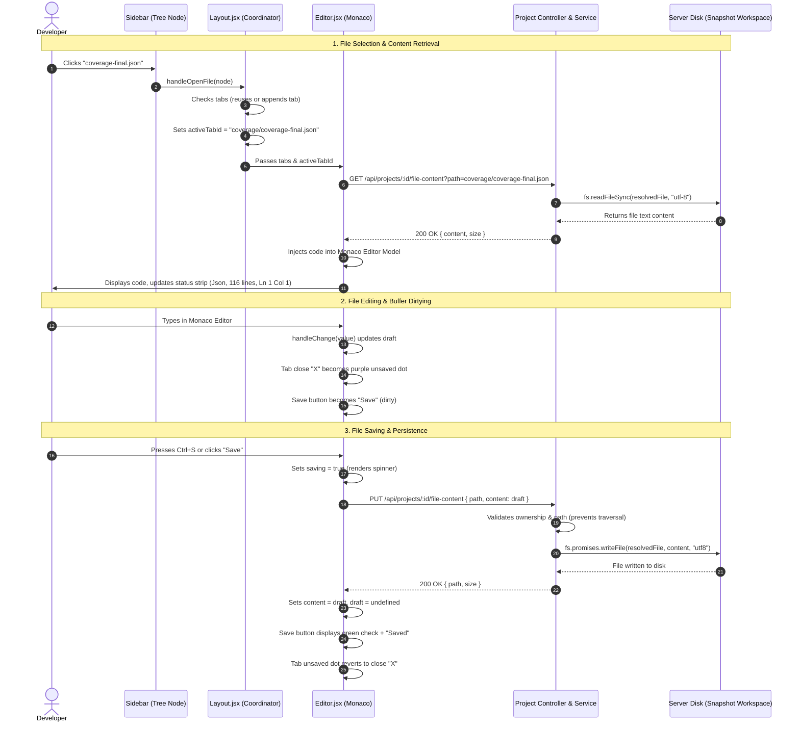

# COVAI Explorer UI — Implementation Analysis

## 1. Overview

The **Explorer interface** (Section 2.1 — Explorer) serves as the core file management, workspace navigation, and code inspection system within the **COVAI Studio** integrated development environment. Its purpose is to provide developers with a hierarchical representation of an imported codebase, allow rapid navigation across directories, enable seamless file opening into a multi-tab Monaco code editor, display real-time file metadata and coverage status, and provide full filesystem modification operations (creating, renaming, and deleting files and folders).

The interface is mounted within the primary dashboard workspace route (`/main-editor?projectId=...`), which renders `DashboardPage.jsx` and `Layout.jsx`. It consists of four tightly synchronized visual zones:
1. **Workspace Header & Studio Breadcrumbs:** Displays the COVAI Studio terminal branding, the active project name (`test2` in the screenshot), and the full file path hierarchy (`CovAI Studio / test2 / coverage / coverage-final.json`).
2. **Activity Bar:** A narrow 60px vertical strip on the far left that toggles workspace modes (`Explorer`, `Git Control`, `Coverage`, `Snapshots & Jobs`, `Architecture`, `Logic Analysis`, and `Settings`). The `Explorer` activity (`Files` icon) is active by default.
3. **Explorer Sidebar:** A collapsible, resizable 260px panel containing the `EXPLORER` header, root toolbar controls (New File, New Folder, Refresh Files, and Collapse All Folders), the active project root status bar with a green indicator dot, and the recursive tree of project directories and files.
4. **Editor Panel:** A full-featured code editing area featuring a draggable/reorderable tab bar (`coverage-final.json`), quick editor controls (Word Wrap toggle, Copy Code), a file breadcrumb header (`coverage > coverage-final.json`) with an interactive save status trigger (`Saved`), an embedded Monaco Code Editor, and a bottom status strip indicating language (`Json`), line count (`116 lines`), cursor position (`Ln 1, Col 1`), encoding (`UTF-8`), and indentation (`Spaces: 2`).

The frontend is implemented in **React 19**, **Vite**, **Framer Motion**, and **Monaco Editor** (`@monaco-editor/react`), styled with **Tailwind CSS v4** and customized design tokens in `client/src/index.css`. The backend runs on **Node.js**, **Express**, **Prisma ORM** (PostgreSQL), and operates directly on physical workspace snapshot directories stored on the server filesystem.

---

## 2. Implementation Files

The following table documents all frontend and backend source files responsible for the Explorer sidebar, file tree construction, Monaco editor integration, and filesystem operations:

| File Path | Component/Function | Responsibility | Evidence |
|---|---|---|---|
| `client/src/components/dashboard/Sidebar.jsx` | `Sidebar`, `TreeNode`, `InlineCreationRow` | Primary Explorer sidebar; renders header toolbar, project root indicator, recursive tree nodes, smart file/folder icons, inline file/folder creation inputs, inline renaming, and delete dialogs. | Lines 30–156 (`getFileIcon`, `getFolderIcon`), Lines 158–220 (`InlineCreationRow`), Lines 222–490 (`TreeNode`), Lines 493–840 (`Sidebar`). |
| `client/src/components/dashboard/Editor.jsx` | `Editor`, `ReorderableTab`, `MarkdownPreview` | Monaco code editor container; manages reorderable tabs, active tab tracking, unsaved draft state, file content fetching, file saving (`updateFileContentApi`), keyboard shortcuts (`Ctrl+S`, `Alt+Z`), and bottom status bar. | Lines 41–128 (`getFileIcon`), Lines 160–254 (`ReorderableTab`), Lines 612–650 (`getFileContentApi`), Lines 739–767 (`handleSave`), Lines 1006–1448 (Tabs, breadcrumbs, Monaco, status strip). |
| `client/src/components/dashboard/Layout.jsx` | `Layout` | Central IDE coordinator; loads project metadata and file tree (`getProjectTreeApi`), synchronizes `activeFileId` and `activeTabId`, handles file creation, folder creation, renaming, deleting, and panel resizing. | Lines 492–559 (`handleOpenFile`, `handleCloseTab`), Lines 561–626 (`handleCreateFile`, `handleCreateFolder`, `handleRenameEntry`, `handleDeleteEntry`), Lines 683–736 (Workspace breadcrumb), Lines 891–925 (`Sidebar` mounting and resizing). |
| `client/src/components/dashboard/ActivityBar.jsx` | `ActivityBar` | Leftmost 60px primary navigation rail; renders activity icons (`Files`, `GitGraph`, `BarChart3`, `Layers`, `Network`, `GitBranch`, `Settings`) and manages active activity switching. | Lines 14–24 (`TOP_ITEMS`), Lines 25–95 (`ActivityItem`), Lines 97–142 (`ActivityBar`). |
| `client/src/services/project.service.js` | API Client | Centralized HTTP service wrapper executing `GET /api/projects/:id/tree`, `GET /api/projects/:id/file-content`, `PUT /api/projects/:id/file-content`, `POST /api/projects/:id/files`, `POST /api/projects/:id/folders`, `PATCH /api/projects/:id/entries`, and `DELETE /api/projects/:id/entries`. | Lines 53–58 (`getProjectTreeApi`), Lines 136–160 (`getFileContentApi`, `updateFileContentApi`, `createProjectFileApi`), Lines 162–190 (`createProjectFolderApi`, `renameProjectEntryApi`, `deleteProjectEntryApi`). |
| `server/src/routes/project.route.js` | Express Router | Defines authenticated API routes for workspace file tree retrieval, file content reading/writing, and file/folder CRUD operations. | Lines 32–38: `GET /:id/tree`, `GET /:id/file-content`, `PUT /:id/file-content`, `POST /:id/files`, `POST /:id/folders`, `PATCH /:id/entries`, `DELETE /:id/entries`. |
| `server/src/controllers/project.controller.js` | `ProjectController` | Controller layer validating project ownership and delegating file tree/content operations to service methods. | Lines 408–418 (`getProjectTree`), Lines 423–453 (`getFileContent`, `updateFileContent`), Lines 458–538 (`createFile`, `createFolder`, `renameEntry`, `deleteEntry`). |
| `server/src/services/project.service.js` | Service Layer | Business logic building recursive file trees (`buildTree`), resolving snapshot workspace roots (`snapshotWorkspaceRoot`), reading/writing files on disk, and enforcing path security. | Lines 36–85 (`buildTree`), Lines 1040–1061 (`getProjectTree`), Lines 1063–1095 (`getFileContent`), Lines 1097–1138 (`updateFileContent`), Lines 1169–1232 (`createProjectFile`, `createProjectFolder`, `renameProjectEntry`, `deleteProjectEntry`). |
| `client/src/components/common/Skeleton.jsx` | `FileTreeSkeleton`, `EditorCodeSkeleton` | Shimmer skeleton placeholders rendered while the project file tree or file contents are loading. | Lines 104–130 (`FileTreeSkeleton`), Lines 132–170 (`EditorCodeSkeleton`). |

---

## 3. Explorer UI Specification

The following five-column specification table details all 46 confirmed visible, interactive, conditional, and structural elements of the COVAI Explorer interface:

| No. | Field name | Type | Require | Target |
|---|---|---|---|---|
| 1 | `WorkspaceHeader` | Workspace Header Bar | `h-11 px-3 sm:px-4 bg-[var(--color-surface)] border-b border-[var(--color-border)] text-[var(--color-text)] flex items-center justify-between select-none z-40`. | Global top bar anchoring studio branding, workspace breadcrumbs, and workspace actions. |
| 2 | `StudioBrandEmblem` | Icon Container | Purple box (`w-6 h-6 rounded-[var(--radius-sm)] bg-[var(--color-primary)] text-white flex items-center justify-center font-bold text-xs shrink-0`); Lucide `Terminal` (`size={13} strokeWidth={2.5}`). | Visual brand emblem representing developer terminal capabilities. |
| 3 | `StudioBrandTitle` | Text (Brand Name) | Text: `"CovAI"` (`font-bold text-xs tracking-tight text-[var(--color-text)]`) + `"Studio"` (`text-[10px] text-[var(--color-text-muted)] font-mono`). | Displays IDE brand name. |
| 4 | `ProjectBreadcrumbRoot` | Breadcrumb Text | Separator `"/"` + `{project.name}` (`text-[var(--color-text-secondary)] font-medium font-mono text-xs`). Visible in screenshot: `"test2"`. | Displays active project root in the workspace header hierarchy. |
| 5 | `ProjectBreadcrumbPath` | Breadcrumb Text (Dynamic) | Iterates `filePathSegments`; renders separator `"/"` + segment name; final segment bolded in `var(--color-text)`. Visible: `"/ coverage / coverage-final.json"`. | Displays the exact relative path of the active editor file. |
| 6 | `ReturnToProjectsButton` | Action Button | Button with Lucide `FolderPlus` (`size={12}`) + text `"Projects"`; `bg-[var(--color-surface-secondary)] border text-xs`. | Navigates back to the Project Hub directory (`/projects`). |
| 7 | `ActivityBarContainer` | Activity Navigation Bar | 60px wide vertical rail (`w-[60px] h-full flex flex-col items-center justify-between py-2.5 bg-[var(--color-surface-secondary)] border-r`). | Primary activity switcher rail. |
| 8 | `ActivityBarExplorerItem` | Activity Icon Button | Lucide `Files` (`size={19}`); active styling: `bg-[var(--color-primary)]/10 text-[var(--color-primary)]` with left vertical indicator bar (`3px` solid accent). | Activates the Explorer activity sidebar (`activeActivity = "explorer"`). |
| 9 | `ExplorerSidebarContainer` | Sidebar Panel | Resizable sidebar (`width: sidebarWidth` [default 260px], `bg-[var(--color-surface)] border-r flex flex-col h-full select-none`). | Encloses the entire Explorer file directory tree. |
| 10 | `ExplorerHeaderBar` | Sidebar Header Bar | Strip (`height: 44px, paddingLeft: 18px, paddingRight: 12px, borderBottom: 1px solid var(--color-border)] flex items-center justify-between`). | Displays `EXPLORER` title and toolbar buttons. |
| 11 | `ExplorerHeadingTitle` | Text Heading | Text: `"Explorer"` (`textTransform: 'uppercase'`, `fontSize: 11px`, `fontWeight: 700`, `letterSpacing: '0.08em'`, text-secondary). Visually: `"EXPLORER"`. | Identifies sidebar section. |
| 12 | `ExplorerNewFileButton` | Icon Button | Lucide `Plus` (`size={14}`); `title="New File at root"`; `aria-label="New File at root"`. | Spawns inline file creation input at project root (`parentPath: ""`). |
| 13 | `ExplorerNewFolderButton` | Icon Button | Lucide `FolderPlus` (`size={14}`); `title="New Folder at root"`; `aria-label="New Folder at root"`. | Spawns inline folder creation input at project root (`parentPath: ""`). |
| 14 | `ExplorerRefreshButton` | Icon Button | Lucide `RefreshCw` (`size={13}`); spins when `isRefreshing === true`; `title="Refresh Files"`. | Reloads the project file tree from the backend API. |
| 15 | `ExplorerCollapseAllButton` | Icon Button | Lucide `ChevronsDownUp` (`size={14}`) when expanded, `ChevronsUpDown` when collapsed; `title="Collapse All Folders"`. Mistaken for "close" icon in visual observation. | Collapses or expands all folders in the file tree simultaneously. |
| 16 | `ProjectRootHeader` | Root Directory Bar | Container (`padding: '9px 18px', background: 'var(--color-surface-secondary)', borderBottom: '1px solid var(--color-border)' flex items-center gap-2`). | Displays project root identifier and connection status. |
| 17 | `ProjectRootStatusDot` | Status Indicator | Circular dot (`width: 6px, height: 6px, borderRadius: '50%', background: 'var(--color-success)'`). Green dot in screenshot. | Visual indicator confirming active workspace synchronization. |
| 18 | `ProjectRootName` | Text (Root Name) | Monospace text: `{project?.name || "No Project"}` (`font-mono text-[11px] text-[var(--color-text)] font-semibold truncate`). Visible: `"test2"`. | Displays the active project name as the root directory label. |
| 19 | `FileTreeScrollArea` | Scrollable Container | Scrollable area (`flex-1 overflow-y-auto custom-scrollbar py-1.5`). | Contains all rendered file and folder tree nodes. |
| 20 | `InlineCreationRow` | Input Component (Conditional) | Highlighted input row (`rgba(124, 58, 237, 0.08)` background with purple left border); contains `FileCode2` or `FolderPlus` icon and `<input>`. | Accepts name for new file/folder; submits on Enter, cancels on Escape/blur. |
| 21 | `FolderTreeNode` | Folder Row Component | Clickable row with depth indent (`depth * 14 + 14px`); renders chevron, folder icon, folder name, and hover actions. | Toggles folder open/closed state (`setOpen((o) => !o)`). |
| 22 | `FolderChevron` | Icon Indicator | Lucide `ChevronRight` (`size={12}`); rotates 90 degrees when folder is open (`rotate: open ? 90 : 0`). | Visual indicator of folder expansion state. |
| 23 | `FolderIcon` | Icon Indicator | Amber `FolderOpen` (`#e3b341`) when open, `Folder` when closed; or `FolderGit2` (`#38bdf8`) for special code folders (`src`, `server`, etc.). | Identifies directory type. |
| 24 | `FolderNameText` | Text (Folder Name) | Truncated folder name string (e.g. `".covai-temp"`, `".github"`, `"coverage"`, `"dist"`, `"docs"`). | Displays directory name. |
| 25 | `FileTreeNode` | File Row Component | Clickable row with depth indent; renders smart file icon, filename, and hover actions. | Opens file into an editor tab on click (`handleOpenFile(node)`). |
| 26 | `FileJsonIcon` | Icon Indicator | Lucide `FileJson` (`size={14}`) styled in green (`#4ade80`). Visible on `coverage-final.json`. | Visual icon identifying JSON files. |
| 27 | `FileSelectedHighlight` | Active State Styling | Purple background (`var(--color-primary-light)`), solid purple left border (`2px solid var(--color-primary)`), purple text. Visible on `coverage-final.json`. | Highlights the currently active file corresponding to the active editor tab. |
| 28 | `TreeNodeHoverActions` | Action Group (Conditional) | Floating pill rendered on node hover; contains `Plus` (New File), `FolderPlus` (New Folder), `Pencil` (Rename), and `Trash2` (Delete). | Contextual action triggers for the hovered tree node. |
| 29 | `TreeNodeRenameInput` | Inline Input Form | Input form replacing node name during inline rename; submits on Enter/blur, cancels on Escape. | Updates file or folder name via `renameProjectEntryApi`. |
| 30 | `EditorContainer` | Main Editor Area | Main editor flex column (`flex flex-col flex-1 h-full min-w-0 bg-[var(--color-bg)]`). | Houses tabs, breadcrumbs, Monaco editor, and status strip. |
| 31 | `EditorTabBar` | Tab Bar Container | Horizontal strip (`height: 38px, bg-[var(--color-surface)], borderBottom: 1px solid var(--color-border) flex items-center justify-between`). | Houses draggable editor tabs and editor quick actions. |
| 32 | `ReorderableTab` | Draggable Tab Item | Draggable tab (`minWidth: 120px, maxWidth: 200px, px: 12px, font-sans text-xs flex items-center gap-2`); renders file icon, filename, and close button. | Displays open file tab; clicking activates file; drag reorders tab. |
| 33 | `TabActiveTopIndicator` | Tab Highlight Line | 2px solid purple bar (`background: var(--color-primary)`) positioned at top of active tab. | Visual indicator marking the currently focused editor tab. |
| 34 | `TabCloseButton` | Icon Button | Lucide `X` (`size={12}`); visible on tab hover or active state; `title="Close (Ctrl+W)"`. | Closes the tab (`handleCloseTab(tab.id)`). |
| 35 | `TabUnsavedDot` | Status Indicator (Conditional) | 7px solid circular purple dot (`background: var(--color-primary)`); replaces close X when file has unsaved changes. | Informs user that tab has unpersisted edits. |
| 36 | `EditorWordWrapToggle` | Icon Button | Lucide `WrapText` (`size={14}`); `title="Word Wrap: ON/OFF (Alt+Z)"`. Visible in editor toolbar. | Toggles Monaco word wrap between `"on"` and `"off"`. |
| 37 | `EditorCopyCodeButton` | Icon Button | Lucide `Copy` (`size={14}`) / `Check` (`size={14}`); `title="Copy all code"`. Visible in editor toolbar. | Copies entire active file content to system clipboard. |
| 38 | `FileBreadcrumbBar` | Sub-Header Strip | Sub-header (`minHeight: 32px, px: 16px, borderBottom: 1px solid var(--color-border), bg-[var(--color-surface)] text-xs flex items-center justify-between`). | Displays file path breadcrumbs and save button. |
| 39 | `FileBreadcrumbPath` | Path Hierarchy Display | Smart file icon + path segments separated by `ChevronRight` (`size={11}`). Visible: `coverage > coverage-final.json`. | In-editor breadcrumb showing relative path within project. |
| 40 | `EditorSaveButton` | Action Button | Button displaying Lucide `Check` in green + text `"Saved"` when clean; or `Save` icon + `"Save"` when unsaved; or `Loader2` + `"Saving..."`. | Saves editor buffer to server filesystem (`updateFileContentApi`). |
| 41 | `EditorSaveErrorText` | Error Label (Conditional) | Red error text (`color: var(--color-danger), text-[11px]`) rendered next to save button if save fails. | Displays server-side write failure message. |
| 42 | `MonacoCodeEditor` | Embedded Code Editor | Monaco code editor (`<MonacoEditor>`) configured with custom `covai-dark` / `covai-light` theme, line numbers, and syntax highlighting. | Primary code viewing and editing interface. |
| 43 | `EditorStatusStrip` | Bottom Status Strip | Monospace bar (`height: 24px, px: 14px, borderTop: 1px solid var(--color-border), bg-[var(--color-surface)] text-[11px] text-[var(--color-text-secondary)]`). | Displays editor cursor, language, and buffer stats. |
| 44 | `EditorStatusLanguage` | Status Label (Dynamic) | Lucide `Code2` (`size={11}`) + capitalized language name (e.g. `"Json"` for `.json`, `"Typescript"` for `.ts`). | Identifies active Monaco syntax grammar. |
| 45 | `EditorStatusLineCount` | Status Label (Dynamic) | Text: `"{totalLines} lines"` (computed dynamically as `codeContent.split("\n").length`). Visible: `"116 lines"`. | Displays total line count of active file buffer. |
| 46 | `EditorStatusCursorPos` | Status Label (Dynamic) | Text: `"Ln {cursorPos.line}, Col {cursorPos.col}"` (updated on cursor move). Visible: `"Ln 1, Col 1"`. | Displays current line and column of editor cursor. |
| 47 | `EditorStatusEncoding` | Status Label (Static) | Static text: `"UTF-8"`. | Documents default file encoding. |
| 48 | `EditorStatusIndentation` | Status Label (Static) | Static text: `"Spaces: 2"`. | Documents default indentation setting. |
| 49 | `SidebarPanelResizer` | Splitter Handle | Drag handle dividing Sidebar and Editor (`PanelResizer`, `side="left"`, `label="Explorer"`). | Drag to resize sidebar width; double-click resets to default 260px. |

---

## 4. Project Root and File Tree

### 4.1 Backend Tree Construction
The Explorer does not read files directly from the user's local operating system during workspace execution. Instead, it reads from the extracted project snapshot stored on the server filesystem.

When the client requests the file tree via `GET /api/projects/:id/tree` (`client/src/services/project.service.js:53-58`), the backend executes `getProjectTree` (`server/src/services/project.service.js:1040-1061`):
1. Verifies that the requesting user owns the project (`where: { id: projectId, ownerId: userId }`).
2. Fetches the latest snapshot record from PostgreSQL (`prisma.projectSnapshot.findFirst`).
3. Resolves the snapshot workspace root on disk (`snapshotWorkspaceRoot(snapshot)`).
4. Recursively constructs the tree using `buildTree(dirPath, rootPath)` (`server/src/services/project.service.js:36-85`):
   - **Exclusions:** Automatically ignores `node_modules` and `.git` directories:
     ```javascript
     if (item === "node_modules" || item === ".git") continue;
     ```
   - **Symlink Protection:** Automatically skips symbolic links (`if (stat.isSymbolicLink()) continue;`).
   - **Recursion:** Recursively scans nested folders, assigning each node a unique relative POSIX path (`relativePath = path.relative(rootPath, itemPath).replace(/\\/g, "/")`).
   - **Deterministic Sorting:** Folders are strictly sorted first alphabetically, followed by files alphabetically:
     ```javascript
     result.sort((a, b) => {
       if (a.type === b.type) return a.name.localeCompare(b.name);
       return a.type === "folder" ? -1 : 1;
     });
     ```

### 4.2 Screenshot Tree Verification
This deterministic sorting explains the exact directory structure visible in the screenshot:
- **Folders first:** `.covai-temp`, `.github`, `coverage`, `dist`, `docs`.
- **Under `coverage` directory:**
  - Files are sorted alphabetically: `coverage-final.json`, `coverage-summary.json`, `integration-scenarios.js...`, `jest-coverage-final.json`, `jest-coverage-summar...`, `jest-results.json`, `lcov.info`.

### 4.3 Smart Icon Resolution
Both `Sidebar.jsx` and `Editor.jsx` incorporate a dedicated smart icon resolver (`getFileIcon` and `getFolderIcon`):
- **JSON files (`.json`, `.jsonc`):** Renders Lucide `FileJson` in emerald green (`#4ade80`). This matches the green icon rendered next to `coverage-final.json` in the screenshot.
- **TypeScript / JavaScript:** Renders `Braces` (`#38bdf8`) or `FileCode2` (`#fbbf24`).
- **Test files (`.test.ts`, `.spec.js`, etc.):** Renders `TestTube2` in purple (`#c084fc`).
- **Special folders (`src`, `server`, etc.):** Renders `FolderGit2` in blue (`#38bdf8`).
- **Standard folders:** Renders `FolderOpen` (open) or `Folder` (closed) in amber (`#e3b341`).

---

## 5. File Selection and Editor Tabs

### 5.1 File Selection Workflow
When a developer clicks on a file entry in the Explorer tree (e.g., clicking `coverage-final.json`):
1. The click triggers `onSelect(node)` inside `TreeNode` (`Sidebar.jsx:303`), invoking `handleOpenFile(node)` in `Layout.jsx:492-503`.
2. `handleOpenFile` validates that `node.type !== "folder"`.
3. It sets `activeActivity = "explorer"` and `activeFileId = node.id` (`"coverage/coverage-final.json"`).
4. **Duplicate Tab Prevention:** It checks whether a tab with `node.id` already exists in `tabs`:
   - If not found: Appends a new tab object `{ id: node.id, name: node.name, unsaved: false }` to the `tabs` array.
   - If already open: Reuses the existing tab without creating a duplicate.
5. Sets `activeTabId = node.id`.
6. Both the Explorer tree node (`isActive = activeFileId === node.id`) and the editor tab (`isActive = tab.id === activeTabId`) highlight simultaneously in the brand primary color.

### 5.2 Tab Reordering and Switching
- **Drag-and-Drop Reordering:** The tab bar uses Framer Motion `<Reorder.Group>` and `<Reorder.Item>` (`Editor.jsx:165-253`). Developers can click and drag tabs horizontally to reorder them; reordered arrays are committed via `onReorderTabs(newTabs)`.
- **Tab Switching:** Clicking any tab sets `activeTabId` and `activeFileId` to that tab's ID, bringing its content into the Monaco viewport.

### 5.3 Tab Closing
- Clicking the `X` button on a tab (`title="Close (Ctrl+W)"`) invokes `handleCloseTab(tabId)` in `Layout.jsx:545-559`.
- The closed tab is removed from `tabs`.
- **Adjacent Tab Activation:** If the currently active tab is closed, the application automatically activates the adjacent left tab (`next[Math.max(0, idx - 1)].id`).
- **All Tabs Closed:** If all tabs are closed, `activeTabId` and `activeFileId` become `null`, causing the editor area to render the `"Welcome to TestCovAI Editor"` empty state (`Editor.jsx:911-993`).
- **Unsaved Draft on Close:** No blocking modal or confirmation dialog is presented when closing an unsaved tab; the tab unmounts immediately while in-memory draft state remains or is discarded.

---

## 6. Editor Content and Save State

### 6.1 Content Loading
When an active tab is selected, `Editor.jsx:612-650` checks its internal `fileContents` cache:
1. If the content is not yet cached, it calls `getFileContentApi(projectId, activeTabId)` (`client/src/services/project.service.js:136-144`).
2. The server endpoint `GET /api/projects/:id/file-content?path=...` reads the physical file from disk via `fs.readFileSync(resolvedFile, "utf-8")` (`server/src/services/project.service.js:1063-1095`).
3. If the file exceeds 1MB (`stat.size > 1024 * 1024`), the server rejects with HTTP 413 (`"File too large to display"`).
4. On success, the raw text content is returned to the client and injected into the Monaco editor model.

### 6.2 Editing and Unsaved Changes
- When the developer types in the Monaco editor, `handleChange(value)` (`Editor.jsx:731-737`) updates local draft state: `fileContents[activeTabId].draft = value`.
- `hasUnsavedChanges` evaluates to `true` when `draft !== undefined && draft !== content`.
- In the tab bar, the close `X` icon is replaced by a solid purple circular dot (`TabUnsavedDot`).
- In the file breadcrumb header, the save button transitions from `"Saved"` (green checkmark) to `"Save"` (purple background with save floppy icon).

### 6.3 Saving Execution
- Saving can be triggered in two ways:
  1. Clicking the `"Save"` button in the breadcrumb header (`Editor.jsx:1218-1246`).
  2. Pressing `Ctrl+S` (or `Cmd+S`), which is intercepted by a custom Monaco command registered during editor mount:
     ```javascript
     editor.addCommand(monaco.KeyMod.CtrlCmd | monaco.KeyCode.KeyS, () =>
       saveHandlerRef.current?.(),
     );
     ```
- `handleSave()` calls `updateFileContentApi(projectId, activeTabId, file.draft)` -> `PUT /api/projects/:id/file-content`.
- The server validates project ownership and writes the updated buffer to disk via `fs.promises.writeFile(resolvedFile, content, "utf8")` (`server/src/services/project.service.js:1133`).
- On HTTP 200, the client sets `content = file.draft` and resets `draft = undefined`. The button transitions back to `"Saved"` with a green checkmark, exactly as shown in the screenshot.
- If saving fails, the server error message is captured in `saveError` and displayed in red text adjacent to the save button.

### 6.4 Status Strip: Dynamic vs. Static Data
The bottom status strip (`Editor.jsx:1405-1446`) displays five distinct indicators:

| Status Strip Element | Screenshot Observation | Source-Code Implementation | Data Nature |
|---|---|---|---|
| **Language** | `"Json"` | `<span>{lang.charAt(0).toUpperCase() + lang.slice(1)}</span>` | **Dynamic:** Evaluated from file extension mapping (`EXT_LANG_MAP['.json'] = 'json'`). |
| **Line Count** | `"116 lines"` | `<span>{totalLines} lines</span>` where `totalLines = codeContent.split("\n").length`. | **Dynamic:** Calculated from active editor text buffer lines. |
| **Cursor Position** | `"Ln 1, Col 1"` | `<span>Ln {cursorPos.line}, Col {cursorPos.col}</span>` updated on `editor.onDidChangeCursorPosition`. | **Dynamic:** Updated in real-time as the cursor moves in Monaco. |
| **File Encoding** | `"UTF-8"` | Static JSX: `<span>UTF-8</span>`. | **Static Label:** Hardcoded string display; no encoding detection logic. |
| **Indentation** | `"Spaces: 2"` | Static JSX: `<span>Spaces: 2</span>`. | **Static Label:** Hardcoded string display; indentation options are not switchable from the strip. |

---

## 7. Explorer Operations

### 7.1 Create File
1. User clicks the `Plus` icon in the Explorer header (`Sidebar.jsx:613-621`).
2. Triggers `handleStartAction({ type: "file", parentPath: "" })`.
3. An `InlineCreationRow` appears at the top of the file tree with a blinking text cursor and a purple left accent.
4. User types the filename (e.g. `test.json`) and presses Enter.
5. Invokes `handleCreateFile(filePath)` in `Layout.jsx:565-578`.
6. Sends `POST /api/projects/:id/files` with payload `{ path: filePath, content: "" }`.
7. Backend verifies path safety (rejects `..` traversal), ensures parent directories exist, and writes the empty file to disk via `fs.promises.writeFile`.
8. The file tree is refreshed, and the newly created file is automatically opened into an active editor tab.

### 7.2 Create Folder
1. User clicks the `FolderPlus` icon in the Explorer header (`Sidebar.jsx:623-633`).
2. Triggers `handleStartAction({ type: "folder", parentPath: "" })`.
3. An `InlineCreationRow` appears with an amber `FolderPlus` icon.
4. User types the directory name and presses Enter.
5. Invokes `handleCreateFolder(folderPath)` in `Layout.jsx:580-588` -> `POST /api/projects/:id/folders`.
6. Backend creates the directory recursively on disk via `fs.promises.mkdir(resolvedPath, { recursive: true })`.
7. The tree refreshes to reveal the new directory.

### 7.3 Refresh Explorer
1. User clicks the `RefreshCw` icon in the Explorer header (`Sidebar.jsx:635-649`).
2. Sets `isRefreshing = true` (triggering CSS `animate-spin`).
3. Calls `onRefresh()` -> `loadData(project?.id, 3, 2000)` in `Layout.jsx:905`.
4. Re-queries `GET /api/projects/:id/tree` from the backend to detect newly added, external, or synthesized files.
5. Resets spinner after 500ms. Expanded folders remain open if their IDs remain stable.

### 7.4 Collapse All Folders vs. Close Sidebar (Screenshot Analysis)
- **Screenshot Observation:** The prompt notes a "Close icon" as the 4th icon in the Explorer header.
- **Source Code Evidence:** In `Sidebar.jsx:650-681`, the 4th button is actually the **Collapse / Expand All Folders** control:
  ```jsx
  <motion.button
    onClick={handleToggleCollapse}
    title={treeCollapsed ? "Expand All Folders" : "Collapse All Folders"}
    aria-label={treeCollapsed ? "Expand All Folders" : "Collapse All Folders"}
  >
    {treeCollapsed ? <ChevronsUpDown size={14} /> : <ChevronsDownUp size={14} />}
  </motion.button>
  ```
- **Visual Clarification:** When folders are expanded, the button renders `ChevronsDownUp` (two opposing vertical chevron arrows pointing toward each other). Visually, this closely resembles an "X" or close symbol to a casual observer.
- **Closing the Explorer Sidebar:** To completely collapse or close the Explorer sidebar itself, developers click the `Files` icon on the `ActivityBar` or use the `PanelResizer` drag handle.

### 7.5 Inline Renaming & Contextual Deletion
When hovering over any tree node, four action icons appear (`Sidebar.jsx:398-451`):
- **Rename (`Pencil` icon):** Replaces the filename with an inline `<input>`. On Enter, submits `renameProjectEntryApi` -> `PATCH /api/projects/:id/entries`. Open tabs are updated in-place with the new name and ID without losing active status.
- **Delete (`Trash2` icon):** Sets `itemToDelete = node`. Opens a danger-styled `<ConfirmDialog>` with title `"Delete File"` or `"Delete Folder"`. On confirm, sends `DELETE /api/projects/:id/entries`. Any open tabs for that file (or files within that folder) are automatically closed, and the tree refreshes.

---

## 8. Data Flow

The following sequence diagram illustrates the verified end-to-end data flow when opening, editing, and saving a file in the COVAI Explorer:



---

## 9. Error Handling

The following table documents the verified error handling behaviors across all Explorer operations:

| Condition | Actual Handling | User Feedback | Evidence | Status |
|---|---|---|---|---|
| Project root unavailable | Server throws `ServiceError("Project snapshot not ready", 202/404)` if snapshot or rootDir missing. | Client renders `FileTreeSkeleton` or empty workspace banner: `"No workspace files detected"`. | `project.service.js:1056`, `Editor.jsx:873-908`. | `IMPLEMENTED` |
| File tree loading failure | `loadData` catches rejection; error logged to `console.error`; `fileTree` remains `[]`. | Displays centered notice: `"No files found in workspace"`. | `Layout.jsx:227`, `Sidebar.jsx:740-745`. | `IMPLEMENTED` |
| File content loading failure | `getFileContentApi` catches error; sets `fileContents[tabId].error = err.message`. | Monaco view renders error state with message; loading spinner removed. | `Editor.jsx:640-649`. | `IMPLEMENTED` |
| File not found on disk | Server verifies `fs.existsSync(resolvedFile)`; throws 404 `ServiceError("File not found", 404)`. | HTTP 404 error propagated to client; displayed in error card. | `project.service.js:1081`. | `IMPLEMENTED` |
| File size exceeds 1MB | Server checks `stat.size > 1024 * 1024`; throws HTTP 413 `ServiceError("File too large to display", 413)`. | HTTP 413 error returned; prevents browser crash on giant binaries. | `project.service.js:1090`. | `IMPLEMENTED` |
| Path traversal attack | Server checks `relativePath.startsWith("..") \|\| path.isAbsolute(relativePath)`; throws 400. | HTTP 400 `"Invalid file path"` returned; prevents server directory escape. | `project.service.js:1161-1165`. | `IMPLEMENTED` |
| Duplicate file/folder creation | Server checks `fs.existsSync(resolvedPath)`; throws 409 `"A file or folder already exists at this path"`. | Client catches error and triggers floating toast: `"Could not create file"`. | `project.service.js:1182`, `Layout.jsx:576`. | `IMPLEMENTED` |
| Save file write failure | Server write fails (e.g. disk permissions or unmounted directory); error caught in `handleSave`. | Red text displayed next to save button: `{saveError}` (e.g. `"Could not save file"`). | `Editor.jsx:763, 1212-1216`. | `IMPLEMENTED` |
| Closing modified unsaved tab | Tab closed immediately without checking dirty state; unsaved draft in memory discarded. | No confirmation dialog or prompt presented to user. | `Layout.jsx:545-559`. | `PARTIAL / UNPROTECTED` |

---

## 10. Screenshot-to-Code Comparison

The following table compares each visual element in the supplied screenshot against the actual source code implementation:

| UI Element | Screenshot Observation | Source-Code Evidence | Status | Notes |
|---|---|---|---|---|
| Breadcrumb Bar | `CovAI Studio / test2 / coverage / coverage-final.json` | `Layout.jsx:695-736`: Renders `Terminal` icon, `"CovAI"`, `"Studio"`, `"/ test2"`, and mapped path segments `"/ coverage / coverage-final.json"`. | `MATCH` | Exact text, hierarchy, and icon representation. |
| Return Projects Button | Button with folder icon and text `"Projects"` | `Layout.jsx:752-761`: Button with `FolderPlus` icon + `"Projects"`; navigates to `/projects`. | `MATCH` | Visible on desktop viewport. |
| Activity Bar | Left rail with `Files` icon highlighted | `ActivityBar.jsx:15, 61-77`: `Files` icon active with purple accent bar on left. | `MATCH` | Exact visual match. |
| Explorer Heading | Title `"EXPLORER"` | `Sidebar.jsx:608`: Text `"Explorer"` styled with `textTransform: "uppercase"`, bold 11px. | `MATCH` | Exact visual match. |
| New File Button | `Plus` icon in Explorer toolbar | `Sidebar.jsx:613-621`: Lucide `Plus` (`size={14}`); `title="New File at root"`. | `MATCH` | Functional. Opens inline creation row. |
| New Folder Button | `FolderPlus` icon in Explorer toolbar | `Sidebar.jsx:623-633`: Lucide `FolderPlus` (`size={14}`); `title="New Folder at root"`. | `MATCH` | Functional. Opens inline folder creation row. |
| Refresh Button | `RefreshCw` icon in Explorer toolbar | `Sidebar.jsx:635-649`: Lucide `RefreshCw` (`size={13}`); `title="Refresh Files"`. | `MATCH` | Functional. Spins and re-fetches project file tree. |
| 4th Header Icon | Opposing arrows pointing inward (mistaken for "Close" icon) | `Sidebar.jsx:650-681`: Lucide `ChevronsDownUp` (`size={14}`); `title="Collapse All Folders"`. | `PARTIAL MATCH` | Visual match to screenshot. The icon is **Collapse All Folders**, not a close icon. |
| Project Root | Green dot + `"test2"` | `Sidebar.jsx:686-711`: Green 6px circular dot (`var(--color-success)`) + `{project?.name}` (`"test2"`). | `MATCH` | Exact visual match. |
| Directory Entries | `.covai-temp`, `.github`, `coverage`, `dist`, `docs` | `project.service.js:83-85`: Folders sorted alphabetically first. `Sidebar.jsx:349`: Amber folder icons. | `MATCH` | Dynamically generated from server snapshot directory. |
| File Entries in Coverage | `coverage-final.json`, `coverage-summary.json`, etc. | `Sidebar.jsx:31-120`: Files rendered alphabetically with smart icons (`FileJson` in green `#4ade80`). | `MATCH` | Matches screenshot file listing. |
| Selected File Row | `coverage-final.json` highlighted with purple background | `Sidebar.jsx:312-321`: `background: var(--color-primary-light)`, `borderLeft: 2px solid var(--color-primary)`. | `MATCH` | Exact visual match. |
| Active Editor Tab | Tab `"coverage-final.json"` with green JSON icon | `Editor.jsx:160-254`: Reorderable tab with `FileJson` icon, top purple indicator line, close button. | `MATCH` | Exact visual match. |
| Tab Toolbar Controls | Two icons: Word Wrap & Copy Code | `Editor.jsx:1071-1107`: Lucide `WrapText` (`size={14}`) + Lucide `Copy` (`size={14}`). | `MATCH` | Exact visual match. Functional handlers verified. |
| File Breadcrumb Header | Green JSON icon + `coverage > coverage-final.json` | `Editor.jsx:1123-1149`: File icon + breadcrumb segments joined by `ChevronRight`. | `MATCH` | Exact visual match. |
| Save Button Status | Green checkmark + `"Saved"` | `Editor.jsx:1218-1246`: `<Check size={12} style={{ color: "var(--color-success)" }} />` + `"Saved"`. | `MATCH` | Exact visual match. Transitions to `"Save"` when edited. |
| Monaco Editor Area | Code lines with JSON syntax highlighting | `Editor.jsx:1360-1400`: `<MonacoEditor>` with line numbers and custom syntax colors. | `MATCH` | Exact visual match. |
| Status Strip: Language | `"Json"` with code icon | `Editor.jsx:1418-1424`: `<Code2 size={11} /> <span>Json</span>`. | `MATCH` | Dynamically capitalized language string. |
| Status Strip: Lines | `"116 lines"` | `Editor.jsx:1425`: `<span>{totalLines} lines</span>`. | `MATCH` | Dynamically computed line count. |
| Status Strip: Cursor | `"Ln 1, Col 1"` | `Editor.jsx:1426-1428`: `<span>Ln {cursorPos.line}, Col {cursorPos.col}</span>`. | `MATCH` | Dynamically tracked cursor position. |
| Status Strip: Encoding | `"UTF-8"` | `Editor.jsx:1443`: `<span>UTF-8</span>`. | `MATCH` | Hardcoded static label. |
| Status Strip: Indent | `"Spaces: 2"` | `Editor.jsx:1444`: `<span>Spaces: 2</span>`. | `MATCH` | Hardcoded static label. |

---

## 11. Findings and Limitations

### 11.1 Verified Strengths
1. **Full-Featured Filesystem CRUD:**
   - The Explorer is not a read-only viewer. It fully implements creating files, creating folders, inline renaming, and safe deletion with confirmation dialogs. All operations write directly to the physical project snapshot workspace on the server.
2. **Robust Path Traversal Security:**
   - `server/src/services/project.service.js:1154-1167` (`resolveProjectPath`) strictly normalizes paths, verifies bounds against `rootDir`, and prevents directory escape attacks using `..` or absolute paths.
3. **Monaco Editor Deep Integration:**
   - Complete support for keyboard shortcuts (`Ctrl+S` / `Cmd+S` for saving, `Alt+Z` for word wrap), cursor tracking, line counting, syntax highlighting, and custom dark/light theme definitions.
4. **Smart Icon Hierarchy:**
   - Dedicated resolvers identify over 15 distinct file types (React, TypeScript, Jest tests, JSON, styles, markdown, config) with tailored Lucide icons and colors.

### 11.2 Identified Limitations & Discrepancies
1. **Collapse All Icon Misinterpreted as Close:**
   - The 4th button in the Explorer header is `ChevronsDownUp` ("Collapse All Folders"). Visually, two opposing arrows look similar to an "X" or close control, leading to visual ambiguity. The Explorer sidebar itself is closed via the Activity Bar or the panel resizer.
2. **Static Status Strip Labels:**
   - In the bottom status strip, `"UTF-8"` and `"Spaces: 2"` are hardcoded static strings. Selecting a file with different encoding or 4-space indentation will still display `UTF-8` and `Spaces: 2`.
3. **Unprotected Tab Closing on Dirty Files:**
   - Closing an editor tab with unsaved edits does not trigger a warning prompt or confirmation dialog. The tab closes immediately, leaving the draft in memory until reloaded.
4. **1MB File Size Limit:**
   - Files larger than 1MB are rejected by the backend (`stat.size > 1024 * 1024`) with HTTP 413 to prevent browser memory exhaustion.

---

## 12. Source References

The following table provides exact file paths, component names, function identifiers, and line ranges for all inspected logic:

| File Reference | Symbol / Function | Line Range | Description |
|---|---|---|---|
| `client/src/components/dashboard/Sidebar.jsx` | `getFileIcon` | Lines 31–120 | Extension-based smart icon resolver for files. |
| `client/src/components/dashboard/Sidebar.jsx` | `getFolderIcon` | Lines 122–156 | Folder icon resolver (amber folder, blue git folder, test tube). |
| `client/src/components/dashboard/Sidebar.jsx` | `InlineCreationRow` | Lines 158–220 | Inline input row for creating new files or folders. |
| `client/src/components/dashboard/Sidebar.jsx` | `TreeNode` | Lines 222–490 | Tree item component handling expand, hover actions, and selection. |
| `client/src/components/dashboard/Sidebar.jsx` | `Sidebar` | Lines 493–840 | Explorer header toolbar, project root indicator, tree scroll area. |
| `client/src/components/dashboard/Editor.jsx` | `ReorderableTab` | Lines 160–254 | Draggable editor tab with active indicator and close X button. |
| `client/src/components/dashboard/Editor.jsx` | `getFileContentApi` fetch | Lines 612–650 | Asynchronous file content loading on active tab change. |
| `client/src/components/dashboard/Editor.jsx` | `handleSave` | Lines 739–767 | Save handler dispatching `updateFileContentApi` and updating state. |
| `client/src/components/dashboard/Editor.jsx` | Tab Bar & Toolbar | Lines 1006–1108 | Tab group, word wrap toggle, and copy code button. |
| `client/src/components/dashboard/Editor.jsx` | Breadcrumb & Save Button | Lines 1110–1248 | File path breadcrumb, testcase suggest, and Save status button. |
| `client/src/components/dashboard/Editor.jsx` | Status Strip | Lines 1405–1446 | Bottom bar displaying language, lines, cursor, UTF-8, Spaces: 2. |
| `client/src/components/dashboard/Layout.jsx` | `handleOpenFile` | Lines 492–503 | Tab creation, duplicate check, active file synchronization. |
| `client/src/components/dashboard/Layout.jsx` | `handleCloseTab` | Lines 545–559 | Tab removal and adjacent tab activation. |
| `client/src/components/dashboard/Layout.jsx` | File Operations | Lines 565–626 | Handlers for create file, create folder, rename, and delete. |
| `client/src/components/dashboard/Layout.jsx` | Workspace Header | Lines 683–736 | Top studio bar rendering project and path breadcrumbs. |
| `server/src/services/project.service.js` | `buildTree` | Lines 36–85 | Recursive directory scanner excluding node_modules/.git and sorting. |
| `server/src/services/project.service.js` | `getProjectTree` | Lines 1040–1061 | Service validating ownership and building snapshot file tree. |
| `server/src/services/project.service.js` | `getFileContent` | Lines 1063–1095 | Service reading file from disk with 1MB size limit. |
| `server/src/services/project.service.js` | `updateFileContent` | Lines 1097–1138 | Service persisting updated editor text to disk. |
| `server/src/services/project.service.js` | `createProjectFile` | Lines 1169–1186 | Service creating new file and parent directories. |
| `server/src/services/project.service.js` | `createProjectFolder` | Lines 1188–1198 | Service creating new folder on disk. |
| `server/src/services/project.service.js` | `renameProjectEntry` | Lines 1200–1222 | Service renaming or moving file/folder on disk. |
| `server/src/services/project.service.js` | `deleteProjectEntry` | Lines 1224–1232 | Service recursively deleting file/folder from disk. |

---

## 13. Final UI Specification Table

The following clean, standalone table is formatted for direct inclusion in the COVAI Capstone report:

| No. | Field name | Type | Require | Target |
|---|---|---|---|---|
| 1 | `WorkspaceHeader` | Workspace Header Bar | Bar (`h-11 px-3 sm:px-4 bg-[var(--color-surface)] border-b text-[var(--color-text)] flex items-center justify-between select-none z-40`). | Global top bar anchoring studio branding, workspace breadcrumbs, and workspace actions. |
| 2 | `StudioBrandEmblem` | Icon Container | Purple box (`w-6 h-6 rounded-[var(--radius-sm)] bg-[var(--color-primary)] text-white flex items-center justify-center font-bold text-xs shrink-0`); Lucide `Terminal` (`size={13} strokeWidth={2.5}`). | Visual brand emblem representing developer terminal capabilities. |
| 3 | `StudioBrandTitle` | Text (Brand Name) | Text: `"CovAI"` (`font-bold text-xs tracking-tight text-[var(--color-text)]`) + `"Studio"` (`text-[10px] text-[var(--color-text-muted)] font-mono`). | Displays IDE brand name. |
| 4 | `ProjectBreadcrumbRoot` | Breadcrumb Text | Separator `"/"` + `{project.name}` (`text-[var(--color-text-secondary)] font-medium font-mono text-xs`). Visible in screenshot: `"test2"`. | Displays active project root in the workspace header hierarchy. |
| 5 | `ProjectBreadcrumbPath` | Breadcrumb Text (Dynamic) | Iterates `filePathSegments`; renders separator `"/"` + segment name; final segment bolded in `var(--color-text)`. Visible: `"/ coverage / coverage-final.json"`. | Displays the exact relative path of the active editor file. |
| 6 | `ReturnToProjectsButton` | Action Button | Button with Lucide `FolderPlus` (`size={12}`) + text `"Projects"`; `bg-[var(--color-surface-secondary)] border text-xs`. | Navigates back to the Project Hub directory (`/projects`). |
| 7 | `ActivityBarContainer` | Activity Navigation Bar | 60px wide vertical rail (`w-[60px] h-full flex flex-col items-center justify-between py-2.5 bg-[var(--color-surface-secondary)] border-r`). | Primary activity switcher rail. |
| 8 | `ActivityBarExplorerItem` | Activity Icon Button | Lucide `Files` (`size={19}`); active styling: `bg-[var(--color-primary)]/10 text-[var(--color-primary)]` with left vertical indicator bar (`3px` solid accent). | Activates the Explorer activity sidebar (`activeActivity = "explorer"`). |
| 9 | `ExplorerSidebarContainer` | Sidebar Panel | Resizable sidebar (`width: sidebarWidth` [default 260px], `bg-[var(--color-surface)] border-r flex flex-col h-full select-none`). | Encloses the entire Explorer file directory tree. |
| 10 | `ExplorerHeaderBar` | Sidebar Header Bar | Strip (`height: 44px, paddingLeft: 18px, paddingRight: 12px, borderBottom: 1px solid var(--color-border)] flex items-center justify-between`). | Displays `EXPLORER` title and toolbar buttons. |
| 11 | `ExplorerHeadingTitle` | Text Heading | Text: `"Explorer"` (`textTransform: 'uppercase'`, `fontSize: 11px`, `fontWeight: 700`, `letterSpacing: '0.08em'`, text-secondary). Visually: `"EXPLORER"`. | Identifies sidebar section. |
| 12 | `ExplorerNewFileButton` | Icon Button | Lucide `Plus` (`size={14}`); `title="New File at root"`; `aria-label="New File at root"`. | Spawns inline file creation input at project root (`parentPath: ""`). |
| 13 | `ExplorerNewFolderButton` | Icon Button | Lucide `FolderPlus` (`size={14}`); `title="New Folder at root"`; `aria-label="New Folder at root"`. | Spawns inline folder creation input at project root (`parentPath: ""`). |
| 14 | `ExplorerRefreshButton` | Icon Button | Lucide `RefreshCw` (`size={13}`); spins when `isRefreshing === true`; `title="Refresh Files"`. | Reloads the project file tree from the backend API. |
| 15 | `ExplorerCollapseAllButton` | Icon Button | Lucide `ChevronsDownUp` (`size={14}`) when expanded, `ChevronsUpDown` when collapsed; `title="Collapse All Folders"`. Mistaken for "close" icon in visual observation. | Collapses or expands all folders in the file tree simultaneously. |
| 16 | `ProjectRootHeader` | Root Directory Bar | Container (`padding: '9px 18px', background: 'var(--color-surface-secondary)', borderBottom: '1px solid var(--color-border)' flex items-center gap-2`). | Displays project root identifier and connection status. |
| 17 | `ProjectRootStatusDot` | Status Indicator | Circular dot (`width: 6px, height: 6px, borderRadius: '50%', background: 'var(--color-success)'`). Green dot in screenshot. | Visual indicator confirming active workspace synchronization. |
| 18 | `ProjectRootName` | Text (Root Name) | Monospace text: `{project?.name || "No Project"}` (`font-mono text-[11px] text-[var(--color-text)] font-semibold truncate`). Visible: `"test2"`. | Displays the active project name as the root directory label. |
| 19 | `FileTreeScrollArea` | Scrollable Container | Scrollable area (`flex-1 overflow-y-auto custom-scrollbar py-1.5`). | Contains all rendered file and folder tree nodes. |
| 20 | `InlineCreationRow` | Input Component (Conditional) | Highlighted input row (`rgba(124, 58, 237, 0.08)` background with purple left border); contains `FileCode2` or `FolderPlus` icon and `<input>`. | Accepts name for new file/folder; submits on Enter, cancels on Escape/blur. |
| 21 | `FolderTreeNode` | Folder Row Component | Clickable row with depth indent (`depth * 14 + 14px`); renders chevron, folder icon, folder name, and hover actions. | Toggles folder open/closed state (`setOpen((o) => !o)`). |
| 22 | `FolderChevron` | Icon Indicator | Lucide `ChevronRight` (`size={12}`); rotates 90 degrees when folder is open (`rotate: open ? 90 : 0`). | Visual indicator of folder expansion state. |
| 23 | `FolderIcon` | Icon Indicator | Amber `FolderOpen` (`#e3b341`) when open, `Folder` when closed; or `FolderGit2` (`#38bdf8`) for special code folders (`src`, `server`, etc.). | Identifies directory type. |
| 24 | `FolderNameText` | Text (Folder Name) | Truncated folder name string (e.g. `".covai-temp"`, `".github"`, `"coverage"`, `"dist"`, `"docs"`). | Displays directory name. |
| 25 | `FileTreeNode` | File Row Component | Clickable row with depth indent; renders smart file icon, filename, and hover actions. | Opens file into an editor tab on click (`handleOpenFile(node)`). |
| 26 | `FileJsonIcon` | Icon Indicator | Lucide `FileJson` (`size={14}`) styled in green (`#4ade80`). Visible on `coverage-final.json`. | Visual icon identifying JSON files. |
| 27 | `FileSelectedHighlight` | Active State Styling | Purple background (`var(--color-primary-light)`), solid purple left border (`2px solid var(--color-primary)`), purple text. Visible on `coverage-final.json`. | Highlights the currently active file corresponding to the active editor tab. |
| 28 | `TreeNodeHoverActions` | Action Group (Conditional) | Floating pill rendered on node hover; contains `Plus` (New File), `FolderPlus` (New Folder), `Pencil` (Rename), and `Trash2` (Delete). | Contextual action triggers for the hovered tree node. |
| 29 | `TreeNodeRenameInput` | Inline Input Form | Input form replacing node name during inline rename; submits on Enter/blur, cancels on Escape. | Updates file or folder name via `renameProjectEntryApi`. |
| 30 | `EditorContainer` | Main Editor Area | Main editor flex column (`flex flex-col flex-1 h-full min-w-0 bg-[var(--color-bg)]`). | Houses tabs, breadcrumbs, Monaco editor, and status strip. |
| 31 | `EditorTabBar` | Tab Bar Container | Horizontal strip (`height: 38px, bg-[var(--color-surface)], borderBottom: 1px solid var(--color-border) flex items-center justify-between`). | Houses draggable editor tabs and editor quick actions. |
| 32 | `ReorderableTab` | Draggable Tab Item | Draggable tab (`minWidth: 120px, maxWidth: 200px, px: 12px, font-sans text-xs flex items-center gap-2`); renders file icon, filename, and close button. | Displays open file tab; clicking activates file; drag reorders tab. |
| 33 | `TabActiveTopIndicator` | Tab Highlight Line | 2px solid purple bar (`background: var(--color-primary)`) positioned at top of active tab. | Visual indicator marking the currently focused editor tab. |
| 34 | `TabCloseButton` | Icon Button | Lucide `X` (`size={12}`); visible on tab hover or active state; `title="Close (Ctrl+W)"`. | Closes the tab (`handleCloseTab(tab.id)`). |
| 35 | `TabUnsavedDot` | Status Indicator (Conditional) | 7px solid circular purple dot (`background: var(--color-primary)`); replaces close X when file has unsaved changes. | Informs user that tab has unpersisted edits. |
| 36 | `EditorWordWrapToggle` | Icon Button | Lucide `WrapText` (`size={14}`); `title="Word Wrap: ON/OFF (Alt+Z)"`. Visible in editor toolbar. | Toggles Monaco word wrap between `"on"` and `"off"`. |
| 37 | `EditorCopyCodeButton` | Icon Button | Lucide `Copy` (`size={14}`) / `Check` (`size={14}`); `title="Copy all code"`. Visible in editor toolbar. | Copies entire active file content to system clipboard. |
| 38 | `FileBreadcrumbBar` | Sub-Header Strip | Sub-header (`minHeight: 32px, px: 16px, borderBottom: 1px solid var(--color-border), bg-[var(--color-surface)] text-xs flex items-center justify-between`). | Displays file path breadcrumbs and save button. |
| 39 | `FileBreadcrumbPath` | Path Hierarchy Display | Smart file icon + path segments separated by `ChevronRight` (`size={11}`). Visible: `coverage > coverage-final.json`. | In-editor breadcrumb showing relative path within project. |
| 40 | `EditorSaveButton` | Action Button | Button displaying Lucide `Check` in green + text `"Saved"` when clean; or `Save` icon + `"Save"` when unsaved; or `Loader2` + `"Saving..."`. | Saves editor buffer to server filesystem (`updateFileContentApi`). |
| 41 | `EditorSaveErrorText` | Error Label (Conditional) | Red error text (`color: var(--color-danger), text-[11px]`) rendered next to save button if save fails. | Displays server-side write failure message. |
| 42 | `MonacoCodeEditor` | Embedded Code Editor | Monaco code editor (`<MonacoEditor>`) configured with custom `covai-dark` / `covai-light` theme, line numbers, and syntax highlighting. | Primary code viewing and editing interface. |
| 43 | `EditorStatusStrip` | Bottom Status Strip | Monospace bar (`height: 24px, px: 14px, borderTop: 1px solid var(--color-border), bg-[var(--color-surface)] text-[11px] text-[var(--color-text-secondary)]`). | Displays editor cursor, language, and buffer stats. |
| 44 | `EditorStatusLanguage` | Status Label (Dynamic) | Lucide `Code2` (`size={11}`) + capitalized language name (e.g. `"Json"` for `.json`, `"Typescript"` for `.ts`). | Identifies active Monaco syntax grammar. |
| 45 | `EditorStatusLineCount` | Status Label (Dynamic) | Text: `"{totalLines} lines"` (computed dynamically as `codeContent.split("\n").length`). Visible: `"116 lines"`. | Displays total line count of active file buffer. |
| 46 | `EditorStatusCursorPos` | Status Label (Dynamic) | Text: `"Ln {cursorPos.line}, Col {cursorPos.col}"` (updated on cursor move). Visible: `"Ln 1, Col 1"`. | Displays current line and column of editor cursor. |
| 47 | `EditorStatusEncoding` | Status Label (Static) | Static text: `"UTF-8"`. | Documents default file encoding. |
| 48 | `EditorStatusIndentation` | Status Label (Static) | Static text: `"Spaces: 2"`. | Documents default indentation setting. |
| 49 | `SidebarPanelResizer` | Splitter Handle | Drag handle dividing Sidebar and Editor (`PanelResizer`, `side="left"`, `label="Explorer"`). | Drag to resize sidebar width; double-click resets to default 260px. |
