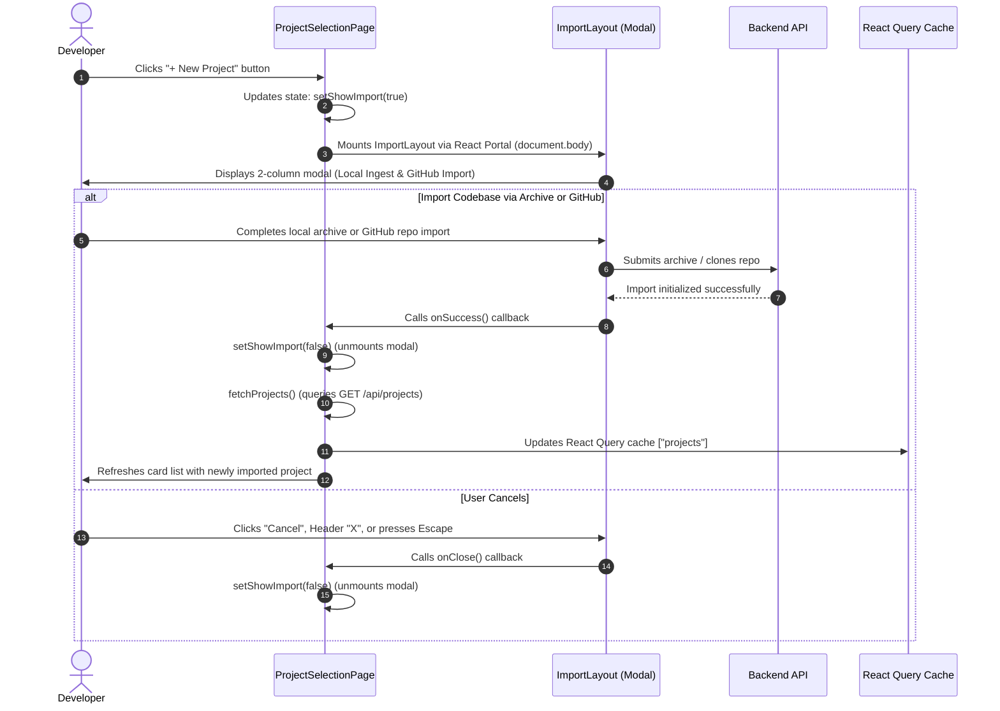
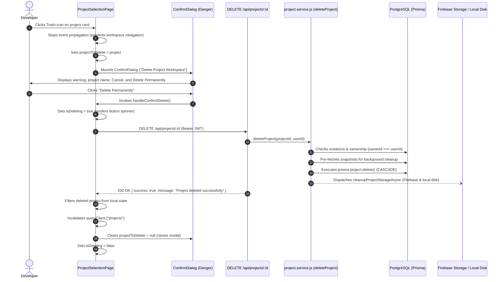

# COVAI Manage Projects UI — Implementation Analysis

## 1. Overview

The **Manage Projects interface** (Use Case **UC-07: Manage Projects** / **Project Hub**) serves as the central project directory and entry portal for authenticated developers on the COVAI platform. Its purpose is to present all repositories and codebases provisioned by the developer, display their operational metadata, enable keyword filtering and sorting, provide layout customization (grid vs. list), facilitate workspace navigation into the code analysis and test synthesis dashboard, and allow permanent project deletion.

The interface is implemented as a full-page client-side route (`ProjectSelectionPage.jsx`) mounted at `/projects` and protected by `<ProtectedRoute>`. It incorporates:
1. **Global Sticky Header:** Displays the COVAI terminal emblem, breadcrumbs (`CovAI / Projects`), a compact theme toggle (light/dark/system), a user avatar displaying account initials (`Q` in the screenshot), and a sign-out trigger with modal confirmation.
2. **Page Header:** Features the page title, dynamic project counter badge (`3` in the screenshot), value proposition subtitle, and the primary call-to-action button (`+ New Project`) which seamlessly opens the centralized Import Project modal (`ImportLayout.jsx`).
3. **Filter and View Toolbar:** Contains a real-time keyword search input with an instant clear button, an active sorting dropdown (`Recently Active`, `Name (A-Z)`, `Oldest First`), and a persistent two-way layout switcher (Card Grid vs. Compact List).
4. **Project Cards Container:** Displays individual project cards featuring project initials (`TE` in the screenshot), source badges (`GitHub` vs. `Local`), interactive favorite/star toggles with `localStorage` persistence, permanent deletion triggers with danger dialogs, branch badges (`main`), last-updated timestamps, and direct workspace navigation links (`Open ->`).

The frontend is built with **React 19**, **Vite**, **React Router v7**, **TanStack React Query**, **Lucide React** icons, and styled with **Tailwind CSS v4** utilizing semantic design tokens defined in `client/src/index.css`. The backend runs on **Node.js**, **Express**, **Prisma ORM** (PostgreSQL), and **Firebase / Cloud Storage** for physical archive and snapshot asset management.

---

## 2. Implementation Files

The following table documents all frontend and backend source files responsible for the Manage Projects interface, project querying, search, sorting, favorite caching, project deletion, and workspace navigation:

| File Path | Component/Function | Responsibility | Evidence |
|---|---|---|---|
| `client/src/pages/ProjectSelectionPage.jsx` | `ProjectSelectionPage` | Primary page component; orchestrates project fetching, search filtering, sorting, view mode switching, favorite toggling in `localStorage`, delete confirmation, logout modal, and import modal triggering. | Lines 32–562: `projects`, `searchQuery`, `sortBy`, `viewMode`, `favorites`, `handleConfirmDelete()`, `toggleFavorite()`, `<ConfirmDialog>`, `<ImportLayout>`. |
| `client/src/App.jsx` | Application Router | Configures client-side routing; binds `/projects` to `ProjectSelectionPage` wrapped in `<ProtectedRoute>` and `/main-editor` to `DashboardPage`. | Lines 106–121: `<Route path="/projects" element={<ProtectedRoute><ProjectSelectionPage /></ProtectedRoute>} />`. |
| `client/src/hooks/useAuth.js` | `useAuth` | Authentication hook providing current user state (`user.name`, `user.email`), authentication status, and `logout()` handler. | Lines 3–70: Reads JWT token from `localStorage`, extracts `userId`, `userEmail`, `userName`, and provides `logout()` clearing auth keys. |
| `client/src/services/project.service.js` | API Client | Centralized HTTP service wrapper executing `GET /api/projects` (`getProjectsApi`) and `DELETE /api/projects/:id` (`deleteProjectApi`). | Lines 38–43 (`getProjectsApi`), Lines 45–51 (`deleteProjectApi`). |
| `client/src/components/common/ConfirmDialog.jsx` | `ConfirmDialog` | Reusable modal dialog implementing Rule 24; manages backdrop, portal rendering, Esc keyboard listener, danger styling, loading spinner, and action callbacks. | Lines 21–162: `createPortal`, `handleKeyDown` (Esc), title, message, danger variant, loading state, `#confirm-dialog-title`. |
| `client/src/components/common/Skeleton.jsx` | `ProjectGridSkeleton` | Loading state placeholder; renders skeleton animated cards mirroring grid and list layouts with exact structural dimensions. | Lines 30–75: `count = 6`, `viewMode = "grid" \| "list"`, animated pulse placeholders for initials, badges, titles, and actions. |
| `client/src/components/common/Card.jsx` | `Card` | Design system container component supporting interactive hover states (`hover:border-[var(--color-primary)] cursor-pointer`). | Lines 1–32: `interactive` prop, variant styles, border radius, background surface tokens. |
| `client/src/components/common/Badge.jsx` | `Badge` | Design system badge supporting `primary`, `neutral`, `info`, `warning`, and `danger` variants across multiple sizes. | Lines 1–45: Used for project count badge, source badges (`GitHub` / `Local`), and branch labels. |
| `client/src/components/common/ThemeSelector.jsx` | `ThemeSelector` | Theme switcher component; in `compact` mode, renders a single icon button cycling `light -> dark -> system`. | Lines 4–31: Compact mode button cycling themes, persisting in `localStorage` key `covai_theme`. |
| `client/src/components/dashboard/import/ImportLayout.jsx` | `ImportLayout` | Project import modal; opened by the `New Project` button to ingest repositories via local archive or GitHub. | Mounted conditionally at `ProjectSelectionPage.jsx:551-559`. |
| `client/src/pages/DashboardPage.jsx` | `DashboardPage` | Target landing workspace page; mounts `Layout.jsx` which reads the `?projectId=` query parameter. | Lines 1–6: Target destination of card navigation (`/main-editor?projectId=${project.id}`). |
| `server/src/routes/project.route.js` | Express Router | Authenticated project routes defining endpoints for project listing and deletion. | Lines 17–18: `router.get("/", projectController.listProjects);`, Line 58: `router.delete("/:id", projectController.deleteProject);`. |
| `server/src/controllers/project.controller.js` | `ProjectController` | Controller handling project listing and project deletion requests. | Lines 178–204 (`listProjects`), Lines 1243–1270 (`deleteProject`). |
| `server/src/services/project.service.js` | Service Layer | Business logic querying user-owned projects and performing atomic cascade deletion with background storage cleanup. | Lines 156–183 (`listProjects`), Lines 910–985 (`cleanupProjectStorageAsync`), Lines 987–1045 (`deleteProject`). |
| `server/prisma/schema.prisma` | Prisma Schema | Defines database models including `User`, `Project`, `ProjectSnapshot`, and relational cascades. | Lines 36–75 (`model Project` with `ownerId`, `name`, `repoUrl`, `defaultBranch`, `snapshots`). |

---

## 3. UI Specification

The following five-column specification table details all 44 confirmed visible, interactive, conditional, and structural elements of the COVAI Manage Projects interface:

| No. | Field name | Type | Require | Target |
|---|---|---|---|---|
| 1 | `TopNavigationBar` | Navigation Bar (`<header>`) | `h-14 border-b border-[var(--color-border)] bg-[var(--color-surface)] px-4 sm:px-6 lg:px-8 flex items-center justify-between sticky top-0 z-30`. | Global top bar anchoring identity, theme switching, and user account actions. |
| 2 | `BrandLogoIcon` | Icon Container | `w-7 h-7 rounded-[var(--radius-md)] bg-[var(--color-primary)] text-white flex items-center justify-center font-bold text-xs shrink-0`; renders Lucide `Terminal` (`stroke-[2.5]`). | Visual emblem representing developer terminal capabilities. |
| 3 | `BrandTitle` | Text (Brand Name) | Visible text: `"CovAI"`; styling: `font-bold text-sm tracking-tight text-[var(--color-text)]`. | Displays application brand identity. |
| 4 | `BreadcrumbDivider` | Text (Separator) | Visible text: `"/"`; styling: `text-xs text-[var(--color-text-muted)]`. | Breadcrumb hierarchy separator. |
| 5 | `BreadcrumbCurrentPage` | Text (Page Identifier) | Visible text: `"Projects"`; styling: `text-xs text-[var(--color-text-secondary)] font-medium`. | Indicates active navigation section. |
| 6 | `ThemeToggleCompact` | Icon Button | Compact `<ThemeSelector compact />`; button cycling `light -> dark -> system`; displays active theme icon (`Sun`, `Moon`, or `Monitor`). | Toggles color theme and updates `localStorage` key `covai_theme`. |
| 7 | `HeaderSeparator` | Visual Divider | `h-4 w-px bg-[var(--color-border)] mx-1`. | Separates theme controls from user account controls. |
| 8 | `UserAvatarBadge` | User Profile Display | Square box (`w-7 h-7 rounded-[var(--radius-md)] bg-[var(--color-surface-secondary)] border text-[var(--color-text)] font-bold text-[11px] flex items-center justify-center select-none`); displays `{userInitials}` (`Q` in screenshot); tooltip shows `user?.email`. Non-clickable. | Visual identity badge representing the logged-in developer. |
| 9 | `SignOutButton` | Icon Button | `p-1.5 text-[var(--color-text-muted)] hover:text-[var(--color-danger)] hover:bg-[var(--color-surface-secondary)] rounded-[var(--radius-sm)] transition-colors cursor-pointer`; renders Lucide `LogOut` (`w-3.5 h-3.5`); `title="Sign Out"`. | Opens the sign-out confirmation dialog (`setShowLogoutConfirm(true)`). |
| 10 | `MainContentContainer` | Main Section (`<main>`) | `w-full max-w-6xl mx-auto px-4 sm:px-6 lg:px-8 py-8 flex-1 flex flex-col gap-6`. | Centers and constrains project cards and toolbars to a 6xl desktop container. |
| 11 | `PageTitleHeading` | Text Heading (`<h1>`) | Visible text: `"Projects"`; styling: `text-2xl font-bold tracking-tight text-[var(--color-text)]`. | Primary page heading establishing the section purpose. |
| 12 | `ProjectCountBadge` | Badge | Visible text: `{projects.length}` (`3` in screenshot); `<Badge variant="neutral" size="sm">`. Derived from loaded projects array length. | Informs user of the total number of projects owned. |
| 13 | `PageDescription` | Descriptive Text (`<p>`) | Visible text: `"Select a project to inspect code, run CFG branch diagnostics, and synthesize unit tests."`; styling: `text-xs sm:text-sm text-[var(--color-text-secondary)] mt-1`. | Explains the primary workflows available once a project is opened. |
| 14 | `NewProjectButton` | Primary Action Button | Visible text: `"New Project"`; `<Button variant="primary" size="md" icon={Plus}>`; purple background with white text. | Opens the Import Project modal dialog (`setShowImport(true)`). |
| 15 | `ToolbarContainer` | Container Bar (`<div>`) | `flex flex-col sm:flex-row items-stretch sm:items-center justify-between gap-3 pb-2 border-b border-[var(--color-border)]`. | Encloses search box, sort dropdown, and layout switcher. |
| 16 | `SearchInputContainer` | Input Field Wrapper | `relative w-full sm:w-80`. | Positions the search icon, text input, and clear button. |
| 17 | `SearchIcon` | Icon Container | Lucide `Search` (`w-4 h-4 text-[var(--color-text-muted)] pointer-events-none absolute left-3 top-1/2 -translate-y-1/2`). | Visual indicator denoting text search functionality. |
| 18 | `SearchInputField` | Text Input Field | Controlled input; `placeholder="Search projects..."`; `w-full h-8 pl-9 pr-8 rounded-[var(--radius-md)] bg-[var(--color-surface)] border text-xs text-[var(--color-text)] outline-none focus:border-[var(--color-primary)]`. | Filters visible projects by matching `project.name` in real-time. |
| 19 | `SearchClearButton` | Icon Button (Conditional) | Rendered when `searchQuery` is non-empty; `absolute right-2.5 top-1/2 -translate-y-1/2 text-[var(--color-text-muted)] hover:text-[var(--color-text)]`; Lucide `X` (`w-3.5 h-3.5`); `aria-label="Clear search"`. | Resets `searchQuery` to an empty string. |
| 20 | `SortFilterIcon` | Icon Decorator | Lucide `SlidersHorizontal` (`w-3.5 h-3.5 text-[var(--color-text-muted)] shrink-0`). Placed adjacent to sort select. Non-clickable icon. | Visual indicator denoting sorting and filtering options. |
| 21 | `SortSelectDropdown` | Select Dropdown | Native `<select>`; options: `"Recently Active"` (`recent`), `"Name (A-Z)"` (`name`), `"Oldest First"` (`oldest`); default: `"recent"`; `bg-[var(--color-surface)] border rounded-[var(--radius-md)] px-2 py-1 text-xs`. | Sorts project list reactively based on timestamps or alphabetical name. |
| 22 | `ViewModeSwitcher` | Button Group Wrapper | Pill wrapper: `flex items-center p-0.5 rounded-[var(--radius-md)] bg-[var(--color-surface)] border border-[var(--color-border)]`. | Houses the Grid View and List View toggle buttons. |
| 23 | `GridViewButton` | Icon Button | Lucide `Grid` (`w-3.5 h-3.5`); active styling: `bg-[var(--color-surface-secondary)] text-[var(--color-text)] font-semibold shadow-xs`; `title="Grid View"`. | Switches display layout to 3-column card grid (`viewMode = "grid"`). |
| 24 | `ListViewButton` | Icon Button | Lucide `List` (`w-3.5 h-3.5`); inactive styling: `text-[var(--color-text-muted)] hover:text-[var(--color-text)]`; `title="List View"`. | Switches display layout to vertical compact list (`viewMode = "list"`). |
| 25 | `ProjectGridContainer` | Grid Layout Container | `grid grid-cols-1 sm:grid-cols-2 lg:grid-cols-3 gap-4`. Rendered when `viewMode === "grid"`. | Formats project cards into a responsive 3-column grid. |
| 26 | `ProjectCard` | Interactive Card Component | `<Card interactive onClick={() => navigate('/main-editor?projectId=' + project.id)} className="p-4 flex flex-col justify-between group bg-[var(--color-surface)] border hover:border-[var(--color-primary)]">`. | Clickable container navigating developer to project workspace. |
| 27 | `ProjectInitialsBadge` | Project Initials Emblem | Box (`w-8 h-8 rounded-[var(--radius-md)] bg-[var(--color-surface-secondary)] border text-[var(--color-primary)] font-bold text-xs shrink-0 font-mono flex items-center justify-center`); renders `{initials}` (`TE` in screenshot). | Displays first two uppercase characters of project name. |
| 28 | `ProjectSourceBadge` | Source Badge | `<Badge variant={project.repoUrl ? "info" : "neutral"} size="sm">`; renders `"GitHub"` (if `repoUrl` populated) or `"Local"`. | Indicates origin channel of the ingested codebase. |
| 29 | `ProjectFavoriteButton` | Icon Button | Lucide `Star` (`w-3.5 h-3.5`); filled with amber if favorited (`fill="currentColor"`), empty stroke if not; stop propagation on click. | Adds or removes project ID from `covai_favorites` in `localStorage`. |
| 30 | `ProjectDeleteButton` | Icon Button | `p-1.5 text-[var(--color-text-muted)] hover:text-[var(--color-danger)] hover:bg-[var(--color-surface-secondary)] rounded-[var(--radius-sm)]`; Lucide `Trash2` (`w-3.5 h-3.5`); stop propagation on click. | Sets `projectToDelete = project` to trigger permanent delete confirmation. |
| 31 | `ProjectCardTitle` | Text Heading (`<h3>`) | Visible text: `{project.name}` (`test2`, `test3`, `test1` in screenshot); styling: `text-sm font-semibold text-[var(--color-text)] group-hover:text-[var(--color-primary)] truncate`. | Displays project title; hovering highlights in brand primary purple. |
| 32 | `ProjectBranchBadge` | Git Branch Badge | Pill badge (`px-1.5 py-0.5 rounded-[var(--radius-sm)] bg-[var(--color-surface-secondary)] border text-[10px] font-mono text-[var(--color-text-muted)]`); renders Lucide `GitBranch` (`w-3 h-3 text-[var(--color-primary)]`) + `"main"`. | Displays active tracking branch (currently hardcoded to `"main"` in UI). |
| 33 | `ProjectCardFooter` | Card Footer Container | `pt-3 mt-4 border-t border-[var(--color-border)] flex items-center justify-between text-xs`. | Houses updated timestamp and launch link. |
| 34 | `ProjectTimestamp` | Text Label | Lucide `Clock` (`w-3 h-3`) + formatted locale date string (`13/10/2026` in screenshot) or `"Recent"`; `text-[11px] font-mono text-[var(--color-text-muted)]`. | Displays last updated timestamp of the project record. |
| 35 | `ProjectOpenLink` | Action Text / Link | Visible text: `"Open"` with Lucide `ArrowRight` (`w-3 h-3`); styling: `text-[var(--color-primary)] font-medium flex items-center gap-1 group-hover:translate-x-0.5 transition-transform text-xs`. | Visual indicator that clicking card opens workspace. |
| 36 | `ProjectListContainer` | List Layout Container | `flex flex-col gap-2`. Rendered when `viewMode === "list"`. | Houses project rows in a compact vertical list layout. |
| 37 | `ProjectListItemRow` | Interactive List Row | `group flex items-center justify-between p-3 rounded-[var(--radius-md)] bg-[var(--color-surface)] hover:bg-[var(--color-surface-secondary)] border hover:border-[var(--color-primary)] cursor-pointer`. | Compact horizontal list alternative to card grid. |
| 38 | `LoadingSkeletonState` | Skeleton Placeholder | `<ProjectGridSkeleton count={6} viewMode={viewMode} />`; rendered while `loading === true`. | Animated skeleton shimmer displayed during initial project querying. |
| 39 | `EmptyProjectsState` | Empty State Container | Rendered when `projects.length === 0`; dashed border box with Lucide `FolderGit2` (`w-6 h-6`), title `"No projects yet"`, subtitle, and `"Import First Project"` button. | Guides new users to import their initial codebase. |
| 40 | `EmptySearchState` | Empty State Container | Rendered when search returns 0 matches; dashed border box with `FolderGit2`, title `"No matching projects"`, subtitle, and `"Clear Search"` button. | Informs user that no projects match the query and offers instant reset. |
| 41 | `DeleteConfirmDialog` | Modal Dialog | `<ConfirmDialog isOpen={Boolean(projectToDelete)} title="Delete Project Workspace" variant="danger">`; contains target project name in danger badge, `"Cancel"`, and `"Delete Permanently"`. | Prevents accidental data loss by requiring explicit deletion confirmation. |
| 42 | `LogoutConfirmDialog` | Modal Dialog | `<ConfirmDialog isOpen={showLogoutConfirm} title="Sign Out" variant="danger">`; contains confirmation prompt, `"Cancel"`, and `"Sign Out"`. | Prevents unintended session termination. |
| 43 | `ImportModalPortal` | Modal Portal Component | `<ImportLayout onClose={() => setShowImport(false)} onSuccess={...} />`; conditionally mounted when `showImport === true`. | Ingestion hub for uploading archives or cloning GitHub repos. |
| 44 | `GlobalToastProvider` | Notification Toast System | Toast context listening to global background jobs and ingest completions. | Displays floating alert toasts for async operations. |

---

## 4. Project Hub Loading and Display

### 4.1 Project Querying and Authorization
When `ProjectSelectionPage` mounts, it issues an authenticated HTTP `GET /api/projects` via `getProjectsApi()` (`client/src/services/project.service.js:38-43`). The request injects the bearer JWT token stored in `localStorage`.

On the server side:
1. `server/src/routes/project.route.js:14` applies `authMiddleware`, ensuring unauthenticated requests are rejected with HTTP 401.
2. `server/src/controllers/project.controller.js:180` calls `listProjects(req.user.id)`.
3. `server/src/services/project.service.js:156-183` queries PostgreSQL using Prisma:
   ```javascript
   prisma.project.findMany({
     where: { ownerId: userId },
     orderBy: { createdAt: "desc" },
     select: {
       id: true,
       name: true,
       description: true,
       repoUrl: true,
       defaultBranch: true,
       rootDir: true,
       jestConfigPath: true,
       storageBasePath: true,
       createdAt: true,
       updatedAt: true,
       snapshots: {
         orderBy: { createdAt: "desc" },
         take: 1,
         select: { id: true },
       },
       _count: {
         select: { snapshots: true },
       },
     },
   });
   ```
4. **Strict Isolation:** Only projects whose `ownerId` matches the authenticated `userId` are retrieved. Collaborator sharing or public project visibility is not implemented at this layer; access is strictly single-tenant ownership.

### 4.2 Project Count and Initials Calculation
- **Project Count:** Displayed dynamically in `ProjectCountBadge` next to the heading: `<Badge variant="neutral" size="sm">{projects.length}</Badge>`. In the screenshot, `projects.length` is `3`.
- **Project Initials Badge:** Displayed on each card in a square box:
  ```javascript
  const initials = (project.name || "PR").slice(0, 2).toUpperCase();
  ```
  **Critical Finding:** In the screenshot, all three project cards display `"TE"` (`test2`, `test3`, `test1`). This is **not** a programming language indicator (e.g., TypeScript), but rather the first two characters of the repository names (`TE` for `test`).

### 4.3 Loading, Empty, and Error States
- **Loading State:** While `loading === true`, the interface renders `<ProjectGridSkeleton count={6} viewMode={viewMode} />`. It displays 6 pulsing skeleton cards in grid mode or 6 skeleton rows in list mode, preventing layout shift.
- **Empty State (No Projects):** If `projects.length === 0` and no search query is active, the interface renders a centered dashed container with a `FolderGit2` icon, title `"No projects yet"`, explanatory text, and a primary button `"Import First Project"` which triggers `setShowImport(true)`.
- **Empty Search State:** If `searchQuery` is active and filters out all projects (`filteredProjects.length === 0`), it renders `"No matching projects"` with text `No projects match "${searchQuery}". Clear your search or try another keyword.` and a secondary button `"Clear Search"`.
- **Error State:** If `getProjectsApi()` throws, the error is logged to `console.error`, and `projects` defaults to an empty array (`[]`), causing the empty state card to render.

---

## 5. Search, Sorting, and View Controls

All project filtering and sorting is handled entirely on the client side inside a memoized hook (`useMemo` in `ProjectSelectionPage.jsx:124-147`):

```javascript
const filteredProjects = useMemo(() => {
  let list = [...projects];

  // 1. Text Search Filter
  if (searchQuery.trim()) {
    const q = searchQuery.toLowerCase();
    list = list.filter((p) => p.name?.toLowerCase().includes(q));
  }

  // 2. Sorting Criteria
  if (sortBy === "recent") {
    list.sort(
      (a, b) =>
        new Date(b.updatedAt || b.createdAt || 0) -
        new Date(a.updatedAt || a.createdAt || 0),
    );
  } else if (sortBy === "name") {
    list.sort((a, b) => (a.name || "").localeCompare(b.name || ""));
  } else if (sortBy === "oldest") {
    list.sort(
      (a, b) => new Date(a.createdAt || 0) - new Date(b.createdAt || 0),
    );
  }

  return list;
}, [projects, searchQuery, sortBy]);
```

### 5.1 Search Field Mechanics
- **Search Scope:** Matches exclusively against `project.name`. Project descriptions, repository URLs, branches, and languages are **not** searched.
- **Interactivity:** Updates reactively on every keystroke (`onChange={(e) => setSearchQuery(e.target.value)}`).
- **Clear Control:** When `searchQuery` has at least one character, an `X` icon button appears on the right side of the input field (`#search-clear-btn`). Clicking it resets `searchQuery = ""` and restores the full project list.

### 5.2 Sorting Mechanics
The sort dropdown (`SortSelectDropdown`) provides three options:
1. `"recent"` (**Recently Active**): Sorts descending by `updatedAt` (or fallback `createdAt`). This is the default option visible in the screenshot.
2. `"name"` (**Name (A-Z)**): Sorts alphabetically by `project.name` using `localeCompare()`.
3. `"oldest"` (**Oldest First**): Sorts ascending by `createdAt`.
- **Persistence:** Sorting order is maintained in React component state (`sortBy`). It is not persisted in `localStorage`; reloading the page defaults back to `"recent"`.
- **Icon Decorator:** The Lucide `SlidersHorizontal` icon (`SortFilterIcon`) next to the dropdown is purely visual and does not open a secondary filter modal.

### 5.3 View Mode Switching (Grid vs. List)
- **Grid View (`viewMode === "grid"`):** Renders a 3-column responsive card grid (`grid-cols-1 sm:grid-cols-2 lg:grid-cols-3 gap-4`). This is the view shown in the screenshot.
- **List View (`viewMode === "list"`):** Renders a vertical stack of compact horizontal rows (`flex flex-col gap-2`). Each row presents initials, title, favorite star, GitHub badge, branch, updated date, trash icon, and Open link.
- **Persistence:** View mode is stored in component state (`viewMode`). It is not persisted in `localStorage`; reloading the page resets to `"grid"`.

---

## 6. New Project Flow

The `+ New Project` button does **not** navigate to an independent URL route or directly create a dummy project. Instead, it serves as the trigger for the **Import Project Modal Hub** (`ImportLayout.jsx`):



---

## 7. Delete Project Flow

Project deletion is permanent, irreversible, and protected by a confirmation modal:



### 7.1 Security and Authorization
1. **Ownership Check:** In `server/src/services/project.service.js:988-994`:
   ```javascript
   const project = await prisma.project.findUnique({ where: { id: projectId } });
   if (!project) throw new ServiceError("Project not found", 404);
   if (project.ownerId !== userId) {
     throw new ServiceError("You are not allowed to delete this project", 403);
   }
   ```
   Users cannot delete projects owned by other developers.
2. **Database Cascade Deletion:**
   The backend first attempts native PostgreSQL `ON DELETE CASCADE` via `prisma.project.delete({ where: { id: projectId } })`. If direct foreign-key cascading encounters constraints, it automatically falls back to an atomic Prisma transaction deleting records across 14 tables:
   - `coverageSummary`, `coverageFile`, `coverageFunction`, `cyclomatic`, `cfg`, `aiContextCache`, `aiSuggestion`, `aiTest`, `jobLog`, `jobOutput`, `job`, `notification`, `projectSnapshot`, and `project`.
3. **Storage Asset Cleanup:**
   Physical files are purged asynchronously via `cleanupProjectStorageAsync(projectId, snapshots)`:
   - Firebase Storage: Deletes all snapshot files and cleans up the prefix `projects/{projectId}/`.
   - Local Disk: Recursively deletes `storage/projects/{projectId}`.

---

## 8. Open Existing Project Flow

When a user clicks anywhere on a project card (or clicks the `"Open ->"` link):
1. **Event Trigger:** `onClick={() => navigate('/main-editor?projectId=' + project.id)}` (`ProjectSelectionPage.jsx:357-359`).
2. **Navigation Destination:** Navigates to `/main-editor` with the URL query parameter `projectId=${project.id}`.
3. **Workspace Ingestion:**
   - In `client/src/App.jsx:115-121`, route `/main-editor` renders `<DashboardPage />`.
   - `DashboardPage.jsx` renders `<Layout />` (`client/src/components/dashboard/Layout.jsx`).
   - `Layout.jsx:92-94` reads `searchParams.get("projectId")`.
   - The workspace fetches project snapshots, loads the file tree, initializes coverage visualizations, and defaults to the code explorer tab.
4. **Access Verification:**
   - If the project does not exist or does not belong to the user, backend endpoints for file trees and snapshots return HTTP 404/403, and the workspace displays an error banner.

---

## 9. Other Project Card Actions

### 9.1 Favorite / Star Control
- **UI Element:** Lucide `Star` icon button positioned in the top-right corner of each card (`ProjectSelectionPage.jsx:379-396`).
- **Handler:** `toggleFavorite(e, project.id)` calls `e.stopPropagation()` to prevent opening the project.
- **Persistence:** Reads and writes directly to browser `localStorage` under key `"covai_favorites"`:
  ```javascript
  setFavorites((prev) => {
    const next = prev.includes(projectId)
      ? prev.filter((id) => id !== projectId)
      : [...prev, projectId];
    localStorage.setItem("covai_favorites", JSON.stringify(next));
    return next;
  });
  ```
- **Visual State:**
  - **Unfavorited (Screenshot state):** Gray stroke icon (`text-[var(--color-text-muted)]`, `fill="none"`).
  - **Favorited:** Amber filled icon (`text-amber-500 bg-amber-500/10`, `fill="currentColor"`).
- **Backend Sync:** Favorites are currently purely client-side; no backend endpoint persists favorites across devices.

### 9.2 Sign-Out Flow
- Clicking the `LogOut` icon button in the header sets `showLogoutConfirm = true`.
- Renders `<ConfirmDialog>` with title `"Sign Out"`, message `"Are you sure you want to sign out? You will be redirected to the home landing page."`, and buttons `"Cancel"` / `"Sign Out"`.
- On confirm, `handleLogout()` executes:
  ```javascript
  logout(); // clears token, user, userName, userEmail from localStorage
  navigate("/", { replace: true });
  ```

---

## 10. Screenshot-to-Code Comparison

The following table compares each visual element in the supplied screenshot against the actual source code implementation:

| UI Element | Screenshot Observation | Source-Code Evidence | Status | Notes |
|---|---|---|---|---|
| Terminal Logo | Purple rounded box with white `>_` terminal icon | `ProjectSelectionPage.jsx:165-167`: `w-7 h-7 rounded-[var(--radius-md)] bg-[var(--color-primary)] text-white flex items-center justify-center font-bold text-xs shrink-0`, renders Lucide `Terminal`. | `MATCH` | Exact visual match. |
| Brand Breadcrumb | `"CovAI / Projects"` | `ProjectSelectionPage.jsx:168-176`: `"CovAI"`, `"/"`, `"Projects"`. | `MATCH` | Exact text and hierarchy match. |
| Theme Toggle | Sun icon in square border | `ProjectSelectionPage.jsx:181`: `<ThemeSelector compact />`. | `MATCH` | Exact component match. In light mode, displays sun icon. |
| User Avatar | Square box with letter `"Q"` | `ProjectSelectionPage.jsx:187-192`: Box displaying `{userInitials}`. For user "quy7373", initials calculate to `"Q"`. | `MATCH` | Confirmed dynamic calculation from `user.name \|\| user.email`. Tooltip displays email. Non-clickable. |
| Sign-Out Icon | Box with logout door arrow icon | `ProjectSelectionPage.jsx:193-201`: Button with Lucide `LogOut` icon (`w-3.5 h-3.5`). | `MATCH` | Exact match. Triggers `ConfirmDialog`. |
| Heading & Counter | `"Projects"` with gray badge `"3"` | `ProjectSelectionPage.jsx:212-218`: `<h1>Projects</h1>`, `<Badge variant="neutral">{projects.length}</Badge>`. | `MATCH` | Counter dynamically reflects project array count. |
| Subtitle Description | Description mentioning CFG diagnostics & tests | `ProjectSelectionPage.jsx:219-222`: Exact string match. | `MATCH` | Exact match. |
| New Project Button | Purple button with `+` icon: `"+ New Project"` | `ProjectSelectionPage.jsx:225-233`: `<Button variant="primary" icon={Plus}>New Project</Button>`. | `MATCH` | Opens `ImportLayout` modal. |
| Search Input | Search icon with placeholder `"Search projects..."` | `ProjectSelectionPage.jsx:240-247`: Input with exact placeholder and Lucide `Search`. | `MATCH` | Exact match. Filters by project name. |
| Sort Dropdown | Sliders icon + dropdown showing `"Recently Active"` | `ProjectSelectionPage.jsx:263-273`: Lucide `SlidersHorizontal` + `<select>` with `"Recently Active"`. | `MATCH` | Exact match. Sorts by `updatedAt` / `createdAt`. |
| View Mode Toggle | Pill container with Grid (active) and List icons | `ProjectSelectionPage.jsx:276-303`: Grid and List buttons. Grid button styled as active. | `MATCH` | Exact match. |
| Card Initials Badge | Square box showing `"TE"` on all 3 cards | `ProjectSelectionPage.jsx:366-368`: `{initials}` calculated as `(project.name \|\| "PR").slice(0, 2).toUpperCase()`. | `MATCH` | For projects `test2`, `test3`, `test1`, initials are `"TE"`. **Not a language badge.** |
| GitHub Source Badge | Blue badge `"GitHub"` | `ProjectSelectionPage.jsx:369-374`: `<Badge variant={project.repoUrl ? "info" : "neutral"}>{project.repoUrl ? "GitHub" : "Local"}</Badge>`. | `MATCH` | Blue info badge rendered because `repoUrl` is present. |
| Star / Favorite Icon | Gray star icon on top-right of cards | `ProjectSelectionPage.jsx:380-396`: Lucide `Star` (`w-3.5 h-3.5`), unfavorited. | `MATCH` | Exact match. Persists to `localStorage`. |
| Delete Trash Icon | Gray trash icon on top-right of cards | `ProjectSelectionPage.jsx:397-408`: Lucide `Trash2` (`w-3.5 h-3.5`). | `MATCH` | Exact match. Triggers deletion dialog. |
| Project Names | `test2`, `test3`, `test1` | `ProjectSelectionPage.jsx:413-419`: `<h3>{project.name}</h3>`. | `MATCH` | Dynamic project names from database. |
| Branch Badge | Git branch icon with text `"main"` | `ProjectSelectionPage.jsx:422-426`: Badge with Lucide `GitBranch` and static text `"main"`. | `MATCH` | Matches screenshot visually, though hardcoded in code rather than reading `project.defaultBranch`. |
| Timestamp | Clock icon + `"13/10/2026"` | `ProjectSelectionPage.jsx:431-436`: Clock icon + `toLocaleDateString()`. | `MATCH` | Exact format and date representation. |
| Open Link | Purple text `"Open"` with right arrow | `ProjectSelectionPage.jsx:437-439`: `"Open"` + Lucide `ArrowRight`. | `MATCH` | Exact match. Clicking card opens workspace. |

---

## 11. Findings and Limitations

### 11.1 Verified Strengths
1. **Architectural Cohesion:**
   - Seamless integration between `ProjectSelectionPage` and `ImportLayout`. The `+ New Project` button directly summons the full-featured import modal, enabling immediate codebase ingestion without route disorientation.
2. **Robust Deletion Pipeline:**
   - Deletion is protected by a dedicated danger-styled `ConfirmDialog` displaying the project name.
   - The backend enforces strict ownership verification (`ownerId === userId`), executes high-speed cascade deletion across 14 tables in PostgreSQL, and asynchronously cleans up cloud and local storage files.
3. **Resilient Client Filtering:**
   - Real-time search, sorting, and view mode switching execute in-memory with zero network overhead, offering sub-millisecond response times.
   - Comprehensive skeleton placeholders and dual-state empty views provide high-quality feedback.

### 11.2 Identified Limitations & Discrepancies
1. **Initials Badge Misidentification:**
   - Visual observation of the screenshot might mistake the badge `"TE"` for a language badge (e.g., TypeScript). Source code confirms it represents **project initials** (`(project.name || "PR").slice(0, 2).toUpperCase()`).
2. **Hardcoded Branch Name:**
   - In `ProjectSelectionPage.jsx:424` and `482`, the branch badge renders hardcoded text `"main"` instead of dynamically interpolating `project.defaultBranch || "main"`. Projects cloned on non-main branches (e.g., `master`, `develop`) will still display `main` in the UI card.
3. **Client-Side-Only Favorites:**
   - The favorite/star toggle persists project IDs exclusively in the browser's `localStorage` (`covai_favorites`). Favorite states are not synchronized across devices or stored in the PostgreSQL database.
4. **Non-Persisted View Mode and Sort Option:**
   - Neither `viewMode` (`grid` vs. `list`) nor `sortBy` (`recent` vs. `name` vs. `oldest`) are saved to `localStorage`. Refreshing the page always resets the UI to grid mode sorted by recently active.
5. **Static Avatar Control:**
   - The user profile avatar displaying `"Q"` is a non-interactive `<div>` with a tooltip. It does not open a profile dropdown menu or navigation settings modal.

---

## 12. Source References

The following table provides exact file paths, component names, function identifiers, and line ranges for all inspected logic:

| File Reference | Symbol / Function | Line Range | Description |
|---|---|---|---|
| `client/src/pages/ProjectSelectionPage.jsx` | `ProjectSelectionPage` | Lines 32–562 | Main page component, state management, render logic. |
| `client/src/pages/ProjectSelectionPage.jsx` | `fetchProjects` | Lines 59–76 | React Query project fetcher callback. |
| `client/src/pages/ProjectSelectionPage.jsx` | `toggleFavorite` | Lines 95–104 | Toggles and persists project IDs in `localStorage`. |
| `client/src/pages/ProjectSelectionPage.jsx` | `handleConfirmDelete` | Lines 106–121 | Executes project deletion and cache invalidation. |
| `client/src/pages/ProjectSelectionPage.jsx` | `filteredProjects` | Lines 124–147 | Memoized search filter and sorting algorithm. |
| `client/src/pages/ProjectSelectionPage.jsx` | `userInitials` | Lines 149–158 | Computes 1–2 letter uppercase user initials. |
| `client/src/services/project.service.js` | `getProjectsApi` | Lines 38–43 | HTTP GET request to `/api/projects`. |
| `client/src/services/project.service.js` | `deleteProjectApi` | Lines 45–51 | HTTP DELETE request to `/api/projects/:id`. |
| `client/src/components/common/ConfirmDialog.jsx` | `ConfirmDialog` | Lines 21–162 | Reusable modal dialog implementing Rule 24. |
| `client/src/components/common/Skeleton.jsx` | `ProjectGridSkeleton` | Lines 30–75 | Shimmer placeholders for grid and list project layouts. |
| `server/src/routes/project.route.js` | Express Router | Lines 17–58 | Route definitions for project listing and deletion. |
| `server/src/controllers/project.controller.js` | `listProjects` | Lines 178–204 | Controller retrieving user's owned projects. |
| `server/src/controllers/project.controller.js` | `deleteProject` | Lines 1243–1270 | Controller handling project deletion requests. |
| `server/src/services/project.service.js` | `listProjects` | Lines 156–183 | Service querying PostgreSQL for user projects. |
| `server/src/services/project.service.js` | `deleteProject` | Lines 987–1045 | Service verifying ownership and executing cascade delete. |
| `server/src/services/project.service.js` | `cleanupProjectStorageAsync` | Lines 910–985 | Asynchronous cleanup of Firebase files and local disk files. |

---

## 13. Final UI Specification Table

The following clean, standalone table is formatted for direct inclusion in the COVAI Capstone report:

| No. | Field name | Type | Require | Target |
|---|---|---|---|---|
| 1 | `TopNavigationBar` | Navigation Bar (`<header>`) | Sticky header (`h-14 border-b bg-[var(--color-surface)] px-4 sm:px-6 lg:px-8 flex items-center justify-between sticky top-0 z-30`). | Global top bar housing brand identity, theme switching, and user account controls. |
| 2 | `BrandLogoIcon` | Icon Container | Purple box (`w-7 h-7 rounded-[var(--radius-md)] bg-[var(--color-primary)] text-white flex items-center justify-center font-bold text-xs shrink-0`); Lucide `Terminal`. | Visual brand emblem representing developer CLI / terminal capability. |
| 3 | `BrandTitle` | Text (Brand Name) | Text: `"CovAI"`; styling: `font-bold text-sm tracking-tight text-[var(--color-text)]`. | Displays application brand identity. |
| 4 | `BreadcrumbDivider` | Text (Separator) | Text: `"/"`; styling: `text-xs text-[var(--color-text-muted)]`. | Hierarchy separator between brand name and page title. |
| 5 | `BreadcrumbCurrentPage` | Text (Page Identifier) | Text: `"Projects"`; styling: `text-xs text-[var(--color-text-secondary)] font-medium`. | Indicates active page section. |
| 6 | `ThemeToggleCompact` | Icon Button | Compact `<ThemeSelector compact />`; cycles `light -> dark -> system`; displays active theme icon (`Sun`, `Moon`, or `Monitor`). | Toggles color theme and updates `localStorage` key `covai_theme`. |
| 7 | `HeaderSeparator` | Visual Divider | Vertical line (`h-4 w-px bg-[var(--color-border)] mx-1`). | Visually separates theme toggle from user profile controls. |
| 8 | `UserAvatarBadge` | User Profile Display | Rounded box (`w-7 h-7 rounded-[var(--radius-md)] bg-[var(--color-surface-secondary)] border text-[var(--color-text)] font-bold text-[11px] flex items-center justify-center select-none`); displays `{userInitials}` (`Q` in screenshot). Non-clickable. | Visual identity badge representing the logged-in developer. |
| 9 | `SignOutButton` | Icon Button | Lucide `LogOut` (`w-3.5 h-3.5`); `p-1.5 text-[var(--color-text-muted)] hover:text-[var(--color-danger)] rounded-[var(--radius-sm)]`; `title="Sign Out"`. | Opens the sign-out confirmation dialog (`setShowLogoutConfirm(true)`). |
| 10 | `MainContentContainer` | Main Section (`<main>`) | Container (`w-full max-w-6xl mx-auto px-4 sm:px-6 lg:px-8 py-8 flex-1 flex flex-col gap-6`). | Constrains project management layout within a 6xl desktop container. |
| 11 | `PageTitleHeading` | Text Heading (`<h1>`) | Text: `"Projects"`; styling: `text-2xl font-bold tracking-tight text-[var(--color-text)]`. | Primary page heading establishing section purpose. |
| 12 | `ProjectCountBadge` | Badge | Text: `{projects.length}` (`3` in screenshot); `<Badge variant="neutral" size="sm">`. Derived dynamically from loaded projects array length. | Displays the total number of projects owned by developer. |
| 13 | `PageDescription` | Descriptive Text (`<p>`) | Text: `"Select a project to inspect code, run CFG branch diagnostics, and synthesize unit tests."`; styling: `text-xs sm:text-sm text-[var(--color-text-secondary)] mt-1`. | Explains core capability: AST analysis, CFG branch verification, and test synthesis. |
| 14 | `NewProjectButton` | Primary Action Button | Text: `"New Project"`; `<Button variant="primary" size="md" icon={Plus}>`; purple background with white text. | Opens the Import Project modal dialog (`setShowImport(true)`). |
| 15 | `ToolbarContainer` | Container Bar (`<div>`) | Container (`flex flex-col sm:flex-row items-stretch sm:items-center justify-between gap-3 pb-2 border-b border-[var(--color-border)]`). | Encloses search box, sort dropdown, and layout switcher. |
| 16 | `SearchInputContainer` | Input Field Wrapper | Wrapper (`relative w-full sm:w-80`). | Positions the search icon, text input, and clear button. |
| 17 | `SearchIcon` | Icon Container | Lucide `Search` (`w-4 h-4 text-[var(--color-text-muted)] pointer-events-none absolute left-3 top-1/2 -translate-y-1/2`). | Visual indicator denoting text search functionality. |
| 18 | `SearchInputField` | Text Input Field | Controlled input; `placeholder="Search projects..."`; `w-full h-8 pl-9 pr-8 rounded-[var(--radius-md)] bg-[var(--color-surface)] border text-xs text-[var(--color-text)] outline-none focus:border-[var(--color-primary)]`. | Filters visible projects by matching `project.name` in real-time. |
| 19 | `SearchClearButton` | Icon Button (Conditional) | Rendered when `searchQuery` is non-empty; `absolute right-2.5 top-1/2 -translate-y-1/2 text-[var(--color-text-muted)] hover:text-[var(--color-text)]`; Lucide `X` (`w-3.5 h-3.5`); `aria-label="Clear search"`. | Resets `searchQuery` to an empty string. |
| 20 | `SortFilterIcon` | Icon Decorator | Lucide `SlidersHorizontal` (`w-3.5 h-3.5 text-[var(--color-text-muted)] shrink-0`). Placed adjacent to sort select. Non-clickable icon. | Visual indicator denoting sorting and filtering options. |
| 21 | `SortSelectDropdown` | Select Dropdown | Native `<select>`; options: `"Recently Active"` (`recent`), `"Name (A-Z)"` (`name`), `"Oldest First"` (`oldest`); default: `"recent"`; `bg-[var(--color-surface)] border rounded-[var(--radius-md)] px-2 py-1 text-xs`. | Sorts project list reactively based on timestamps or alphabetical name. |
| 22 | `ViewModeSwitcher` | Button Group Wrapper | Pill wrapper (`flex items-center p-0.5 rounded-[var(--radius-md)] bg-[var(--color-surface)] border border-[var(--color-border)]`). | Houses the Grid View and List View toggle buttons. |
| 23 | `GridViewButton` | Icon Button | Lucide `Grid` (`w-3.5 h-3.5`); active styling: `bg-[var(--color-surface-secondary)] text-[var(--color-text)] font-semibold shadow-xs`; `title="Grid View"`. | Switches display layout to 3-column card grid (`viewMode = "grid"`). |
| 24 | `ListViewButton` | Icon Button | Lucide `List` (`w-3.5 h-3.5`); inactive styling: `text-[var(--color-text-muted)] hover:text-[var(--color-text)]`; `title="List View"`. | Switches display layout to vertical compact list (`viewMode = "list"`). |
| 25 | `ProjectGridContainer` | Grid Layout Container | Container (`grid grid-cols-1 sm:grid-cols-2 lg:grid-cols-3 gap-4`). Rendered when `viewMode === "grid"`. | Formats project cards into a responsive 3-column grid. |
| 26 | `ProjectCard` | Interactive Card Component | `<Card interactive onClick={() => navigate('/main-editor?projectId=' + project.id)} className="p-4 flex flex-col justify-between group bg-[var(--color-surface)] border hover:border-[var(--color-primary)]">`. | Clickable container navigating developer to project workspace. |
| 27 | `ProjectInitialsBadge` | Project Initials Emblem | Box (`w-8 h-8 rounded-[var(--radius-md)] bg-[var(--color-surface-secondary)] border text-[var(--color-primary)] font-bold text-xs shrink-0 font-mono flex items-center justify-center`); renders `{initials}` (`TE` in screenshot). | Displays first two uppercase characters of project name. |
| 28 | `ProjectSourceBadge` | Source Badge | `<Badge variant={project.repoUrl ? "info" : "neutral"} size="sm">`; renders `"GitHub"` (if `repoUrl` populated) or `"Local"`. | Indicates origin channel of the ingested codebase. |
| 29 | `ProjectFavoriteButton` | Icon Button | Lucide `Star` (`w-3.5 h-3.5`); filled with amber if favorited (`fill="currentColor"`), empty stroke if not; stop propagation on click. | Adds or removes project ID from `covai_favorites` in `localStorage`. |
| 30 | `ProjectDeleteButton` | Icon Button | `p-1.5 text-[var(--color-text-muted)] hover:text-[var(--color-danger)] hover:bg-[var(--color-surface-secondary)] rounded-[var(--radius-sm)]`; Lucide `Trash2` (`w-3.5 h-3.5`); stop propagation on click. | Sets `projectToDelete = project` to trigger permanent delete confirmation. |
| 31 | `ProjectCardTitle` | Text Heading (`<h3>`) | Text: `{project.name}` (`test2`, `test3`, `test1` in screenshot); styling: `text-sm font-semibold text-[var(--color-text)] group-hover:text-[var(--color-primary)] truncate`. | Displays project title; hovering highlights in brand primary purple. |
| 32 | `ProjectBranchBadge` | Git Branch Badge | Pill badge (`px-1.5 py-0.5 rounded-[var(--radius-sm)] bg-[var(--color-surface-secondary)] border text-[10px] font-mono text-[var(--color-text-muted)]`); renders Lucide `GitBranch` (`w-3 h-3 text-[var(--color-primary)]`) + `"main"`. | Displays active tracking branch (currently hardcoded to `"main"` in UI). |
| 33 | `ProjectCardFooter` | Card Footer Container | Container (`pt-3 mt-4 border-t border-[var(--color-border)] flex items-center justify-between text-xs`). | Houses updated timestamp and launch link. |
| 34 | `ProjectTimestamp` | Text Label | Lucide `Clock` (`w-3 h-3`) + formatted locale date string (`13/10/2026` in screenshot) or `"Recent"`; `text-[11px] font-mono text-[var(--color-text-muted)]`. | Displays last updated timestamp of the project record. |
| 35 | `ProjectOpenLink` | Action Text / Link | Text: `"Open"` with Lucide `ArrowRight` (`w-3 h-3`); styling: `text-[var(--color-primary)] font-medium flex items-center gap-1 group-hover:translate-x-0.5 transition-transform text-xs`. | Visual indicator that clicking card opens workspace. |
| 36 | `ProjectListContainer` | List Layout Container | Container (`flex flex-col gap-2`). Rendered when `viewMode === "list"`. | Houses project rows in a compact vertical list layout. |
| 37 | `ProjectListItemRow` | Interactive List Row | Row (`group flex items-center justify-between p-3 rounded-[var(--radius-md)] bg-[var(--color-surface)] hover:bg-[var(--color-surface-secondary)] border hover:border-[var(--color-primary)] cursor-pointer`). | Compact horizontal list alternative to card grid. |
| 38 | `LoadingSkeletonState` | Skeleton Placeholder | `<ProjectGridSkeleton count={6} viewMode={viewMode} />`; rendered while `loading === true`. | Animated skeleton shimmer displayed during initial project querying. |
| 39 | `EmptyProjectsState` | Empty State Container | Rendered when `projects.length === 0`; dashed border box with Lucide `FolderGit2` (`w-6 h-6`), title `"No projects yet"`, subtitle, and `"Import First Project"` button. | Guides new users to import their initial codebase. |
| 40 | `EmptySearchState` | Empty State Container | Rendered when search returns 0 matches; dashed border box with `FolderGit2`, title `"No matching projects"`, subtitle, and `"Clear Search"` button. | Informs user that no projects match the query and offers instant reset. |
| 41 | `DeleteConfirmDialog` | Modal Dialog | `<ConfirmDialog isOpen={Boolean(projectToDelete)} title="Delete Project Workspace" variant="danger">`; contains target project name in danger badge, `"Cancel"`, and `"Delete Permanently"`. | Prevents accidental data loss by requiring explicit deletion confirmation. |
| 42 | `LogoutConfirmDialog` | Modal Dialog | `<ConfirmDialog isOpen={showLogoutConfirm} title="Sign Out" variant="danger">`; contains confirmation prompt, `"Cancel"`, and `"Sign Out"`. | Prevents unintended session termination. |
| 43 | `ImportModalPortal` | Modal Portal Component | `<ImportLayout onClose={() => setShowImport(false)} onSuccess={...} />`; conditionally mounted when `showImport === true`. | Ingestion hub for uploading archives or cloning GitHub repos. |
| 44 | `GlobalToastProvider` | Notification Toast System | Toast context listening to global background jobs and ingest completions. | Displays floating alert toasts for async operations. |
