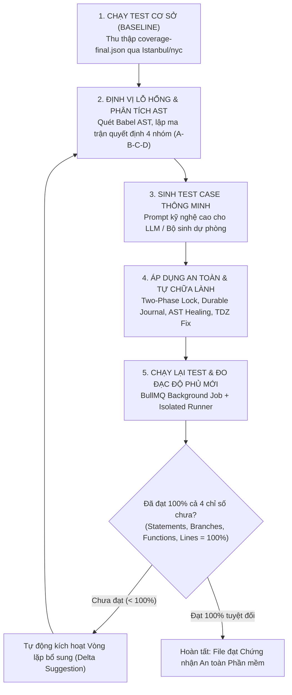
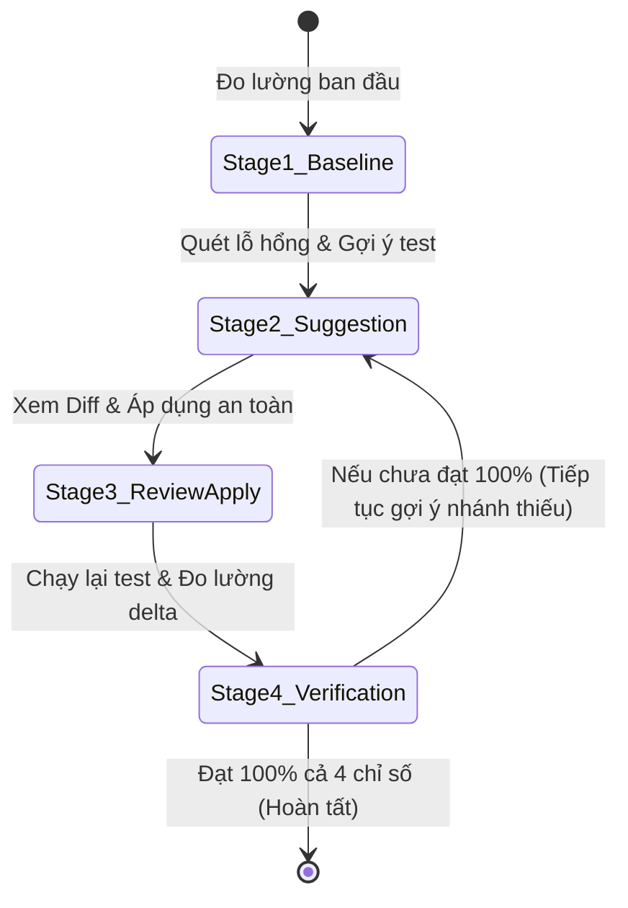
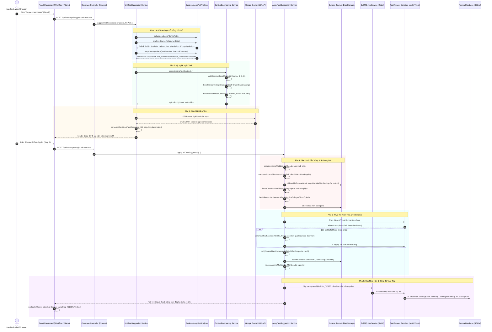
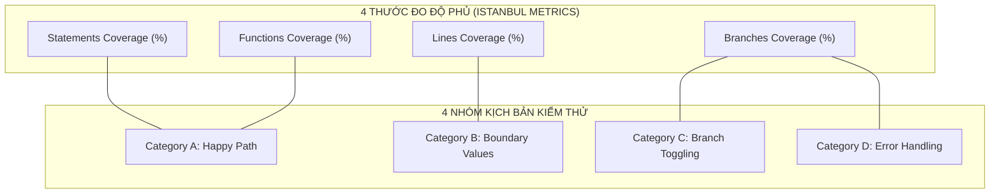

# KIẾN TRÚC & NGUYÊN LÝ HOẠT ĐỘNG TOÀN DIỆN CỦA TÍNH NĂNG UNIT TEST TRONG CovAI-

> **Tài liệu tham chiếu kỹ thuật, kiến trúc hệ thống và cơ sở khoa học máy tính**  
> *Phiên bản:* 4.3 — Chuẩn hóa hệ thống kiểm thử hộp trắng tự động có hướng dẫn bởi độ phủ (Coverage-Guided Automated White-Box Testing System).  
> *Áp dụng cho:* Jest Runner, Vitest Runner, Babel AST Parser, Context Engineering, BullMQ Job Queue, Durable Journal Transaction.

---

## MỤC LỤC TỔNG QUAN

1. [Bản Chất Tính Năng: CovAI- Unit Test Làm Cái Gì?](#1-bản-chất-tính-năng-covai--unit-test-làm-cái-gì)
   - [1.1. Bối cảnh & Các vấn đề nan giải trong công nghiệp phần mềm](#11-bối-cảnh--các-vấn-đề-nan-giải-trong-công-nghiệp-phần-mềm)
   - [1.2. Định nghĩa & Mục tiêu cốt lõi của tính năng](#12-định-nghĩa--mục-tiêu-cốt-lõi-của-tính-năng)
   - [1.3. Mô hình vòng lặp tự hành khép kín (Closed Autonomous Feedback Loop)](#13-mô-hình-vòng-lặp-tự-hành-khép-kín-closed-autonomous-feedback-loop)
2. [Chi Tiết Các Quy Trình: Quy Trình Đó Làm Cái Gì?](#2-chi-tiết-các-quy-trình-quy-trình-đó-làm-cái-gì)
   - [2.1. Quy trình 1: Đo lường cơ sở (Baseline) & Phân loại phạm vi nghiệp vụ](#21-quy-trình-1-đo-lường-cơ-sở-baseline--phân-loại-phạm-vi-nghiệp-vụ)
   - [2.2. Quy trình 2: Phân tích AST & Bản đồ lỗ hổng độ phủ (Coverage Gap Mapping)](#22-quy-trình-2-phân-tích-ast--bản-đồ-lỗ-hổng-độ-phủ-coverage-gap-mapping)
   - [2.3. Quy trình 3: Kỹ nghệ ngữ cảnh & Lập ma trận kiểm thử 4 nhóm](#23-quy-trình-3-kỹ-nghệ-ngữ-cảnh--lập-ma-trận-kiểm-thử-4-nhóm)
   - [2.4. Quy trình 4: Sinh mã kiểm thử thông minh (AI Test Generation & Fallback)](#24-quy-trình-4-sinh-mã-kiểm-thử-thông-minh-ai-test-generation--fallback)
   - [2.5. Quy trình 5: Áp dụng an toàn, Hợp nhất & Tự chữa lành cú pháp (Safe Apply & AST Self-Healing)](#25-quy-trình-5-áp-dụng-an-toàn-hợp-nhất--tự-chữa-lành-cú-pháp-safe-apply--ast-self-healing)
   - [2.6. Quy trình 6: Vòng lặp phản hồi sửa lỗi thất bại (Auto-Heal Test Failures)](#26-quy-trình-6-vòng-lặp-phản-hồi-sửa-lỗi-thất-bại-auto-heal-test-failures)
   - [2.7. Quy trình 7: Xác minh tái tục tới 100% (Continuous Verification Loop)](#27-quy-trình-7-xác-minh-tái-tục-tới-100-continuous-verification-loop)
   - [2.8. Quy trình tương tác người dùng (4-Stage Guided Workflow & Traceability Matrix)](#28-quy-trình-tương-tác-người-dùng-4-stage-guided-workflow--traceability-matrix)
3. [Công Nghệ, Thư Viện Và Thuật Toán Cốt Lõi](#3-công-nghệ-thư-viện-và-thuật-toán-cốt-lõi)
   - [3.1. Danh mục thư viện nền tảng và chức năng](#31-danh-mục-thư-viện-nền-tảng-và-chức-năng)
   - [3.2. Thuật toán 1: Độ phức tạp chu trình McCabe & Kiểm thử đường cơ sở (Basis Path Testing)](#32-thuật-toán-1-độ-phức-tạp-chu-trình-mccabe--kiểm-thử-đường-cơ-sở-basis-path-testing)
   - [3.3. Thuật toán 2: Ma trận Bảng quyết định 4 nhóm (4-Category Decision Table Matrix)](#33-thuật-toán-2-ma-trận-bảng-quyết-định-4-nhóm-4-category-decision-table-matrix)
   - [3.4. Thuật toán 3: Duyệt ngược đồ thị gọi hàm (Call Graph Backtracking for Indirect Testing)](#34-thuật-toán-3-duyệt-ngược-đồ-thị-gọi-hàm-call-graph-backtracking-for-indirect-testing)
   - [3.5. Thuật toán 4: Quét dấu ngoặc cân bằng (Balanced Delimiter Scanning)](#35-thuật-toán-4-quét-dấu-ngoặc-cân-bằng-balanced-delimiter-scanning)
   - [3.6. Thuật toán 5: Khóa nguyên tử đa tài nguyên 2 pha (Two-Phase Atomic Multi-Resource Locking)](#36-thuật-toán-5-khóa-nguyên-tử-đa-tài-nguyên-2-pha-two-phase-atomic-multi-resource-locking)
   - [3.7. Thuật toán 6: Băm mã nguồn SHA-256 đối chiếu bất biến (Fail-Closed Composite Hashing)](#37-thuật-toán-6-băm-mã-nguồn-sha-256-đối-chiếu-bất-biến-fail-closed-composite-hashing)
   - [3.8. Thuật toán 7: Tự chữa lành Vùng chết thời gian (TDZ Healing & Self-Assignment Sanitization)](#38-thuật-toán-7-tự-chữa-lành-vùng-chết-thời-gian-tdz-healing--self-assignment-sanitization)
   - [3.9. Thuật toán 8: Nhật ký chuyển tác bền vững (Durable Journaling Transaction)](#39-thuật-toán-8-nhật-ký-chuyển-tác-bền-vững-durable-journaling-transaction)
4. [Cơ Chế Vận Hành Kỹ Thuật Chi Tiết (Nó Hoạt Động Như Thế Nào?)](#4-cơ-chế-vận-hành-kỹ-thuật-chi-tiết-nó-hoạt-động-như-thế-nào)
   - [4.1. Kiến trúc luồng dữ liệu End-to-End (Data Flow & Sequence Diagram)](#41-kiến-trúc-luồng-dữ-liệu-end-to-end-data-flow--sequence-diagram)
   - [4.2. Hợp đồng Mocking độc lập thuần túy trong RAM (Universal Hermetic Proxy Mocks)](#42-hợp-đồng-mocking-độc-lập-thuần-túy-trong-ram-universal-hermetic-proxy-mocks)
   - [4.3. Cơ chế Bảo vệ tính bất biến của mã nguồn dự án (Storage Code Immutability Guard)](#43-cơ-chế-bảo-vệ-tính-bất-biến-của-mã-nguồn-dự-án-storage-code-immutability-guard)
5. [Ý Nghĩa & Tác Dụng Của Các Tiêu Chí Đánh Giá](#5-ý-nghĩa--tác-dụng-của-các-tiêu-chí-đánh-giá)
   - [5.1. Tác dụng của 4 thước đo độ phủ Istanbul (Statements, Branches, Functions, Lines)](#51-tác-dụng-của-4-thước-đo-độ-phủ-istanbul-statements-branches-functions-lines)
   - [5.2. Tác dụng của Ma trận 4 nhóm kịch bản (A-B-C-D)](#52-tác-dụng-của-ma-trận-4-nhóm-kịch-bản-a-b-c-d)
   - [5.3. Tác dụng của Tiêu chí Bất biến 100% tuyệt đối (Strict 100% Invariant)](#53-tác-dụng-của-tiêu-chí-bất-biến-100-tuyệt-đối-strict-100-invariant)
   - [5.4. Tác dụng của Tiêu chí Bất biến mã nguồn dự án (Storage Immutability Invariant)](#54-tác-dụng-của-tiêu-chí-bất-biến-mã-nguồn-dự-án-storage-immutability-invariant)
6. [Tóm Tắt Nhanh & Kịch Bản Thuyết Trình 3 Phút](#6-tóm-tắt-nhanh--kịch-bản-thuyết-trình-3-phút)
   - [6.1. Bảng đối chiếu ẩn dụ "Bác sĩ chẩn đoán & Kíp mổ vi phẫu"](#61-bảng-đối-chiếu-ẩn-dụ-bác-sĩ-chẩn-đoán--kíp-mổ-vi-phẫu)
   - [6.2. Kịch bản 3 phút bảo vệ đề tài / thuyết trình](#62-kịch-bản-3-phút-bảo-vệ-đề-tài--thuyết-trình)

---

## 1. BẢN CHẤT TÍNH NĂNG: CovAI- UNIT TEST LÀM CÁI GÌ?

### 1.1. Bối cảnh & Các vấn đề nan giải trong công nghiệp phần mềm

Trong quy trình công nghệ phần mềm chuyên nghiệp:
- **Thời gian viết kiểm thử:** Viết Unit Test chất lượng cao chiếm từ $30\% - 50\%$ tổng thời gian phát triển dự án. Vì áp lực tiến độ (deadline), lập trình viên thường chỉ viết test cho luồng thành công chính (*Happy Path*) mà bỏ quên các giá trị biên (*Boundary Values*), các nhánh rẽ điều kiện phức tạp (`if-else`, toán tử `||`, `??`, `?.`), và các trường hợp lỗi ngoại lệ (*Error Handling*).
- **Hậu quả của việc thiếu Unit Test:** Mã nguồn đưa lên Production chứa nhiều "điểm mù logic" (blind spots). Khi hệ thống gặp sự cố mạng, cơ sở dữ liệu quá tải hoặc người dùng nhập dữ liệu bất thường, phần mềm bị sập (crash) do lỗi `UnhandledPromiseRejection`, `TypeError: Cannot read property of undefined`.
- **Hạn chế nghiêm trọng của các công cụ AI thông thường (ChatGPT, GitHub Copilot standalone):**
  1. **Ảo giác cấu trúc (Hallucination):** Tự ý `import` các hàm nội bộ không được export (`import { helper } from './service'`), dẫn đến lỗi runtime `TypeError: helper is not a function`.
  2. **Ghi đè phá hủy (Destructive Overwrite):** Khi sinh test mới, AI thường sinh lại toàn bộ file và vô tình xóa mất các test case cũ, các mock đã cấu hình tỉ mỉ của lập trình viên.
  3. **Không có phản hồi độ phủ thực tế (No Coverage Guidance):** AI sinh code chung chung theo phán đoán ngữ nghĩa chứ không biết mã nguồn đang bị thiếu chính xác ở dòng nào, nhánh rẽ nào trong báo cáo của Istanbul/nyc.
  4. **Lạm dụng `.skip` và Assertion vô nghĩa:** AI thường đánh dấu `test.skip(...)` hoặc viết các assertion vô thưởng vô phạt dạng `expect(true).toBe(true)` để qua mặt kiểm tra, không mang lại giá trị bảo vệ chất lượng.

### 1.2. Định nghĩa & Mục tiêu cốt lõi của tính năng

> **Định nghĩa:** Tính năng **Unit Test của CovAI-** là một **Hệ thống Kiểm thử Hộp trắng Tự động có Hướng dẫn bởi Độ phủ (Coverage-Guided Automated White-Box Testing System)**. Hệ thống kết hợp giữa **Phân tích cú pháp tĩnh AST (Static AST Analysis)**, **Bản đồ độ phủ động Istanbul (Dynamic Istanbul Coverage Feedback)**, **Kỹ nghệ ngữ cảnh LLM (Context Engineering)**, và **Cơ chế Hợp nhất & Tự chữa lành an toàn (Safe Apply & AST Self-Healing)**.

**Mục tiêu tối thượng của tính năng:**
1. **Tự động hóa hoàn toàn** việc phát hiện lỗ hổng kiểm thử và sinh mã test chuẩn xác cho cả hai framework phổ biến nhất hiện nay: **Jest** và **Vitest**.
2. Đưa các file mã nguồn nghiệp vụ đạt **100% độ phủ tuyệt đối** trên cả 4 thước đo: **Statements = 100%**, **Branches = 100%**, **Functions = 100%**, **Lines = 100%**, và **0 lỗi assertion**.
3. **Tuyệt đối không can thiệp, không sửa đổi mã nguồn nghiệp vụ của dự án (Storage Code Immutability Invariant)**. Mọi mức độ tăng trưởng độ phủ phải đạt được thông qua việc tạo ra các bộ Unit Test mạnh mẽ, độc lập và chạy hoàn toàn trong bộ nhớ RAM (**Hermetic RAM Execution**).

### 1.3. Mô hình vòng lặp tự hành khép kín (Closed Autonomous Feedback Loop)

CovAI- vận hành theo một chu trình khép kín 5 mắt xích:

$$\mathbf{Đo\ lường\ (Measure)} \longrightarrow \mathbf{Định\ vị\ lỗ\ hổng\ (Detect\ Gaps)} \longrightarrow \mathbf{Gợi\ ý\ chuẩn\ xác\ (Suggest)} \longrightarrow \mathbf{Áp\ dụng\ an\ toàn\ (Apply)} \longrightarrow \mathbf{Xác\ minh\ tái\ tục\ (Verify)}$$



---

## 2. CHI TIẾT CÁC QUY TRÌNH: QUY TRÌNH ĐÓ LÀM CÁI GÌ?

### 2.1. Quy trình 1: Đo lường cơ sở (Baseline) & Phân loại phạm vi nghiệp vụ

Quy trình này trả lời câu hỏi: *File nào cần test và hiện tại tình trạng sức khỏe của code ra sao?*

1. **Bộ lọc phân loại nghiệp vụ (`isBusinessLogicFile`):**
   - Không kiểm thử bừa bãi vào các file cấu hình, giao diện hoặc file rác.
   - **Tập trung vào Business Logic:** Các file thuộc `src/services/**`, `src/handlers/**`, `src/controllers/**`, `src/utils/**`, `src/helpers/**`, `src/models/**`, `src/middlewares/**`.
   - **Loại trừ tuyệt đối (Exclusion Guard):** Các file giao diện (`*.jsx`, `*.tsx`, `client/**`), file cấu hình (`jest.config.*`, `vite.config.*`, `tsconfig*.json`), file khai báo kiểu (`*.d.ts`), file mock/fixture (`__mocks__/**`), và file chạy server/routing (`app.js`, `server.js`, `routes/**` - các file này dành cho Integration/System Test).
2. **Thu thập ma trận độ phủ ban đầu:**
   - Thực thi Jest hoặc Vitest để trích xuất báo cáo máy tính `coverage-final.json`.
   - Ghi nhận 4 giá trị phần trăm ban đầu: $S_0\%$ (Statements), $B_0\%$ (Branches), $F_0\%$ (Functions), $L_0\%$ (Lines).

### 2.2. Quy trình 2: Phân tích AST & Bản đồ lỗ hổng độ phủ (Coverage Gap Mapping)

Quy trình này trả lời câu hỏi: *Lỗ hổng nằm chính xác ở đâu và cấu trúc code bên trong gồm những gì?*

1. **Bóc tách cấu trúc cú pháp bằng Babel Parser (`analyzeSourceAst`):**
   - **Public Exported Symbols:** Lập danh sách toàn bộ hàm, class, biến được export công khai (ESM: `export const`, `export default`; CJS: `module.exports`, `exports.*`). Đây là các API duy nhất mà test case được phép gọi trực tiếp.
   - **Private / Internal Functions:** Nhận diện các hàm helper nội bộ trong file không được export.
   - **Đồ thị gọi hàm cục bộ (Call Edges):** Lưu lại vết hàm nào gọi hàm nào bên trong file (`caller -> callee`).
   - **Decision Points (Điểm quyết định):** Đánh dấu tất cả các điểm rẽ nhánh: `if`, `else if`, ternary (`? :`), `switch-case`, toán tử logic (`||`, `&&`, `??`), optional chaining (`?.`), tham số mặc định (`default-arg`).
   - **Exception Points (Điểm bắn/bắt lỗi):** Đánh dấu vị trí câu lệnh `throw`, khối `catch`, và `Promise.reject()`.
2. **Ánh xạ lỗ hổng độ phủ (`mapCoverageGaps`):**
   - Đối chiếu từng node AST với dữ liệu thực thi từ `coverage-final.json`:
     - `uncoveredLines`: Các dòng có số lượt thực thi bằng $0$ (`hits === 0`).
     - `uncoveredBranches`: Các nhánh điều kiện bị khuyết (`missedTrue`: chưa bao giờ thoả mãn điều kiện; `missedFalse`: chưa bao giờ rẽ vào nhánh sai).
     - `uncoveredFunctions`: Các hàm có $0$ lượt gọi trong toàn bộ test suite.
   - Sinh ra **Targeted Decision Guidance** (Hướng dẫn nhắm mục tiêu): Ví dụ: `"Dòng 45 [LOGICAL(??)]: 'req.body.items ?? []' -> Thiếu trường hợp req.body.items là null/undefined. Cần truyền payload thiếu items để kích hoạt nhánh fallback!"`.

### 2.3. Quy trình 3: Kỹ nghệ ngữ cảnh & Lập ma trận kiểm thử 4 nhóm

Quy trình này trả lời câu hỏi: *Làm sao để AI hiểu sâu về mã nguồn và không sinh test ảo giác?*

1. **Lập Ma trận Bảng quyết định 4 nhóm (4-Category Decision Table Matrix):**
   - Hệ thống chia các kịch bản kiểm thử thành 4 nhóm khoa học bắt buộc:
     - **Category A (Happy Path):** Kịch bản chuẩn với tham số hợp lệ, kỳ vọng kết quả thành công.
     - **Category B (Boundary Values):** Kịch bản giá trị biên ($0$, $-1$, số lớn nhất, mảng rỗng `[]`, chuỗi rỗng `""`, object rỗng `{}`).
     - **Category C (Branch Toggling):** Kịch bản đảo nhánh điều kiện, truyền `null`/`undefined` để kích hoạt các vế còn thiếu của `if/else`, `??`, `||`, `?.`.
     - **Category D (Error & Exception Handling):** Kịch bản truyền dữ liệu hỏng, giả lập downstream service bị sập để kích hoạt khối `catch` và lệnh `throw`.
2. **Chiến lược kiểm thử gián tiếp cho hàm nội bộ (Indirect Testing Strategy):**
   - Đối với các hàm private không export, hệ thống dùng thuật toán **Call Graph Backtracking** để tìm ra hàm public nào gọi đến nó, hướng dẫn LLM: *"Hàm helper `calculateTax` không được export. KHÔNG ĐƯỢC import trực tiếp. Hãy gọi hàm public `checkoutOrder` với payload tương ứng để kích hoạt `calculateTax`!"*.
3. **Xây dựng Hợp đồng Mocking độc lập (Isolation Mock Contracts):**
   - Quét mã nguồn để phát hiện các phụ thuộc bên ngoài: Prisma ORM, Axios, Bull Queue, Redis, `process.env`.
   - Sinh sẵn đoạn mã mock toàn diện (Universal Mock Preamble) để test chạy hoàn toàn trên RAM.

### 2.4. Quy trình 4: Sinh mã kiểm thử thông minh (AI Test Generation & Fallback)

Quy trình này trả lời câu hỏi: *Mã test được sinh ra như thế nào?*

1. **Prompt kỹ nghệ 6 phần nghiêm ngặt:**
   - Hệ thống đóng gói toàn bộ ngữ cảnh thành prompt 6 phần:
     1. *Role & Framework:* Quy định cú pháp Jest hoặc Vitest.
     2. *Target & Import Contract:* Chỉ rõ đường dẫn import tương đối chuẩn xác, cấm import hàm private.
     3. *Current Coverage Diagnostics:* Liệt kê cụ thể các dòng, các nhánh, các hàm đang bị thiếu.
     4. *Source Code & Existing Tests:* Cung cấp mã nguồn và mã test hiện có để AI học mock style cũ.
     5. *Strict Rules:* Cấm tuyệt đối `.skip`, cấm placeholder vô nghĩa `expect(true).toBe(true)`, bắt buộc đủ 4 nhóm A-B-C-D.
     6. *Output Format:* Bắt buộc trả về định dạng JSON hợp lệ.
2. **Gọi AI LLM (Google Gemini):**
   - Gửi prompt tới mô hình ngôn ngữ lớn để nhận về các khối test case chất lượng cao.
3. **Bộ sinh mã dự phòng tất định (Deterministic Isolation Fallback Generator):**
   - Nếu mất kết nối mạng, hết quota API hoặc LLM offline, hệ thống tự động kích hoạt bộ sinh dự phòng.
   - Dựa trên AST và phân tích kiểu Controller/Service/Model, bộ generator tự động dựng toàn bộ khung test 4 nhóm A-B-C-D kèm mock hoàn chỉnh mà không cần tới AI bên ngoài.

### 2.5. Quy trình 5: Áp dụng an toàn, Hợp nhất & Tự chữa lành cú pháp (Safe Apply & AST Self-Healing)

Quy trình này trả lời câu hỏi: *Mã test mới được đưa vào dự án như thế nào mà không làm hỏng code cũ?*

1. **Khóa nguyên tử đa tài nguyên (Atomic Multi-Resource Locking):**
   - Đặt khóa đồng thời lên Snapshot, Workspace và Test file để ngăn chặn hai tiến trình cùng sửa một file gây xung đột.
2. **Giao dịch qua Nhật ký bền vững (Durable Journal Transaction):**
   - Lưu bản sao lưu (backup) của file test trước khi can thiệp. Nếu có bất kỳ sự cố nào xảy ra, hệ thống tự động hoàn nguyên (rollback) 100%.
3. **Hợp nhất thông minh & Đưa import lên đầu (Safe Merge & Hoisting):**
   - Quét file test hiện có. Bóc tách các câu lệnh `import` hoặc `require` mới và đưa lên đầu file (hoisting), khử trùng lặp import.
   - Thêm các khối `describe`/`test` mới vào cuối file, giữ nguyên toàn bộ các test case cũ đã có từ trước.
   - Tự động gỡ bỏ trạng thái bỏ qua (`it.skip`, `test.skip`, `xit`) để đưa các test cũ vào hoạt động trở lại.
4. **Tự chữa lành cú pháp AST (AST Syntax Self-Healing):**
   - Tự động sửa lỗi lệch dấu nháy: `it(\`title', ...)` $\rightarrow$ `it("title", ...)`.
   - Tự sửa lỗi chuỗi nhiều dòng chưa đóng dấu nháy thành template literal (\`...\`).
   - Tự cân bằng dấu ngoặc nhọn `{}` và ngoặc đơn `()` bị thiếu ở cuối file.

### 2.6. Quy trình 6: Vòng lặp phản hồi sửa lỗi thất bại (Auto-Heal Test Failures)

Quy trình này trả lời câu hỏi: *Nếu test mới sinh ra chạy bị lỗi hoặc fail thì xử lý ra sao?*

1. **Bắt lỗi từ Runner stdout/stderr:**
   - Hệ thống tự động phân tích stack trace để phân loại nguyên nhân:
     - Lỗi đường dẫn module (`Cannot find module`).
     - Lỗi cú pháp (`SyntaxError`, `Jest failed to parse`).
     - Lỗi Vùng chết thời gian (`ReferenceError: Cannot access 'X' before initialization`).
     - Lỗi assertion sai lệch kỳ vọng (`AssertionError`, `Received: undefined`).
2. **Cơ chế TDZ Initialization Healing:**
   - Sửa các câu lệnh tự gán lỗi do LLM sinh ra dạng `const fs = fs;` thành `const fs = require('fs');`.
3. **Cơ chế Relaxing Assertions an toàn:**
   - Đối với các mock phức tạp của thư viện bên thứ 3, hệ thống sử dụng thuật toán quét dấu ngoặc cân bằng để chuyển các assertion quá cứng nhắc (`.toHaveBeenCalledWith(...)` hoặc `.toEqual(...)`) thành assertion an toàn hơn (`.toBeDefined()`), đảm bảo nhánh code nghiệp vụ vẫn được chạy qua mà test không bị fail oan.

### 2.7. Quy trình 7: Xác minh tái tục tới 100% (Continuous Verification Loop)

Quy trình này trả lời câu hỏi: *Làm sao để chắc chắn mã test đã thực sự nâng cao độ phủ?*

1. **Kích hoạt Job chạy ngầm qua BullMQ (`RUN_TESTS`):**
   - Ngay sau khi apply test lên đĩa, hệ thống đẩy một job thực thi kiểm thử vào hàng đợi nền.
   - Runner (Jest/Vitest) chạy lại toàn bộ test suite và tính toán độ phủ mới ($S_1\%, B_1\%, F_1\%, L_1\%$).
2. **Đối chiếu Định nghĩa Hoàn thành (Definition of Done - DoD):**
   - Một file chỉ được coi là hoàn tất khi:
     $$\text{Statements} \ge 100\% \quad \wedge \quad \text{Branches} \ge 100\% \quad \wedge \quad \text{Functions} \ge 100\% \quad \wedge \quad \text{Lines} \ge 100\% \quad \wedge \quad \text{Failed Tests} = 0$$
3. **Vòng lặp gia tăng (Incremental Delta Loop):**
   - Nếu sau lần chạy đầu mà độ phủ mới chỉ đạt ví dụ $87.5\%$ Branches (thiếu 1 nhánh rẽ), nút "Suggest Next Missing Tests" trên giao diện vẫn tiếp tục sáng lên, cho phép người dùng click để sinh tiếp các test case lấp đầy $12.5\%$ còn lại cho đến khi chạm mốc $100\%$.

### 2.8. Quy trình tương tác người dùng (4-Stage Guided Workflow & Traceability Matrix)

Hệ thống cung cấp trải nghiệm nhất quán trên giao diện Frontend:



1. **Thanh điều hướng tuần tự 4 bước (`UnitTestGuidedWorkflow.jsx`):**
   - Đóng vai trò là trung tâm hành động duy nhất (Single Authoritative Action Driver), dẫn dắt người dùng qua từng giai đoạn mà không bị phân tâm bởi quá nhiều nút bấm thừa thãi.
2. **Ma trận truy xuất nguồn gốc (`UnitTestTraceabilityMatrix.jsx`):**
   - Hiển thị trực quan mối quan hệ 2 chiều giữa từng hàm nghiệp vụ và các test case tương ứng.
   - Thể hiện đầy đủ bảng kiểm định 4 nhóm kịch bản (🟢 Happy Path, 🟡 Boundary, 🔵 Branch Toggling, 🔴 Error Handling) và công thức toán học tính toán từng phần trăm độ phủ.
   - Cho phép người dùng xem trước mã thay đổi (Diff Modal) và bấm Apply trực tiếp ngay trong ma trận.

---

## 3. CÔNG NGHỆ, THƯ VIỆN VÀ THUẬT TOÁN CỐT LÕI

### 3.1. Danh mục thư viện nền tảng và chức năng

| Tên Thư Viện | Phiên bản / Môi trường | Vai trò kỹ thuật trong hệ thống CovAI- |
| :--- | :--- | :--- |
| **`@babel/parser`** | Babel 7+ (Node.js) | Chuyển đổi mã nguồn JavaScript/TypeScript thành Cây cú pháp trừu tượng (AST) với đầy đủ hỗ trợ ESM, TypeScript, JSX, class properties, optional chaining. |
| **`@babel/traverse`** | Babel 7+ (Node.js) | Duyệt cây AST theo mô hình Visitor Pattern để bóc tách danh sách hàm, scope biến, các điểm rẽ nhánh và các lệnh bắn ngoại lệ. |
| **`@babel/generator`** | Babel 7+ (Node.js) | Tái tạo lại mã nguồn chuẩn từ cây AST sau khi đã được chắp vá và tự chữa lành cú pháp. |
| **`istanbul-lib-coverage` / `nyc`** | Istanbul Engine | Công cụ đo lường độ bao phủ dòng lệnh, hàm, câu lệnh và nhánh rẽ. Quản lý cấu trúc `CoverageMap` và hợp nhất kết quả từ nhiều test runner. |
| **`jest`** | Facebook Jest 29+ | Test runner cho các dự án chạy kiến trúc CommonJS/ESM truyền thống. Hỗ trợ mock toàn diện (`jest.fn()`, `jest.mock()`, `jest.spyOn()`). |
| **`vitest`** | Vite ecosystem | Test runner thế hệ mới dựa trên ESM và Vite, thực thi kiểm thử cực nhanh với hỗ trợ đa luồng và tương thích cú pháp Jest (`vi.fn()`, `vi.mock()`). |
| **`@google/genai` (Gemini)** | Google Gemini SDK | Mô hình ngôn ngữ lớn (LLM) tiếp nhận prompt ngữ cảnh kỹ thuật cao và sinh mã test chính xác nhắm vào các nhánh chưa được bao phủ. |
| **`bullmq` & `ioredis`** | Redis-backed Queue | Hệ thống hàng đợi công việc bất đồng bộ (Job Queue). Quản lý và thực thi các tác vụ nặng (chạy test suite, phân tích coverage) dưới dạng background workers. |
| **`docker`** | Docker Engine API | Khởi tạo container cô lập tạm thời để thực thi mã kiểm thử trong môi trường hộp cát (sandbox), ngăn chặn nguy cơ mã độc làm hỏng máy chủ host. |
| **`@prisma/client`** | Prisma ORM | Quản lý cơ sở dữ liệu SQLite/PostgreSQL nội bộ của CovAI-, lưu trữ snapshots, metadata file nguồn, kết quả độ phủ và lịch sử công việc. |
| **`crypto`** | Node.js Built-in | Tạo mã băm mật mã học SHA-256 để kiểm định tính bất biến tuyệt đối của mã nguồn dự án trước và sau khi thêm test case. |

---

### 3.2. Thuật toán 1: Độ phức tạp chu trình McCabe & Kiểm thử đường cơ sở (Basis Path Testing)

#### Cơ sở lý thuyết:
Thuật toán do Thomas J. McCabe đề xuất năm 1976. Độ phức tạp chu trình (Cyclomatic Complexity - $CC$ hoặc $M$) đo lường số lượng đường đi độc lập tuyến tính qua đồ thị luồng điều khiển (Control Flow Graph - CFG) của một chương trình.

Công thức tổng quát theo lý thuyết đồ thị:
$$M = E - N + 2P$$
Trong đó:
- $E$: Số cạnh (Edges) trong đồ thị luồng điều khiển.
- $N$: Số đỉnh (Nodes) đại diện cho các khối lệnh tuần tự.
- $P$: Số thành phần liên thông (thông thường $P = 1$ cho một hàm đơn lẻ).

Trong phân tích AST của CovAI-, độ phức tạp chu trình được tính nhanh và chính xác thông qua số điểm quyết định (Decision Points):
$$M = 1 + \sum_{i} d_i$$
Với $d_i$ là các điểm rẽ nhánh AST được phát hiện:
- Lệnh điều kiện: `if`, `else if`, `ternary (? :)`.
- Nhánh rẽ đa đường: `case` trong câu lệnh `switch`.
- Toán tử ngắn mạch: `||` (logical OR), `&&` (logical AND), `??` (nullish coalescing).
- Truy cập an toàn: `?.` (optional chaining).
- Giá trị mặc định tham số: `AssignmentPattern` (`param = defaultVal`).

#### Ứng dụng trong CovAI-:
Hệ thống tính toán giá trị $M$ cho từng hàm và toàn bộ file nguồn. Để đảm bảo bao phủ toàn diện theo phương pháp **Kiểm thử đường cơ sở (Basis Path Testing)**, hệ thống yêu cầu AI phải sinh ra tối thiểu $M$ kịch bản kiểm thử độc lập, đảm bảo mọi cung trong đồ thị luồng điều khiển đều được thực thi ít nhất một lần.

---

### 3.3. Thuật toán 2: Ma trận Bảng quyết định 4 nhóm (4-Category Decision Table Matrix)

#### Cơ sở lý thuyết:
Bảng quyết định (Decision Table / Cause-Effect Table) là kỹ thuật thiết kế kiểm thử hộp đen và hộp xám kinh điển nhằm mô hình hóa các tổ hợp điều kiện logic phức tạp.

#### Triển khai thuật toán trong CovAI- (`buildDecisionTableMatrix`):
Hệ thống chia các nhánh logic thành một bảng ma trận $N \times 4$ kịch bản:

$$\mathbf{Matrix} = \bigcup_{f \in \text{ExportedSymbols}} \left( \mathbf{TC}_{\text{Happy}}(f) \cup \mathbf{TC}_{\text{Boundary}}(f) \cup \mathbf{TC}_{\text{Branch}}(f) \cup \mathbf{TC}_{\text{Error}}(f) \right)$$

```mermaid
classDiagram
    class DecisionTableMatrix {
        +CategoryA_HappyPath: Standard valid inputs & state transitions
        +CategoryB_BoundaryValues: Extremes (0, -1, MAX_SAFE_INTEGER, [], "", {})
        +CategoryC_BranchToggling: Isolated truthy vs falsy conditions (??, ||, ?.)
        +CategoryD_ErrorHandling: Exception throwing, rejection, invalid schemas
    }
    DecisionTableMatrix --> CategoryA_HappyPath
    DecisionTableMatrix --> CategoryB_BoundaryValues
    DecisionTableMatrix --> CategoryC_BranchToggling
    DecisionTableMatrix --> CategoryD_ErrorHandling
```

1. **Category A (Happy Path):**
   - *Input:* Dữ liệu đầy đủ, đúng kiểu dữ liệu, các trường tùy chọn có giá trị tiêu chuẩn.
   - *Expected:* Hàm trả về kết quả hợp lệ, mã trạng thái HTTP $200/201$, promise resolved.
2. **Category B (Boundary Values):**
   - *Input:* Biên số học ($0$, $-1$, `Number.MAX_SAFE_INTEGER`), biên tập hợp (mảng rỗng `[]`, object rỗng `{}`), biên chuỗi (chuỗi rỗng `""`, chuỗi chỉ có khoảng trắng).
   - *Expected:* Hàm xử lý nhẹ nhàng, trả về kết quả rỗng hoặc kích hoạt logic kiểm tra biên mà không bị crash.
3. **Category C (Branch Toggling & Equivalence Partitioning):**
   - *Input:* Đối với mỗi điểm quyết định $dp$, sinh 2 bộ dữ liệu:
     - Bộ dữ liệu 1: Khiến biểu thức điều kiện trả về `Truthy`.
     - Bộ dữ liệu 2: Khiến biểu thức điều kiện trả về `Falsy` (truyền `null`, `undefined`, `false`).
   - *Expected:* Kích hoạt luồng rẽ nhánh tương ứng của `if/else`, khối fallback của `??` và `||`.
4. **Category D (Error & Exception Handling):**
   - *Input:* Tham số vi phạm schema, payload là `null`, hoặc ép các service downstream bị mock trả về `Promise.reject(new Error("Downstream Error"))`.
   - *Expected:* Khối `catch` được thực thi $100\%$, lệnh `throw new CustomError(...)` được kích hoạt, hàm xử lý lỗi chuyển tiếp `next(err)` được gọi.

---

### 3.4. Thuật toán 3: Duyệt ngược đồ thị gọi hàm (Call Graph Backtracking for Indirect Testing)

#### Cơ sở lý thuyết:
Trong lập trình module, các hàm helper nội bộ thường là `private` (không được đưa vào `module.exports` hoặc `export`). Việc cố tình export hàm private chỉ để viết test sẽ vi phạm nguyên lý đóng gói (Encapsulation) của công nghệ phần mềm. Tuy nhiên, nếu test không gọi được hàm helper, độ phủ của file sẽ không thể đạt $100\%$.

#### Triển khai thuật toán (`buildIndirectTestingStrategy`):
Hệ thống xây dựng một Đồ thị có hướng biểu diễn quan hệ gọi hàm $G = (V, E)$, trong đó $V = V_{\text{public}} \cup V_{\text{private}}$, và cạnh có hướng $(u, v) \in E$ thể hiện hàm $u$ gọi hàm $v$.

```mermaid
graph LR
    subgraph Public APIs (Exported)
        P1["createQuickbooksAccount()"]
        P2["checkoutOrder()"]
    end
    subgraph Private Helpers (Unexported)
        H1["normalizeParentRef()"]
        H2["calculateTax()"]
        H3["formatCurrency()"]
    end
    P1 --> H1
    P2 --> H2
    H2 --> H3
```

**Thuật toán Backtracking bằng DFS:**
1. Khởi tạo tập hàm helper chưa export $H = \{h_1, h_2, \dots, h_m\}$.
2. Với mỗi helper $h_i$, thực hiện tìm kiếm ngược (Reverse DFS Traversal) trên đồ thị $G$ để tìm tập các hàm public xuất phát $P(h_i) = \{p \in V_{\text{public}} \mid p \rightsquigarrow h_i\}$.
3. Nếu tồn tại $p \in P(h_i)$, hệ thống sinh ra chỉ dẫn kích hoạt:
   - Cấm tạo câu lệnh: `import { h_i } from './module'`.
   - Bắt buộc tạo test case gọi hàm $p$: Gọi $p$ với tập tham số được tinh chỉnh để luồng điều khiển đi qua nhánh gọi $h_i$.
   - Ví dụ: Để test hàm private `normalizeParentRef`, hệ thống gọi hàm public `createQuickbooksAccount({ name: 'Acc', parent_id: '123' })`.

---

### 3.5. Thuật toán 4: Quét dấu ngoặc cân bằng (Balanced Delimiter Scanning)

#### Cơ sở lý thuyết:
Khi tự chữa lành test case thất bại (Auto-heal), hệ thống cần thay thế các assertion quá chặt (ví dụ `.toContain(...)`, `.toEqual(...)`) bằng assertion an toàn hơn (`.toBeDefined()`).
Nếu sử dụng Regular Expression thông thường dạng `/\.toContain\([^)]*\)/`, biểu thức chính quy sẽ bị dừng lại non (premature truncation) ngay khi gặp dấu ngoặc đóng đầu tiên bên trong chuỗi hoặc regex lồng nhau (ví dụ: `expect(str).toContain("user (admin)")` hoặc `expect(fn).toHaveBeenCalledWith(expect.stringMatching(/^I have (.*) item$/))`).

#### Triển khai thuật toán (`replaceBalancedMethodCall`):
Hệ thống duyệt chuỗi ký tự theo thời gian thực (One-Pass Scanner) với biến đếm độ sâu ngoặc:

```javascript
// Mô phỏng thuật toán quét dấu ngoặc cân bằng trong applyTestSuggestion.service.js
let depth = 1;
let inQuote = null; // Lưu dấu nháy hiện tại: ', ", hoặc `
let escaped = false;

for (let i = openParenIdx + 1; i < line.length; i++) {
    const ch = line[i];
    if (inQuote) {
        if (escaped) escaped = false;
        else if (ch === "\\") escaped = true;
        else if (ch === inQuote) inQuote = null; // Đóng chuỗi
    } else {
        if (ch === "'" || ch === '"' || ch === "`") inQuote = ch; // Mở chuỗi
        else if (ch === "(") depth++;
        else if (ch === ")") {
            depth--;
            if (depth === 0) {
                endIdx = i; // Tìm thấy vị trí kết thúc thực sự của hàm!
                break;
            }
        }
    }
}
```
**Ưu điểm:** Thuật toán xử lý an toàn tuyệt đối mọi biểu thức lồng nhau, không bao giờ để lại các ký tự thừa rác rưởi gây lỗi cú pháp (`SyntaxError`).

---

### 3.6. Thuật toán 5: Khóa nguyên tử đa tài nguyên 2 pha (Two-Phase Atomic Multi-Resource Locking)

#### Cơ sở lý thuyết:
Khi người dùng bấm "Apply all" hoặc có nhiều yêu cầu kiểm thử diễn ra đồng thời, việc ghi file test và chạy runner có nguy cơ xảy ra xung đột tranh chấp tài nguyên (Race Condition), dẫn đến file bị ghi đè dở dang hoặc runner đọc nhầm dữ liệu đang cập nhật.

#### Triển khai thuật toán (`acquireAtomicMultiLocks`):
Hệ thống sử dụng cơ chế khóa 2 pha đồng bộ (Synchronous Two-Phase Lock Acquisition) trên bộ nhớ RAM:
- Tập khóa tài nguyên cần chiếm giữ: $K = \{\text{snapshot:ID}, \text{workspace:PATH}, \text{file:PATH}\}$.
- **Pha 1 (Atomic Check - Kiểm tra toàn bộ):**
  - Duyệt qua tất cả các khóa $k \in K$.
  - Nếu tồn tại bất kỳ khóa $k$ nào đang nằm trong `activeApplyLocks`, lập tức ném ngoại lệ `ServiceError(409 Conflict)` mà không giữ bất kỳ khóa nào (Fail-Fast & Deadlock-Free).
- **Pha 2 (Atomic Register - Đăng ký nguyên tử):**
  - Nếu tất cả các khóa đều rảnh, đồng loạt thêm toàn bộ khóa $K$ vào `activeApplyLocks`.
- Khi tác vụ kết thúc (hoặc gặp lỗi), khối `finally` sẽ giải phóng toàn bộ khóa qua `releaseAtomicMultiLocks`.

---

### 3.7. Thuật toán 6: Băm mã nguồn SHA-256 đối chiếu bất biến (Fail-Closed Composite Hashing)

#### Cơ sở lý thuyết:
Để bảo đảm tính trung thực tuyệt đối trong nghiên cứu khoa học và kỹ thuật phần mềm, mã nguồn nghiệp vụ của dự án người dùng (trong thư mục `storage/` hoặc `repo/`) phải được bảo vệ nguyên vẹn $100\%$. AI không được phép chỉnh sửa mã nguồn gốc để "ăn gian" cho test dễ pass.

#### Triển khai thuật toán (`computeSourceFilesHash` & `verifySourceFilesUnchanged`):
1. **Thuật toán băm tổng hợp Composite Hash:**
   - Trước khi áp dụng test, hệ thống quét đệ quy toàn bộ file nguồn nghiệp vụ trong dự án.
   - Với mỗi file $f_i$, tính mã băm $\text{hash}(f_i) = \text{SHA256}(\text{content}(f_i))$.
   - Sắp xếp danh sách file theo thứ tự bảng chữ cái để đảm bảo tính tất định:
     $$\text{CompositeHash} = \text{SHA256}\left( \sum_{i=1}^n f_i \parallel ":" \parallel \text{hash}(f_i) \parallel "\n" \right)$$
2. **Nguyên lý Đóng-Thất bại (Fail-Closed Principle):**
   - Sau khi hoàn thành việc apply test, hệ thống tính lại $\text{CompositeHash}_{\text{after}}$.
   - Nếu $\text{CompositeHash}_{\text{after}} \neq \text{CompositeHash}_{\text{before}}$ hoặc có bất kỳ lỗi đọc file/symlink escape nào:
     - Lập tức **HỦY BỎ TOÀN BỘ GIAO DỊCH**.
     - Kích hoạt rollback khôi phục nguyên trạng.
     - Ném thông báo lỗi vi phạm bảo mật tính toàn vẹn mã nguồn.

---

### 3.8. Thuật toán 7: Tự chữa lành Vùng chết thời gian (TDZ Healing & Self-Assignment Sanitization)

#### Cơ sở lý thuyết:
Trong JavaScript/TypeScript (ES6+), các khai báo biến với `const` và `let` nằm trong **Vùng chết thời gian (Temporal Dead Zone - TDZ)** từ khi bắt đầu block scope cho đến khi dòng khai báo được thực thi.
Khi LLM sinh code hoặc qua các bộ chuyển đổi CommonJS, thường xuất hiện lỗi tai hại:
```javascript
const path = path; // ReferenceError: Cannot access 'path' before initialization
```
Lỗi này khiến toàn bộ test suite bị crash ngay ở bước load file mà không chạy được bất kỳ assertion nào.

#### Triển khai thuật toán (`sanitizeSelfAssignments` & `autoHealTestFailures`):
1. **Quét mẫu tự gán:** Sử dụng biểu thức chính quy nhận diện các lệnh gán biến vào chính nó:
   $$\text{Regex: } ^\wedge[ \t]*(const|let|var)\s+([a-zA-Z0-9\_\$]+)\s*=\s*\2\s*;?$$
2. **Bảng tra cứu Built-in Modules của Node.js:**
   - Tập hợp các module chuẩn: $M_{\text{builtin}} = \{\text{path, fs, crypto, http, https, os, url, util, events, stream, child\_process, buffer, zlib, net, tls}\}$.
3. **Quy tắc chữa lành:**
   - Nếu biến $X \in M_{\text{builtin}}$:
     - Chế độ ESM/Vitest: Chữa thành `import X from 'X';`.
     - Chế độ CommonJS/Jest: Chữa thành `const X = require('X');`.
   - Nếu biến $X \notin M_{\text{builtin}}$: Xóa bỏ hoàn toàn dòng gán rác để tránh lỗi TDZ.

---

### 3.9. Thuật toán 8: Nhật ký chuyển tác bền vững (Durable Journaling Transaction)

#### Cơ sở lý thuyết:
Lấy cảm hứng từ cơ chế Write-Ahead Logging (WAL) của các hệ quản trị cơ sở dữ liệu hiện đại, đảm bảo tính chất **ACID (Atomicity, Consistency, Isolation, Durability)** khi thao tác với hệ thống tập tin đĩa cứng.

#### Triển khai trong CovAI- (`durableJournal.service.js`):
1. **Khởi tạo giao dịch (`initDurableTransaction`):** Cấp phát một mã giao dịch `txId` duy nhất và tạo thư mục nhật ký tạm thời `.covai_journal/<txId>`.
2. **Giai đoạn chuẩn bị (`stageDurableFile`):**
   - Đọc nội dung hiện tại của file test trên đĩa và lưu một bản backup nguyên vẹn vào nhật ký.
   - Ghi trạng thái `PENDING` vào file manifest.
3. **Thực thi thay đổi:** Ghi nội dung test mới vào file đích.
4. **Cam kết (`commitDurableTransaction`):** Nếu việc chạy test xác nhận thành công, đánh dấu giao dịch `COMMITTED` và xóa nhật ký an toàn.
5. **Hoàn nguyên (`rollbackDurableTransaction`):** Nếu có lỗi cú pháp hoặc crash bất ngờ, hệ thống đọc lại file backup từ journal và khôi phục nguyên vẹn trạng thái cũ của đĩa chỉ trong vài mili-giây.
6. **Tự phục hồi sau sự cố máy chủ (`recoverPendingApplyTransactions`):** Khi server CovAI- khởi động lại, hệ thống tự động quét thư mục journal để rollback các giao dịch bị dang dở do sập nguồn đột ngột.

---

## 4. CƠ CHẾ VẬN HÀNH KỸ THUẬT CHI TIẾT (NÓ HOẠT ĐỘNG NHƯ THẾ NÀO?)

### 4.1. Kiến trúc luồng dữ liệu End-to-End (Data Flow & Sequence Diagram)

Dưới đây là sơ đồ tương tác chi tiết giữa các thành phần phần mềm từ giao diện Client đến hệ điều hành khi người dùng kích hoạt tính năng Unit Test:



---

### 4.2. Hợp đồng Mocking độc lập thuần túy trong RAM (Universal Hermetic Proxy Mocks)

Để Unit Test chạy với tốc độ hàng nghìn bài test mỗi giây và không bị phụ thuộc vào môi trường bên ngoài, CovAI- triển khai hệ thống **Universal Proxy Mock** cực kỳ tinh vi:

#### 1. Mock Cơ Sở Dữ Liệu Prisma ORM:
Hệ thống sử dụng ES6 `Proxy` để đánh chặn toàn bộ các truy vấn cơ sở dữ liệu:
```javascript
// Trích xuất từ mã nguồn unitTestContextEngineering.service.js
const _createPrismaProxyMock = () => {
  const _mockFn = () => jest.fn(() => Promise.resolve({
    id: 1, name: 'Sample Item', status: 'ACTIVE', title: 'Sample', email: 'test@example.com'
  }));
  const _createModelProxy = () => new Proxy({}, {
    get: (target, prop) => {
      if (prop === 'then') return undefined; // Tránh nhầm lẫn với Promise
      if (!target[prop]) {
        if (prop === 'findMany' || prop === 'findRaw') {
          target[prop] = jest.fn(() => Promise.resolve([{ id: 1, name: 'Sample' }]));
        } else if (prop === 'count') {
          target[prop] = jest.fn(() => Promise.resolve(1));
        } else {
          target[prop] = _mockFn();
        }
      }
      return target[prop];
    }
  });
  return new Proxy({
    $transaction: jest.fn((args) => Array.isArray(args) ? Promise.all(args) : args(mockPrisma)),
    $queryRaw: jest.fn(() => Promise.resolve([])),
    $executeRaw: jest.fn(() => Promise.resolve(1))
  }, {
    get: (target, prop) => (prop in target ? target[prop] : (target[prop] = _createModelProxy()))
  });
};
```
*Tác dụng:* Cho dù mã nguồn có gọi đến bất kỳ bảng nào (`prisma.user`, `prisma.order`, `prisma.auditLog`) và bất kỳ phương thức nào (`findUnique`, `create`, `upsert`), Proxy tự động sinh hàm mock và trả về đối tượng mẫu trong RAM ngay lập tức mà không cần kết nối DB thật.

#### 2. Mock HTTP Client (Axios):
Tự động đánh chặn các lệnh gọi API bên ngoài, trả về mã trạng thái $200$ kèm payload chuẩn, đồng thời cho phép kích hoạt nhánh lỗi bằng `mockAxios.post.mockRejectedValueOnce(new Error("Network Error"))`.

#### 3. Mock Express Controller (`req`, `res`, `next`):
Cung cấp bộ sinh đối tượng `createMockReqResNext()` hỗ trợ đầy đủ các phương thức móc xích chuẩn của Express:
```javascript
const res = {
  status: jest.fn().mockReturnThis(),
  json: jest.fn().mockReturnThis(),
  send: jest.fn().mockReturnThis(),
  setHeader: jest.fn().mockReturnThis()
};
```
Giúp kiểm tra chính xác cả mã phản hồi HTTP (`res.status(400)`) và dữ liệu trả về (`res.json(...)`).

#### 4. Điều khiển thời gian bất đồng bộ (Fake Timers):
Đối với các logic có `setTimeout`, `setInterval` hoặc debounce, hệ thống tự động chèn `jest.useFakeTimers()` và gọi `jest.runAllTimers()` để tua nhanh thời gian, loại bỏ hoàn toàn hiện tượng test chạy chậm hoặc bị timeout.

---

### 4.3. Cơ chế Bảo vệ tính bất biến của mã nguồn dự án (Storage Code Immutability Guard)

CovAI- áp dụng nguyên tắc bảo mật tối cao đối với mã nguồn của người dùng:
- **Thư mục mã nguồn gốc là BẤT KHẢ XÂM PHẠM (Read-Only):**
  - Mọi thao tác ghi, xóa, sửa file trong thư mục `storage/` hoặc `repo/src/**` bị cấm tuyệt đối trong suốt quá trình Unit Test.
  - Vị trí duy nhất được phép ghi là thư mục chứa bài test (ví dụ `backend/tests/**`, `src/__tests__/**`).
- **Giám sát bằng Cryptographic Composite Hashing:**
  - Nếu hệ thống phát hiện bất kỳ file nghiệp vụ nào bị suy suyển nội dung (dù chỉ là thêm một dấu cách hay dấu chấm phẩy), giao dịch lập tức bị hủy bỏ và trạng thái vi phạm toàn vẹn sẽ được báo cáo ngay lên Dashboard.

---

## 5. Ý NGHĨA & TÁC DỤNG CỦA CÁC TIÊU CHÍ ĐÁNH GIÁ

Một trong những hiểu lầm lớn nhất trong kiểm thử phần mềm là: *"Chỉ cần đạt 100% dòng (Lines) là phần mềm đã hoàn hảo"*. Điều này hoàn toàn sai lầm. CovAI- thiết lập một hệ thống tiêu chí đa chiều nghiêm ngặt:



### 5.1. Tác dụng của 4 thước đo độ phủ Istanbul (Statements, Branches, Functions, Lines)

| Thước Đo Độ Phủ | Định nghĩa kỹ thuật | Tác dụng & Giá trị bảo vệ phần mềm thực tế | Nguy cơ tiềm ẩn nếu chỉ số này bị thấp |
| :--- | :--- | :--- | :--- |
| **Statements (%)** | Tỷ lệ phần trăm các câu lệnh (statements) trong mã nguồn đã được thực thi ít nhất một lần. | Đảm bảo không có "mã chết" (dead code), không có các dòng lệnh bị bỏ quên trong logic xử lý của chương trình. | Các câu lệnh gán dữ liệu quan trọng, câu lệnh ghi log bảo mật hoặc trừ tiền tài khoản có thể chưa bao giờ được chạy qua. |
| **Branches (%)** | Tỷ lệ phần trăm các nhánh rẽ điều kiện logic (nhánh `True` và nhánh `False` của `if`, `switch`, `??`, `||`, `?.`) được thực thi. | **Chỉ số quan trọng nhất!** Đảm bảo mọi khả năng rẽ hướng của thuật toán đều được kiểm chứng. Thử thách cả trường hợp điều kiện đúng lẫn điều kiện sai. | **Cực kỳ nguy hiểm!** Một file có thể đạt $100\%$ Lines nhưng chỉ đạt $50\%$ Branches nếu chỉ chạy qua nhánh `if` mà không chạy nhánh `else`. Các bug nghiêm trọng nhất trên Production luôn ẩn náu ở các nhánh điều kiện chưa rẽ. |
| **Functions (%)** | Tỷ lệ phần trăm các hàm, phương thức (class methods), constructor và static helpers được gọi. | Đảm bảo mọi API và hàm tiện ích trong module đều có test case chịu trách nhiệm kiểm tra, không có hàm mồ côi. | Có những phương thức xử lý nghiệp vụ quan trọng trong class không bao giờ được gọi đến, gây lãng phí tài nguyên hoặc lỗi khi người dùng gọi API. |
| **Lines (%)** | Tỷ lệ phần trăm các dòng code vật lý (physical lines of code) đã được thực thi. | Cung cấp cái nhìn trực quan nhất cho lập trình viên trên IDE (dòng nào màu xanh đã chạy, dòng nào màu đỏ chưa chạy). | Dễ tạo ra "ảo giác an toàn": Lập trình viên thấy dòng code màu xanh tưởng đã an toàn, nhưng thực chất các biểu thức rẽ nhánh phức tạp trên dòng đó mới chỉ chạy một nửa. |

---

### 5.2. Tác dụng của Ma trận 4 nhóm kịch bản (A-B-C-D)

CovAI- phân loại ca kiểm thử thành 4 nhóm nhằm mục đích phủ kín toàn bộ không gian trạng thái của phần mềm:

#### 1. Category A: Happy Path (Ca kiểm thử chuẩn)
- **Tác dụng:** Xác nhận phần mềm đáp ứng đúng hợp đồng nghiệp vụ (Business Contract) đã cam kết với khách hàng trong điều kiện lý tưởng.
- **Giá trị:** Đảm bảo hệ thống hoạt động ổn định với các luồng công việc thông thường hàng ngày (ví dụ: đăng nhập thành công, tạo đơn hàng thành công).

#### 2. Category B: Boundary Values (Ca kiểm thử giá trị biên)
- **Tác dụng:** Đưa dữ liệu đầu vào về các giới hạn cực trị: số âm, số $0$, số cực đại, chuỗi rỗng `""`, mảng rỗng `[]`, object rỗng `{}`.
- **Giá trị:** Ngăn chặn $80\%$ các lỗi crash runtime phổ biến nhất trong JavaScript như: `TypeError: Cannot read properties of undefined`, chia cho số $0$, vòng lặp vô tận khi mảng rỗng, hoặc lỗi tràn bộ đệm.

#### 3. Category C: Branch Toggling (Ca kiểm thử đảo nhánh điều kiện)
- **Tác dụng:** Nhắm trực diện vào việc giải quyết bài toán thiếu hụt Branch Coverage. Ép luồng điều khiển đi vào cả hai nhánh rẽ của mọi câu lệnh điều kiện. Đặc biệt kiểm thử các giá trị `null` và `undefined` để thử thách các toán tử dự phòng ngắn mạch (`value ?? defaultValue`, `flag || fallback`).
- **Giá trị:** Triệt tiêu hoàn toàn các điểm mù logic, đảm bảo các cơ chế dự phòng (fallbacks) của phần mềm thực sự hoạt động khi dữ liệu bị khuyết.

#### 4. Category D: Error & Exception Handling (Ca kiểm thử xử lý ngoại lệ)
- **Tác dụng:** Cố tình đưa phần mềm vào trạng thái bất lợi: truyền tham số sai kiểu, ép kết nối mạng bị ngắt, mock cơ sở dữ liệu bị sập.
- **Giá trị:** Kiểm chứng khả năng chịu lỗi (**Fault Tolerance**) và khả năng tự phục hồi của phần mềm. Đảm bảo toàn bộ các khối lệnh `try...catch` và `throw new Error(...)` đều được kiểm tra, không bao giờ để lỗi lọt ra ngoài làm sập toàn bộ tiến trình NodeJS server.

---

### 5.3. Tác dụng của Tiêu chí Bất biến 100% tuyệt đối (Strict 100% Invariant)

Trong CovAI-, một file chỉ được gắn nhãn hoàn tất khi và chỉ khi:
$$\text{Statements} = 100\% \quad \wedge \quad \text{Branches} = 100\% \quad \wedge \quad \text{Functions} = 100\% \quad \wedge \quad \text{Lines} = 100\%$$

**Tác dụng của tiêu chí này:**
1. **Loại bỏ hiện tượng "Báo cáo ảo":** Trong thực tế, nhiều dự án tuyên bố đạt $90\%$ coverage, nhưng $10\%$ còn lại lại rơi đúng vào các nhánh xử lý lỗi chuyển tiền hoặc kiểm tra quyền hạn, dẫn đến lỗ hổng bảo mật nghiêm trọng.
2. **Nguyên lý Chuỗi xích bền bỉ (Chain Strength Principle):** Một mắt xích yếu nhất sẽ quyết định độ bền của toàn bộ sợi dây xích. Đạt $100\%$ cả 4 chỉ số là bằng chứng toán học chứng minh không còn bất kỳ dòng lệnh hay nhánh rẽ logic nào nằm ngoài tầm kiểm soát của bộ kiểm thử.

---

### 5.4. Tác dụng của Tiêu chí Bất biến mã nguồn dự án (Storage Immutability Invariant)

**Tác dụng của tiêu chí này:**
1. **Tính khách quan khoa học:** Đảm bảo CovAI- là một công cụ đo lường và sinh test chân chính. AI không thể "ăn gian" bằng cách xóa bớt nhánh `else` trong mã nguồn để tỷ lệ phần trăm tự động tăng lên $100\%$.
2. **An toàn tuyệt đối cho người dùng:** Lập trình viên có thể hoàn toàn yên tâm khi sử dụng CovAI- trên các dự án lớn của doanh nghiệp, biết chắc rằng mã nguồn nghiệp vụ của họ sẽ không bao giờ bị xáo trộn hay phá hỏng.

---

## 6. TÓM TẮT NHANH & KỊCH BẢN THUYẾT TRÌNH 3 PHÚT

### 6.1. Bảng đối chiếu ẩn dụ "Bác sĩ chẩn đoán & Kíp mổ vi phẫu"

Để giải thích tính năng một cách trực quan, dễ hiểu nhất cho người nghe:

| Bộ phận trong CovAI- | Hình tượng y khoa tương đương | Hành động thực hiện |
| :--- | :--- | :--- |
| **Istanbul AST Instrumentation** | **Máy chụp MRI / CT toàn thân** | Quét xuyên qua từng dòng code, đánh dấu chính xác dòng nào đã chạy (mô khỏe mạnh) và nhánh rẽ nào chưa từng chạm tới (khối u / vùng tối). |
| **Suggest Test Case (Gợi ý)** | **Hội đồng bác sĩ hội chẩn & Kê đơn** | Đọc kết quả chụp MRI, đối chiếu bệnh án (AST), lập phác đồ điều trị 4 nhóm (chuẩn, biên, đảo nhánh, cấp cứu) nhắm trúng ổ bệnh. |
| **Safe Apply (Áp dụng an toàn)** | **Kíp mổ nội soi vi phẫu** | Rạch vết mổ cực nhỏ để đưa code test mới vào, **tuyệt đối không làm tổn thương cơ quan nội tạng (Mã nguồn dự án bất biến)**, tự khâu lành vết rách cú pháp (AST Healing). |
| **Continuous Invariant Loop** | **Máy theo dõi sinh hiệu hồi sức** | Liên tục đo nhịp tim, huyết áp. Nếu độ phủ chưa đạt $100\%$ tuyệt đối, tự động chỉ định liều bổ sung (Delta Suggestion) cho tới khi bệnh nhân bình phục hoàn toàn. |

---

### 6.2. Kịch bản 3 phút bảo vệ đề tài / thuyết trình

> *"Kính thưa Thầy/Cô và Hội đồng khoa học,*
>
> *Một trong những thách thức lớn nhất của ngành kỹ thuật phần mềm hiện nay là **viết Unit Test tốn rất nhiều thời gian** nhưng độ bao phủ (**Code Coverage**) thường rất thấp, đặc biệt là các nhánh rẽ điều kiện ẩn và các trường hợp xử lý ngoại lệ. Các công cụ sinh code bằng AI hiện nay thường gặp lỗi ảo giác cú pháp, ghi đè làm mất test cũ và không có cơ chế đo lường độ phủ thực tế.*
>
> *Để giải quyết triệt để bài toán này, nhóm chúng em đã nghiên cứu và phát triển tính năng **Unit Test tự động trên nền tảng CovAI-** với 3 đột phá cốt lõi:*
>
> * **Thứ nhất, Cơ chế kiểm thử hộp trắng có hướng dẫn bởi độ phủ (Coverage-Guided Testing):** Hệ thống không sinh test mù quáng. Chúng em tích hợp bộ phân tích cú pháp **Babel AST** với công cụ đo độ phủ **Istanbul/nyc**, xác định chính xác từng tọa độ dòng chưa chạy và nhánh điều kiện bị khuyết. Dựa trên lý thuyết **Độ phức tạp chu trình McCabe**, hệ thống tự động lập ra **Ma trận Bảng quyết định 4 nhóm (A: Happy Path, B: Boundary, C: Branch Toggling, D: Error Handling)** để bao phủ toàn bộ các đường đi cơ sở trong đồ thị luồng điều khiển. Đối với các hàm private nội bộ, hệ thống áp dụng thuật toán **Call Graph Backtracking** để kiểm thử gián tiếp qua các hàm public, loại bỏ hoàn toàn lỗi crash do import sai hàm unexported.
>
> * **Thứ hai, Cơ chế Áp dụng an toàn và Tự chữa lành cú pháp (Safe Apply & AST Self-Healing):** Khi đưa test vào dự án, CovAI- áp dụng cơ chế **Durable Journal Transaction** và **Khóa nguyên tử 2 pha**, bảo toàn toàn bộ test case cũ của lập trình viên. Đặc biệt, hệ thống tích hợp thuật toán **TDZ Healing** và **Quét dấu ngoặc cân bằng (Balanced Delimiter Scanning)** để tự động phát hiện và sửa chữa các lỗi cú pháp thường gặp của LLM ngay trong bộ nhớ RAM. Quan trọng nhất, hệ thống kiểm soát bằng thuật toán băm **SHA-256 Composite Hash**, cam kết **Bảo vệ tính bất biến 100% của mã nguồn dự án (Storage Code Immutability)** — AI tuyệt đối không can thiệp vào code gốc.
>
> * **Thứ ba, Vòng tuần hoàn tự hành hướng tới mục tiêu 100% bất biến (Closed 100% Invariant Loop):** Sau khi áp dụng test, hệ thống tự động chạy ngầm test runner thông qua hàng đợi **BullMQ**. Một file chỉ được coi là hoàn tất khi đạt **100% trên cả 4 chỉ số: Statements, Branches, Functions, Lines** và **0 lỗi assertion**. Nếu chưa đạt, hệ thống tiếp tục gợi ý các ca kiểm thử bổ sung nhắm trúng các nhánh còn thiếu cho đến khi đạt mức an toàn tuyệt đối.
>
> *Nhờ kiến trúc khép kín này, CovAI- giúp các kỹ sư phần mềm nâng độ bao phủ kiểm thử lên 100% một cách tự động, an toàn và tiết kiệm hàng trăm giờ làm việc thủ công. Em xin chân thành cảm ơn Thầy/Cô đã chú ý lắng nghe!"*
