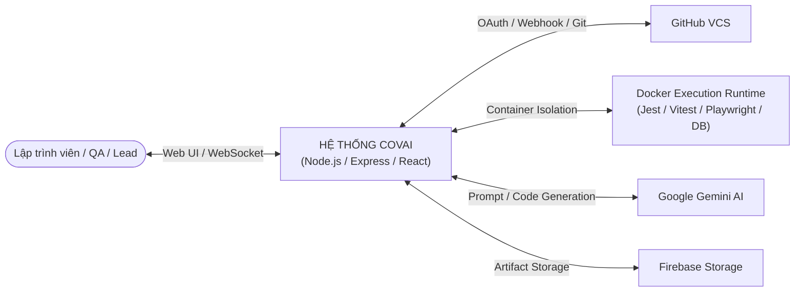
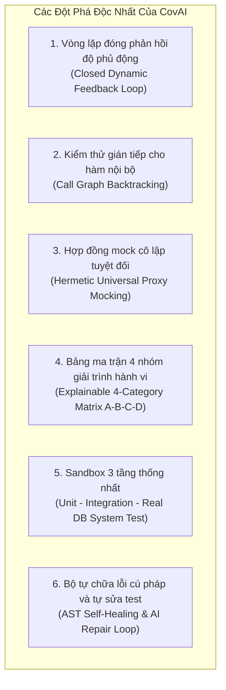
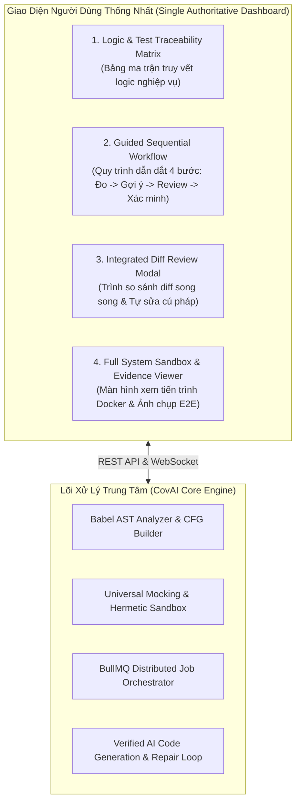
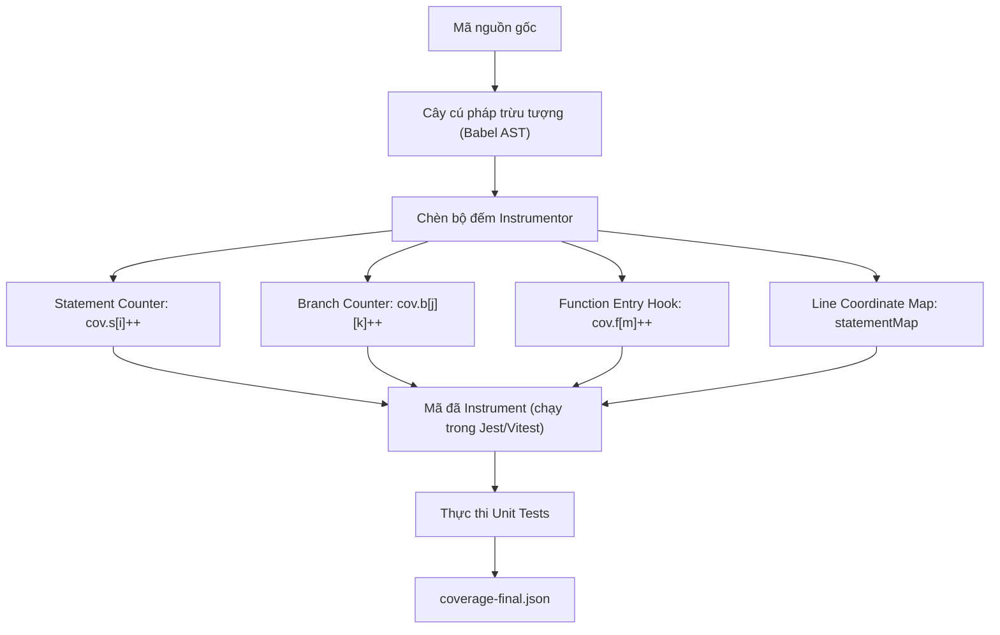
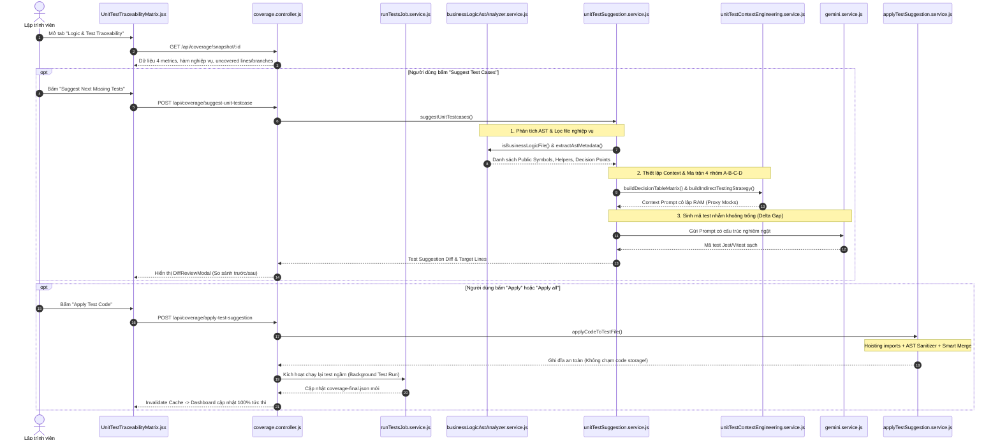
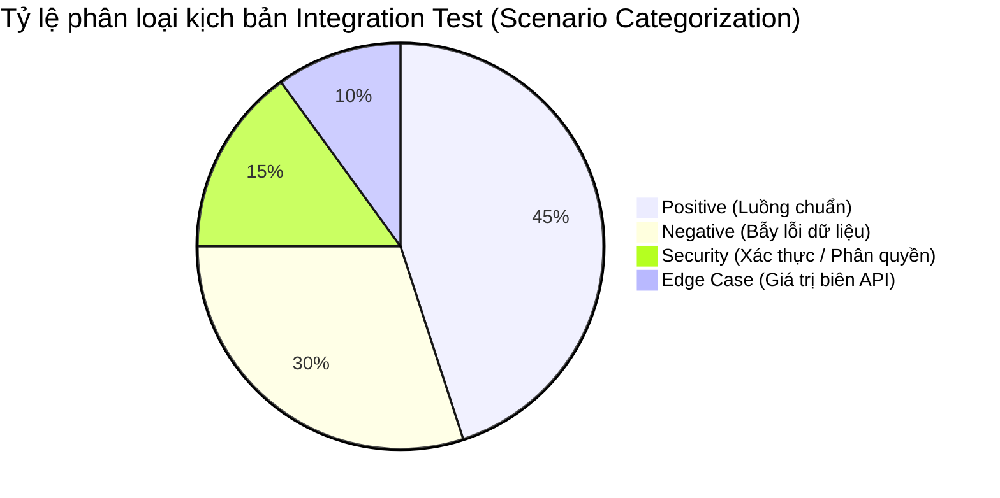
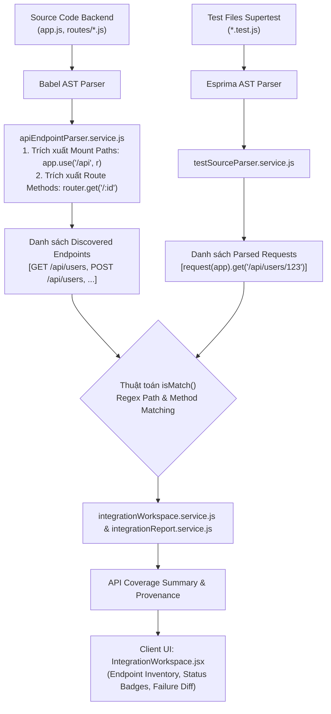
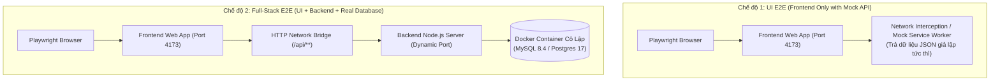
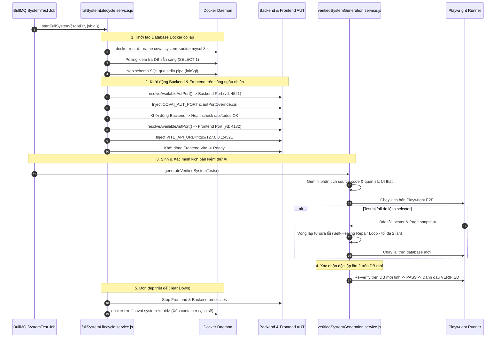
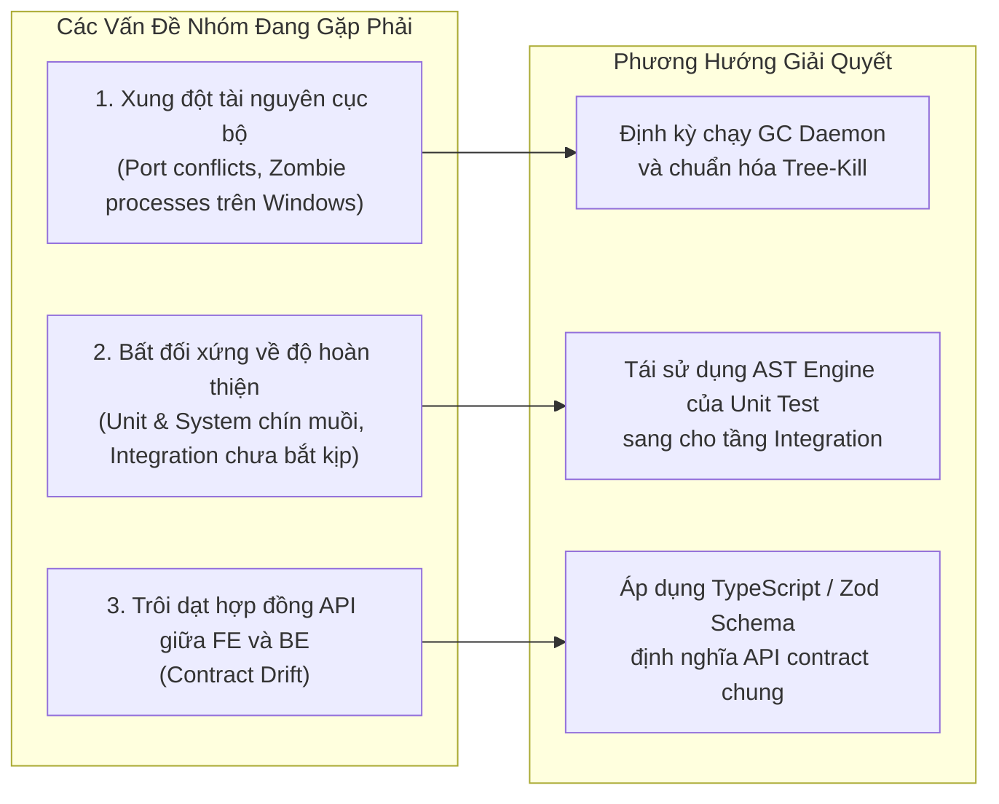

# BÁO CÁO TOÀN DIỆN DỰ ÁN NGHIÊN CỨU & PHÁT TRIỂN NỀN TẢNG COVAI
## Hệ Thống Phân Tích Độ Bao Phủ Đa Tầng Thông Minh & Tự Động Sinh Mã Kiểm Thử Cho Hệ Sinh Thái JavaScript / TypeScript

---

> **Mã số đề tài / Đồ án:** C1SE.30  
> **Lĩnh vực:** Kỹ thuật Phần mềm (Software Engineering) · Kiểm thử phần mềm tự động (Automated Testing) · Trí tuệ nhân tạo hỗ trợ lập trình (AI-Assisted Software Engineering)  
> **Tài liệu tham chiếu:** `specs/C1SE.30_Proposal_ver1.1.docx`, `docs/architecture/system-context.md`, `docs/unit-test-suggestion-principles-and-algorithms.md`, `docs/full-system-testing.md`  
> **Ngày lập báo cáo:** 18/10/2026  

---

## MỤC LỤC CHI TIẾT

1. [Câu hỏi 1: COVAI Là Gì? Dự Án Này Giải Quyết Vấn Đề Gì?](#1-covai-là-gì-dự-án-này-giải-quyết-vấn-đề-gì)
2. [Câu hỏi 2: Tổng Quan Các Dự Án Hiện Có & Sự Khác Biệt Mang Tính Đột Phá Của CovAI](#2-tổng-quan-các-dự-án-hiện-có--sự-khác-biệt-mang-tính-đột-phá-của-covai)
3. [Câu hỏi 3: Mục Tiêu Khi Hoàn Thành Dự Án (Scope & Hình Thái Sản Phẩm Cuối Cùng)](#3-mục-tiêu-khi-hoàn-thành-dự-án-scope--hình-thái-sản-phẩm-cuối-cùng)
4. [Câu hỏi 4: Chuyên Sâu Tầng 1 - Unit Test (Khái Niệm, 4 Chỉ Số Istanbul, Luồng Logic & Thuật Toán Đo Lường)](#4-chuyên-sâu-tầng-1---unit-test-khái-niệm-4-chỉ-số-istanbul-luồng-logic--thuật-toán-đo-lường)
5. [Câu hỏi 5: Chuyên Sâu Tầng 2 - Integration Test (Kiểm Thử Tích Hợp API, Chỉ Số Định Đo & Luồng Đo Lường Thực Tế)](#5-chuyên-sâu-tầng-2---integration-test-kiểm-thử-tích-hợp-api-chỉ-số-định-đo--luồng-đo-lường-thực-tế)
6. [Câu hỏi 6: Chuyên Sâu Tầng 3 - System Test (Kiểm Thử Toàn Hệ Thống, Phân Tách UI vs Full-Stack, Docker Sandbox & AI Repair)](#6-chuyên-sâu-tầng-3---system-test-kiểm-thử-toàn-hệ-thống-phân-tách-ui-vs-full-stack-docker-sandbox--ai-repair)
7. [Câu hỏi 7: Đánh Giá Mã Nguồn Hiện Tại, Đề Xuất Thêm/Bớt Tính Năng & Cải Tiến Làm Việc Nhóm](#7-đánh-giá-mã-nguồn-hiện-tại-đề-xuất-thêmbớt-tính-năng--cải-tiến-làm-việc-nhóm)
8. [Câu hỏi 8: Các Khó Khăn & Thách Thức Kỹ Thuật Đã Đối Mặt Trong Quá Trình Thực Hiện](#8-các-khó-khăn--thách-thức-kỹ-thuật-đã-đối-mặt-trong-quá-trình-thực-hiện)

---

## 1. COVAI LÀ GÌ? DỰ ÁN NÀY GIẢI QUYẾT VẤN ĐỀ GÌ?

### 1.1. Định danh và bản chất của CovAI
**CovAI** (viết tắt của *Coverage with AI*) là một nền tảng kỹ thuật phần mềm thế hệ mới, kết hợp chặt chẽ giữa **Phân tích mã nguồn tĩnh & động (Static & Dynamic Program Analysis)**, **Môi trường thực thi cô lập container hóa (Sandboxed Container Runtime)** và **Mô hình ngôn ngữ lớn (Large Language Models - LLM)** để đo lường độ bao phủ kiểm thử đa tầng và tự động hóa toàn diện quy trình kiểm thử cho các ứng dụng JavaScript/TypeScript.

Trong mô hình kiến trúc C4 (C4 Context Level 1), CovAI đóng vai trò là **Hệ thống trung tâm (System Under Study)** đứng giữa lập trình viên/chuyên viên QA và hạ tầng phát triển (GitHub, Docker Engine, Google Gemini AI, Firebase Cloud Storage).



### 1.2. Các vấn đề cốt lõi mà CovAI giải quyết trong thực tế kỹ thuật phần mềm

Trong thực tế phát triển phần mềm doanh nghiệp và mã nguồn mở, hoạt động kiểm thử gặp phải 5 nút thắt nghiêm trọng:

#### 1. Ảo tưởng về độ bao phủ (The Code Coverage Illusion)
Hầu hết các công cụ CI/CD hiện nay chỉ đo lường phần trăm dòng code chạy qua (*Line Coverage*). Một lập trình viên có thể chỉ cần gọi hàm với dữ liệu thông thường để đạt 80% - 90% Line Coverage, nhưng thực chất bỏ sót toàn bộ các nhánh rẽ điều kiện ẩn (`if-else`, ternary `? :`, nullish coalescing `??`, optional chaining `?.`, các khối bẫy lỗi `try-catch`). Khi ứng dụng ra môi trường production gặp dữ liệu bất thường, hệ thống vẫn sụp đổ dù báo cáo kiểm thử trước đó "xanh mướt".

#### 2. Gánh nặng và rào cản thời gian viết kiểm thử thủ công (High Testing Effort Barrier)
Theo thống kê công nghiệp, việc viết và duy trì bộ kiểm thử chất lượng cao (Unit, Integration, System) chiếm tới **40% – 60%** tổng thời gian phát triển tính năng. Lập trình viên thường ưu tiên đẩy nhanh tính năng kinh doanh và xem nhẹ kiểm thử, dẫn đến "nợ kỹ thuật" (technical debt) tích tụ. Khi được yêu cầu viết test, họ thường chỉ viết kiểm thử bề mặt (*Superficial Assertions* như `expect(result).toBeDefined()`) mà không kiểm tra tính đúng đắn của logic nghiệp vụ.

#### 3. Sự phân mảnh và thiếu nhất quán giữa 3 tầng kiểm thử (Test Pyramid Disconnect)
Kiểm thử phần mềm chuẩn tắc được tổ chức theo hình kim tự tháp (Testing Pyramid):
- **Unit Test (Tầng đáy):** Kiểm tra tính đúng đắn của từng hàm/module logic cô lập.
- **Integration Test (Tầng giữa):** Kiểm tra sự giao tiếp giữa các module, định tuyến API router, middleware và bộ điều khiển (Controller).
- **System / E2E Test (Tầng đỉnh):** Kiểm tra hành vi từ đầu đến cuối trên trình duyệt thật tương tác với backend và cơ sở dữ liệu thật.

Hiện nay, các công cụ kiểm thử trên thị trường bị phân mảnh sâu sắc: một bên chuyên đo unit test, một bên chuyên chạy E2E, không có một giải pháp thống nhất nào cung cấp khả năng quan sát (observability), truy vết ngược (traceability) từ dòng mã nguồn đến từng tầng kiểm thử tương ứng.

#### 4. Hiện tượng "ảo giác" và rò rỉ môi trường của các công cụ AI sinh code truyền thống (AI Hallucination & Leakage)
Khi lập trình viên dùng ChatGPT hay GitHub Copilot để sinh kiểm thử:
- AI thường tự ý `import` các hàm nội bộ không được export (`private helper`), gây lỗi sụp đổ lúc chạy (`TypeError: not a function`).
- AI không hiểu trạng thái độ phủ hiện tại, sinh ra các test case trùng lặp với những gì đã pass, lãng phí thời gian và token.
- AI sinh ra các câu lệnh kiểm thử gọi thẳng vào Database hoặc gửi HTTP request thật, vi phạm tính cô lập của Unit Test, dẫn đến test chạy chậm và không ổn định (flaky test).
- AI thường sinh lỗi cú pháp (`SyntaxError`), self-assignment (`const X = X;`), hoặc assertion không đóng ngoặc.

#### 5. Thiếu tính giải trình và truy vết (Explainable Traceability)
Lập trình viên không thể trả lời nhanh được câu hỏi: *"Hàm nghiệp vụ `calculateDiscount` của tôi đã được kiểm thử những gì? Đã kiểm tra trường hợp voucher hết hạn chưa? Đã kiểm tra mảng giỏ hàng rỗng chưa? Tại sao Branch Coverage lại chỉ đạt 75%?"*.

**CovAI ra đời để giải quyết triệt để 5 vấn đề trên** thông qua quy trình tự động hóa khép kín: Đo lường khách quan bằng AST $\rightarrow$ Phân loại ma trận kiểm thử 4 nhóm hành vi $\rightarrow$ Kỹ nghệ ngữ cảnh sinh test nhắm trúng nhánh thiếu $\rightarrow$ Tự sửa lỗi cú pháp $\rightarrow$ Thực thi cô lập trong Docker $\rightarrow$ Xác minh độ phủ tăng trưởng thực tế.

---

## 2. TỔNG QUAN CÁC DỰ ÁN HIỆN CÓ & SỰ KHÁC BIỆT MANG TÍNH ĐỘT PHÁ CỦA COVAI

### 2.1. Phân tích bối cảnh cạnh tranh (Competitive Landscape)

| Công cụ / Giải pháp | Mô hình hoạt động chính | Điểm mạnh | Hạn chế cố hữu |
| :--- | :--- | :--- | :--- |
| **SonarQube / SonarCloud** | Phân tích cú pháp tĩnh (Static Code Analysis) + Tổng hợp báo cáo kiểm thử. | Phát hiện lỗ hổng bảo mật (SAST), code smells, bug patterns rất mạnh; giao diện quản trị chất lượng trực quan. | **Mang tính thụ động (Passive):** Chỉ phát hiện lỗi và báo % coverage mà **không tự sinh test case**, không thể tự nâng cao độ phủ, không cung cấp môi trường chạy test. |
| **Codecov / Coveralls** | Nền tảng hiển thị báo cáo độ phủ (Coverage Visualization SaaS). | Tích hợp CI/CD mượt mà, hỗ trợ PR comment thông báo độ phủ tăng/giảm trên GitHub/GitLab. | **Chỉ là tầng hiển thị:** Phụ thuộc 100% vào file `lcov.info` do bên ngoài đẩy lên; không phân tích cấu trúc mã nguồn sâu, không có AI sinh test. |
| **CodiumAI (nay là Qodo) / GitHub Copilot** | Extension IDE sinh mã kiểm thử bằng LLM. | Sinh test nhanh trực tiếp trong trình soạn thảo (VS Code, JetBrains), tương tác chat tự nhiên. | **Thiếu vòng lặp phản hồi độ phủ động (Dynamic Coverage Feedback Loop):** Không tự đo lường lại coverage sau khi viết test; không tự động khởi tạo môi trường container Docker với Database thật; dễ sinh test rò rỉ I/O hoặc lỗi cú pháp. |
| **Diffblue Cover** | Tự động sinh Unit Test bằng thực thi ký hiệu (Symbolic Execution) kết hợp AI. | Tự động sinh 100% unit test độc lập mà không cần con người can thiệp. | **Đóng kín và hạn chế nền tảng:** Chỉ hỗ trợ Java/Spring Framework, hoàn toàn **không hỗ trợ JavaScript/TypeScript**; chi phí bản quyền doanh nghiệp cực kỳ đắt đỏ. |
| **Keploy / Testsigma** | Ghi lại lưu lượng mạng (Network Traffic Replay) để sinh Integration Test. | Tạo test nhanh từ request/response thực tế ở môi trường staging/production. | Phụ thuộc hoàn toàn vào lưu lượng có sẵn; **không thể sinh test cho các nhánh biên (Edge Cases/Negative Paths)** chưa từng xảy ra trong thực tế; không đo lường được chi tiết 4 chỉ số Istanbul của từng hàm backend. |

### 2.2. Sự khác biệt mang tính đột phá và đóng góp mới của CovAI

CovAI không đơn thuần là một công cụ báo cáo độ phủ hay một wrapper bọc quanh API của OpenAI/Gemini, mà là một **Hệ thống kiểm thử hộp trắng tự động có hướng dẫn bởi độ phủ (Coverage-Guided Automated White-Box Testing System)** với các đột phá kỹ thuật độc nhất:



1. **Vòng lặp phản hồi độ phủ động khép kín (Dynamic Coverage Feedback Loop):**  
   CovAI liên tục thực hiện chu trình: Đo lường baseline $\rightarrow$ Nhận diện khoảng trống (Gaps) $\rightarrow$ Kỹ nghệ ngữ cảnh prompt $\rightarrow$ Sinh test $\rightarrow$ Chữa lỗi cú pháp AST $\rightarrow$ Thực thi kiểm thử trong container $\rightarrow$ Xác minh độ phủ tăng thực tế. Nếu chưa đạt 100%, hệ thống tự động kích hoạt lượt bổ sung nhánh còn thiếu (Incremental Delta Augmentation).
2. **Thuật toán điều hướng kiểm thử gián tiếp (Call Graph Backtracking):**  
   Giải quyết triệt để vấn đề "hàm nội bộ không export" (`private/internal helper`). Hệ thống phân tích đồ thị gọi hàm tĩnh (Static Call Graph) để tìm ra hàm public nào gọi đến hàm helper này, sau đó hướng dẫn AI truyền bộ tham số chuẩn vào hàm public để kích hoạt 100% các nhánh bên trong hàm helper mà không bao giờ gây lỗi `TypeError`.
3. **Môi trường mock RAM cô lập tuyệt đối (Hermetic Universal Proxy Mocking):**  
   Tự động sinh proxy mock toàn diện cho các ORM phổ biến (Prisma Client, Mongoose), HTTP Client (Axios), Queue (BullMQ, Redis) và biến môi trường (`process.env`), đảm bảo toàn bộ unit test chạy thuần túy trên RAM với tốc độ hàng mili-giây và không bao giờ bị phụ thuộc vào môi trường ngoài.
4. **Hạ tầng kiểm thử toàn hệ thống với Database thật tự động (Containerized Real-DB System Testing):**  
   Khác với các công cụ E2E chỉ chạy trên mock dữ liệu, CovAI tự động tạo container Docker chứa MySQL 8.4 hoặc PostgreSQL 17 thật, nạp schema SQL, khởi động Backend AUT và Frontend AUT trên cổng ngẫu nhiên độc lập (tránh xung đột cổng bằng cơ chế Dynamic Port Interception `--require autPortOverride.cjs`), chạy Playwright và tự dọn dẹp sạch sẽ sau khi kiểm thử.

---

## 3. MỤC TIÊU KHI HOÀN THÀNH DỰ ÁN (SCOPE & HÌNH THÁI SẢN PHẨM CUỐI CÙNG)

### 3.1. Phạm vi dự án (Project Scope)
- **Hệ sinh thái mục tiêu:** JavaScript và TypeScript (ESM & CommonJS).
- **Loại hình ứng dụng hỗ trợ:** 
  - Backend: Node.js, Express.js REST API, kiến trúc Controller-Service-Repository, ORM (Prisma, Mongoose, MySQL, Postgres).
  - Frontend: Single Page Applications (React, Vite, Vue, HTML5/CSS3/Vanilla JS).
- **Khung kiểm thử (Testing Frameworks) hỗ trợ chính thức:**
  - **Unit Testing:** Jest, Vitest.
  - **Integration Testing:** Supertest, Playwright API Request.
  - **System / E2E Testing:** Playwright, Cypress.
- **Hạ tầng tích hợp:** Docker Container Engine, Redis Queue (BullMQ), PostgreSQL (Prisma ORM), Google Gemini AI API, Firebase Cloud Storage, GitHub REST API / Webhooks.

### 3.2. Hình thái sản phẩm khi hoàn thành (Final Product Vision)

Khi hoàn thành toàn diện, CovAI là một **Nền tảng kiểm thử và đảm bảo chất lượng phần mềm tự động hóa toàn diện (Comprehensive Automated Quality Assurance & Coverage Platform)** hoạt động dưới dạng Web Application SaaS hoặc On-Premises.



#### Các tiêu chuẩn nghiệm thu sản phẩm cuối cùng (Acceptance Criteria):
1. **Trải nghiệm "1-Click Full Coverage":** Người dùng chỉ cần nhập đường dẫn GitHub repo hoặc tải lên file ZIP mã nguồn, hệ thống tự động:
   - Nhận diện kiến trúc project, ngôn ngữ, test framework phù hợp.
   - Chạy bộ kiểm thử hiện có để lập bản đồ độ phủ ban đầu (Baseline Coverage).
   - Tự động sinh bộ kiểm thử bổ sung nhắm chính xác vào các nhánh chưa chạy để đưa độ phủ lên mục tiêu $\ge 90\%$ hoặc $100\%$.
2. **Đảm bảo tính bất biến của mã nguồn dự án (Storage Code Immutability Invariant):** Tuyệt đối không bao giờ chỉnh sửa mã nguồn gốc trong thư mục nghiệp vụ (`storage/`) để ép test pass; tất cả sự gia tăng độ phủ phải đạt được bằng cách hoàn thiện test case và mock sạch sẽ.
3. **Độ tin cậy của mã kiểm thử sinh ra:** 100% test case sinh ra phải thực thi được (*runnable*), không có lỗi cú pháp (*Zero Syntax Error*), không bị lỗi khởi tạo trước thời hạn (*No TDZ ReferenceError*), và không bao giờ rò rỉ I/O ra môi trường ngoài.
4. **Tính minh bạch và giải trình cao:** Mỗi hàm nghiệp vụ đều được gắn kèm thẻ kiểm thử 4 nhóm hành vi (Happy Path, Boundary, Branch Toggling, Error Handling), cho phép kỹ sư kiểm tra chi tiết tại sao hàm đó pass và pass qua đường dẫn logic nào.

---

## 4. CHUYÊN SÂU TẦNG 1 - UNIT TEST (KHÁI NIỆM, 4 CHỈ SỐ ISTANBUL, LUỒNG LOGIC & THUẬT TOÁN ĐO LƯỜNG)

> **Dành cho thành viên phụ trách Tầng 1 (Unit Testing Module)**

### 4.1. Unit Test là gì? Nó kiểm thử cái gì và như thế nào?
- **Định nghĩa:** Unit Test (Kiểm thử đơn vị) là tầng kiểm thử mức thấp nhất trong kim tự tháp kiểm thử, tập trung vào việc cô lập và xác minh tính đúng đắn của **từng đơn vị mã nguồn nhỏ nhất có thể kiểm tra được** (thường là một hàm số, một phương thức của class, hoặc một module logic độc lập).
- **Đối tượng kiểm thử:**
  - Logic tính toán thuần túy (thuật toán chiết khấu giá, định dạng chuỗi, tính toán thuế).
  - Các phép chuyển đổi trạng thái (state transitions) trong bộ nhớ.
  - Các điều kiện rẽ nhánh và bẫy ngoại lệ (`throw new Error`, `catch`).
- **Cách thức thực thi (Nguyên lý cô lập tuyệt đối - Hermeticity):**
  - Unit test **bắt buộc phải thực thi hoàn toàn trong RAM**, với thời gian chạy tính bằng mili-giây.
  - Mọi phụ thuộc ngoại vi (Database, Network, File system, Timers) bắt buộc phải được thay thế bằng các hàm giả lập (**Mocks / Stubs / Spies**). Nếu một bài test chạm vào database thật hoặc gọi HTTP thật, bài test đó không còn là Unit Test mà đã biến thành Integration Test hoặc Flaky Test.

### 4.2. Bản chất và công thức toán học của 4 chỉ số Istanbul (Istanbul / V8 Coverage Metrics)

Trong hệ sinh thái JavaScript/TypeScript, thư viện **Istanbul (nyc / babel-plugin-istanbul)** là tiêu chuẩn công nghiệp được Jest và Vitest tích hợp ngầm để đo độ phủ. Để hiểu rõ cách tính toán, ta cần đi sâu vào cơ chế **Chèn mã AST (AST Source Code Instrumentation)**.

Trước khi chạy kiểm thử, Istanbul phân tích cây cú pháp trừu tượng (Babel AST) của mã nguồn và chèn các biến đếm toàn cục (`__coverage__` object). Khi bài test chạy qua một vị trí, biến đếm tương ứng tại vị trí đó sẽ tự động tăng lên $1$.



#### 1. Statements Coverage ($C_{stmt}$ - Độ bao phủ câu lệnh)
- **Bản chất:** Đo lường tỷ lệ các câu lệnh độc lập trong chương trình đã được thực thi ít nhất một lần. Một câu lệnh (statement) là một chỉ thị hoàn chỉnh cho máy tính thực hiện (ví dụ: `VariableDeclaration`, `ExpressionStatement`, `ReturnStatement`, `ThrowStatement`).
- **Cơ chế chèn mã:**
  ```javascript
  // Mã gốc:
  const discount = price * 0.1;
  return discount;

  // Mã sau khi chèn bộ đếm:
  cov().s[0]++; const discount = price * 0.1;
  cov().s[1]++; return discount;
  ```
- **Công thức toán học:**
  $$C_{stmt} = \left( \frac{\sum_{i=1}^{N_{stmt}} \mathbb{I}(s[i] > 0)}{N_{stmt}} \right) \times 100\%$$
  *Trong đó:* $N_{stmt}$ là tổng số câu lệnh; $s[i]$ là số lần câu lệnh thứ $i$ được chạy qua; $\mathbb{I}(\text{condition})$ là hàm chỉ thị nhận giá trị $1$ nếu điều kiện đúng, ngược lại bằng $0$.

#### 2. Branches Coverage ($C_{branch}$ - Độ bao phủ nhánh điều kiện)
- **Bản chất:** Đo lường tỷ lệ các hướng rẽ khả dĩ của tất cả các cấu trúc điều khiển đã được duyệt qua. Các điểm quyết định bao gồm: `if-else`, toán tử 3 ngôi `condition ? expr1 : expr2`, toán tử logic chập (`||`, `&&`, `??`), `switch-case`.
- **Cơ chế đặc biệt - Nhánh ẩn (Implicit Else):**
  Nếu bạn viết một câu lệnh `if (x > 0) { doSomething(); }` mà **không có `else`**, Istanbul vẫn tự động đăng ký cấu trúc này có **2 nhánh**:
  - Nhánh 0: Khi điều kiện `x > 0` là `true`.
  - Nhánh 1 (Nhánh ẩn): Khi điều kiện `x > 0` là `false` (bỏ qua khối `if`).
  Nếu test case chỉ truyền `x = 5`, nhánh `true` được chạy ($b[0][0] = 1$), nhưng nhánh `false` chưa chạy ($b[0][1] = 0$). Khi đó:
  $$C_{branch} = \frac{1}{2} = 50\%$$
- **Cơ chế với toán tử logic ngắn mạch (Short-circuit Evaluation):**
  Biểu thức `const name = user.name || 'Anonymous';` được Istanbul bọc thành:
  ```javascript
  const name = (cov().b[0][0]++, user.name) || (cov().b[0][1]++, 'Anonymous');
  ```
  Để đạt 100% branch, cần 1 test case có `user.name` hợp lệ (kích hoạt nhánh vế trái) và 1 test case có `user.name = null` hoặc `""` (kích hoạt nhánh vế phải).
- **Công thức toán học:**
  $$C_{branch} = \left( \frac{\sum_{j=1}^{M_{branch}} \sum_{k=0}^{P_j - 1} \mathbb{I}(b[j][k] > 0)}{\sum_{j=1}^{M_{branch}} P_j} \right) \times 100\%$$
  *Trong đó:* $M_{branch}$ là số cấu trúc điều kiện; $P_j$ là số nhánh rẽ của cấu trúc thứ $j$.

> **Quy ước toán học cho hàm thẳng (Straight-line Functions without Branches):**  
> Trong trường hợp hàm nghiệp vụ không chứa bất kỳ cấu trúc điều kiện nào ($M_{branch} = 0$, `branchesTotal = 0`), CovAI- và Istanbul quy ước toán học:
> $$C_{branch} = 100\%, \quad \text{uncoveredBranches} = \emptyset$$
> Điều này phản ánh đúng thực tế: hàm không có nhánh rẽ nào để bỏ sót, do đó độ phủ nhánh đạt tuyệt đối ngay khi hàm được thực thi.

#### 3. Functions Coverage ($C_{func}$ - Độ bao phủ hàm)
- **Bản chất:** Đo lường tỷ lệ các hàm hoặc phương thức được định nghĩa trong mã nguồn đã được gọi ít nhất một lần. Bao gồm: `FunctionDeclaration`, `FunctionExpression`, `ArrowFunctionExpression`, `ClassMethod`.
- **Cơ chế chèn mã:** Istanbul chèn một hook vào dòng đầu tiên của thân hàm:
  ```javascript
  // Mã gốc:
  function calculateTotal(items) {
      return items.reduce((sum, i) => sum + i.price, 0);
  }
  // Mã sau khi instrument:
  function calculateTotal(items) {
      cov().f[0]++; // Đánh dấu hàm calculateTotal đã được gọi
      return items.reduce((sum, i) => {
          cov().f[1]++; // Đánh dấu hàm callback arrow function đã được gọi
          return sum + i.price;
      }, 0);
  }
  ```
- **Công thức toán học:**
  $$C_{func} = \left( \frac{\sum_{m=1}^{K_{func}} \mathbb{I}(f[m] > 0)}{K_{func}} \right) \times 100\%$$

#### 4. Lines Coverage ($C_{line}$ - Độ bao phủ dòng mã khả thi)
- **Bản chất:** Đo lường tỷ lệ các dòng code thực thi (executable lines) có chứa ít nhất một câu lệnh đã được chạy. Các dòng trống, dòng chỉ có dấu ngoặc đóng `}`, hoặc dòng ghi chú (comments) được loại trừ khỏi danh sách dòng thực thi.
- **Mối quan hệ giữa Statement và Line:**
  Một dòng có thể chứa nhiều statement (ví dụ: `const a = 1; const b = 2;`). Nếu dòng đó có ít nhất một statement có $s[i] > 0$, dòng đó được coi là đã phủ ($LineCovered = 1$).
- **Công thức toán học:**
  $$C_{line} = \left( \frac{\sum_{l \in L_{exec}} \mathbb{I}\left( \exists s \in \text{Stmts}(l) : \text{hits}(s) > 0 \right)}{|L_{exec}|} \right) \times 100\%$$

---

### 4.3. Mô tả luồng logic đo lường và gợi ý Unit Test từ đầu đến cuối trong mã nguồn CovAI-

Quy trình kỹ thuật được thực hiện thông qua sự cộng tác giữa các service cốt lõi:



#### Chi tiết các bước thực hiện trong mã nguồn:
1. **Thực thi runner trong RAM cô lập (`runTestsJob.service.js`):**  
   Hệ thống gọi lệnh `jest --coverage --json --outputFile=test-results.json` hoặc lệnh Vitest tương đương trong môi trường Node.js. Istanbul sinh ra file thô `coverage-final.json` và `coverage-summary.json`.
2. **Bóc tách và lưu trữ dữ liệu độ phủ (`coverageFinalParser.service.js`):**  
   Hệ thống đọc file JSON, trích xuất 4 mảng quan trọng:
   - `uncoveredLines`: Các dòng code chưa chạy qua.
   - `uncoveredBranches`: Các nhánh rẽ điều kiện bị thiếu một vế (True hoặc False).
   - `uncoveredFunctions`: Các hàm chưa từng được gọi.
   - `failedLines`: Các dòng gây lỗi assertion.  
   Dữ liệu được lưu vào cơ sở dữ liệu PostgreSQL thông qua Prisma: bảng `CoverageSummary`, `FileCoverage`, và `CoverageFunction`.
3. **Phân tích AST & Lập đồ thị gọi hàm (`businessLogicAstAnalyzer.service.js`):**  
   Sử dụng `@babel/parser` duyệt cây AST của mã nguồn để bóc tách:
   - Các hàm export công khai (**Public Symbols**).
   - Các hàm helper nội bộ không export (**Internal Helpers**).
   - Đồ thị quan hệ gọi hàm (**Static Call Graph**).
4. **Kỹ nghệ ngữ cảnh sinh test 4 nhóm (`unitTestContextEngineering.service.js`):**  
   Hệ thống chia kịch bản thành **Ma trận quyết định 4 nhóm (4-Category Decision Table Matrix)**:
   - **Nhóm A (Happy Path):** Dữ liệu chuẩn, các trường hợp thành công điển hình.
   - **Nhóm B (Boundary Values):** Các giá trị biên: $0$, $-1$, `Number.MAX_SAFE_INTEGER`, mảng rỗng `[]`, chuỗi rỗng `""`, object rỗng `{}`.
   - **Nhóm C (Branch Toggling):** Lật mở từng nhánh boolean của `if/else`, toán tử 3 ngôi, toán tử `??`, `||`, `?.`.
   - **Nhóm D (Error Handling):** Kiểm tra `throw new Error()`, `catch`, promise reject, mock service ngoài trả về lỗi.
5. **Hợp nhất an toàn và tự sửa lỗi cú pháp (`applyTestSuggestion.service.js`):**  
   Khi người dùng chấp nhận áp dụng test:
   - **Hoisting Imports:** Tự động đưa các câu lệnh `import` hoặc `require` mới lên đầu file test đích, loại bỏ trùng lặp.
   - **AST Sanitizer & Anti-TDZ:** Phát hiện và tự động sửa các lỗi self-assignment (`const path = path;` $\rightarrow$ `const path = require('path');`), cân bằng lại các dấu ngoặc nhọn `{}` và dấu nháy đơn `'` nếu LLM bị cắt cụt output.
   - **Unskip Skipped Tests:** Khôi phục các test đang bị vô hiệu hóa (`it.skip`, `xit`).

---

### 4.4. Ví dụ minh họa cụ thể từ mã nguồn đến cách Istanbul tính toán

Xét hàm nghiệp vụ xử lý mã giảm giá trong file `server/src/utils/discountCalculator.js`:

```javascript
// Mã nguồn gốc:
export function applyCoupon(orderTotal, coupon, user) {
    if (!coupon || !coupon.code) { // Điểm rẽ nhánh 1 (2 nhánh)
        return { total: orderTotal, discount: 0 };
    }
    
    const minSpend = coupon.minSpend ?? 50; // Điểm rẽ nhánh 2 (2 nhánh)
    if (orderTotal < minSpend) {            // Điểm rẽ nhánh 3 (2 nhánh)
        throw new Error('Đơn hàng chưa đạt giá trị tối thiểu');
    }
    
    const isVip = user?.role === 'VIP';     // Điểm rẽ nhánh 4 (2 nhánh)
    const rate = isVip ? 0.2 : 0.1;         // Điểm rẽ nhánh 5 (2 nhánh)
    
    const discount = orderTotal * rate;
    return {
        total: orderTotal - discount,
        discount
    };
}
```

#### Phân tích cấu trúc Istanbul:
- **Tổng số câu lệnh (Statements):** 8 câu lệnh ($S_{total} = 8$).
- **Tổng số nhánh điều kiện (Branches):** 5 cấu trúc điều kiện $\times$ 2 nhánh = 10 nhánh ($B_{total} = 10$).
- **Tổng số hàm (Functions):** 1 hàm `applyCoupon` ($F_{total} = 1$).
- **Tổng số dòng khả thi (Lines):** 9 dòng ($L_{total} = 9$).

#### Kịch bản 1: Lập trình viên chỉ viết 1 test case Happy Path thông thường:
```javascript
test('Happy Path: Khách hàng thường áp dụng coupon', () => {
    const res = applyCoupon(100, { code: 'SALE10' }, { role: 'MEMBER' });
    expect(res.discount).toBe(10);
});
```
- **Kết quả đo lường của Istanbul:**
  - *Statements:* 7/8 câu lệnh được chạy (bỏ sót dòng `throw new Error`). $C_{stmt} = 87.5\%$.
  - *Functions:* 1/1 hàm được chạy. $C_{func} = 100\%$.
  - *Lines:* 8/9 dòng được chạy. $C_{line} = 88.8\%$.
  - *Branches:* 
    - Nhánh 1: Mới chỉ chạy vế `false` (coupon hợp lệ). Thiếu vế `true` ($b[0][0] = 0$).
    - Nhánh 2: Mới chỉ chạy vế vế fallback `?? 50`. Thiếu vế truyền `minSpend` tường minh.
    - Nhánh 3: Mới chỉ chạy vế `false` (`orderTotal >= minSpend`). Thiếu vế `true`.
    - Nhánh 4: Mới chỉ chạy vế `user.role !== 'VIP'`. Thiếu vế `user = undefined` và `user.role === 'VIP'`.
    - Nhánh 5: Mới chỉ chạy vế `isVip === false` (`rate = 0.1`). Thiếu vế `rate = 0.2`.  
    $\rightarrow$ **Branch Coverage chỉ đạt 4/10 nhánh = 40%!**

#### Kịch bản 2: CovAI- tự động phân tích và sinh bổ sung 4 test case nhắm trúng các khoảng trống (Delta Gaps):
```javascript
describe('applyCoupon - AI Coverage Completion Suite', () => {
    // Nhóm A & B (Boundary): Coupon rỗng / không có code
    test('Category B: Không truyền coupon hoặc coupon rỗng', () => {
        expect(applyCoupon(100, null, null)).toEqual({ total: 100, discount: 0 });
        expect(applyCoupon(100, {}, null)).toEqual({ total: 100, discount: 0 });
    });

    // Nhóm D (Error Handling): Đơn hàng không đạt giá trị tối thiểu
    test('Category D: Bắn lỗi khi đơn hàng nhỏ hơn minSpend', () => {
        expect(() => applyCoupon(30, { code: 'SALE', minSpend: 50 }, null))
            .toThrow('Đơn hàng chưa đạt giá trị tối thiểu');
    });

    // Nhóm C (Branch Toggling): Khách hàng VIP kích hoạt chiết khấu 20%
    test('Category C: Khách hàng VIP nhận chiết khấu 20%', () => {
        const res = applyCoupon(100, { code: 'VIP20' }, { role: 'VIP' });
        expect(res.discount).toBe(20);
    });

    // Nhóm C (Branch Toggling): User null kích hoạt optional chaining an toàn
    test('Category C: Đối tượng user là nullish', () => {
        const res = applyCoupon(100, { code: 'SALE10' }, undefined);
        expect(res.discount).toBe(10);
    });
});
```
- **Kết quả sau khi CovAI- áp dụng bộ test trên:**
  - $C_{stmt} = 8/8 = 100\%$
  - $C_{branch} = 10/10 = 100\%$ (Toàn bộ các vế True/False và toán tử nullish đều được duyệt qua)
  - $C_{func} = 1/1 = 100\%$
  - $C_{line} = 9/9 = 100\%$
  - `uncoveredLines = []`, `uncoveredBranches = []`
  - Thỏa mãn điều kiện bất biến: `isFullyCovered = true`.

---

## 5. CHUYÊN SÂU TẦNG 2 - INTEGRATION TEST (KIỂM THỬ TÍCH HỢP API, CHỈ SỐ ĐỊNH ĐO & LUỒNG ĐO LƯỜNG THỰC TẾ)

> **Dành cho thành viên phụ trách Tầng 2 (Integration Testing Module)**

### 5.1. Integration Test là gì? Nó kiểm thử cái gì và như thế nào?
- **Định nghĩa:** Integration Test (Kiểm thử tích hợp) là tầng kiểm thử tập trung xác minh **sự phối hợp chính xác giữa nhiều thành phần / module phần mềm khi chúng kết hợp với nhau**, thay vì kiểm tra từng hàm cô lập.
- **Đối tượng kiểm thử trong CovAI- (Ecosystem Node.js/Express):**
  - Luồng dữ liệu đi từ **HTTP Request $\rightarrow$ Router $\rightarrow$ Middleware (Auth, Validation) $\rightarrow$ Controller $\rightarrow$ Service Layer**.
  - Kiểm tra tính đúng đắn của HTTP Status Code (`200 OK`, `201 Created`, `400 Bad Request`, `401 Unauthorized`, `404 Not Found`, `500 Internal Error`).
  - Kiểm tra tính hợp lệ của Header, Query Parameters, Request Body (JSON payload) và Response Schema.
- **Cách thức thực thi:**
  - Sử dụng thư viện **Supertest** để gửi các HTTP request ảo trực tiếp vào instance của Express app (`request(app).get('/api/users')`) thông qua cơ chế IPC/Stream nội bộ trong RAM, **không cần phải mở cổng mạng công cộng (Network Port)** và không bị ảnh hưởng bởi tường lửa.

---

### 5.2. Các thông số định đo và kết quả hiển thị trên Dashboard Integration
Khác với Unit Test đo lường 4 chỉ số Istanbul trên từng dòng code, Integration Test của CovAI- đo lường **Độ bao phủ giao diện lập trình ứng dụng (API Endpoint Coverage)** và **Độ tin cậy của kịch bản kiểm thử (Scenario Execution Reliability)**:



1. **API Endpoint Coverage ($C_{api}$):**
   - Tỷ lệ các API endpoint được định nghĩa trong mã nguồn backend đã được bao phủ bởi ít nhất một kịch bản test Supertest.
   - **Công thức tính toán:**
     $$C_{api} = \left( \frac{\text{testedApis}}{\text{discoveredApis}} \right) \times 100\%$$
   - *Trong đó:* `discoveredApis` là tổng số endpoint bóc tách được từ Express router; `testedApis` là số endpoint có ít nhất một request hợp lệ nhắm tới.
2. **Chỉ số thực thi kịch bản (Scenario Execution Counts):**
   - `totalTests`, `passedTests`, `failedTests`, `skippedTests`, `durationMs`.
3. **Phân loại kịch bản nghiệp vụ (Scenario Categorization):**
   - **Positive Scenarios:** Các request hợp lệ, mong đợi status `200/201`.
   - **Negative Scenarios:** Các request gửi thiếu trường, sai kiểu dữ liệu, mong đợi status `400/422`.
   - **Security Scenarios:** Các request không có token, token hết hạn, hoặc không đủ quyền, mong đợi status `401/403`.
   - **Edge Case Scenarios:** Các request với payload phân trang cực đại, ID không tồn tại (`404`).
4. **Truy nguyên nguồn gốc dữ liệu (Data Provenance & Transparency):**
   - Hệ thống hiển thị rõ ràng: Dữ liệu này được trích xuất từ đâu (`Endpoint Analysis` qua AST hay `TestRunner Report`), công thức tính là gì, và các giới hạn kỹ thuật cần lưu ý.

---

### 5.3. Luồng logic code từ đầu đến cuối của Tầng Integration trong CovAI-

Quá trình được thực hiện qua các file mã nguồn:
`server/src/services/apiEndpointParser.service.js` $\rightarrow$ `testSourceParser.service.js` $\rightarrow$ `integrationWorkspace.service.js` $\rightarrow$ `integrationReport.service.js` $\rightarrow$ `client/src/components/dashboard/IntegrationWorkspace.jsx`.



#### Chi tiết các bước xử lý trong backend:
1. **Trích xuất Endpoint từ mã nguồn Express (`apiEndpointParser.service.js`):**
   - **Bước 1 (Extract Mount Paths):** Quét file `app.js`, `server.js` hoặc `index.js` tìm các câu lệnh gắn router:
     ```javascript
     app.use('/api/v1/orders', orderRouter);
     ```
     Trích xuất cặp `{ mountPath: '/api/v1/orders', routeVarName: 'orderRouter' }`.
   - **Bước 2 (Extract Router Methods):** Quét các file trong `routes/` hoặc `controllers/`. Dùng `@babel/traverse` tìm các `CallExpression` có dạng `router.get(...)`, `router.post(...)`, `router.put(...)`, `router.delete(...)`. Ghép `mountPath` và đường dẫn nội bộ để tạo ra đường dẫn hoàn chỉnh:
     ```
     POST /api/v1/orders
     GET  /api/v1/orders/:id
     ```
2. **Bóc tách các lời gọi Supertest từ file kiểm thử (`testSourceParser.service.js`):**
   - Sử dụng parser **Esprima** duyệt cây AST của các file kiểm thử tích hợp.
   - Tìm các chuỗi phương thức dạng: `request(app).get('/api/v1/orders/123')` hoặc `request(app).post('/api/v1/orders').send({...})`.
   - Chuẩn hóa các đường dẫn chứa biến động (Template Literal ``/api/v1/orders/${orderId}``) thành dạng placeholder: `/api/v1/orders/:param`.
3. **Thuật toán khớp nối định tuyến thông minh (`isMatch`):**
   - So khớp phương thức HTTP (`GET === GET`).
   - Chuyển đổi định dạng route Express chứa param (ví dụ: `/api/v1/orders/:id`) thành biểu thức chính quy (Regex):
     ```javascript
     const regexStr = "^" + cleanRoute.replace(/:[^\/]+/g, "[^/]+") + "$";
     return new RegExp(regexStr).test(cleanPath);
     ```
   - Nhờ vậy, lời gọi `request(app).get('/api/v1/orders/abc-999')` được khớp chính xác vào endpoint `GET /api/v1/orders/:id`.
4. **Phân tích lỗi chi tiết (`parseFailureMessages`):**
   - Khi một assertion của Supertest thất bại (ví dụ: mong đợi status `200` nhưng nhận `500`), hàm trích xuất sạch mã thoát màu ANSI, bóc tách dòng code bị vỡ (`brokenLineText`), khối diff `Expected vs Received`, và số dòng gây lỗi trong file test để hiển thị trực tiếp lên UI.

---

### 5.4. Ví dụ cụ thể về kịch bản Integration Test
Giả sử hệ thống có router quản lý giỏ hàng `POST /api/cart/items`:

```javascript
// Test suite tích hợp Supertest được CovAI- phân tích và quản lý:
describe('Integration: POST /api/cart/items', () => {
    // 1. Positive Scenario
    test('Positive: Thêm sản phẩm hợp lệ vào giỏ hàng trả về 201', async () => {
        const res = await request(app)
            .post('/api/cart/items')
            .set('Authorization', 'Bearer valid_token')
            .send({ productId: 'prod_123', quantity: 2 });
            
        expect(res.status).toBe(201);
        expect(res.body.success).toBe(true);
        expect(res.body.data.itemCount).toBe(2);
    });

    // 2. Negative Scenario
    test('Negative: Thiếu trường quantity trả về 400 Bad Request', async () => {
        const res = await request(app)
            .post('/api/cart/items')
            .set('Authorization', 'Bearer valid_token')
            .send({ productId: 'prod_123' });
            
        expect(res.status).toBe(400);
        expect(res.body.error).toContain('quantity is required');
    });

    // 3. Security Scenario
    test('Security: Không có token xác thực trả về 401 Unauthorized', async () => {
        const res = await request(app)
            .post('/api/cart/items')
            .send({ productId: 'prod_123', quantity: 1 });
            
        expect(res.status).toBe(401);
    });
});
```
- Khi chạy qua pipeline, CovAI- sẽ ghi nhận:
  - Endpoint `POST /api/cart/items` chuyển trạng thái từ **Uncovered** $\rightarrow$ **Tested (Covered)**.
  - Phân loại 3 kịch bản thành: 1 Positive, 1 Negative, 1 Security.
  - Lưu giữ lịch sử thực thi và thời gian chạy để vẽ biểu đồ xu hướng.

---

## 6. CHUYÊN SÂU TẦNG 3 - SYSTEM TEST (KIỂM THỬ TOÀN HỆ THỐNG, PHÂN TÁCH UI VS FULL-STACK, DOCKER SANDBOX & AI REPAIR)

> **Dành cho thành viên phụ trách Tầng 3 (System Testing Module)**

### 6.1. System Test là gì? Nó kiểm thử cái gì và như thế nào?
- **Định nghĩa:** System Test (Kiểm thử hệ thống hay End-to-End Testing - E2E) là tầng kiểm thử mức cao nhất, có nhiệm vụ xác minh **toàn bộ hệ thống phần mềm hoàn chỉnh hoạt động trơn tru đúng theo yêu cầu đặc tả từ góc nhìn của người dùng thực tế**.
- **Đối tượng kiểm thử:**
  - Giao diện người dùng đồ họa (GUI) hiển thị trên trình duyệt thật (Chromium, Firefox, WebKit).
  - Các tương tác chuột, gõ bàn phím, cuộn trang, điều hướng URL.
  - Các luồng nghiệp vụ xuyên suốt: Từ khi người dùng bấm nút trên giao diện $\rightarrow$ trình duyệt gửi request mạng $\rightarrow$ backend xử lý $\rightarrow$ truy vấn cơ sở dữ liệu thật $\rightarrow$ phản hồi và cập nhật giao diện (DOM).
- **Công cụ thực thi chính trong CovAI-:** **Playwright** (kết hợp Cypress).

---

### 6.2. Tại sao kiểm thử hệ thống lại chia thành: "Test giao diện (UI E2E with Mock)" và "Test toàn hệ thống (Full-Stack UI + Backend + Real DB)"?

Đây là câu hỏi kiến trúc cực kỳ quan trọng trong kiểm thử phần mềm hiện đại. CovAI- phân tách rõ ràng hai chế độ này vì các lý do kỹ thuật sau:



| Tiêu chí so sánh | Chế độ 1: Test Giao diện (UI E2E with Mock) | Chế độ 2: Test Toàn hệ thống (Full-Stack Real DB) |
| :--- | :--- | :--- |
| **Bản chất** | Chỉ khởi động Frontend (Vite/React); mọi request mạng ra ngoài (`/api/*`) đều bị chặn và trả về dữ liệu mẫu (Mock JSON). | Khởi động đồng thời: Frontend + Backend + Cơ sở dữ liệu Docker thật (MySQL 8.4 hoặc PostgreSQL 17). |
| **Mục đích kiểm tra** | • Kiểm tra giao diện người dùng, responsive, render CSS/DOM.<br>• Kiểm tra luồng chuyển hướng (Routing), form validation.<br>• Kiểm tra khả năng xử lý giao diện khi API gặp lỗi (ví dụ giả lập backend trả lỗi `500` hoặc timeout để xem UI có hiện banner thông báo lỗi không). | • Kiểm tra **tính bền vững dữ liệu thực tế (Data Persistence)**: Thêm mới bản ghi, tải lại trang (`page.reload()`), dữ liệu vẫn còn nguyên vẹn trong DB.<br>• Kiểm tra các ràng buộc toàn vẹn dữ liệu (Foreign Key, Unique constraint, Transaction ACID).<br>• Kiểm tra tích hợp thực giữa Frontend và Backend. |
| **Tốc độ thực thi** | Rất nhanh (vài giây), tiêu tốn cực ít tài nguyên. | Chậm hơn (1 - 3 phút), cần thời gian khởi động container Docker và nạp schema. |
| **Độ ổn định (Flakiness)** | Rất cao, hoàn toàn không phụ thuộc mạng hay database. | Cần cơ chế chờ bất đồng bộ (Web-First Assertions) để tránh lệch pha giữa backend và frontend. |

> **Quyết định thiết kế trong CovAI-:**  
> Tại màn hình System Test, CovAI- thiết lập mặc định tiêu chuẩn vàng là **Chế độ Toàn hệ thống · API + DB thật (Full Stack E2E)**. Các test case có hành vi mock API bị từ chối trong chế độ này nhằm đảm bảo tính toàn vẹn và giá trị thực tế của kết quả kiểm thử.

---

### 6.3. Các thông số định đo và kết quả mong muốn thấy sau khi phân tích
1. **Tỷ lệ kịch bản thành công (Scenario Pass Rate):**
   - $Pass/Total$ (ví dụ: 3/3 Scenarios Passed, 0 Flaky, 0 Failed).
2. **Thời gian thực thi từng bước (Step-by-step Duration):**
   - Đo lường thời gian tải trang, thời gian phản hồi của API, thời gian hoàn thành từng thao tác nghiệp vụ.
3. **Bằng chứng kiểm thử dạng hình ảnh (Visual Screenshot Evidence):**
   - Mỗi scenario Playwright khi kết thúc (kể cả thành công hay thất bại) đều tự động chụp ảnh màn hình lưu vào `.covai-system-test/`.
   - Lập trình viên có thể click vào từng scenario trên giao diện để phóng to ảnh chụp màn hình kiểm chứng trạng thái ứng dụng trước khi dữ liệu bị dọn dẹp.
4. **Báo cáo lỗi ngữ cảnh trang (Error Context & Page Snapshot):**
   - Khi một thao tác thất bại, hệ thống lưu lại cây DOM HTML tại thời điểm lỗi (`error-context.md`) và file Playwright Trace để lập trình viên xem lại từng khung hình (frame-by-frame debug).

---

### 6.4. Luồng logic code từ đầu đến cuối của Tầng System Test trong CovAI-

Quá trình được điều phối bởi các service:
`fullSystemLifecycle.service.js` $\rightarrow$ `fullSystemSetup.service.js` $\rightarrow$ `systemTestRunner.service.js` $\rightarrow$ `verifiedSystemGeneration.service.js`.



#### Chi tiết kỹ thuật đặc sắc trong mã nguồn:
1. **Tạo Database Docker độc lập tức thì (`fullSystemLifecycle.service.js`):**  
   Hệ thống sinh một UUID ngẫu nhiên cho container: `covai-system-<uuid>` và một mật khẩu ngẫu nhiên 24 bytes an toàn bằng `crypto.randomBytes(24).toString('hex')`. Gắn nhãn `--label covai.system-test=true` để phục vụ việc tự động dọn rác.
2. **Cơ chế can thiệp cổng backend động (Dynamic Port Interception):**  
   Nhiều dự án người dùng fix cứng cổng trong mã nguồn (ví dụ: `app.listen(3000)`). Khi chạy trên máy chủ có nhiều job chạy song song, cổng 3000 sẽ bị xung đột. CovAI- giải quyết bằng kỹ thuật chèn module preload:
   ```javascript
   backendEnv.NODE_OPTIONS = `${process.env.NODE_OPTIONS || ''} --require="${preload}"`;
   ```
   File `autPortOverride.cjs` can thiệp vào tầng `http.Server.prototype.listen` của Node.js, ép server lắng nghe trên cổng ngẫu nhiên do CovAI- cấp phát (`COVAI_AUT_PORT`), giúp hệ thống chạy song song hàng chục bài test mà không bao giờ trùng cổng.
3. **Cơ chế AI tự sửa lỗi kiểm thử (AI Self-Healing Repair Loop - `verifiedSystemGeneration.service.js`):**  
   - Sau khi Gemini sinh kịch bản Playwright, nếu test bị trượt do lệch locator (ví dụ nút bấm đổi tên hoặc form chuyển sang chế độ edit), hàm `readFailureFeedback` trích xuất thông tin lỗi và cây DOM snapshot.
   - Hệ thống gửi prompt yêu cầu Gemini sửa lại chính xác 1 đến 4 đoạn code (`replacements`). Tuyệt đối không cho phép AI sửa import hay làm suy yếu assertion (`expect(true)`).
   - Mã sửa phải vượt qua **2 lần xác minh độc lập liên tiếp trên 2 cơ sở dữ liệu mới tinh** trước khi được lưu chính thức vào file `tests/system/ai-generated.spec.js`.

---

### 6.5. Ví dụ cụ thể về một kịch bản Full-Stack System Test
Kịch bản kiểm thử toàn diện tính năng CRUD trên TodoApp có kết nối MySQL 8.4 thật:

```javascript
import { test, expect } from '@playwright/test';

test.describe('TodoApp Full-Stack Journey with Real Database', () => {
    test('Xác minh quy trình CRUD và tính bền vững dữ liệu khi tải lại trang', async ({ page }) => {
        // 1. Mở trang chủ (dữ liệu ban đầu rỗng trong DB mới)
        await page.goto('/');
        await expect(page.locator('.todo-item')).toHaveCount(0);

        // 2. Thêm mới công việc
        const todoText = 'Mua tài liệu NCKH CovAI';
        await page.fill('input[placeholder="What needs to be done?"]', todoText);
        await page.keyboard.press('Enter');
        
        // Xác minh hiển thị trên DOM
        const item = page.locator('.todo-item', { hasText: todoText });
        await expect(item).toBeVisible();

        // 3. Tải lại trang để kiểm chứng tính bền vững dữ liệu (Persistence Verification)
        await page.reload();
        await expect(page.locator('.todo-item', { hasText: todoText })).toBeVisible();

        // 4. Đánh dấu hoàn thành
        await item.locator('input[type="checkbox"]').check();
        await expect(item).toHaveClass(/completed/);

        // 5. Chụp ảnh bằng chứng trước khi xóa (Evidence Attachment)
        await test.info().attach('evidence', {
            body: await page.screenshot(),
            contentType: 'image/png'
        });

        // 6. Xóa công việc
        await item.hover();
        await item.locator('button.destroy').click();
        await expect(page.locator('.todo-item')).toHaveCount(0);
    });
});
```

---

## 7. ĐÁNH GIÁ MÃ NGUỒN HIỆN TẠI, ĐỀ XUẤT THÊM/BỚT TÍNH NĂNG & CẢI TIẾN LÀM VIỆC NHÓM

### 7.1. Đánh giá khách quan về chất lượng mã nguồn hiện tại
- **Điểm mạnh (Strengths):**
  - Kiến trúc phân tách module rất rõ ràng ở tầng server (hơn 160 service chuyên biệt cho từng tác vụ: AST, CFG, Docker, BullMQ, Gemini, System Lifecycle).
  - Tầng Unit Test và System Test được đầu tư cực kỳ sâu về thuật toán: có bộ bóc tách AST, xử lý lỗi cú pháp tự động, xử lý TDZ, cơ chế preload ghi đè cổng backend.
  - UI hiện đại, sử dụng TailwindCSS, Lucide icons, và phân bố bố cục khoa học theo quy trình dẫn dắt tuần tự (*Guided Stepper*).
- **Điểm yếu & Nợ kỹ thuật (Technical Debts):**
  - Một số file service có kích thước quá lớn (ví dụ `runTestsJob.service.js` dài gần 150KB, `applyTestSuggestion.service.js` dài 118KB), tập trung quá nhiều logic xử lý chuỗi và regex thay vì phân tách thành các micro-module nhỏ hơn.
  - Tầng Integration Test vẫn còn tồn tại một số logic dùng Regular Expression để phân tích chuỗi trong `apiEndpointParser.service.js`, dễ gặp hạn chế với các cấu trúc Express quá phức tạp hoặc dùng router lồng nhau nhiều cấp.

### 7.2. Đề xuất thêm / bớt tính năng

#### Các tính năng nên THÊM:
1. **Tự động suy luận Database Schema / Migrations cho nhiều ORM hơn:**  
   Hiện tại hệ thống hỗ trợ tự động rất tốt với Prisma (`prisma migrate / db push`) và file SQL thuần (`.covai/system-test.sql`). Nên bổ sung bộ chuyển đổi tự động cho TypeORM, Sequelize, và Mongoose schema để người dùng không cần phải viết file SQL bằng tay.
2. **GitHub Pull Request Bot (CovAI GitHub App):**  
   Tích hợp webhook để khi lập trình viên tạo PR, CovAI tự động chạy phân tích độ phủ, so sánh diff với nhánh `main`, và tự động comment bảng ma trận truy vết trực tiếp vào PR kèm các gợi ý test case.
3. **Bộ nhớ ngữ cảnh AI thích ứng (Adaptive Context Window Pruning):**  
   Đối với các dự án lớn (monorepo), tổng dung lượng file mã nguồn vượt quá 320.000 ký tự. Cần bổ sung thuật toán chọn lọc file thông minh dựa trên độ phụ thuộc (Dependency Graph Filtering) để chỉ nạp các file thực sự liên quan vào prompt của Gemini.

#### Các tính năng nên BỚT / TỐI GIẢN:
1. **Loại bỏ hoàn toàn chế độ "System Test Frontend Mock":**  
   Như mã nguồn đã định hướng, việc duy trì chế độ mock API ở System Test gây nhầm lẫn cho người dùng về độ tin cậy. Nên chuẩn hóa 100% System Test sang chế độ **Full-Stack Real DB** để đảm bảo tính chuyên nghiệp của sản phẩm.
2. **Loại bỏ các thuật toán Regex heuristic cũ trong bóc tách Route:**  
   Thay thế toàn bộ các đoạn mã regex tìm kiếm mount path bằng việc duyệt AST thuần túy qua Babel Parser để tránh bỏ sót các cú pháp route khai báo phức tạp.

---

### 7.3. Các vấn đề nhóm đang gặp phải & Đề xuất phương hướng giải quyết



1. **Vấn đề 1: Xung đột tài nguyên và tiến trình mồ côi (Zombie Processes) trên môi trường Windows:**
   - *Thực trạng:* Trong quá trình phát triển, khi một tác vụ System Test hoặc Unit Test bị người dùng bấm hủy ngang, một số tiến trình con Node.js hoặc container Docker không kịp nhận tín hiệu dừng, dẫn đến kẹt cổng mạng và tiêu hao RAM máy tính của thành viên nhóm.
   - *Hướng giải quyết:* Xây dựng một background daemon tự động dọn rác (Garbage Collector Daemon) chạy mỗi 15 phút, quét tất cả container có nhãn `covai.system-test=true` hoặc tiến trình con bị mất kết nối với Job cha để giải phóng tài nguyên.
2. **Vấn đề 2: Bất đối xứng về tiến độ và kiến trúc giữa 3 tầng kiểm thử:**
   - *Thực trạng:* Tầng Unit Test và System Test được đầu tư rất mạnh mẽ về mặt giải thuật và cơ chế tự sửa lỗi, trong khi Tầng Integration Test vẫn dùng các cơ chế cache và so khớp đơn giản.
   - *Hướng giải quyết:* Tái cấu trúc module Integration bằng cách tận dụng trực tiếp bộ phân tích `businessLogicAstAnalyzer.service.js` của Tầng 1, tạo sợi dây liên kết từ Router $\rightarrow$ Controller $\rightarrow$ Service $\rightarrow$ Unit Test.
3. **Vấn đề 3: Sự trôi dạt hợp đồng giao tiếp giữa Frontend và Backend (Contract Drift):**
   - *Thực trạng:* Khi backend cập nhật thêm trường dữ liệu trong response (như provenance metadata hay execution mode), giao diện frontend đôi khi chưa bắt kịp hoặc bị lỗi hiển thị rỗng (`undefined`).
   - *Hướng giải quyết:* Thiết lập tài liệu đặc tả API chuẩn bằng Swagger/OpenAPI hoặc sử dụng thư viện kiểm tra schema kiểu dữ liệu như **Zod** để cả hai bên chia sẻ chung một định nghĩa dữ liệu (Single Source of Truth).

---

## 8. CÁC KHÓ KHĂN & THÁCH THỨC KỸ THUẬT ĐÃ ĐỐI MẶT TRONG QUÁ TRÌNH THỰC HIỆN

Trong suốt quá trình nghiên cứu và phát triển CovAI, nhóm nghiên cứu đã đối mặt và vượt qua **5 thách thức kỹ thuật lớn nhất**:

### 8.1. Thách thức 1: Vấn đề Temporal Dead Zone (TDZ) và Self-Assignment khi AI sinh test
- **Hiện tượng:** Khi yêu cầu mô hình AI sinh mã kiểm thử, mô hình thỉnh thoảng sinh ra các câu lệnh gán biến chính nó:
  ```javascript
  const path = path; // hoặc const fs = fs;
  ```
- **Hậu quả:** Khi Jest/Vitest thực thi file test này, JavaScript Engine sẽ lập tức quăng lỗi nghiêm trọng: `ReferenceError: Cannot access 'path' before initialization` do rơi vào vùng chết thời gian (TDZ), khiến toàn bộ bài test sụp đổ ngay từ bước import.
- **Giải pháp xử lý:** Nhóm đã xây dựng bộ lọc **AST Sanitizer & Anti-TDZ Engine** trong `applyTestSuggestion.service.js`. Bộ lọc sử dụng phân tích token cú pháp: nếu phát hiện câu lệnh gán tự thân của một built-in module Node.js (`path`, `fs`, `crypto`, `os`, `http`), hệ thống tự động chuẩn hóa thành `const path = require('path');`. Nếu là biến thông thường, hệ thống tự động bóc tách và loại bỏ câu lệnh lỗi trước khi ghi xuống đĩa.

### 8.2. Thách thức 2: Vấn đề kiểm thử các hàm nội bộ không export (Private Helpers)
- **Hiện tượng:** Lập trình viên thường viết các hàm tính toán phụ trợ bên trong file mà không dùng từ khóa `export`. Khi AI nhìn thấy các dòng code trong hàm này chưa được phủ, AI thường tự động sinh câu lệnh:
  ```javascript
  import { calculateInternalBonus } from './salaryService';
  ```
- **Hậu quả:** Gây lỗi runtime fatal: `TypeError: (0, salaryService_1.calculateInternalBonus) is not a function` vì file gốc không hề export hàm đó.
- **Giải pháp xử lý:** Nhóm đã phát triển thuật toán **Điều hướng kiểm thử gián tiếp (Call Graph Backtracking)**. Hệ thống dùng AST để quét tìm hàm public nào gọi đến hàm private này, từ đó hướng dẫn AI truyền bộ tham số đầu vào đặc thù vào hàm public để luồng điều khiển đi xuyên qua và bao phủ hàm private.

### 8.3. Thách thức 3: Xung đột cổng mạng của ứng dụng cần kiểm thử (AUT Port Collision)
- **Hiện tượng:** Mã nguồn người dùng tải lên thường fix cứng cổng mạng trong code (ví dụ `server.listen(5000)` hoặc `app.listen(3000)`). Khi CovAI chạy nhiều job kiểm thử đồng thời trên cùng một máy chủ, các bài test sẽ đụng độ cổng mạng và thất bại ngay lập tức (`Error: listen EADDRINUSE: address already in use :::5000`).
- **Ràng buộc:** CovAI cam kết **tính bất biến của mã nguồn người dùng** (không được sửa file gốc của họ).
- **Giải pháp xử lý:** Nhóm đã sáng tạo giải pháp **Dynamic Port Interception**:
  - Viết một module CJS preload độc lập: `autPortOverride.cjs`.
  - Can thiệp vào phương thức gốc `http.Server.prototype.listen` trong bộ nhớ Node.js lúc runtime.
  - Khi ứng dụng gọi `listen(3000)`, module preload sẽ chặn lại và thay thế bằng cổng ngẫu nhiên do CovAI cấp phát qua biến môi trường `COVAI_AUT_PORT`.

### 8.4. Thách thức 4: Hiện tượng Test Flakiness và trượt Locator trong System Test Playwright
- **Hiện tượng:** Kiểm thử E2E trên trình duyệt rất dễ bị chập chờn (flaky) do độ trễ mạng, hiệu ứng chuyển động animation của CSS, hoặc khi một dòng dữ liệu chuyển sang chế độ chỉnh sửa (edit form) thì các selector cũ không còn khớp.
- **Giải pháp xử lý:**
  - Bắt buộc áp dụng **Web-First Assertions** (`await expect(locator).toBeVisible()`) thay vì các lệnh chờ cố định (`waitForTimeout`).
  - Xây dựng **Vòng lặp tự chữa lỗi kiểm thử (Self-Healing Repair Loop)** với tối đa 2 lần thử, cho phép AI đọc lỗi locator và ảnh chụp DOM thời gian thực để cập nhật selector chính xác mà không làm thay đổi mục đích kiểm thử.

### 8.5. Thách thức 5: Đảm bảo tính bất biến tuyệt đối của mã nguồn trong `storage/`
- **Hiện tượng:** Rất nhiều công cụ kiểm thử trên thị trường tự ý sửa mã nguồn người dùng (thêm hàm export giả, sửa logic điều kiện) để ép bộ kiểm thử chạy pass và khoe độ phủ 100% ảo.
- **Giải pháp xử lý:** CovAI thiết lập quy tắc bất biến nghiêm ngặt: **Mã nguồn trong `storage/` là bất khả xâm phạm**. Mọi thành tựu về độ phủ bắt buộc phải đến từ chất lượng của bộ kiểm thử, kỹ thuật mock cô lập trên RAM và khả năng thiết kế kịch bản kiểm thử của hệ thống.

---

## TỔNG KẾT

Dự án **CovAI (C1SE.30)** là một công trình nghiên cứu và phát triển kỹ thuật phần mềm có tính hoàn thiện cao, giải quyết trọn vẹn bài toán kiểm thử tự động đa tầng cho hệ sinh thái JavaScript/TypeScript. Bằng cách kết hợp giữa phân tích cú pháp trừu tượng (AST), thuật toán đồ thị gọi hàm, môi trường thực thi cô lập container hóa và kỹ nghệ ngữ cảnh AI, CovAI đã chuyển hóa việc kiểm thử phần mềm từ một gánh nặng thủ công tốn kém thành một **quy trình tự động hóa thông minh, chính xác, minh bạch và có tính giải trình cao**.
