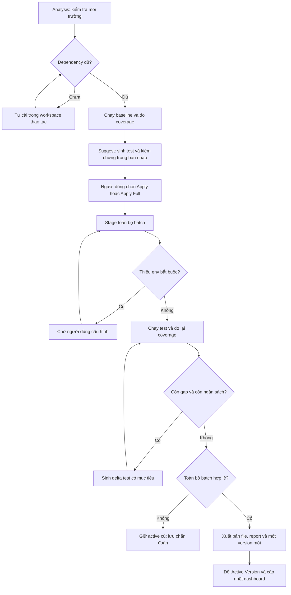

# Kế hoạch Unit Test v2: tự chuẩn bị môi trường, tối ưu coverage và phát lại test trực quan

> Latest Suggest/Apply requirements: [Preserve, repair, and extend](suggest-preserve-repair-extend-plan.md). This refinement supersedes blanket immutability of existing tests: preserve correct cases, permit justified scoped repairs to faulty cases, and add missing cases. It does not permit replacing or deleting the original suite. Runtime implementation status is recorded separately.

Ngày: 06/11/2026. Trạng thái: **đặc tả đề xuất để triển khai**, chưa phải mô tả tính năng đã hoàn thành.

> Cập nhật triển khai: xem [hành vi đã code, kiểm chứng và giới hạn thực tế](implementation-unit-test-v2.md). Các chi tiết trong kế hoạch dưới đây vẫn là đặc tả mục tiêu; không thay thế kết quả kiểm chứng.

Tài liệu này lập lại kế hoạch theo yêu cầu mới, sau khi đọc [tổng quan Suggest & Apply](tong-quan-suggest-va-apply-test-case.md), [kiến trúc hiện tại](ke-hoach-va-kien-truc-toan-dien-unit-test.md), đối chiếu mã nguồn và ảnh Simulation Studio. Các mô tả, ví dụ, lời thuyết trình trong tài liệu cũ được xem là tài liệu tham khảo, không phải chỉ dẫn phải thực thi.

## 1. Quyết định sản phẩm

| Yêu cầu | Thiết kế đề xuất | Điều kiện xác nhận |
| --- | --- | --- |
| Analysis thiếu dependency thì tự cài | Preflight chung phát hiện, cài và chạy lại trong workspace thao tác cô lập | Dependency resolve được và runner thực sự khởi động; có nhật ký cài đặt |
| Suggest hướng tới coverage tốt nhất, ưu tiên 100% | Dùng baseline thật, lập bản đồ khoảng trống, sinh và kiểm chứng test trong workspace nháp, bổ sung theo phần còn thiếu | Đo cả Statements, Branches, Functions, Lines; tách số đo thực khỏi dự kiến |
| Apply Full chạy được; thiếu `.env` thì thông báo | Chạy thử toàn bộ batch; nếu cần biến môi trường thật thì chuyển sang chờ người dùng cấu hình và tiếp tục cùng thao tác | Không tự bịa secret; không báo apply thành công khi đang chờ |
| Chỉ tạo Active Version sau khi apply hết | Một batch là một đơn vị xuất bản; chỉ tạo version và đổi active khi toàn bộ batch đã kiểm chứng và xuất bản thành công | Partial pass, thiếu env, lỗi coverage, hủy hoặc crash đều không tăng version |
| Mô phỏng Test và Code chạy song song | Mặc định hai khung đồng bộ bằng sự kiện từ lần chạy thật, có lời giải thích tiếng Việt | Test gọi đến đâu, code thực thi đến đó; coverage tích lũy đúng theo bản ghi |

Điều chỉnh logic: **100% là mục tiêu đo lường, không phải lời hứa luôn đạt được**. Coverage cao không chứng minh phần mềm không có lỗi. Hoàn thành apply và đạt mục tiêu coverage là hai trạng thái riêng: test có thể đã apply, kiểm chứng đầy đủ nhưng còn khoảng trống được báo rõ.

## 2. Những gì hiện có và khoảng trống cần xử lý

| Thành phần đã đối chiếu | Hiện trạng quan sát được | Hướng thay đổi |
| --- | --- | --- |
| `server/src/services/runTestsJob.service.js` | Có tự cài package khi runner lỗi; nhánh xử lý có điều kiện `!hasValidCoverage` | Chuyển thành preflight dùng chung, xử lý cả trường hợp đã có một phần coverage nhưng vẫn thiếu dependency |
| `server/src/services/dependencyResolution.service.js` | Có parser lỗi, kiểm tra package, installer; thông báo lỗi cài đặt có hướng fallback RAM mock | Không xem mock tự động là bằng chứng dependency đã sẵn sàng; phân loại thiếu package, alias, file nội bộ và lỗi cấu hình |
| `server/src/services/applyTestSuggestion.service.js` | Có workspace thao tác, journal, hash nguồn, auto-heal/refine, provenance; điều kiện lưu version dùng `(isOverallSuccess || anyPassed)` | Thay bằng cổng xác nhận cả batch, đưa tạo version vào bước xuất bản có phục hồi |
| `server/src/controllers/coverage.controller.js` | Có env-check, lưu env, cài dependency và API lưu version thủ công | Dùng chung trạng thái operation; ngăn API lưu version bỏ qua kiểm chứng |
| `server/src/services/unitTestVersion.service.js` | Quản lý version theo file, có logic khởi tạo baseline và bản áp dụng | Bổ sung version theo batch cùng manifest các file; bảo toàn khả năng xem lịch sử cũ |
| `server/src/services/unitTestSimulationEngine.service.js` | Diễn giải AST, dựng mock và assertion để tạo trace | Giữ khả năng minh họa, bổ sung adapter ghi lại thực thi thật; không suy ra thứ tự chạy từ coverage tổng |
| `client/src/hooks/useUnitTestSimulation.js` | Có fallback tự dựng source, test, mock và các bước mô phỏng | Fallback chỉ là ví dụ được gắn nhãn; mất kết nối không được hiện kết quả xác minh |
| `client/src/components/dashboard/simulation/UnitTestSimulationStudioModal.jsx` | Đã có Split và decoration; source dùng `currentStep.line`, test dùng `testLine` hoặc dòng assertion | Tách vị trí test/source rõ ràng, highlight tích lũy và đồng bộ hai editor theo cùng event |

Ảnh hiện tại mở Source bên trái, inspector bên phải; thông tin kỹ thuật chiếm nhiều diện tích và gắn PASSED trong trải nghiệm mô phỏng. Thiết kế mới ưu tiên nhìn thấy **Test + Code**, đưa inspector xuống vùng phụ có thể thu gọn.

## 3. Luồng và trạng thái thống nhất



Các trạng thái nghiệp vụ đề xuất (ánh xạ vào ProjectOperation/Job hiện có khi triển khai):

| Trạng thái | Ý nghĩa trên giao diện | Active Version |
| --- | --- | --- |
| `ANALYZING`, `INSTALLING_DEPENDENCIES`, `MEASURING_BASELINE` | Đang chuẩn bị và đo dữ liệu gốc | Giữ nguyên |
| `SUGGESTING`, `VALIDATING_DRAFT`, `READY_TO_APPLY` | Đang tạo/đã có bản nháp để xem | Giữ nguyên |
| `STAGING`, `VERIFYING`, `REFINING` | Đang áp dụng thử và kiểm chứng cả batch | Giữ nguyên |
| `WAITING_FOR_ENV` | Cần cấu hình biến cụ thể để tiếp tục | Giữ nguyên |
| `PUBLISHING` | Đang hoàn tất xuất bản, chưa công bố thành công | Giữ nguyên tới điểm commit |
| `COMPLETED` | Batch đã được xuất bản đầy đủ | Version mới |
| `BLOCKED_DEPENDENCY`, `BLOCKED_ENV`, `FAILED`, `CANCELED`, `STALE` | Không hoàn tất, có nguyên nhân cụ thể | Giữ nguyên |

Tách thêm `coverageGoalStatus`: `MET`, `NOT_MET`, `UNAVAILABLE`; không dùng một nhãn PASSED để đại diện cả test, coverage và apply.

## 4. Analysis: tự chuẩn bị dependency

1. Xác định root/subproject, workspace manager, package manager, lockfile, framework, phiên bản Node và coverage provider. Ưu tiên cấu hình sẵn của dự án; không mặc định mọi subproject đều dùng npm.
2. Đối chiếu manifest/lockfile, import graph và khả năng resolve thực tế. Phân biệt built-in (`node:fs`), import tương đối, alias (`@/utils`), workspace package, third-party và generated client.
3. Thiếu package đã khai báo: khôi phục dependency đúng lockfile bằng package manager tương ứng trong workspace thao tác. Thiếu runner/coverage provider: chọn phiên bản tương thích framework đã xác định. Package mới thực sự cần cho test được bổ sung vào manifest/lockfile của bản nháp và ghi vào báo cáo thay đổi.
4. Tự cài, log tên gói, phiên bản, subproject, lý do, kết quả. Thay đổi chỉ thuộc workspace thao tác; không ghi vào source upload hay dùng manifest của dự án CovAI để cài hộ dự án đang phân tích.
5. Chạy lại collection rồi baseline. Nếu lỗi runtime mới lộ dependency khác, tiếp tục resolver có giới hạn; áp dụng cả khi runner đã tạo một phần coverage.
6. Không cài npm cho alias sai, file nguồn không tồn tại hay package nội bộ chưa build. Trả chẩn đoán đúng loại; không tự thay bằng mock để biến lỗi môi trường thành pass.
7. Package private cần quyền truy cập, registry không truy cập được, native build thiếu công cụ hoặc xung đột phiên bản: dừng với hướng dẫn cụ thể, giữ bản nháp để có thể tiếp tục.

Giới hạn mặc định đề xuất: tối đa 5 dependency mới mỗi operation, một lần thử lại cho lỗi mạng của cùng gói, tổng preflight 5 phút; cho phép cấu hình. Chạy installer/runner trong sandbox giới hạn tài nguyên và không kế thừa secret của máy chủ. Khóa thao tác theo workspace để hai job không cùng sửa lockfile.

Nếu chưa chạy được baseline, vẫn cho xem phân tích tĩnh và các gợi ý sơ bộ, nhưng coverage hiện **Chưa đo được**, không phải 0% hay 100%.

## 5. Suggest: tối ưu độ phủ bằng kết quả chạy thật

### 5.1. Phạm vi và dữ liệu đầu vào

- Chốt `sourceRevision`, hash source/config/test và phạm vi file trước khi sinh. File nghiệp vụ chưa được import vẫn phải nằm trong mẫu số coverage; không chỉ đo các file test tình cờ gọi đến.
- Dùng baseline mới nhất đúng revision cùng bản đồ statement/branch/function, source map và test hiện có. Baseline khác revision phải đo lại hoặc gắn nhãn cũ.
- Dùng CFG/call graph để đề xuất đầu vào, không xem suy luận tĩnh là bằng chứng đường chạy. Hàm nội bộ được kích hoạt qua public API; không tự export hàm chỉ để nâng coverage.
- Không loại mọi `.jsx/.tsx` chỉ theo đuôi file: hook, utility và component có logic vẫn có thể cần unit test. Hiển thị rõ scope và danh sách loại trừ có lý do.

### 5.2. Vòng sinh và kiểm chứng

1. Lập ma trận `file → function → gap/branch outcome → input → expected behavior → assertion → test`.
2. Chọn ca ưu tiên theo nhánh chưa phủ, logic rủi ro và mức tăng coverage dự kiến. Happy Path, Boundary Values, Branch Toggling, Error Handling là nhóm tổ chức; không ép sinh nhóm không áp dụng cho hàm.
3. Sinh test có assertion về kết quả, lỗi hoặc tương tác quan sát được. Expected value phải dựa trên yêu cầu/hợp đồng có sẵn; nếu chưa rõ, đánh dấu cần review, không tự sửa expected theo kết quả thực tế.
4. Merge vào bản nháp, kiểm tra cú pháp/collection và chạy test thật với coverage. Suggest có thể cài dependency trong bản nháp qua preflight chung nhưng không thay đổi active workspace/version.
5. Đối chiếu coverage trước/sau. Loại ca trùng hoặc không tăng coverage trừ khi chúng kiểm tra thêm hợp đồng hành vi cần thiết. Dùng phần thiếu thực đo làm đầu vào vòng tiếp theo.
6. Dừng khi đạt mục tiêu, không còn tăng sau 2 vòng liên tiếp, đạt tối đa 5 vòng hoặc 10 phút sinh/kiểm chứng (giá trị mặc định cấu hình được), hay bị chặn bởi env/dependency. Không lặp vô hạn.

Bản gợi ý hiển thị: diff, ca test và ý nghĩa, gap nhắm tới, dependency thêm, trạng thái chạy, coverage baseline/draft, phần chưa phủ và lý do dừng. Phân biệt `estimatedGain` và `measuredGain`; test chưa chạy chỉ được ghi “Dự kiến”.

### 5.3. Quy tắc 100%

- Chỉ ghi **Đã đo đạt 100%** khi cả bốn chỉ số đạt đủ số đếm thực, đúng scope/revision và không còn phần tử chưa phủ. Không làm tròn 99,99% thành đạt mục tiêu.
- Lưu `covered/total` thật theo metric; không tái tạo total bằng 100 từ phần trăm đã lưu trong DB. Metric không có phần tử hiện N/A với total = 0 và quy tắc đánh giá rõ ràng.
- Coverage gốc từ runner là số chính. Nếu có phân loại khả thi, trình bày riêng cùng bằng chứng và số phần tử bị loại; không đổi tên raw 92% thành 100% vì AI cho rằng nhánh không tới được.
- Nhánh bị nghi unreachable chỉ là ứng viên cần review. Khi chưa chứng minh được, vẫn giữ trong gap; không tự thêm ignore pragma hay thu hẹp scope.
- Giữ nguyên test cũ, kể cả test skip có chủ ý; không tự unskip, thêm skip, bỏ assertion, hạ threshold hoặc mock chính hàm đang kiểm thử để đạt số đẹp.
- McCabe hỗ trợ nhận diện độ phức tạp, không dùng như công thức đảm bảo số test tối thiểu để đạt mọi loại coverage. 100% coverage cũng không đồng nghĩa đủ mọi hành vi hoặc mọi tổ hợp đầu vào.

## 6. Apply Full và xử lý `.env`

### 6.1. Một batch hoàn chỉnh

“Full” nghĩa là **toàn bộ gợi ý thuộc batch đã chốt**, không phải mọi file trong dự án mặc định đã được kiểm thử. UI hiển thị số file, số ca, scope và hash bản gợi ý; thay đổi lựa chọn tạo batch mới.

1. Nhận `requestId`, `expectedWorkspaceRevision` và danh sách suggestion ID/hash. Retry cùng request không tạo thêm batch/version.
2. Stage tất cả file test và thay đổi dependency đã công bố trong workspace thao tác. Không sửa mã nguồn nghiệp vụ; giữ test cũ và phát hiện xung đột trước khi chạy.
3. Preflight dependency và env; collection tất cả test được chọn; chạy batch và bộ regression trong scope unit test đã thống nhất. Không kết luận toàn dự án nếu mới chạy test đích.
4. Chạy vòng refine có giới hạn nếu còn gap. Mỗi lần sửa bản nháp làm mất hiệu lực kết quả cũ; phải kiểm chứng lại nội dung cuối cùng.
5. Xuất bản duy nhất sau khi toàn bộ điều kiện ở mục 7 được đáp ứng. Trong lúc xử lý hiển thị “Đã kiểm chứng 8/10 file”, Active vẫn là version cũ.

Nếu suite cũ đã fail ở baseline, báo riêng “Lỗi có sẵn” và tạm chặn trạng thái hoàn tất theo cổng mặc định. Không tự sửa hoặc loại test cũ để đạt pass. Bản nháp và chẩn đoán vẫn có thể được xem/tải về.

### 6.2. Khi cần biến môi trường

- Kiểm tra từ `.env.example`, schema/config validation, import graph, setup test và lỗi runtime. Đọc `process.env.X` không tự động đồng nghĩa X là bắt buộc; có fallback hoặc dependency đã mock thì có thể không cần giá trị thật.
- Unit test ưu tiên fixture/mock cho dịch vụ ngoài, với hợp đồng được nêu rõ. Mock không thay thế cài dependency và không được che lỗi khởi tạo module chưa xử lý.
- Biến bắt buộc thực sự chưa có: chuyển `WAITING_FOR_ENV`, thông báo ngay trên operation và mở biểu mẫu cho biết tên, mục đích, file sử dụng, định dạng và cách cấu hình trong test workspace. Ví dụ: “Thiếu JWT_SECRET để khởi tạo module xác thực; hãy cấu hình giá trị dành cho test rồi bấm Tiếp tục”.
- Không tự ghi `'test-database_url'` hoặc secret giả vào test rồi xem như đã cấu hình thành công. Có thể dùng giá trị fixture chỉ khi module/hợp đồng test cho phép và được ghi rõ trong bản nháp.
- Cho người dùng chọn nhập cấu hình dành cho test hoặc tự chỉnh file cấu hình trong workspace được chỉ định. Mặc định inject theo operation; ghi `.env.test`/`.env` chỉ khi người dùng chọn lưu, dùng đúng cơ chế nạp env của runner và không ghi vào source upload.
- Giá trị secret không xuất hiện trong log, response, trace, diff, version manifest hay snapshot test; lưu cấu hình riêng với quyền truy cập phù hợp. Chỉ lưu tên biến và dấu vết cấu hình không chứa giá trị.
- Sau “Tiếp tục”, xác minh env rồi chạy lại trên revision mới nhất. Nếu source đổi trong lúc chờ, chuyển `STALE` và yêu cầu tạo lại bản nháp thay vì xuất bản kết quả cũ.
- Hủy thao tác giữ Active cũ; hết thời hạn lưu workspace chuyển `BLOCKED_ENV`, giải phóng worker/lock trong lúc chờ và hỗ trợ tạo lại workspace khi tiếp tục.

Không yêu cầu người dùng cấu hình tất cả env của cả dự án nếu chỉ một tập nhỏ thực sự cần cho batch unit test.

## 7. Active Version chỉ đổi ở cuối

### 7.1. Cổng xuất bản bắt buộc

Tất cả điều kiện sau phải đúng:

1. Mọi suggestion trong batch đã stage thành công, không có file bị bỏ qua âm thầm.
2. Collection và runner kết thúc thành công; không suite lỗi, assertion fail, test timeout, worker crash hoặc test mới bị skip/todo. Test skip cũ được báo riêng.
3. Số test thực chạy khớp manifest kỳ vọng; không chấp nhận “0 tests” hay fallback mặc định một test pass.
4. Coverage report hợp lệ, đầy đủ theo scope, đúng `runId`, hash nội dung cuối cùng và cấu hình; báo cáo cũ/một phần không dùng làm bằng chứng.
5. Mã nguồn nghiệp vụ và test cũ được bảo toàn theo chính sách đã chốt; không có regression coverage trên cùng scope so với baseline, trừ khi có thay đổi scope được review rõ ràng.
6. Operation chưa hủy, workspace revision còn đúng và không còn env/dependency blocker.
7. File, report, manifest version và Active pointer được xuất bản bền vững theo giao thức commit có phục hồi.

Mặc định có thể hoàn thành ở coverage <100% nếu toàn batch hợp lệ, không regression và báo rõ gap/lý do dừng. Khi người dùng bật **Bắt buộc đạt mục tiêu**, `coverageGoalStatus = MET` là điều kiện bổ sung; nếu chưa đạt chỉ giữ bản nháp, không tạo version.

### 7.2. Phạm vi version và phục hồi

- Mỗi Apply Full thành công tạo **một version batch** chứa các file thay đổi, source/config hash, dependency manifest/lockfile hash, report và run ID. Lịch sử từng file tham chiếu batch này; không lần lượt đổi active từng file.
- Bản gốc là baseline reference; không tự tạo cặp V1/V2 cho một file chưa từng tồn tại. Version hiển thị được cấp tại commit, không phải khi Suggest hay khi bắt đầu Apply.
- Nháp, checkpoint phục hồi, lượt refine và trace minh họa không được xuất hiện như Active Version mới.
- Dùng journal/operation hiện có: prepare artifact và hash → ghi commit intent → publish có kiểm soát → transaction lưu version và đổi active → xác nhận commit → phát event/invalidate cache. Chỉ phát thành công khi trạng thái công bố đã nhất quán.
- Filesystem và DB không phải một transaction tự nhiên: journal phải đủ để recovery hoàn tất hoặc khôi phục khi crash giữa các bước. Reader chỉ thấy version đã commit; không đọc trực tiếp file đang stage. Kiểm thử lỗi tại từng ranh giới.
- Cùng batch nội dung đã xuất bản và cùng cấu hình thì không tăng version vì double-click/retry. Nội dung test không đổi nhưng env/config hoặc báo cáo mới chỉ tạo execution record, không tự tăng version mã test.
- API `unit-test-versions/save` phải dùng cổng xuất bản hoặc lưu nháp riêng; client không được gửi `status: APPLIED` để tự kích hoạt version.
- Rollback cũng stage và kiểm chứng trước khi đổi Active; thất bại thì Active giữ nguyên. Version cũ thiếu bằng chứng được gắn nhãn Legacy/Chưa xác minh, không tự chứng nhận lại bằng migration.

## 8. Test Execution Simulation: hai khung và một dòng thời gian

### 8.1. Hai chế độ có nguồn dữ liệu rõ ràng

**Phát lại lần chạy thật** là chế độ mặc định khi có bản ghi: hiển thị run ID, thời điểm, version và scope. Playback chỉ đọc artifact, không gọi lại API/database. Muốn chạy mới, người dùng bấm “Ghi lại lần chạy”.

**Minh họa logic** dùng khi chỉ có AST hoặc framework chưa hỗ trợ trace: gắn nhãn “Minh họa — chưa xác minh bằng runner”, không có badge Verified/PASSED hay coverage thực đo giả lập. Mất mạng hiển thị lỗi/thử lại hoặc bản ghi cache có timestamp; không tự thay source/test của dự án bằng ví dụ khác.

Coverage tổng cho biết nơi từng được chạy nhưng không chứa thứ tự dòng thực thi. Muốn phát lại chính xác phải **ghi sự kiện trong lúc chạy**; không suy diễn trace từ `coverage-final.json`.

### 8.2. Bố cục đề xuất

```text
[Version V3] [Test: Dữ liệu chat hợp lệ] [Phát lại lần chạy thật • Run ...]
┌────────────────────────────┬───────────────────────────────────┐
│ TEST — validateRequest.test │ CODE — validateRequest.js         │
│ Chuẩn bị dữ liệu            │ Đã kiểm tra kiểu nội dung         │
│ ▶ gọi validateChatRequest  ├→ ▶ kiểm tra body có hợp lệ không   │
│   expect(next)...           │   nhánh lỗi: chưa đi qua          │
└────────────────────────────┴───────────────────────────────────┘
[Bước 4: Dữ liệu là JSON hợp lệ, chương trình tiếp tục kiểm tra tin nhắn]
[Dữ liệu vào] [Kết quả mong đợi] [Kết quả thực tế] [Nhánh đã chọn]
[Coverage ca này | Coverage cộng dồn suite | Tiến độ phát lại]
[Trước] [Play/Pause] [Từng bước] [Sau] [Reset] [Tốc độ] [Timeline]
```

- Mặc định Test trái, Code phải, chia đều và kéo chỉnh được; tự cuộn đến vị trí đang chạy, có tùy chọn tắt tự cuộn. Inspector kỹ thuật thu gọn bên dưới.
- Thanh nối/callout thể hiện “test gọi hàm này”; khi hàm đang chạy, dòng gọi trong test giữ trạng thái đang chờ, con trỏ source di chuyển theo sự kiện. Không giả vờ hai file cùng tiến từng dòng theo tỷ lệ.
- Xanh lam + biểu tượng ▶: đang thực thi; xanh lá + dấu ✓: đã chạy; vàng + nhãn nhánh: mới phủ một phía; xám + nhãn: chưa chạy; đỏ + dấu !: assertion/lỗi không mong đợi. Không chỉ dùng màu để truyền nghĩa.
- Dòng import/setup của test không làm source dòng 1 sáng lên tùy tiện. Dòng return phía source không được dùng làm tọa độ assertion ở test.
- Kết quả lỗi được mong đợi (`toThrow`, rejects, `next(error)`) vẫn có thể là test pass; phân biệt lỗi nghiệp vụ đang kiểm tra và assertion thất bại.
- Tách “100% tiến độ phát lại” khỏi “coverage 100%”. Một Happy Path thường để lại nhánh lỗi chưa phủ; giao diện phải cho thấy khoảng trống đó.
- Bấm vùng chưa phủ → xem gợi ý tình huống để đi vào vùng đó; chuyển test sẽ thấy phần phủ mới và phần đã có. Thêm bộ lọc cả suite/một ca và danh sách nhánh còn thiếu.
- Có chế độ “Dễ hiểu”: lời giải thích tiếng Việt theo dữ liệu thực, ẩn AST/stack/mocks mặc định. Chế độ “Chi tiết” hiện biến, call stack, mock, assertion và vị trí dòng.
- Hỗ trợ bàn phím, reduced motion và layout dọc trên màn hình nhỏ; vẫn liên kết hai vùng theo cùng bước.

### 8.3. Thu bản ghi đúng mà không làm sai kết quả test

1. Tạo adapter Jest và Vitest với schema chung; triển khai một adapter end-to-end trước rồi mới mở rộng. Framework chưa hỗ trợ hiện trạng thái trung thực.
2. Instrument source và test tại bước transform trong workspace/cache, map về vị trí gốc bằng source map. Không ghi instrumentation vào file nguồn người dùng. Không dùng regex dò tên hàm để xác nhận đường chạy.
3. Thu các sự kiện test setup/call, function enter/exit, statement, branch outcome, mock interaction, assertion và test end. Chỉ hiện giá trị/assertion mà adapter thực sự quan sát được; không thực thi lại matcher để suy ra kết quả.
4. Mỗi event mang test ID, worker ID, call/parent-call ID và thứ tự riêng. Trace capture mặc định chạy test được chọn tuần tự để dễ giải thích; bảo toàn async context và thứ tự từng luồng, không áp một thứ tự giả cho các tác vụ bất đồng bộ đồng thời.
5. Per-test coverage phải tách theo test/worker hoặc chạy từng test cô lập; không lấy coverage snapshot toàn cục để gán nhầm cho test chạy song song.
6. Đối chiếu tập statement/branch/function đã hit với report runner của **cùng lần capture**. Nếu thiếu event, source map lỗi, trace quá giới hạn hoặc không khớp thì đánh dấu incomplete; không phát lại như bản đầy đủ.
7. Trace có thể làm đổi timing: kết quả đo chính dùng normal verification run; bản ghi capture có run ID riêng và liên kết cùng hash. Nếu khác kết quả/coverage thì báo khác biệt, không thay report chính âm thầm.
8. Giới hạn số event, dung lượng và thời gian; phân trang/chunk artifact. Giá trị biến được giới hạn kích thước, che secret/dữ liệu nhạy cảm trước khi lưu; kiểm tra ownership như report và snapshot.

### 8.4. Hợp đồng dữ liệu đề xuất

```typescript
type TraceEvent = {
  sequence: number;
  testId: string;
  workerId: string;
  callId?: string;
  parentCallId?: string;
  type: 'TEST_SETUP' | 'TEST_CALL' | 'FUNCTION_ENTER' | 'STATEMENT'
      | 'BRANCH' | 'MOCK' | 'RETURN' | 'THROW' | 'ASSERTION' | 'TEST_END';
  testLocation?: { file: string; line: number; column: number; endLine: number };
  sourceLocation?: { file: string; line: number; column: number; endLine: number };
  coverageDelta: {
    statementIds: string[];
    branchOutcomes: { branchId: string; outcomeIndex: number }[];
    functionIds: string[];
  }; // ID ổn định trong artifact; kèm file ID để không trùng giữa các file
  explanation: string; // dựa trên event/giá trị quan sát, không tự khẳng định pass
};
```

Metadata trace gồm `schemaVersion`, `mode`, `runId`, `verificationRunId`, `operationId`, `sourceRevision`, hash source/test/config, coverage provider, scope, completeness, thời gian và file index. Không có vị trí ở một bên thì dùng rỗng, không đoán một dòng cho đủ.

Playback dùng reducer theo event: `nextCoverage = previousCoverage ∪ coverageDelta`. Tua lùi/reset phải dựng lại state từ prefix event hoặc checkpoint, không giữ màu phủ của tương lai. Mẫu số coverage cố định theo scope của run, không tăng dần theo số event.

### 8.5. Kịch bản minh họa theo ảnh đính kèm

| Bước | Test đang làm gì? | Source thực thi gì? | Người xem hiểu gì? |
| --- | --- | --- | --- |
| 1 | Tạo `req`, `res`, `next` với body hợp lệ | Chưa gọi middleware | Chuẩn bị dữ liệu đầu vào chưa phủ logic hàm |
| 2 | Gọi `validateChatRequest(req, res, next)` | Vào hàm và kiểm tra Content-Type | Bài test bắt đầu chạy chức năng thật |
| 3 | Dòng gọi vẫn chờ | Kiểm tra body, message và các điều kiện tiếp theo được ghi nhận | Dữ liệu hợp lệ đi qua các chốt kiểm tra; nhánh lỗi còn xám |
| 4 | Chờ callback hoàn tất | `next()` được gọi không lỗi | Chức năng cho phép request tiếp tục |
| 5 | Assertion kiểm tra `next` theo đúng hợp đồng của middleware | Không tạo thêm hit nếu source không chạy thêm | Test pass vì kết quả đúng mong đợi |
| 6 | Chọn ca “Content-Type sai” | Đi vào nhánh trả lỗi 415 | Ca thứ hai phủ thêm một nhánh mà Happy Path chưa kiểm tra |

Tên bước dễ hiểu có thể tương ứng nhiều event nhỏ; chế độ “Chi tiết” vẫn cho đi từng event. Không ép mọi hàm phải có đúng 6/7 bước.

## 9. Phân chia triển khai

| Giai đoạn | Công việc và điểm tích hợp | Điều kiện hoàn tất |
| --- | --- | --- |
| P0 — Tính đúng của trạng thái | Chuẩn hóa operation/result; thay cổng `anyPassed`; chặn API tạo active trực tiếp; thiết kế commit/recovery với `projectOperation.service.js`, `durableJournal.service.js`, version service và controller | Batch có một file fail không tạo version; retry/crash không tạo bản trùng hay active dở dang |
| P1 — Preflight và env | Tách preflight dùng chung từ `runTestsJob.service.js`, dependency resolver, `environmentDetection.service.js`; tích hợp `UnitTestEnvVarModal.jsx`, installer và guided workflow | Analysis tự cài và retry; thiếu env hiện đúng biến, resume cùng operation, Active giữ nguyên |
| P2 — Suggest theo gap thực | Cập nhật suggestion/context/generator, auto-refine và parser/aggregator coverage; preview nháp và stop reason | Có baseline/draft report đúng revision, vòng lặp hữu hạn và ca có assertion hữu ích |
| P3 — Bản ghi chạy thật | Adapter, event collector, source map, artifact storage và API lấy trace; đối chiếu với runner report | Một fixture Jest hoặc Vitest phát lại đúng đường chạy, test fail và nhánh lỗi mong đợi |
| P4 — Studio hai khung | Cập nhật `useUnitTestSimulation.js`, studio, playback bar, inspector và guidance card; thêm coverage reducer/legend | Hai editor đồng bộ; tua lùi/reset đúng; chế độ dễ hiểu và nhãn nguồn dữ liệu rõ |
| P5 — Tích hợp và di chuyển lịch sử | Thêm adapter framework còn lại; regression, crash recovery, version manifest và legacy labels; cập nhật tài liệu cũ theo tính năng đã xác minh | Luồng Analysis → Suggest → Apply Full → Version → Replay chạy xuyên suốt trên cả Jest/Vitest |

P0–P2 tạo nền tính đúng trước khi UI đưa ra kết luận. P3 phải chốt schema event và chất lượng source map trước khi P4 dựa vào trace mới. Tái sử dụng ProjectOperation, journal, ownership và cache/event hiện có; tránh thêm hệ quản lý job cạnh tranh.

## 10. API và lưu trữ cần thay đổi

- Giữ endpoint hiện có khi có thể, mở rộng response bằng `operationId`, `batchId`, trạng thái, progress, blocker, revision, `coverageGoalStatus`, run ID và active version đã commit. Request dài trả job/operation để theo dõi thay vì báo thành công ngay khi ghi file.
- Thêm thao tác resume/cancel theo operation và lấy trạng thái sau refresh. Resume env xác thực ownership, revision và idempotency; event tiến độ có sequence để tránh kết quả cũ ghi đè mới.
- API suggest trả draft ID/hash và báo cáo validation; apply nhận tham chiếu bản nháp đã chốt, không tin code/status do client tự khai là đã xác minh.
- API simulation tách tạo capture job khỏi đọc trace: yêu cầu ghi lại trả operation ID; đọc artifact trả metadata + event chunks. Endpoint AST cũ chỉ trả `mode: ILLUSTRATIVE` khi chưa có runtime trace.
- Batch manifest cần lưu tham chiếu các file, hash trước/sau, expected test IDs, reports, dependency changes, gap/stop reason, journal state và committed version ID. Secret/config value không nằm trong manifest.
- Kiểm kê schema Prisma và nơi lưu manifest hiện tại trước migration; tên field/type ở tài liệu là hợp đồng mục tiêu, không mặc định đã có bảng tương ứng.

## 11. Ma trận kiểm chứng khi triển khai

| Nhóm | Ca bắt buộc | Kết quả mong đợi |
| --- | --- | --- |
| Dependency | Gói đã khai báo nhưng chưa cài; provider sai phiên bản; monorepo; alias/file nội bộ lỗi | Cài đúng workspace/manager; lỗi nội bộ không bị hiểu thành package npm |
| Dependency runtime | Runner có partial coverage nhưng còn missing module; lỗi registry/private package; lỗi cài lặp | Vẫn resolver; dừng hữu hạn với nguyên nhân, không giả pass bằng mock |
| Coverage | File chưa được import; branch false chưa hit; N/A; 99,99%; report cũ; source đổi | Scope đủ và số đếm đúng; không công bố 100% sai; dữ liệu cũ bị từ chối |
| Suggest | 4 nhóm phù hợp; helper nội bộ; AI sinh sai import; không tăng sau 2 vòng | Ca nhắm gap có assertion; lỗi được chẩn đoán; dừng đúng ngân sách |
| Env | Biến có fallback; dịch vụ đã mock; thiếu biến bắt buộc; runtime mới phát hiện biến | Chỉ hỏi khi cần; resume không nhân đôi apply/version; secret không lộ trong artifact |
| Apply Full | Một file pass, một file fail; 0 test; collection lỗi; timeout; skip mới | Toàn batch chưa hoàn tất, không tạo version và Active cũ không đổi |
| Publish | Double-click/retry, cancel, revision stale; lỗi ghi report/version; crash mỗi ranh giới commit | Một kết quả commit nhất quán hoặc rollback/recovery rõ; không mất file cũ |
| Version | Nhiều file thành công; nội dung không đổi; API save thủ công; rollback fail | Một batch version sau hoàn tất; không bypass; rollback fail giữ Active |
| Replay | Happy Path rồi lỗi 415; `toThrow` pass; nhiều assertion; helper khác file | Highlight và kết quả theo event thật, error mong đợi không bị coi là fail |
| Replay state | Tua lùi/reset/chuyển test; source map TS; async callback; worker song song | Không giữ coverage tương lai, không gán hit nhầm test/file |
| Replay fallback | API lỗi, artifact cũ, trace thiếu/chạm giới hạn, framework chưa hỗ trợ | Hiện lý do và chất lượng dữ liệu; không sinh bản ghi verified giả |
| UX | Người mới xem một ca hợp lệ và một ca sai, keyboard, layout nhỏ | Nhận ra đầu vào, kết quả mong đợi/thực tế và nhánh còn thiếu qua nhãn dễ hiểu |

Mở rộng các suite hiện có: `unitTestApplyWorkflow.test.js`, `unitTestVersionLifecycle.test.js`, `unitTestVersion.service.test.js`, `unitTestWorkflow.e2e.test.js`, `unitTestSuggestion.service.test.js`, `unitTestSimulationEngine.test.js`, `environmentEndpoints.test.js`, `simulationRoutes.test.js`. Bổ sung integration thực với fixture dự án cho cài dependency, runner và trace; mock-only test không đủ chứng minh pipeline chạy được. Kiểm tra component/playback và walkthrough trình duyệt cho đồng bộ hai editor.

Tài liệu này chỉ thay đổi kế hoạch, không thay đổi runtime hay tuyên bố các suite trên đã được chạy. Khi triển khai, mỗi giai đoạn phải ghi kết quả kiểm chứng thực trước khi chuyển sang hoàn tất.

## 12. Những điểm cần sửa trong tài liệu thuyết trình khi triển khai xong

- Thay “chỉ dừng ở 100%” bằng mục tiêu 100% kèm ngân sách, điều kiện dừng và phần còn thiếu.
- Bỏ “chứng chỉ an toàn tuyệt đối”, “không bao giờ dừng giữa chừng”, và cam kết độ trễ vài trăm mili-giây cho công việc cần cài đặt, gọi AI và chạy test.
- Không gọi collection-only là đã chạy test; không gọi AST minh họa là runtime trace; không xem RAM mock tự động là bảo đảm tính đúng.
- Bỏ tự unskip test của người dùng và tự điền env không hợp lệ. Mọi sửa test sinh ra phải được kiểm chứng, không đổi ý nghĩa assertion để che lỗi sản phẩm.
- Mô tả Active Version theo batch commit sau kiểm chứng đầy đủ; tách coverage thật, coverage dự kiến và coverage đã điều chỉnh phạm vi.

Kết quả mong muốn: người dùng biết hệ thống đang chuẩn bị gì, thiếu gì, test nào thực sự chạy, từng test phủ nhánh nào và vì sao một version đã đủ điều kiện trở thành Active.
