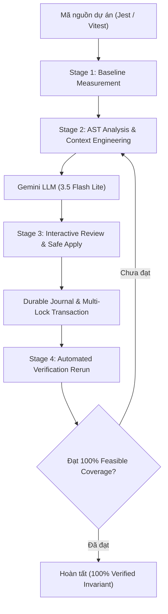
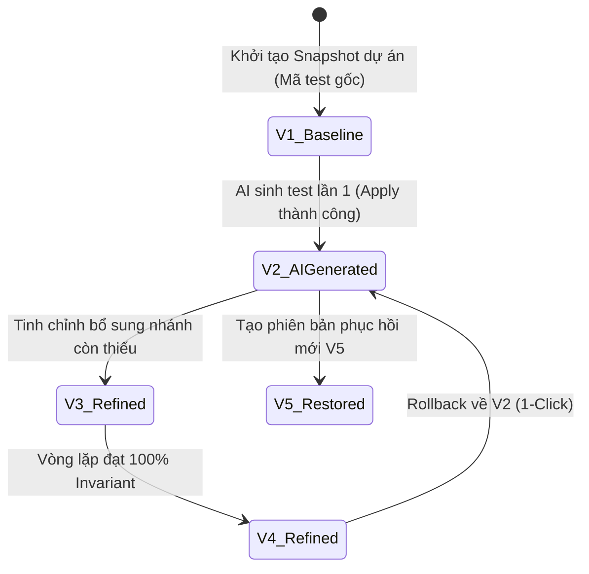
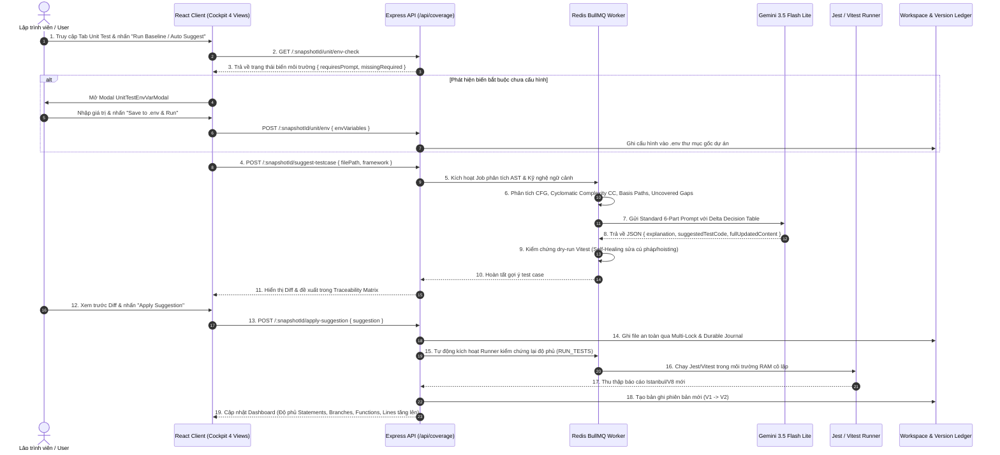
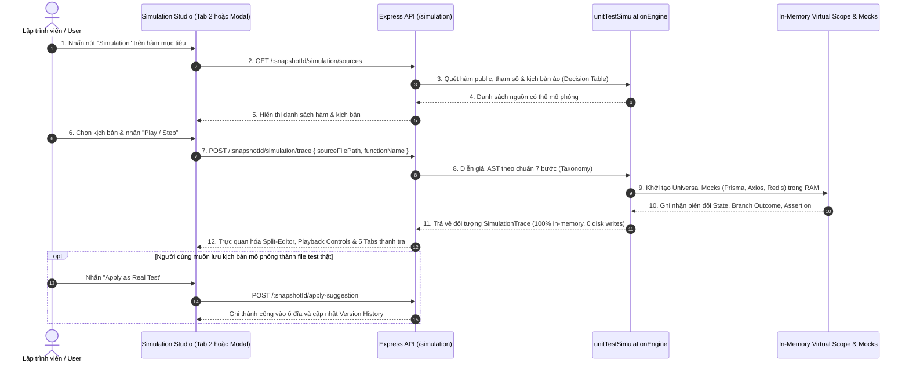
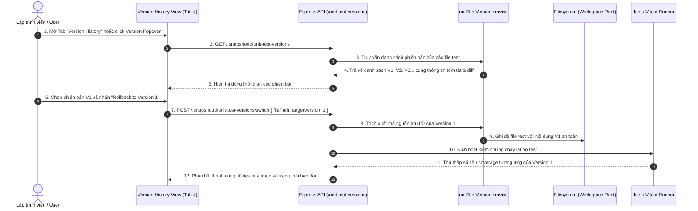

# KẾ HOẠCH & KIẾN TRÚC TOÀN DIỆN PHÂN HỆ UNIT TEST TRONG COVAI-
*(Comprehensive Unit Test Architecture, Features Inventory & Operational Lifecycle)*

> **Tài liệu kiểm tra, đặc tả kỹ thuật và phân tích ngược (Reverse Engineering & Specification)**  
> *Hệ thống kiểm thử đơn vị tự động đa khung (Jest & Vitest) đạt chuẩn 100% Invariant Coverage.*

---

## MỤC LỤC
1. [Tổng Quan Kiến Trúc Chu Trình Khép Kín (Closed-Loop Architecture)](#1-tổng-quan-kiến-trúc-chu-trình-khép-kín-closed-loop-architecture)
2. [Kiến Trúc Giao Diện 4 View Trung Tâm (Cockpit 4-View Architecture)](#2-kiến-trúc-giao-diện-4-view-trung-tâm-cockpit-4-view-architecture)
   - [2.1. View 1: Logic & Test Traceability Matrix (Primary View)](#21-view-1-logic--test-traceability-matrix-primary-view)
   - [2.2. View 2: Test Execution Simulation Studio (Interactive Studio)](#22-view-2-test-execution-simulation-studio-interactive-studio)
   - [2.3. View 3: Test Suites & Specs (File Testcase & Assertions View)](#23-view-3-test-suites--specs-file-testcase--assertions-view)
   - [2.4. View 4: Version History & Rollback Studio (Time-Travel Revision View)](#24-view-4-version-history--rollback-studio-time-travel-revision-view)
3. [Phân Tích Chi Tiết 3 Tính Năng Trọng Tâm (Deep-Dive Features)](#3-phân-tích-chi-tiết-3-tính-năng-trọng-tâm-deep-dive-features)
   - [3.1. Tính năng Test Execution Simulation (Mô phỏng thực thi 7 bước trong RAM)](#31-tính-năng-test-execution-simulation-mô-phỏng-thực-thi-7-bước-trong-ram)
   - [3.2. Tính năng Test Suites & Specs (Quản lý Suite, Spec, Assertion & Diagnostics)](#32-tính-năng-test-suites--specs-quản-lý-suite-spec-assertion--diagnostics)
   - [3.3. Tính năng Version History & Rollback (Vòng đời phiên bản & Hoàn tác đa cấp)](#33-tính-năng-version-history--rollback-vòng-đời-phiên-bản--hoàn-tác-đa-cấp)
4. [Danh Mục 14 Tính Năng Cốt Lõi Của Toàn Bộ Phân Hệ Unit Test](#4-danh-mục-14-tính-năng-cốt-lõi-của-toàn-bộ-phân-hệ-unit-test)
5. [Sơ Đồ Tuần Tự Luồng Vận Hành End-to-End (Operational Sequence Diagrams)](#5-sơ-đồ-tuần-tự-luồng-vận-hành-end-to-end-operational-sequence-diagrams)
6. [Hợp Đồng Dữ Liệu & Danh Mục REST API Endpoints](#6-hợp-đồng-dữ-liệu--danh-mục-rest-api-endpoints)
7. [Cơ Chế Phòng Vệ Bất Biến & Tự Chữa Lành (Safety & Self-Healing)](#7-cơ-chế-phòng-vệ-bất-biến--tự-chữa-lành-safety--self-healing)
8. [Kế Hoạch Bào Chứng & Xác Minh (Verification & Test Plan)](#8-kế-hoạch-bào-chứng--xác-minh-verification--test-plan)

---

## 1. TỔNG QUAN KIẾN TRÚC CHU TRÌNH KHÉP KÍN (CLOSED-LOOP ARCHITECTURE)

Trong quy trình truyền thống, Unit Test thường rời rạc và tốn nhiều công sức: Lập trình viên viết code $\rightarrow$ tự viết test thủ công $\rightarrow$ chạy test $\rightarrow$ xem tỷ lệ phần trăm chung mà không biết dòng logic hoặc nhánh điều kiện nào bị sót.

**CovAI-** chuyển đổi toàn bộ quy trình kiểm thử đơn vị thành một **Chu trình tự vận hành khép kín (Closed-Loop Autonomous Architecture)** gồm 4 giai đoạn nối tiếp:

$$\mathbf{Stage\ 1:\ Baseline} \longrightarrow \mathbf{Stage\ 2:\ AI\ Suggestion} \longrightarrow \mathbf{Stage\ 3:\ Review\ \&\ Apply} \longrightarrow \mathbf{Stage\ 4:\ Continuous\ Verification}$$



### 3 Nguyên tắc bất biến (Invariants) cốt lõi:
1. **Tính chính xác (Deterministic Accuracy):** Mọi ca kiểm thử sinh ra đều bám sát đồ thị luồng điều khiển (Control Flow Graph - CFG) và Bảng quyết định 4 nhóm (Category A, B, C, D) từ báo cáo động Istanbul/V8.
2. **Tính bất biến mã nguồn gốc (Storage Immutability Guard):** Thư mục lưu trữ ban đầu `storage/` tuyệt đối không bị ghi đè. Mọi thao tác sửa đổi được bảo vệ qua Durable Journal và cô lập trong RAM.
3. **Mục tiêu 100% Feasible Coverage:** Nhận diện và loại trừ các khối mã không thể chạm tới (Infeasible/Dead Code), lặp tự động cho tới khi 4 chiều đo (Statements, Branches, Functions, Lines) đạt $100\%$ logic khả thi.

---

## 2. KIẾN TRÚC GIAO DIỆN 4 VIEW TRUNG TÂM (COCKPIT 4-VIEW ARCHITECTURE)

Giao diện Unit Test Cockpit (`CoverageTypeDashboard.jsx`) được thiết kế trực quan với **4 Tab/View độc lập**, cho phép người dùng chuyển đổi linh hoạt để quản lý toàn bộ vòng đời kiểm thử:

```
[ 🎯 Logic & Test Traceability ]   [ ⚡ Test Execution Simulation ]   [ 📄 Test Suites & Specs ]   [ 🕒 Version History ]
```

---

### 2.1. View 1: Logic & Test Traceability Matrix (Primary View)
- **Component đảm nhiệm:** [`UnitTestTraceabilityMatrix.jsx`](file:///d:/NCKH/CovAI-/client/src/components/dashboard/UnitTestTraceabilityMatrix.jsx)
- **Mục đích:** Cung cấp bức tranh toàn cảnh về mối liên kết 2 chiều giữa **Logic Nghiệp Vụ $\longleftrightarrow$ Ca Kiểm Thử $\longleftrightarrow$ Đồ Thị Rẽ Nhánh (CFG)**.
- **Cấu trúc dữ liệu phân cấp:**
  - *Cấp 1 (File Level):* Tên file mã nguồn, đường dẫn tương đối, tổng số hàm, tỷ lệ che phủ tổng quát.
  - *Cấp 2 (Function Level):* Tên hàm (`calculateDiscount`), dòng bắt đầu/kết thúc, độ phức tạp chu trình McCabe (Cyclomatic Complexity - CC), số lượng đường đi cơ sở (Basis Paths).
  - *Cấp 3 (Branch Level):* Danh sách chi tiết từng nhánh rẽ điều kiện (IF, TERNARY, SWITCH, NULLISH COALESCING `??`, OPTIONAL CHAINING `?.`), trạng thái che phủ (`fully_covered`, `partially_covered`, `uncovered`, `infeasible`).
  - *Cấp 4 (Test Case Level):* Các test case liên kết đã thực thi nhánh đó, phân loại theo 4 nhóm (`HAPPY_PATH`, `BOUNDARY_VALUES`, `BRANCH_TOGGLING`, `ERROR_HANDLING`).
- **Thanh công cụ & Hành động nhanh tại mỗi dòng:**
  - ⚡ **Suggest Test:** Kích hoạt AI tạo test case tập trung cho riêng file/hàm đang xem.
  - 🧪 **Simulation:** Chuyển nhanh sang View 2 để mô phỏng tương tác trên hàm này.
  - 👁️ **View Code / CFG:** Mở trình biên tập mã in-place hoặc cửa sổ đồ thị CFG tương tác.
  - 🕒 **Version:** Xem phiên bản hiện tại và lịch sử rollback của file test tương ứng.

---

### 2.2. View 2: Test Execution Simulation Studio (Interactive Studio)
- **Component đảm nhiệm:** [`UnitTestSimulationStudioModal.jsx`](file:///d:/NCKH/CovAI-/client/src/components/dashboard/simulation/UnitTestSimulationStudioModal.jsx), [`useUnitTestSimulation.js`](file:///d:/NCKH/CovAI-/client/src/hooks/useUnitTestSimulation.js)
- **Mục đích:** Cung cấp môi trường **chạy mô phỏng thực thi từng bước trong RAM (100% Zero-Disk Writes)**, cho phép kiểm thử viên và lập trình viên quan sát cách dữ liệu di chuyển qua các nhánh logic mà không cần cấu hình database thật hay ghi file lên đĩa.
- **Tính năng nổi bật:**
  - **Trình soạn thảo Split Monaco Editor:** Nửa trái hiển thị Source Code với highlight dòng đang chạy; nửa phải hiển thị Test Code hoặc mẫu template test.
  - **Thanh điều khiển mô phỏng (Simulation Playback Bar):** Nút Play, Pause, Next Step, Previous Step, thanh tiến trình bước nhảy (1/7, 2/7...), điều chỉnh tốc độ chạy (0.5x, 1x, 2x).
  - **Tabs thanh tra thực thi (Simulation Inspector Tabs):**
    1. *Educational Guidance Tab:* Hiển thị bài học sư phạm (Developer Takeaway) và lời tường thuật bước chạy (Step Narrative).
    2. *Scope & Variables Tab:* Bảng giá trị các biến cục bộ, tham số đầu vào, trạng thái heap trong RAM.
    3. *Branch Decisions Tab:* Biểu thức logic được đánh giá, kết quả True/False, lý do nhánh được kích hoạt.
    4. *Universal Mock State Tab:* Nhật ký tương tác với các mock giả lập (Prisma ORM, Axios HTTP, Redis Cache, Bull Queue).
    5. *Assertion Results Tab:* So sánh kết quả thực tế với giá trị kỳ vọng (`expected` vs `received`).
  - **Nút "Apply as Real Test":** Khi người dùng hài lòng với kịch bản mô phỏng, nhấn 1 nút để hệ thống tự động ghi mã test vào file test thực tế trên ổ đĩa.

---

### 2.3. View 3: Test Suites & Specs (File Testcase & Assertions View)
- **Component đảm nhiệm:** Table View `testcases` trong [`CoverageTypeDashboard.jsx`](file:///d:/NCKH/CovAI-/client/src/components/dashboard/CoverageTypeDashboard.jsx#L4056-L4550)
- **Mục đích:** Quản lý toàn bộ danh sách các file kiểm thử thực tế của dự án (`.test.js`, `.spec.js`, `.test.ts`, `.spec.ts`) được phát hiện và thực thi bởi **Jest** hoặc **Vitest**.
- **Cấu trúc bảng hiển thị:**
  - *Cột # (Index):* Số thứ tự file testcase trong kho dự án.
  - *Cột File Testcase:* Đường dẫn tương đối của file testcase (phân biệt thư mục cha và tên file), click để mở trình biên tập code trực tiếp.
  - *Cột Framework:* Badge màu nhận diện bộ chạy (`JEST` màu tím hồng, `VITEST` màu xanh lục).
  - *Cột Test Cases:* Thống kê số lượng ca kiểm thử con: số test đỗ (`✓ Passed`) và số test trượt (`× Failed`).
  - *Cột Duration:* Thời gian thực thi chính xác của suite (VD: `142ms`, `1.2s`).
  - *Cột Status:* Trạng thái tổng thể (`passed`, `failed`, `pending`).
  - *Cột Actions:* Nút "Open test" để xem code và nút mũi tên Chevron mở rộng chi tiết.
- **Khối Accordion mở rộng chi tiết (Expanded Test Spec Details):**
  - **Pending Reason Banner:** Nếu file có trạng thái `pending`, hiển thị lý do tại sao file có trên ổ đĩa nhưng runner bỏ qua (ví dụ: bị skip, lỗi cú pháp hoặc không khớp glob pattern).
  - **Error Details Banner:** Hiển thị chi tiết stack trace và lỗi biên dịch/assertion nếu suite bị fail (đã được lọc sạch mã ANSI escape sequences).
  - **Danh sách từng Test Spec con (`assertions` list):** Hiển thị danh sách từng khối `it(...)` hoặc `test(...)` bên trong file:
    - Tiêu đề test case (`testCase.title`).
    - Chuỗi phân cấp nhóm (`ancestorTitles` từ các khối `describe`).
    - Hàm mục tiêu (`targetFunction`).
    - Thời gian chạy của riêng case đó.
    - Icon trạng thái Pass/Fail.
    - Click trực tiếp vào spec để nhảy ngay đến dòng mã nguồn định nghĩa test case đó trong file.

---

### 2.4. View 4: Version History & Rollback Studio (Time-Travel Revision View)
- **Component đảm nhiệm:** [`UnitTestVersionHistoryView.jsx`](file:///d:/NCKH/CovAI-/client/src/components/dashboard/UnitTestVersionHistoryView.jsx), [`UnitTestVersionPopover.jsx`](file:///d:/NCKH/CovAI-/client/src/components/dashboard/UnitTestVersionPopover.jsx)
- **Mục đích:** Quản lý lịch sử tiến hóa của bộ test case qua các vòng lặp sinh AI, cho phép lập trình viên so sánh vi sai (diff) và **hoàn tác (Rollback / Time-Travel)** về bất kỳ phiên bản nào trong quá khứ.
- **Tính năng nổi bật:**
  - **Danh sách phiên bản ngữ nghĩa (Semantic Revisions):**
    - `Version 1 (V1)`: Phiên bản cơ sở (Baseline) ban đầu của kho mã nguồn trước khi AI can thiệp.
    - `Version 2 (V2)`: Bộ test case đầu tiên do AI sinh ra.
    - `Version 3..n (V3..Vn)`: Các phiên bản tinh chỉnh vi sai sau mỗi chu kỳ kiểm chứng.
  - **Thông tin chi tiết phiên bản:**
    - Nhãn trạng thái: `Baseline`, `AI Generated`, `Refined`, `Restored`.
    - Dấu mốc thời gian: Thời gian tuyệt đối (`05/11/2026, 11:20:15`) và thời gian tương đối (`5 minutes ago`).
    - Tóm tắt thay đổi tự động (Summary): Giải thích số lượng nhánh mới được che phủ.
  - **Trình so sánh Diff trực quan (Side-by-Side Diff Viewer):**
    - So sánh trực tiếp giữa mã gốc (`originalContent`) và mã cập nhật (`updatedContent`).
    - Đánh dấu màu đỏ cho các dòng bị xóa/thay thế và màu xanh cho các khối test mới thêm vào.
  - **Nút "Rollback to Version X":**
    - Nhấn hoàn tác 1-click: Backend tự động ghi lại nội dung của phiên bản đó vào ổ đĩa.
    - Tự động kích hoạt lại Runner trong nền (`runTests: true`).
    - Phục hồi lại toàn bộ số liệu phần trăm coverage (Lines, Branches, Statements, Functions) chính xác tại thời điểm của phiên bản đó.

---

## 3. PHÂN TÍCH CHI TIẾT 3 TÍNH NĂNG TRỌNG TÂM (DEEP-DIVE FEATURES)

### 3.1. Tính năng Test Execution Simulation (Mô phỏng thực thi 7 bước trong RAM)
*(File phụ trách: [`unitTestSimulationEngine.service.js`](file:///d:/NCKH/CovAI-/server/src/services/unitTestSimulationEngine.service.js))*

Khác với việc chạy runner truyền thống vốn đòi hỏi phải ghi file vào đĩa và khởi động process Node.js nặng nề, **Simulation Engine** phân tích AST và diễn giải ký hiệu (Symbolic Interpretation) trực tiếp trong RAM.

#### Chuẩn 7 Bước Sư Phạm (7-Step Educational Taxonomy):
1. **Bước 1: `SETUP_MOCKS` (Khởi tạo Mock):** Giả lập môi trường cô lập, thiết lập các hàm do thám (spies) và đối tượng trả về giả lập cho DB/API.
2. **Bước 2: `CALL_ENTRY` (Bước vào hàm):** Bắt đầu thực thi hàm logic nghiệp vụ với bộ tham số đầu vào cụ thể.
3. **Bước 3: `GUARD_CHECK` (Kiểm tra điều kiện biên/Guard):** Đánh giá các câu lệnh kiểm tra đầu vào (như kiểm tra `if (!id) throw new Error(...)`).
4. **Bước 4: `BRANCH_EVAL` (Đánh giá rẽ nhánh):** Tính toán giá trị của biểu thức điều kiện (True/False) và xác định nhánh luồng điều khiển tiếp theo được kích hoạt.
5. **Bước 5: `MOCK_INTERACTION` (Tương tác dịch vụ ngoài):** Chặn bắt các lệnh gọi đến module bên ngoài (ví dụ `prisma.user.findUnique` hoặc `axios.get`), trả về dữ liệu mẫu trong RAM mà không tạo kết nối mạng thật.
6. **Bước 6: `RETURN_VALUE` / `STATE_MUTATION` (Giá trị trả về & Thay đổi trạng thái):** Ghi nhận kết quả trả về của hàm hoặc biến đổi đối tượng trạng thái.
7. **Bước 7: `ASSERTION` (Kiểm chứng kỳ vọng):** Thực hiện so sánh `expect(actual).toEqual(expected)` và hiển thị trạng thái Passed/Failed trực quan.

#### Cơ chế Universal RAM Mock:
Engine tích hợp sẵn bộ giả lập thông minh trong bộ nhớ cho các thư viện thông dụng:
- **Prisma ORM:** Giả lập `prisma[model][findUnique/findMany/create/update/delete]` với RAM In-Memory Store.
- **Axios / Fetch:** Tự động trả về mock response `{ status: 200, data: {...} }` dựa trên URL được gọi.
- **Redis / Bull Queue:** Giả lập `redisClient.get/set` và `queue.add` bằng cấu trúc Map trong RAM.
- **Express Fixtures:** Tự động tiêm các đối tượng `req`, `res`, `next` với các hàm `status()`, `json()`, `send()` hỗ trợ chaining.

#### Tổng hợp kịch bản ảo (Virtual Scenarios Synthesis):
Đối với các file hoàn toàn mới chưa có test case nào trên đĩa (0% coverage, 0 file test), Engine tự động đối chiếu Bảng quyết định 4 nhóm (Category A, B, C, D) để sinh ra **các kịch bản ảo (Virtual Scenarios)** có cờ `isVirtual: true`. Người dùng có thể chạy thử nghiệm kịch bản ảo này trước, sau đó nhấn "Apply as Real Test" để tạo thành file kiểm thử vật lý.

---

### 3.2. Tính năng Test Suites & Specs (Quản lý Suite, Spec, Assertion & Diagnostics)
*(File phụ trách: [`coverage.controller.js`](file:///d:/NCKH/CovAI-/server/src/controllers/coverage.controller.js), [`runTestsJob.service.js`](file:///d:/NCKH/CovAI-/server/src/services/runTestsJob.service.js))*

Tính năng này cung cấp cái nhìn chi tiết về kết quả vận hành của bộ chạy Jest và Vitest ở mức độ vi mô.

#### Cấu trúc dữ liệu `testSuites`:
Mỗi suite trả về từ API `/api/coverage/:snapshotId/summary` bao gồm:
```typescript
interface TestSuiteSummary {
  id: string;
  filePath: string;          // Đường dẫn tương đối: "tests/calculator.test.js"
  fileName: string;          // "calculator.test.js"
  framework: "jest" | "vitest";
  status: "passed" | "failed" | "pending";
  totalTests: number;
  passedTests: number;
  failedTests: number;
  durationMs: number;        // Thời gian chạy (ms)
  message?: string;          // Chi tiết lỗi runner nếu có
  pendingReason?: string;    // Lý do pending nếu không chạy
  assertions: TestCaseSpec[]; // Danh sách từng test case con
}

interface TestCaseSpec {
  title: string;             // "should apply VIP discount for VIP users"
  ancestorTitles: string[];  // ["Calculator Service", "Discounts"]
  status: "passed" | "failed";
  duration: number;
  line?: number;             // Số dòng định nghĩa trong file test
  targetFunction?: string;   // Hàm logic nghiệp vụ liên kết
  failureMessages?: string[];// Lỗi assertion nếu test fail
}
```

#### Các khả năng quản trị:
1. **Tìm kiếm thời gian thực:** Input lọc file test case theo tên file hoặc thư mục cha.
2. **Lọc trạng thái & Phát hiện cảnh báo:** Hiển thị tức thì số lượng test case vượt qua và thất bại trong từng suite.
3. **Phân tích lỗi (Error Diagnostics):** Bóc tách thông báo lỗi biên dịch, lỗi module không tìm thấy (`Cannot find module`) hoặc lỗi so khớp assertion (`Expected 80, Received 100`).
4. **Điều hướng mã nguồn (Deep Linking):** Nhấp chuột vào bất kỳ test spec nào sẽ mở mã nguồn file test đó tại vị trí chính xác của dòng lệnh `it(...)` hoặc `test(...)`.

---

### 3.3. Tính năng Version History & Rollback (Vòng đời phiên bản & Hoàn tác đa cấp)
*(File phụ trách: [`unitTestVersion.service.js`](file:///d:/NCKH/CovAI-/server/src/services/unitTestVersion.service.js), [`applyTestSuggestion.service.js`](file:///d:/NCKH/CovAI-/server/src/services/applyTestSuggestion.service.js))*

Nhằm bảo đảm an toàn tuyệt đối khi áp dụng code do AI sinh ra, hệ thống áp dụng cơ chế quản lý phiên bản theo mô hình **Bản ghi bất biến dạng Snapshot (Immutable Version Ledger)**.

#### Cấu trúc vòng đời phiên bản:


#### Quy trình hoàn tác (Rollback Flow):
1. **Tiếp nhận yêu cầu:** Người dùng chọn phiên bản mục tiêu (VD: `targetVersion: 1`) trong giao diện lịch sử hoặc popover.
2. **Truy vấn nội dung lịch sử:** Backend đọc bản ghi trong `UnitTestVersion`, lấy lại nội dung `originalContent` hoặc `updatedContent` tại thời điểm đó.
3. **Ghi đĩa an toàn (Safe Disk Write):** Ghi đè file test trên ổ đĩa bằng nội dung của phiên bản được chọn, bảo vệ bằng multi-lock để tránh đụng độ tiến trình.
4. **Kích hoạt chạy lại kiểm chứng:** Tự động kích hoạt task `RUN_TESTS` trong nền để chạy lại bộ test vừa khôi phục.
5. **Cập nhật số liệu độ phủ:** Báo cáo Istanbul mới được tính toán lại, các thanh tiến trình Statements, Branches, Functions, Lines trên giao diện tự động nhảy về đúng giá trị của phiên bản đó.

---

## 4. DANH MỤC 14 TÍNH NĂNG CỐT LÕI CỦA TOÀN BỘ PHÂN HỆ UNIT TEST

| STT | Mã tính năng | Tên tính năng | Tầng kiến trúc | File nguồn phụ trách |
| :---: | :---: | :--- | :--- | :--- |
| **1** | **F-ENV** | **Pre-flight Environment Detection & Hermetic Mocking** | Backend / AST / Runner | [`environmentDetection.service.js`](file:///d:/NCKH/CovAI-/server/src/services/environmentDetection.service.js) |
| **2** | **F-RUN** | **Dual-Runner Baseline Measurement (Jest & Vitest)** | Backend / Runner | [`runTestsJob.service.js`](file:///d:/NCKH/CovAI-/server/src/services/runTestsJob.service.js), [`vitestRunner.service.js`](file:///d:/NCKH/CovAI-/server/src/services/vitestRunner.service.js) |
| **3** | **F-AST** | **AST Business Logic & Complexity Analysis (McCabe CC)** | Backend / AST | [`businessLogicAstAnalyzer.service.js`](file:///d:/NCKH/CovAI-/server/src/services/businessLogicAstAnalyzer.service.js) |
| **4** | **F-INF** | **Infeasible / Unreachable Code Detection** | Backend / Classifier | [`unreachableCodeDetector.service.js`](file:///d:/NCKH/CovAI-/server/src/services/unreachableCodeDetector.service.js), [`feasibleCoverageClassifier.service.js`](file:///d:/NCKH/CovAI-/server/src/services/feasibleCoverageClassifier.service.js) |
| **5** | **F-DEC** | **4-Category Context Engineering & Decision Table** | Backend / Context Engine | [`unitTestContextEngineering.service.js`](file:///d:/NCKH/CovAI-/server/src/services/unitTestContextEngineering.service.js) |
| **6** | **F-AI** | **Standard 6-Part Prompting & Gemini AI Test Generation** | Backend / AI Engine | [`unitTestGenerator.service.js`](file:///d:/NCKH/CovAI-/server/src/services/unitTestGenerator.service.js), [`gemini.service.js`](file:///d:/NCKH/CovAI-/server/src/services/gemini.service.js) |
| **7** | **F-HL** | **Vitest Collection Dry-Run Self-Healing** | Backend / Validator | [`vitestCollectionValidator.service.js`](file:///d:/NCKH/CovAI-/server/src/services/vitestCollectionValidator.service.js) |
| **8** | **F-APP** | **Atomic Safe Apply & Durable Journal Transaction** | Backend / Transaction | [`applyTestSuggestion.service.js`](file:///d:/NCKH/CovAI-/server/src/services/applyTestSuggestion.service.js), [`durableJournal.service.js`](file:///d:/NCKH/CovAI-/server/src/services/durableJournal.service.js) |
| **9** | **F-PKG** | **Automatic Dependency Resolution & Auto-Installer** | Backend / Package Resolver | [`dependencyResolution.service.js`](file:///d:/NCKH/CovAI-/server/src/services/dependencyResolution.service.js), [`UnitTestPackageInstaller.jsx`](file:///d:/NCKH/CovAI-/client/src/components/dashboard/UnitTestPackageInstaller.jsx) |
| **10** | **F-VER** | **Version History & Rollback Studio (Time-Travel)** | Full-Stack / Versioning | [`unitTestVersion.service.js`](file:///d:/NCKH/CovAI-/server/src/services/unitTestVersion.service.js), [`UnitTestVersionHistoryView.jsx`](file:///d:/NCKH/CovAI-/client/src/components/dashboard/UnitTestVersionHistoryView.jsx) |
| **11** | **F-SIM** | **Test Execution Simulation Studio (7-Step Taxonomy)** | Full-Stack / Simulation | [`unitTestSimulationEngine.service.js`](file:///d:/NCKH/CovAI-/server/src/services/unitTestSimulationEngine.service.js), [`UnitTestSimulationStudioModal.jsx`](file:///d:/NCKH/CovAI-/client/src/components/dashboard/simulation/UnitTestSimulationStudioModal.jsx) |
| **12** | **F-SPC** | **Test Suites & Specs Management (Assertions & Specs)** | Full-Stack / Specs Manager | [`coverage.controller.js`](file:///d:/NCKH/CovAI-/server/src/controllers/coverage.controller.js), [`CoverageTypeDashboard.jsx`](file:///d:/NCKH/CovAI-/client/src/components/dashboard/CoverageTypeDashboard.jsx) |
| **13** | **F-TRC** | **Logic & Test Traceability Matrix (Primary View)** | Frontend / UX | [`UnitTestTraceabilityMatrix.jsx`](file:///d:/NCKH/CovAI-/client/src/components/dashboard/UnitTestTraceabilityMatrix.jsx) |
| **14** | **F-WFL** | **4-Stage Guided Workflow Progression Bar** | Frontend / UX | [`UnitTestGuidedWorkflow.jsx`](file:///d:/NCKH/CovAI-/client/src/components/dashboard/UnitTestGuidedWorkflow.jsx) |

---

## 5. SƠ ĐỒ TUẦN TỰ LUỒNG VẬN HÀNH END-TO-END (OPERATIONAL SEQUENCE DIAGRAMS)

### 5.1. Luồng Tự Động Toàn Chu Trình (Closed-Loop Autonomous Sequence)



---

### 5.2. Luồng Mô Phỏng Thực Thi Kịch Bản (Test Execution Simulation Sequence)



---

### 5.3. Luồng Quản Lý & Hoàn Tác Phiên Bản (Version Rollback Sequence)



---

## 6. HỢP ĐỒNG DỮ LIỆU & DANH MỤC REST API ENDPOINTS

Dưới đây là bảng đặc tả toàn bộ các REST API endpoints của phân hệ Unit Test:

| Phương thức | Đường dẫn API | Thuộc tính / Payload chính | Mô tả chức năng & Kết quả trả về |
| :---: | :--- | :--- | :--- |
| `GET` | `/api/coverage/:snapshotId/unit/env-check` | Không | Tiền kiểm tra AST biến môi trường. Trả về `{ requiresPrompt, missingRequired, detectedVariables }`. |
| `POST` | `/api/coverage/:snapshotId/unit/env` | `{ envVariables: object, runAfterSave: boolean }` | Lưu cấu hình vào file `.env` tại thư mục gốc dự án và kích hoạt chạy test nếu yêu cầu. |
| `POST` | `/api/coverage/:snapshotId/unit/run` | `{ restart: boolean, useHermeticMock: boolean }` | Kích hoạt bộ chạy kiểm thử đơn vị (Jest hoặc Vitest), hỗ trợ chạy cô lập thuần RAM với `useHermeticMock`. |
| `POST` | `/api/coverage/:snapshotId/suggest-testcase` | `{ filePath: string, projectId: string, framework?: string }` | AI sinh test case tập trung cho một file mã nguồn logic nghiệp vụ cụ thể. |
| `POST` | `/api/coverage/:snapshotId/suggest-testcase-all` | `{ projectId: string, framework?: string }` | AI sinh test case hàng loạt cho toàn bộ các file nghiệp vụ còn khoảng trống coverage. |
| `POST` | `/api/coverage/:snapshotId/apply-suggestion` | `{ suggestion: object, suggestions?: array }` | Ghi mã test vào ổ đĩa thông qua Durable Journal và tự động kích hoạt chạy lại test để tính coverage. |
| `GET` | `/api/coverage/:snapshotId/unit-test-versions` | Không | Lấy toàn bộ danh sách phiên bản (V1..Vn) của các file testcase trong snapshot. |
| `POST` | `/api/coverage/:snapshotId/unit-test-versions/switch` | `{ filePath: string, targetVersion: number, runTests: boolean }` | Hoàn tác / Chuyển đổi mã kiểm thử của file về phiên bản chỉ định và đo đạc lại độ phủ. |
| `POST` | `/api/coverage/:snapshotId/unit-test-versions/save` | `{ sourceFile, testFile, originalContent, updatedContent, framework }` | Lưu thủ công một checkpoint phiên bản mới vào sổ cái phiên bản. |
| `GET` | `/api/coverage/:snapshotId/simulation/sources` | Query: `?filePath=...` | Lấy danh sách các file logic, hàm, testcase và kịch bản ảo có thể mô phỏng. |
| `POST` | `/api/coverage/:snapshotId/simulation/trace` | `{ sourceFilePath, functionName, testCaseTitle, sourceCode?, testCode? }` | Sinh vết thực thi mô phỏng 7 bước trong RAM với trạng thái mock, biến số và assertion. |
| `POST` | `/api/coverage/:snapshotId/install-dependency` | `{ packageName: string, isDev?: boolean, targetSubDir?: string }` | Tự động cài đặt gói thư viện npm bên thứ ba bị thiếu vào workspace và chạy lại test. |

---

## 7. CƠ CHẾ PHÒNG VỆ BẤT BIẾN & TỰ CHỮA LÀNH (SAFETY & SELF-HEALING)

### 7.1. Phòng vệ bất biến mã nguồn dự án (Storage Immutability Guard)
- Thư mục gốc chứa mã nguồn tải lên của người dùng (`uploads/` hoặc `storage/`) được bảo vệ bằng quyền chỉ đọc trong suốt chu trình kiểm thử.
- Mọi thao tác biên dịch, cài đặt package, thực thi runner diễn ra trong thư mục workspace bản sao cô lập.
- Trước và sau mỗi lần test, hệ thống tự động băm (hash SHA-256) cây thư mục lưu trữ để khẳng định không có bất kỳ byte dữ liệu nào bị sai lệch.

### 7.2. Tự chữa lành lỗi cú pháp & Ngoặc lồng nhau (AST Self-Healing)
- Dịch vụ [`testSanitizer.service.js`](file:///d:/NCKH/CovAI-/server/src/services/testSanitizer.service.js) tự động quét mã do AI sinh ra trước khi ghi xuống đĩa:
  - Tự động đóng các cặp ngoặc nhọn `}` và ngoặc đơn `)` bị thiếu.
  - Sửa lỗi Temporal Dead Zone (TDZ): Tự động di chuyển khai báo biến lên trước khi sử dụng.
  - Tự động loại bỏ các lệnh import trùng lặp hoặc import vào các hàm chưa được export.
  - Tự động bọc mock Express `req`, `res`, `next` với đầy đủ các hàm chaining tránh lỗi `res.status is not a function`.

### 7.3. Chống va chạm tiêu đề kiểm thử (Test Title Collision Elimination)
- Khi lặp nhiều vòng sinh test cho cùng một file, hệ thống phân tích AST của file test cũ và tự động thêm hậu tố định danh phân biệt (VD: `[Branch L42: True]`, `[Boundary: 0]`).
- Đảm bảo Runner không bao giờ báo lỗi trùng lặp test title hoặc ghi đè mất các test case cũ đã pass.

---

## 8. KẾ HOẠCH BÀO CHỨNG & XÁC MINH (VERIFICATION & TEST PLAN)

### 8.1. Kiểm thử tự động qua Jest Test Suites (Automated Test Suites)
Toàn bộ 14 tính năng trên được bảo vệ bởi bộ test tự động nghiêm ngặt trong thư mục `server/src/tests/`:

```bash
# 1. Kiểm tra API hợp đồng biến môi trường và chạy Runner
npm --prefix server test -- src/tests/environmentEndpoints.test.js

# 2. Kiểm tra API mô phỏng thực thi Simulation Routes (7-Step Taxonomy & In-Memory Mocks)
npm --prefix server test -- src/tests/simulationRoutes.test.js

# 3. Kiểm tra AST Context Engineering & Bảng quyết định Delta Decision Table
npm --prefix server test -- src/tests/unitTestContextEngineering.service.test.js

# 4. Kiểm tra bộ sinh test Gemini LLM & Fallback Isolation Generator
npm --prefix server test -- src/tests/unitTestGenerator.service.test.js

# 5. Kiểm tra cơ chế tự chữa lành Vitest (Dry-run Self-Healing)
npm --prefix server test -- src/tests/vitestCollectionValidator.service.test.js

# 6. Kiểm tra quy trình áp dụng an toàn & quản lý phiên bản (Apply & Versions Lifecycle)
npm --prefix server test -- src/tests/unitTestApplyWorkflow.test.js src/tests/unitTestVersionLifecycle.test.js

# 7. Kiểm tra toàn bộ luồng End-to-End từ Baseline -> Suggest -> Apply -> Verify
npm --prefix server test -- src/tests/unitTestWorkflow.e2e.test.js
```

### 8.2. Kịch bản kiểm thử thủ công trên trình duyệt (Manual Verification Walkthrough)
1. Mở trình duyệt tại `http://localhost:5173`, đăng nhập và chọn một snapshot dự án.
2. Điều hướng đến tab **Unit Test**.
3. **Kiểm tra View 1 (Logic & Test Traceability):**
   - Xem bảng ma trận phân cấp File $\rightarrow$ Function $\rightarrow$ Branch $\rightarrow$ Test case.
   - Kiểm tra chỉ số độ phức tạp Cyclomatic Complexity (CC) và các nhánh chưa che phủ.
4. **Kiểm tra View 2 (Test Execution Simulation):**
   - Nhấp vào nút "Simulation" trên một hàm bất kỳ.
   - Kiểm tra giao diện Split Editor tải mã nguồn và test case.
   - Nhấn nút Play/Step trên Playback Bar để xem từng bước di chuyển qua 7 bước sư phạm, kiểm tra trạng thái biến số và RAM Mock.
   - Thử nghiệm nhấn "Apply as Real Test" để chuyển kịch bản mô phỏng thành file test thực tế.
5. **Kiểm tra View 3 (Test Suites & Specs):**
   - Chuyển sang Tab "Test Suites & Specs".
   - Nhập từ khóa tìm kiếm file testcase, kiểm tra badge Jest/Vitest, số lượng test case đỗ/trượt và thời gian chạy.
   - Nhấn mở rộng Accordion để xem danh sách từng test spec con và thông tin chẩn đoán lỗi nếu có.
   - Nhấp vào một test spec để kiểm tra tính năng nhảy trực tiếp đến dòng mã nguồn định nghĩa test case đó.
6. **Kiểm tra View 4 (Version History):**
   - Chuyển sang Tab "Version History".
   - Quan sát danh sách các phiên bản (V1 Baseline, V2 AI Generated...).
   - Nhấn xem diff giữa các phiên bản.
   - Nhấn nút "Rollback" về một phiên bản trước đó và quan sát tỷ lệ phần trăm coverage tự động cập nhật lại tương ứng.

