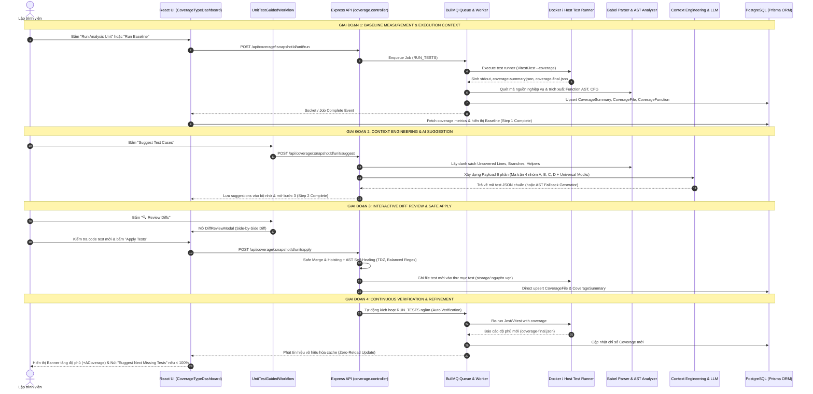
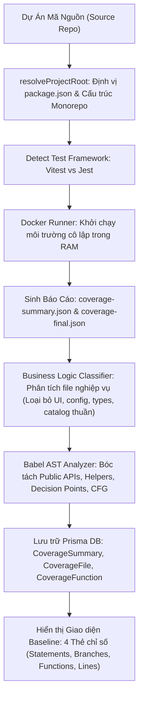
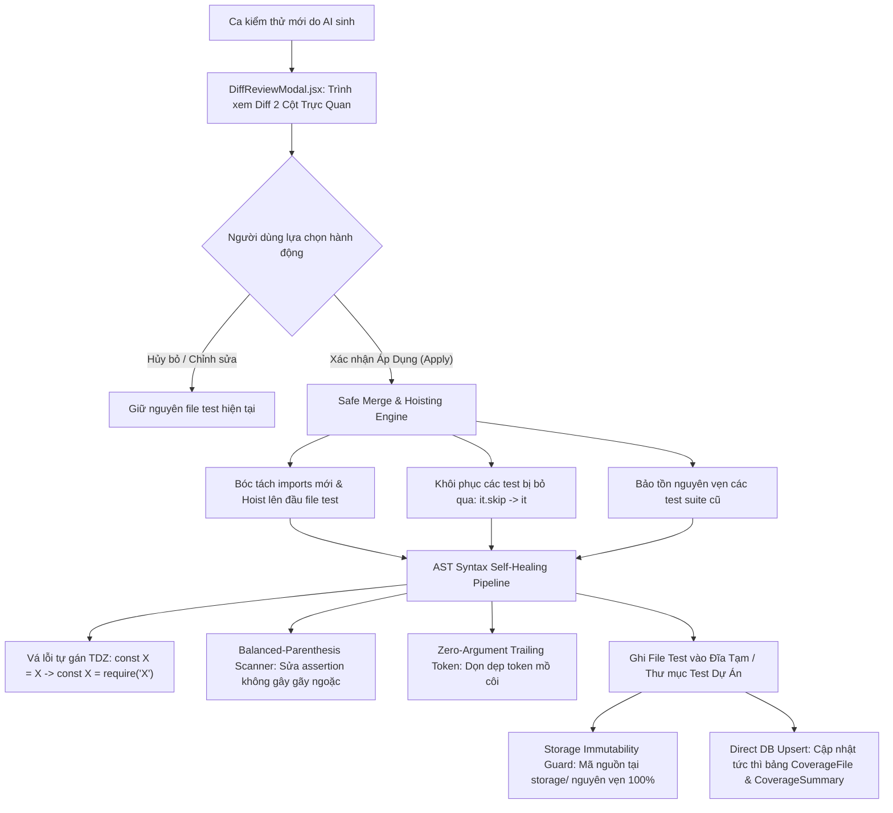
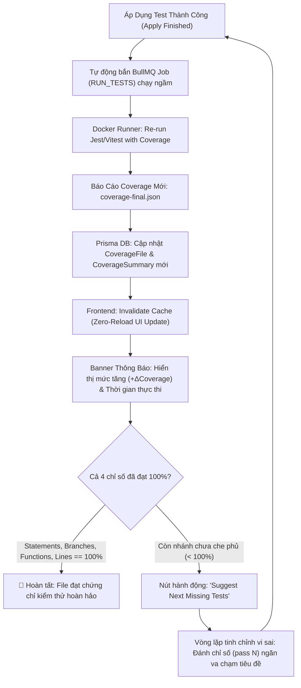
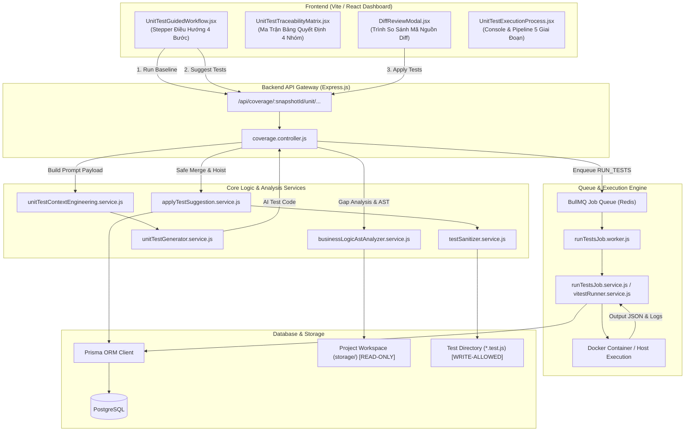
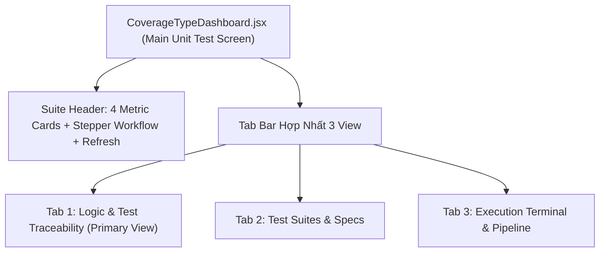

# Luồng Hoạt Động Của Unit Test Trong CovAI-
*(End-to-End Operational Workflow & Execution Lifecycle)*

> **Tài liệu đặc tả kỹ thuật và kiến trúc luồng vận hành toàn diện (End-to-End SOP)**  
> *Dành cho nhóm phát triển, tài liệu nghiên cứu khoa học, báo cáo nghiệm thu và giải trình luồng dữ liệu hệ thống CovAI-.*

---

## MỤC LỤC
1. [Bản Chất Luồng Vận Hành Unit Test Khép Kín (Closed-Loop Autonomous Architecture)](#1-bản-chất-luồng-vận-hành-unit-test-khép-kín-closed-loop-autonomous-architecture)
   - [1.1. Triết lý thiết kế: Tự động hóa 4 giai đoạn nối tiếp](#11-triết-lý-thiết-kế-tự-động-hóa-4-giai-đoạn-nối-tiếp)
   - [1.2. Biểu đồ tổng quan luồng tương tác End-to-End (High-Level Sequence Diagram)](#12-biểu-đồ-tổng-quan-luồng-tương-tác-end-to-end-high-level-sequence-diagram)
2. [Chi Tiết 4 Giai Đoạn Vận Hành (4-Stage Execution Lifecycle)](#2-chi-tiết-4-giai-đoạn-vận-hành-4-stage-execution-lifecycle)
   - [2.1. Giai đoạn 1: Đo Đạc Điểm Tựa & Phân Tích Mã Nguồn (Baseline Measurement & AST Analysis)](#21-giai-đoạn-1-đo-đạc-điểm-tựa--phân-tích-mã-nguồn-baseline-measurement--ast-analysis)
   - [2.2. Giai đoạn 2: Kỹ Nghệ Ngữ Cảnh & Gợi Ý Ca Kiểm Thử (Context Engineering & AI Suggestion)](#22-giai-đoạn-2-kỹ-nghệ-ngữ-cảnh--gợi-ý-ca-kiểm-thử-context-engineering--ai-suggestion)
   - [2.3. Giai đoạn 3: Xem Xét Trực Quan & Áp Dụng An Toàn (Interactive Diff Review & Safe Apply)](#23-giai-đoạn-3-xem-xét-trực-quan--áp-dụng-an-toàn-interactive-diff-review--safe-apply)
   - [2.4. Giai đoạn 4: Kiểm Chứng Ngầm & Vòng Lặp Tinh Chỉnh (Continuous Verification & Refinement Loop)](#24-giai-đoạn-4-kiểm-chứng-ngầm--vòng-lặp-tinh-chỉnh-continuous-verification--refinement-loop)
3. [Luồng Dữ Liệu & Hợp Đồng Giao Tiếp Giữa Các Thành Phần (Component Data Flow & API Contracts)](#3-luồng-dữ-liệu--hợp-đồng-giao-tiếp-giữa-các-thành-phần-component-data-flow--api-contracts)
   - [3.1. Sơ đồ tương tác Frontend React $\leftrightarrow$ Backend Express $\leftrightarrow$ BullMQ Worker $\leftrightarrow$ Docker $\leftrightarrow$ Database](#31-sơ-đồ-tương-tác-frontend-react-leftrightarrow-backend-express-leftrightarrow-bullmq-worker-leftrightarrow-docker-leftrightarrow-database)
   - [3.2. Cấu trúc dữ liệu trạng thái (State Machine Transitions)](#32-cấu-trúc-dữ-liệu-trạng-thái-state-machine-transitions)
4. [Kiến Trúc Giao Diện Hợp Nhất 3 View (Consolidated 3-View UX Architecture)](#4-kiến-trúc-giao-diện-hợp-nhất-3-view-consolidated-3-view-ux-architecture)
   - [4.1. View 1: Logic & Test Traceability Matrix (Primary View)](#41-view-1-logic--test-traceability-matrix-primary-view)
   - [4.2. View 2: Test Suites & Specs](#42-view-2-test-suites--specs)
   - [4.3. View 3: Execution Terminal & Pipeline](#43-view-3-execution-terminal--pipeline)
5. [Cơ Chế Phòng Vệ Lỗi & Tự Chữa Lành Tại Chỗ (Resilience & Auto-Healing Mechanisms)](#5-cơ-chế-phòng-vệ-lỗi--tự-chữa-lành-tại-chỗ-resilience--auto-healing-mechanisms)
   - [5.1. Phòng vệ bất biến mã nguồn dự án (Storage Immutability Guard)](#51-phòng-vệ-bất-biến-mã-nguồn-dự-án-storage-immutability-guard)
   - [5.2. Chữa lành lỗi cú pháp, tự gán TDZ và assertion ngoặc lồng nhau](#52-chữa-lành-lỗi-cú-pháp-tự-gán-tdz-và-assertion-ngoặc-lồng-nhau)
   - [5.3. Loại bỏ hoàn toàn Test Title Collision trong đa vòng lặp](#53-loại-bỏ-hoàn-toàn-test-title-collision-trong-đa-vòng-lặp)
6. [Bảng Đối Chiếu Vòng Đời Tác Vụ (Operational Lifecycle Traceability Matrix)](#6-bảng-đối-chiếu-vòng-đời-tác-vụ-operational-lifecycle-traceability-matrix)

---

## 1. BẢN CHẤT LUỒNG VẬN HÀNH UNIT TEST KHÉP KÍN (CLOSED-LOOP AUTONOMOUS ARCHITECTURE)

### 1.1. Triết lý thiết kế: Tự động hóa 4 giai đoạn nối tiếp

Trong phát triển phần mềm truyền thống, kiểm thử đơn vị (Unit Test) thường rời rạc: lập trình viên viết code $\rightarrow$ tự nghĩ test case $\rightarrow$ chạy test thủ công $\rightarrow$ nhìn bảng coverage tổng thể mà không biết dòng/nhánh logic cụ thể nào bị sót.

CovAI- định nghĩa lại toàn bộ vòng đời kiểm thử thành một **chu trình khép kín tự vận hành (Closed Autonomous Loop)**:
$$\text{Bước 1: Baseline} \longrightarrow \text{Bước 2: AI Suggest} \longrightarrow \text{Bước 3: Review \& Apply} \longrightarrow \text{Bước 4: Verify \& Refine}$$

Quy trình này giải quyết 3 thách thức lớn nhất của kiểm thử tự động bằng AI:
1. **Tính chính xác (Accuracy):** Không sinh test mù quáng; mọi ca kiểm thử đều bám sát đồ thị luồng điều khiển (CFG) và các nhánh chưa che phủ từ báo cáo Istanbul động.
2. **Tính tin cậy & An toàn (Hermetic & Immutability):** Test chạy 100% trong RAM với universal mocks; tuyệt đối không can thiệp sửa đổi mã nguồn gốc của dự án (`storage/`).
3. **Tính liên tục (Continuous 100% Invariant):** Không dừng lại ở mức 70% hay 80%, hệ thống tự động lặp bổ sung vi sai cho tới khi cả 4 chiều đo (Statements, Branches, Functions, Lines) đạt $100\%$.

---

### 1.2. Biểu đồ tổng quan luồng tương tác End-to-End (High-Level Sequence Diagram)



---

## 2. CHI TIẾT 4 GIAI ĐOẠN VẬN HÀNH (4-STAGE EXECUTION LIFECYCLE)

### 2.1. Giai đoạn 1: Đo Đạc Điểm Tựa & Phân Tích Mã Nguồn (Baseline Measurement & AST Analysis)

Giai đoạn 1 thiết lập "tọa độ không" (*Ground Zero*) để hệ thống biết chính xác mã nguồn dự án đang đứng ở đâu trước khi can thiệp.



#### Các bước thực thi chi tiết:
1. **Phát hiện Môi trường & Thư mục Gốc:**
   - [projectRootResolver.js](file:///d:/NCKH/CovAI-/server/src/utils/projectRootResolver.js) duyệt cây thư mục để tìm tệp `package.json` thực sự của dự án (hỗ trợ monorepo, thư mục con lồng nhau).
   - Tự động nhận diện Test Runner: [vitestRunner.service.js](file:///d:/NCKH/CovAI-/server/src/services/vitestRunner.service.js) nếu có cấu hình Vitest (`vitest.config.*`), hoặc Jest qua [runTestsJob.service.js](file:///d:/NCKH/CovAI-/server/src/services/runTestsJob.service.js).
2. **Khởi chạy Test Runner có gắn cờ Coverage:**
   - Chạy lệnh cô lập qua [dockerRunner.service.js](file:///d:/NCKH/CovAI-/server/src/services/dockerRunner.service.js):
     ```bash
     npx vitest run --coverage --reporter=json
     # hoặc
     npx jest --coverage --json --outputFile=coverage-summary.json
     ```
3. **Phân tích Cú pháp AST Tĩnh:**
   - [businessLogicAstAnalyzer.service.js](file:///d:/NCKH/CovAI-/server/src/services/businessLogicAstAnalyzer.service.js) dùng `@babel/parser` duyệt AST:
     - Nhận diện hàm xuất khẩu (`export function`, `export const`, `export default`, `module.exports`).
     - Nhận diện hàm nội bộ (*internal helpers*).
     - Định vị tất cả Decision Points (`if`, `ternary`, `??`, `||`, `switch`).
     - Tính toán độ phức tạp chu trình McCabe: $V(G) = E - N + 2P$.
4. **Đồng bộ Dữ liệu:**
   - Lưu trữ toàn bộ metrics vào PostgreSQL qua Prisma: Bảng `CoverageSummary`, `CoverageFile`, `CoverageFunction`.

---

### 2.2. Giai đoạn 2: Kỹ Nghệ Ngữ Cảnh & Gợi Ý Ca Kiểm Thử (Context Engineering & AI Suggestion)

Giai đoạn 2 chuyển đổi các khoảng trống độ phủ đo được thành các ca kiểm thử chính xác bằng kỹ thuật **Coverage-Guided White-Box Testing**.

```mermaid
graph LR
    A["Istanbul Uncovered Coordinates: Lines & Branches"] --> B["Bắt cặp với Babel AST Decision Points"]
    B --> C["4-Category Decision Table Matrix: Nhóm A, B, C, D"]
    C --> D["Call Graph Backtracking: Tạo đường dẫn gián tiếp cho Unexported Helpers"]
    D --> E["Universal Hermetic Mocks: Prisma Proxy, Axios, BullMQ, Env"]
    E --> F["Context Payload (6 Phần Chuẩn)"]
    F --> G["Gemini LLM hoặc AST Fallback Generator"]
    G --> H["Bộ Ca Kiểm Thử Độc Lập, Chạy 100% trong RAM"]
```



#### Các trụ cột thuật toán:
1. **Clean Prompt Architecture:** Loại bỏ toàn bộ các chuỗi meta-prompt nhân tạo gây loãng context, giữ prompt tập trung 100% vào mã logic nghiệp vụ và các nhánh còn trống.
2. **Ma trận Bảng Quyết Định 4 Nhóm (4-Category Decision Table Matrix):**
   - **Nhóm A (Happy Path):** Dữ liệu chuẩn danh định.
   - **Nhóm B (Boundary Values):** Biên cực trị $0$, $-1$, `MAX_SAFE_INTEGER`, mảng rỗng `[]`, chuỗi rỗng `""`, object `{}`.
   - **Nhóm C (Branch Toggling):** Ép lật ngược trạng thái `True` và `False` của các nhánh `if/else`, `??`, `||`.
   - **Nhóm D (Error Handling):** Thử nghiệm ném ngoại lệ `throw`, `reject`, timeout, mock lỗi I/O.
3. **Thuật toán Duyệt ngược Đồ thị Gọi hàm (Call Graph Backtracking):**
   - Tuyệt đối không import trực tiếp hàm nội bộ unexported (`import { helper }` gây `TypeError`).
   - Tìm hàm public gọi tới helper đó, suy luận bộ tham số đầu vào để luồng điều khiển đi xuyên qua helper.
4. **Universal Hermetic Mock Isolation:**
   - Tự động sinh Mock Proxy cho Prisma Client, Axios (`_mockAxios` và `mockAxios`), BullMQ và nạp sẵn `process.env` giả lập trong RAM.

---

### 2.3. Giai đoạn 3: Xem Xét Trực Quan & Áp Dụng An Toàn (Interactive Diff Review & Safe Apply)

Giai đoạn 3 bảo vệ mã nguồn dự án tuyệt đối không bị ô nhiễm hay phá hủy cấu trúc khi tích hợp test mới.



#### Các cơ chế bảo đảm an toàn:
- **Storage Code Immutability Guard:** Thư mục mã nguồn `storage/` là **Read-Only tuyệt đối**. Mọi thay đổi chỉ được phép ghi vào các tệp kiểm thử (`*.test.js`, `*.spec.ts`).
- **Interactive Diff Review ([DiffReviewModal.jsx](file:///d:/NCKH/CovAI-/client/src/components/dashboard/DiffReviewModal.jsx)):** Lập trình viên có toàn quyền xem trước từng dòng code sinh ra dưới dạng side-by-side diff trước khi ghi đĩa.
- **Hoisting & Deduplication:** Gom tất cả khai báo `import` hoặc `require` mới lên đầu tệp, loại bỏ trùng lặp và không gây xung đột biến.
- **Tự chữa lành AST & TDZ:**
  - Lỗi tự gán `const X = X;` được tự động chuyển thành module import chuẩn nếu `X` là module có sẵn trong Node.js (`path`, `fs`, `crypto`, ...).
  - Sử dụng Balanced-Parenthesis Scanner thay cho các regex ngắt sớm `[^)]*` để chuyển đổi an toàn các assertion mà không làm đứt đoạn mã.

---

### 2.4. Giai đoạn 4: Kiểm Chứng Ngầm & Vòng Lặp Tinh Chỉnh (Continuous Verification & Refinement Loop)

Giai đoạn 4 xác nhận thành quả, cập nhật dashboard thời gian thực và tự động lặp tiếp cho tới khi đạt ngưỡng 100%.



#### Các đặc điểm nổi bật:
- **Zero-Reload State Synchronization:** Giao diện tự động làm mới số liệu (thanh tiến trình, ma trận truy vết, số dòng cover) ngay khi worker chạy xong thông qua cơ chế vô hiệu hóa cache React Query (`invalidateCoverageQueries`).
- **Đánh chỉ số vi sai Pass N:** Mỗi vòng lặp bổ sung test vi sai được gán định danh `(pass ${pass})` vào tiêu đề test, loại trừ 100% hiện tượng trùng lặp tiêu đề khiến hệ thống dừng sớm vòng lặp.
- **Continuous 100% Invariant Loop:** Hệ thống khuyến khích người dùng chạy chu trình khép kín đến khi tất cả các nhánh khó nhất (như `req.body.items || []`, fallback ternary, các nhánh bắt lỗi catch) đều được bao phủ trọn vẹn.

---

## 3. LUỒNG DỮ LIỆU & HỢP ĐỒNG GIAO TIẾP GIỮA CÁC THÀNH PHẦN (COMPONENT DATA FLOW & API CONTRACTS)

### 3.1. Sơ đồ tương tác Frontend React $\leftrightarrow$ Backend Express $\leftrightarrow$ BullMQ Worker $\leftrightarrow$ Docker $\leftrightarrow$ Database



---

### 3.2. Cấu trúc dữ liệu trạng thái (State Machine Transitions)

Toàn bộ quy trình Unit Test chuyển đổi tuần tự theo máy trạng thái xác định (Deterministic State Machine):

| Trạng Thái (State) | Điều Kiện Chuyển Tiếp (Trigger) | Thành Phần Xử Lý | Trạng Thái Tiếp Theo |
| :--- | :--- | :--- | :--- |
| **`IDLE`** | Người dùng mở giao diện Unit Test | `CoverageTypeDashboard.jsx` | `READY_FOR_BASELINE` |
| **`READY_FOR_BASELINE`** | Bấm `Run Analysis Unit` hoặc `Run Baseline` | `coverage.controller.js` | `BASELINE_RUNNING` |
| **`BASELINE_RUNNING`** | Job `RUN_TESTS` kết thúc thành công | `runTestsJob.worker.js` | `BASELINE_COMPLETED` |
| **`BASELINE_COMPLETED`** | Bấm `Suggest Test Cases` | `unitTestGenerator.service.js` | `SUGGESTION_GENERATING` |
| **`SUGGESTION_GENERATING`** | Hoàn tất sinh code test & ma trận 4 nhóm | `unitTestContextEngineering.service.js` | `REVIEW_REQUIRED` |
| **`REVIEW_REQUIRED`** | Bấm `🔍 Review Diffs` mở modal xem diff | `DiffReviewModal.jsx` | `IN_REVIEW` |
| **`IN_REVIEW`** | Bấm `Apply Tests` (toàn bộ hoặc từng file) | `applyTestSuggestion.service.js` | `APPLYING_AND_SANITIZING` |
| **`APPLYING_AND_SANITIZING`**| Ghi test thành công & kích hoạt chạy ngầm | `testSanitizer.service.js` | `VERIFICATION_RUNNING` |
| **`VERIFICATION_RUNNING`** | Job xác nhận kết thúc, độ phủ $< 100\%$ | `runTestsJob.service.js` | `INCREMENTAL_REFINEMENT_READY` |
| **`VERIFICATION_RUNNING`** | Job xác nhận kết thúc, cả 4 chỉ số $= 100\%$ | `runTestsJob.service.js` | **`FULLY_COVERED_100`** |

---

## 4. KIẾN TRÚC GIAO DIỆN HỢP NHẤT 3 VIEW (CONSOLIDATED 3-VIEW UX ARCHITECTURE)

Theo quy tắc chuẩn hóa giao diện của CovAI-, hệ thống **tuyệt đối không tách 4 chỉ số coverage (Statements, Branches, Functions, Lines) thành 4 tab rời rạc**, mà hợp nhất toàn bộ trải nghiệm thành **3 View chức năng chuyên biệt**:



### 4.1. View 1: Logic & Test Traceability Matrix (Primary View)
- **Thành phần phụ trách:** [UnitTestTraceabilityMatrix.jsx](file:///d:/NCKH/CovAI-/client/src/components/dashboard/UnitTestTraceabilityMatrix.jsx).
- **Mục đích:** Là trung tâm giải trình chất lượng kiểm thử. Mỗi dòng tương ứng với một hàm nghiệp vụ trong dự án, hiển thị đồng thời:
  - Tên hàm, loại hàm (`Exported Public` vs `Internal Helper`), vị trí dòng trong mã nguồn.
  - 4 chỉ số Istanbul Coverage chi tiết cho riêng hàm đó.
  - **4-Category Test Scenario Checklist:**
    - 🟢 **Category A (Happy Path):** Ca kiểm thử luồng chuẩn.
    - 🟡 **Category B (Boundary Values):** Ca kiểm thử giá trị biên ($0, -1, \text{rỗng}$).
    - 🔵 **Category C (Branch Toggling):** Ca kiểm thử lật nhánh điều kiện.
    - 🔴 **Category D (Error Handling):** Ca kiểm thử bắt lỗi ngoại lệ.
  - Các nút hành động tức thì tại chỗ: `Suggest Tests`, `Review Diff`, `Apply Test`.

### 4.2. View 2: Test Suites & Specs
- **Thành phần phụ trách:** `File Testcase (Jest / Vitest)`.
- **Mục đích:** Danh sách chi tiết các tệp kiểm thử (`*.test.js`, `*.spec.ts`), số lượng ca kiểm thử (`it`/`test`), số lượng assertion, thời gian chạy và trạng thái Pass/Fail/Skipped của từng tệp.

### 4.3. View 3: Execution Terminal & Pipeline
- **Thành phần phụ trách:** [UnitTestExecutionProcess.jsx](file:///d:/NCKH/CovAI-/client/src/components/dashboard/UnitTestExecutionProcess.jsx).
- **Mục đích:** Bảng điều khiển giám sát tiến trình thực thi 5 giai đoạn thời gian thực (Environment Check $\rightarrow$ Dependency Resolution $\rightarrow$ Test Execution $\rightarrow$ Coverage Parsing $\rightarrow$ Storage Immutability Check) cùng cửa sổ Console Terminal stream trực tiếp log stdout/stderr từ Docker runner.

---

## 5. CƠ CHẾ PHÒNG VỆ LỖI & TỰ CHỮA LÀNH TẠI CHỖ (RESILIENCE & AUTO-HEALING MECHANISMS)

### 5.1. Phòng vệ bất biến mã nguồn dự án (Storage Immutability Guard)
- **Cơ chế:** Thư mục `storage/` chứa mã nguồn dự án của người dùng được phân quyền Read-Only trong suốt quá trình chạy.
- **Cam kết kỹ thuật:** Tuyệt đối không can thiệp, không thêm comment, không xóa nhánh code để ép test pass. Mọi mức tăng độ phủ ($\Delta \text{Coverage}$) đều là kết quả thực tế từ các ca kiểm thử mới được bổ sung hợp lệ.

### 5.2. Chữa lành lỗi cú pháp, tự gán TDZ và assertion ngoặc lồng nhau
Khi mô hình AI sinh mã gặp lỗi, pipeline [testSanitizer.service.js](file:///d:/NCKH/CovAI-/server/src/services/testSanitizer.service.js) tự động thực hiện 3 bước chữa lành trước khi lưu đĩa:
1. **Khử tự gán TDZ (Temporal Dead Zone):**
   - Biến câu lệnh lỗi `const path = path;` thành câu lệnh import chuẩn `const path = require('path');`.
2. **Quét ngoặc cân bằng (Balanced Delimiter Scanning):**
   - Không dùng regex `[^)]*` dễ ngắt sớm khi gặp regex hay chuỗi phức tạp. Bộ quét ngoặc đảm bảo cấu trúc `.toBe(...)` hay `.toEqual(...)` luôn giữ nguyên toàn vẹn các biểu thức con lồng nhau.
3. **Dọn dẹp Token mồ côi (Zero-Argument Trailing Token Sanitization):**
   - Cắt bỏ các token thừa đằng sau các assertion không đối số (`.toBeDefined()`, `.toBeUndefined()`).

### 5.3. Loại bỏ hoàn toàn Test Title Collision trong đa vòng lặp
- Trong [applyTestSuggestion.service.js](file:///d:/NCKH/CovAI-/server/src/services/applyTestSuggestion.service.js), mỗi pass của vòng lặp tinh chỉnh vi sai đều được gán nhãn duy nhất:
  ```javascript
  const passSuffix = pass > 1 ? ` (pass ${pass})` : '';
  const testTitle = `should handle uncovered branch${passSuffix}`;
  ```
- Cơ chế này giúp thuật toán chống trùng lặp không nhận nhầm test mới là test cũ, cho phép vòng lặp chạy liên tục 2-3 passes đến khi đạt 100% độ bao phủ.

---

## 6. BẢNG ĐỐI CHIẾU VÒNG ĐỜI TÁC VỤ (OPERATIONAL LIFECYCLE TRACEABILITY MATRIX)

Bảng đối chiếu toàn bộ các tác vụ trong luồng Unit Test với thành phần mã nguồn phụ trách và bằng chứng kiểm thử:

| Giai Đoạn / Bước | Tác Vụ Cốt Lõi | Tệp Mã Nguồn Phụ Trách | Test Suite Kiểm Chứng |
| :--- | :--- | :--- | :--- |
| **Bước 1: Baseline** | Khởi chạy test & đo Istanbul ban đầu | [runTestsJob.service.js](file:///d:/NCKH/CovAI-/server/src/services/runTestsJob.service.js)<br/>[dockerRunner.service.js](file:///d:/NCKH/CovAI-/server/src/services/dockerRunner.service.js) | `runTestsJob.test.js`<br/>`coverage.controller.test.js` |
| **Bước 1: AST Scan** | Trích xuất hàm, decision points, CFG | [businessLogicAstAnalyzer.service.js](file:///d:/NCKH/CovAI-/server/src/services/businessLogicAstAnalyzer.service.js) | `phase1AstAndGapAnalyzer.test.js`<br/>`businessLogicAstAnalyzer.service.test.js` |
| **Bước 2: Context** | Xây dựng ma trận 4 nhóm & Universal Mocks | [unitTestContextEngineering.service.js](file:///d:/NCKH/CovAI-/server/src/services/unitTestContextEngineering.service.js) | `unitTestContextEngineering.service.test.js`<br/>`phase2PromptAndMatrixGenerator.test.js` |
| **Bước 2: AI Suggest** | Sinh mã test từ LLM hoặc Fallback AST | [unitTestGenerator.service.js](file:///d:/NCKH/CovAI-/server/src/services/unitTestGenerator.service.js)<br/>[unitTestSuggestion.service.js](file:///d:/NCKH/CovAI-/server/src/services/unitTestSuggestion.service.js) | `unitTestGenerator.service.test.js`<br/>`unitTestSuggestion.service.test.js` |
| **Bước 3: Diff Review** | So sánh diff trực quan side-by-side | [DiffReviewModal.jsx](file:///d:/NCKH/CovAI-/client/src/components/dashboard/DiffReviewModal.jsx) | `diffReview.test.jsx` |
| **Bước 3: Safe Apply** | Hoist imports, unskip tests, tự vá AST/TDZ | [applyTestSuggestion.service.js](file:///d:/NCKH/CovAI-/server/src/services/applyTestSuggestion.service.js)<br/>[testSanitizer.service.js](file:///d:/NCKH/CovAI-/server/src/services/testSanitizer.service.js) | `applyTestSuggestion.service.test.js`<br/>`testSanitizer.service.test.js`<br/>`safeApplyAndSanitization.test.js` |
| **Bước 4: Verify** | Kích hoạt RUN_TESTS ngầm & Invalidate Cache | [coverage.controller.js](file:///d:/NCKH/CovAI-/server/src/controllers/coverage.controller.js)<br/>[queue.service.js](file:///d:/NCKH/CovAI-/server/src/services/queue.service.js) | `coverage.controller.test.js`<br/>`phase4RefinementLoopAndVerification.test.js` |
| **Bước 4: Continuous** | Vòng lặp bổ sung vi sai đạt 100% | [applyTestSuggestion.service.js](file:///d:/NCKH/CovAI-/server/src/services/applyTestSuggestion.service.js) | `phase4RefinementLoopAndVerification.test.js`<br/>`businessLogicEdgeCasesMatrix.test.js` |

---

> [!NOTE]
> Tài liệu này tạo thành bộ tứ quy trình hoàn chỉnh của phân hệ Unit Test trong hệ thống CovAI-:
> 1. [Quy trình Baseline & Phân tích Source Code](file:///d:/NCKH/CovAI-/docs/quy-trinh-baseline-va-phan-tich-source-code.md)
> 2. [Quy trình AI Suggest Testcase](file:///d:/NCKH/CovAI-/docs/quy-trinh-ai-suggest-testcase.md)
> 3. [Quy trình Review & Apply Testcase](file:///d:/NCKH/CovAI-/docs/quy-trinh-review-va-apply-testcase.md)
> 4. **[Luồng Hoạt Động Tổng Thể Của Unit Test](file:///d:/NCKH/CovAI-/docs/luong-hoat-dong-unit-test.md) (Tài liệu này)**
