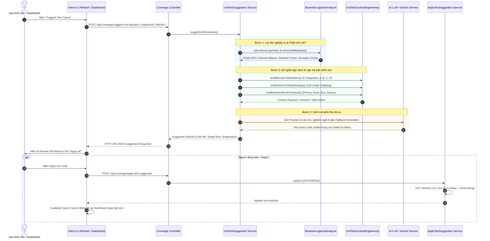
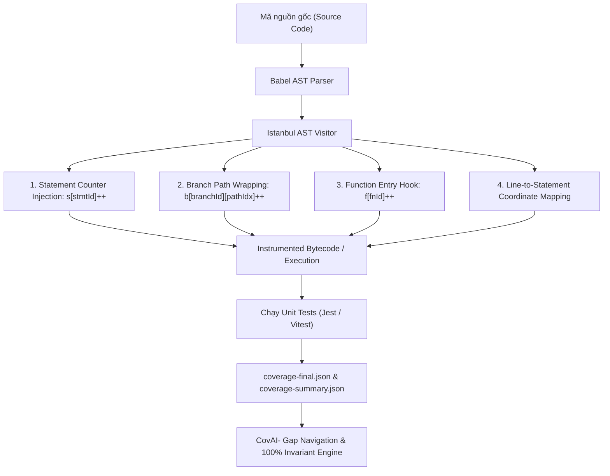

# Nguyên Lý & Thuật Toán Gợi Ý Unit Test Case Trong CovAI-

Tài liệu này giải thích chi tiết toàn bộ **nguyên lý khoa học**, **kiến trúc luồng xử lý (Data Flow & Architecture)** và **các thuật toán cốt lõi** được sử dụng trong hệ thống gợi ý và tự động sinh mã Unit Test Case (Jest & Vitest) của nền tảng **CovAI-**.

---

## 1. Tổng quan & Bản chất của tính năng Suggest Test Case

Trong kiểm thử phần mềm truyền thống, việc viết test case thủ công thường gặp 3 hạn chế lớn:
1. **Thiếu sót các nhánh điều kiện ẩn (Hidden Branch Gaps):** Lập trình viên thường chỉ viết test cho luồng chính (*Happy Path*) mà bỏ quên các nhánh rẽ điều kiện phức tạp (ternary `? :`, nullish coalescing `??`, optional chaining `?.`, switch-case, default arguments).
2. **Khó kiểm thử các hàm nội bộ không export (Private/Internal Helper Bottlenecks):** Việc cố gắng `import` trực tiếp một hàm không được export sẽ gây lỗi runtime fatal (`TypeError`), nhưng nếu bỏ qua thì các dòng code bên trong hàm helper đó sẽ bị thiếu độ phủ.
3. **Phụ thuộc môi trường ngoài (Environment Leakage):** Các hàm nghiệp vụ thường gọi Database (Prisma/Mongoose), HTTP Client (Axios), Message Queue (Bull/Redis), biến môi trường (`process.env`). Nếu không mock triệt để, test case sẽ bị chậm, flaky hoặc thất bại khi chạy trên máy tính lập trình viên khác.

> **Định nghĩa:** Tính năng **Suggest Test Case** của CovAI- là một hệ thống **Kiểm thử hộp trắng tự động có hướng dẫn bởi độ phủ (Coverage-Guided Automated White-Box Testing System)**, kết hợp giữa **Phân tích cú pháp tĩnh (Static AST Analysis)**, **Bản đồ độ phủ động (Dynamic Coverage Feedback Loop)** và **Kỹ nghệ ngữ cảnh AI (Context Engineering)** để sinh ra các test case chính xác, cô lập và đạt mục tiêu độ phủ $\ge 90\%$ đến $100\%$.

---

## 2. Các nguyên lý nền tảng (Foundational Principles)

Hệ thống hoạt động dựa trên 5 nguyên lý cốt lõi:

### 2.1. Nguyên lý 1: Kiểm thử hộp trắng dựa trên độ phủ động (Coverage-Guided White-Box Testing)
- Không coi mã nguồn là "hộp đen" (chỉ nhìn đầu vào/đầu ra). Hệ thống đọc trực tiếp mã nguồn (Source Code) và kết hợp với dữ liệu độ phủ chi tiết từ Istanbul/v8 (`coverage-final.json` hoặc `test-results.json`).
- Nhận diện chính xác từng tọa độ:
  - Dòng code chưa chạy (`uncoveredLines`).
  - Điểm rẽ nhánh bị thiếu một vế (`uncoveredBranches`: chỉ mới chạy nhánh `True` hoặc chỉ mới chạy nhánh `False`).
  - Hàm chưa từng được gọi (`uncoveredFunctions`).
  - Dòng bị lỗi assertion (`failedLines`).

### 2.2. Nguyên lý 2: Phân tích cấu trúc cú pháp trừu tượng (AST - Abstract Syntax Tree)
- Sử dụng **Babel Parser** để chuyển mã nguồn TypeScript/JavaScript thành cây cú pháp trừu tượng (AST).
- Phân tích và bóc tách cấu trúc mã nguồn thành 4 thành phần thiết yếu:
  - **Public Exported Symbols:** Các hàm, class, biến được export công khai — đây là các API mà test case được phép gọi trực tiếp.
  - **Private / Internal Functions:** Các hàm helper nằm trong phạm vi file mà không được export.
  - **Decision Points (Điểm quyết định):** Tất cả các câu lệnh rẽ nhánh (`if`, `else if`, ternary, `switch`, `??`, `||`, `&&`, default parameter).
  - **Exception Points (Điểm ngoại lệ):** Các điểm bắn lỗi (`throw`), bắt lỗi (`catch`), hoặc trả về `Promise.reject()`.

### 2.3. Nguyên lý 3: Nguyên lý cô lập tuyệt đối của Unit Test (Unit Hermeticity & Mock Isolation)
- **Quy tắc bất biến:** Một Unit Test đạt chuẩn **bắt buộc phải chạy hoàn toàn trên RAM**, không bao giờ được chạm vào Database thật, không mở kết nối mạng HTTP thật, không kết nối Redis/Queue thật.
- Hệ thống áp dụng **Universal Proxy Mock Contract**:
  - Tự động sinh `Proxy` mock toàn diện cho ORM (ví dụ Prisma Client: giả lập tất cả models `prisma.<model>.<action>` và `$transaction`).
  - Tự động mock Axios/HTTP Client với các hàm `.create()`, `.get()`, `.post()`.
  - Tự động phát hiện các biến `process.env.*` được sử dụng trong file nguồn và khởi tạo giá trị an toàn trong test environment.

### 2.4. Nguyên lý 4: Chiến lược kiểm thử gián tiếp cho hàm nội bộ (Indirect Testing Strategy)
- Đối với các hàm helper không export, **tuyệt đối không bao giờ** sinh code dạng `import { internalHelper } from './service'` (sẽ gây lỗi cú pháp hoặc runtime error).
- Thay vào đó, hệ thống áp dụng thuật toán phân tích đồ thị gọi hàm (**Call Graph Backtracking**):
  - Tìm ra hàm public nào gọi đến hàm helper nội bộ này.
  - Xác định bộ tham số đầu vào cho hàm public để luồng điều khiển đi xuyên qua và kích hoạt toàn bộ các nhánh điều kiện bên trong hàm helper.

### 2.5. Nguyên lý 5: Hợp nhất an toàn và Tự sửa lỗi cú pháp (Safe Apply & AST Self-Healing)
- Khi người dùng bấm **Apply** hoặc **Apply all**:
  - Không ghi đè mù quáng làm mất các test case cũ của lập trình viên.
  - Tự động bóc tách import mới và đưa lên đầu file (hoisting), giữ nguyên các block `describe` và `test` hiện có.
  - Tự động kích hoạt lại các test đang bị skip (`.skip()`, `xit()`, `xdescribe()`) để khôi phục độ phủ.
  - **AST Sanitizer:** Tự động sửa chữa các lỗi cú pháp thường gặp khi LLM sinh code (lệch dấu nháy đơn trong assertion, template literal bị ngắt dòng, object literal chưa đóng ngoặc).

---

## 3. Kiến trúc & Luồng hoạt động (Data Flow & Architecture)

### Sơ đồ quy trình tổng thể (Sequence Diagram)



---

## 4. Chi tiết các thuật toán được áp dụng

### 4.1. Thuật toán Duyệt cây AST & Trích xuất điểm rẽ nhánh (AST Traversal Algorithm)
- **Input:** Chuỗi mã nguồn JavaScript/TypeScript.
- **Cơ chế:**
  1. Sử dụng `@babel/parser` với đầy đủ plugins: `typescript`, `jsx`, `classProperties`, `asyncGenerators`, `dynamicImport`, `optionalChaining`, `nullishCoalescingOperator`.
  2. Duyệt qua cây AST bằng pattern Visitor:
     - Nhận diện `ExportNamedDeclaration`, `ExportDefaultDeclaration` để xây dựng **Public Symbol Table**.
     - Nhận diện `FunctionDeclaration`, `ArrowFunctionExpression` không nằm trong danh sách export để xây dựng **Internal Helper Table**.
     - Nhận diện `IfStatement`, `ConditionalExpression` (ternary), `SwitchCase`, `LogicalExpression` (`&&`, `||`, `??`) để trích xuất danh sách **Decision Points** kèm số dòng chính xác.
     - Nhận diện `ThrowStatement`, `CatchClause`, `CallExpression` (`Promise.reject`) để đánh dấu **Exception Points**.

### 4.2. Thuật toán Tính độ phức tạp Cyclomatic & Bản đồ luồng điều khiển (CFG - Control Flow Graph)
- Dựa trên công thức lý thuyết đồ thị của **Thomas J. McCabe**:
  $$M = E - N + 2P$$
  *Trong đó:*
  - $E$: Số cạnh trong đồ thị luồng điều khiển (Control Flow Edges).
  - $N$: Số nút (Basic Blocks / Statements).
  - $P$: Số thành phần liên thông (thường $P = 1$ cho một hàm).
- **Ý nghĩa:** Giá trị Cyclomatic Complexity ($M$) biểu thị **số lượng ca kiểm thử tối thiểu độc lập tuyến tính** cần có để phủ kín $100\%$ các nhánh của hàm đó.
- Hệ thống dùng giá trị này để kiểm tra xem số lượng test case sinh ra có đủ để bao quát toàn bộ các đường đi khả thi hay không.

### 4.3. Thuật toán Lập ma trận quyết định 4 nhóm (Decision Table / Truth Table Engine)
Hệ thống chia toàn bộ không gian kiểm thử thành **4 nhóm kiểm thử bắt buộc (4 Mandatory Testing Categories)**:

| Nhóm | Tên danh mục | Nguyên lý & Kịch bản đầu vào | Mục tiêu kiểm thử |
| :--- | :--- | :--- | :--- |
| **A** | **Happy Path** | Cung cấp dữ liệu chuẩn, hợp lệ đầy đủ các trường bắt buộc và tùy chọn. | Đảm bảo hàm thực thi thành công, trả về kết quả đúng cấu trúc, resolve promise bình thường. |
| **B** | **Boundary Value Analysis (BVA)** | Kiểm tra các giá trị cực trị: số `0`, số âm (`-1`), giá trị số lớn nhất (`Number.MAX_SAFE_INTEGER`), mảng rỗng `[]`, chuỗi rỗng `""`, object rỗng `{}`. | Đảm bảo hàm không bị crash, không throw unhandled exception khi gặp biên dữ liệu. |
| **C** | **Equivalence Partitioning & Branch Toggling** | Kích hoạt từng nhánh điều kiện độc lập: gán đầu vào thỏa mãn điều kiện `True`, sau đó đổi đầu vào để thành `False` / `null` / `undefined`. | Phủ kín $100\%$ các nhánh rẽ của `if/else`, toán tử 3 ngôi, toán tử `??`, `\|\|`, `?.`. |
| **D** | **Error & Exception Handling** | Cố tình truyền tham số sai kiểu dữ liệu, thiếu trường bắt buộc, hoặc mock downstream service (DB, HTTP) throw/reject error. | Kiểm tra các khối `throw new Error()`, `catch (err)`, đảm bảo hệ thống bẫy lỗi an toàn. |

### 4.4. Thuật toán Điều hướng kiểm thử gián tiếp (Call Graph Reachability & Backtracking)
Đối với mỗi hàm nội bộ $H_{internal}$:
1. Quét AST của toàn bộ file nguồn để tìm tập hợp các hàm public $F_{public}$ có chứa lời gọi đến $H_{internal}$ trong thân hàm:
   $$\text{Callers}(H_{internal}) = \{ f \in F_{public} \mid f \text{ gọi } H_{internal} \}$$
2. Xác định các tham số đầu vào của $f$ ảnh hưởng trực tiếp đến việc gọi $H_{internal}$.
3. Sinh chỉ dẫn kỹ nghệ ngữ cảnh (Prompt Guidance) hướng dẫn AI hoặc Test Generator truyền các bộ tham số cụ thể vào hàm $f$ để gián tiếp bao phủ từng nhánh bên trong $H_{internal}$.

### 4.5. Thuật toán Giải quyết liên kết file test 3 tầng (Multi-tiered Test File Resolution)
Để xác định chính xác file test nào tương ứng với file nguồn cần kiểm thử:
- **Tầng 1 (Static AST Import Traceability):** Quét toàn bộ project tìm các file test có câu lệnh `import` hoặc `require` trực tiếp đến đường dẫn tương đối của file nguồn. Đây là mối liên kết có độ tin cậy cao nhất ($1.0$).
- **Tầng 2 (Naming Convention & Text Match):** Quét các thư mục `tests/`, `spec/`, `__tests__/` tìm các file có tên trùng khớp quy ước (e.g., `calc.service.js` $\leftrightarrow$ `calc.service.test.js` hoặc `calc.test.js`).
- **Tầng 3 (Candidate Fallback & Framework Distinction):** Nếu chưa có file test nào:
  - Nếu framework là `vitest`: Gợi ý đường dẫn mặc định `tests/<baseName>.vitest.test.js`. Lọc bỏ các file Jest thông thường (`// jest test`) để tránh ghi đè nhầm lẫn.
  - Nếu framework là `jest`: Gợi ý đường dẫn mặc định `tests/<baseName>.test.js`.

### 4.6. Thuật toán Hợp nhất thông minh & Tự sửa lỗi cú pháp (Smart Merge & AST Self-Healing)
Khi áp dụng mã kiểm thử mới vào file test đã có:
1. **Hoisting Imports:** Trích xuất các câu lệnh `import` hoặc `require` mới từ code gợi ý và ghép lên đầu file test đích nếu chưa tồn tại, tránh khai báo trùng lặp identifier.
2. **Describe Title De-collision:** Nếu block `describe` mới trùng tên với block `describe` đã có, tự động đổi tên thành `<title> - Additional Coverage` để tránh ghi đè test case cũ của lập trình viên.
3. **Unskip Skipped Tests:** Tự động chuyển đổi `it.skip`, `test.skip`, `xit`, `xtest` thành `it` và `test` thông thường để phục hồi các ca kiểm thử từng bị bỏ quên.
4. **AST Syntax Healing Engine (Regex + Token Balancer):**
   - **Mismatched Quotes:** Sửa lỗi dấu nháy chắp vá (ví dụ kết hợp nhầm giữa backtick `` ` `` và nháy đơn `'`).
   - **Multiline Strings:** Tự động chuyển đổi các chuỗi nháy đơn/nháy kép có ký tự xuống dòng thành ES6 Template Literal (`` `...` ``).
   - **Unclosed Object Literals:** Đếm và cân bằng lại các dấu mở ngoặc `{` và đóng ngoặc `}` nếu code do AI sinh ra bị cắt cụt trước câu lệnh `expect()`.

### 4.7. Thuật toán đo lường 4 chiều Coverage (Statements, Branches, Functions, Lines) - Dynamic AST Instrumentation Engine

Để đo lường độ bao phủ một cách khách quan trong quá trình test runner (Jest/Vitest) thực thi, hệ thống sử dụng **Thuật toán Chèn mã AST tĩnh (AST Source Instrumentation Algorithm)** dựa trên tiêu chuẩn Istanbul/Babel. Quá trình đo lường không can thiệp vào logic nghiệp vụ mà phân tách mã nguồn thành một đối tượng bản đồ độ phủ toàn cục (`__coverage__` object).



#### 1. Statements Coverage ($C_{stmt}$) - Thuật toán đánh chỉ mục câu lệnh (Statement Indexing & Counter Injection)
- **Cơ chế:** Khi duyệt AST, mọi câu lệnh độc lập (`VariableDeclaration`, `ExpressionStatement`, `ReturnStatement`, `ThrowStatement`, `BreakStatement`, v.v.) được gán một ID duy nhất `s[i]`. Trước khi câu lệnh thực thi, một lệnh tăng biến đếm được chèn vào:
  ```javascript
  // Mã gốc:
  const tax = price * 0.1;
  // Mã sau khi instrument:
  cov_1a2b3c().s[0]++; const tax = price * 0.1;
  ```
- **Công thức tính toán:**
  $$C_{stmt} = \left( \frac{\sum_{i=1}^{N_{stmt}} \mathbb{I}(s[i] > 0)}{N_{stmt}} \right) \times 100\%$$
  *Trong đó:* $\mathbb{I}( condition )$ là hàm chỉ thị ($1$ nếu $s[i] > 0$, ngược lại $0$).

#### 2. Branches Coverage ($C_{branch}$) - Thuật toán bọc biểu thức điều kiện (Branch Path Wrapping & Binary Truth Table)
- **Cơ chế:** Mỗi điểm quyết định (`IfStatement`, `ConditionalExpression` `?:`, `LogicalExpression` `&&`, `||`, `??`, `SwitchCase`) được bóc tách thành các đường đi độc lập (True Path và False Path).
  - Đối với cấu trúc `if (cond) { A } else { B }`:
    - Nhánh 0: Đường đi khi điều kiện là True.
    - Nhánh 1: Đường đi khi điều kiện là False (kể cả khi không viết `else`, Istanbul vẫn tự động chèn một nhánh ngầm định để đo trường hợp điều kiện không thỏa mãn).
  - Đối với toán tử logic `a || b`:
    - Biểu thức được bọc bằng hàm wrapper: `cov_1a2b3c().b[0][0]++ ? a : (cov_1a2b3c().b[0][1]++, b)`.
- **Công thức tính toán:**
  $$C_{branch} = \left( \frac{\sum_{j=1}^{M_{branch}} \sum_{k=0}^{P_j - 1} \mathbb{I}(b[j][k] > 0)}{\sum_{j=1}^{M_{branch}} P_j} \right) \times 100\%$$
  *Trong đó:* $M_{branch}$ là số lượng cấu trúc điều kiện, $P_j$ là số nhánh rẽ của cấu trúc thứ $j$ (thường là 2 nhánh cho boolean).

#### 3. Functions Coverage ($C_{func}$) - Thuật toán Hook mở đầu hàm (Function Entry Hooking)
- **Cơ chế:** Mỗi khai báo hàm (`FunctionDeclaration`, `FunctionExpression`, `ArrowFunctionExpression`, `ClassMethod`) được định danh bằng một ID trong `fnMap`. Tại dòng đầu tiên của thân hàm (Function Body Block), Istanbul chèn một bộ đếm:
  ```javascript
  // Mã gốc:
  function calculateTotal(items) { return items.reduce(...); }
  // Mã sau khi instrument:
  function calculateTotal(items) { cov_1a2b3c().f[0]++; return items.reduce(...); }
  ```
- **Công thức tính toán:**
  $$C_{func} = \left( \frac{\sum_{k=1}^{K_{func}} \mathbb{I}(f[k] > 0)}{K_{func}} \right) \times 100\%$$

#### 4. Lines Coverage ($C_{line}$) - Thuật toán ánh xạ tọa độ dòng từ câu lệnh (Line-to-Statement Coordinate Mapping)
- **Cơ chế:** Không có một bộ đếm "dòng" độc lập trong runtime để tránh tốn bộ nhớ. Thay vào đó, Istanbul xây dựng bảng ánh xạ tọa độ `statementMap` lưu giữ `loc.start.line` và `loc.end.line` của từng câu lệnh:
  - Một dòng mã được xem là đã thực thi (Covered Line) nếu **có ít nhất một statement nằm trên dòng đó có số lần chạy > 0**.
  - Nếu tất cả statement trên dòng đó có lượt chạy $= 0$, dòng đó được đưa vào danh sách `uncoveredLines`.
- **Công thức tính toán:**
  $$C_{line} = \left( \frac{\sum_{l \in L_{executable}} \mathbb{I}\left( \exists s \in \text{Stmts}(l) : \text{hits}(s) > 0 \right)}{|L_{executable}|} \right) \times 100\%$$

#### 5. Cơ chế kiểm soát bất biến 100% liên tục (Continuous Suggestion Loop Invariant)
CovAI- thiết lập điều kiện nghiêm ngặt để xác định một file đã đạt $100\%$ độ bao phủ:
$$\text{IsFullyCovered} = \text{true} \iff \begin{cases}
C_{stmt} = 100\% \land \text{uncoveredStatements} = \emptyset \\
C_{branch} = 100\% \land \text{uncoveredBranches} = \emptyset \\
C_{func} = 100\% \land \text{uncoveredFunctions} = \emptyset \\
C_{line} = 100\% \land \text{uncoveredLines} = \emptyset \land \text{failedLines} = \emptyset
\end{cases}$$
Nếu bất kỳ một trong 4 tiêu chí trên $< 100\%$, chu trình sinh test của CovAI- sẽ tiếp tục kích hoạt và nhắm trúng các khoảng trống còn thiếu (Delta Gap-Closing Tests) cho đến khi toàn bộ đạt chuẩn tuyệt đối.

---

## 5. Ví dụ minh họa thực tế

### 5.1. File nguồn cần kiểm thử (`src/services/discountService.js`)
```javascript
// Hàm helper nội bộ - KHÔNG export
function calculateVipBonus(years) {
    if (years > 5) {
        return 0.15; // Nhánh 1 (True)
    }
    return 0.05;     // Nhánh 2 (False)
}

// Hàm public duy nhất được export
export function getFinalPrice(price, customer) {
    if (price <= 0) {
        throw new Error("Invalid price"); // Exception Point
    }
    
    let discount = 0;
    if (customer?.isVip) {                // Decision Point: Optional chaining + if
        discount = calculateVipBonus(customer.yearsActive || 0); // Decision Point: Logical OR
    }
    
    return price * (1 - discount);
}
```

### 5.2. Kết quả phân tích của CovAI-
1. **Public APIs:** `getFinalPrice` (1 hàm).
2. **Internal Helpers:** `calculateVipBonus` (1 hàm, được gọi bởi `getFinalPrice`).
3. **Decision Points:**
   - Dòng 2: `if (years > 5)`
   - Dòng 8: `if (price <= 0)`
   - Dòng 13: `customer?.isVip`
   - Dòng 14: `customer.yearsActive || 0`
4. **Exception Points:**
   - Dòng 9: `throw new Error("Invalid price")`

### 5.3. Bộ test case được CovAI- tự động gợi ý
```javascript
import { describe, test, expect } from '@jest/globals';
import { getFinalPrice } from '../src/services/discountService';

describe('discountService unit tests', () => {
    // Category A: Happy Path
    test('A1: Happy Path - standard non-VIP customer gets no discount', () => {
        const result = getFinalPrice(100, { isVip: false });
        expect(result).toBe(100);
    });

    // Category B: Boundary Value Analysis
    test('B1: Boundary - handles 0 yearsActive gracefully for VIP', () => {
        const result = getFinalPrice(100, { isVip: true, yearsActive: 0 });
        expect(result).toBe(95); // 100 * (1 - 0.05)
    });

    // Category C: Branch Toggling & Indirect Testing of calculateVipBonus
    test('C1: Branch True - VIP with >5 years triggers higher bonus (years=6)', () => {
        // Gián tiếp bao phủ nhánh True của calculateVipBonus (years > 5)
        const result = getFinalPrice(100, { isVip: true, yearsActive: 6 });
        expect(result).toBe(85); // 100 * (1 - 0.15)
    });

    test('C2: Branch False - VIP with <=5 years triggers standard bonus (years=3)', () => {
        // Gián tiếp bao phủ nhánh False của calculateVipBonus
        const result = getFinalPrice(100, { isVip: true, yearsActive: 3 });
        expect(result).toBe(95);
    });

    test('C3: Branch Falsy - handles nullish customer object safely via optional chaining', () => {
        const result = getFinalPrice(100, null);
        expect(result).toBe(100);
    });

    // Category D: Error & Exception Handling
    test('D1: Exception - throws error when price is zero or negative', () => {
        expect(() => getFinalPrice(0, { isVip: false })).toThrow("Invalid price");
        expect(() => getFinalPrice(-50, { isVip: false })).toThrow("Invalid price");
    });
});
```
> **Kết quả:** Bộ test case trên bao phủ **$100\%$ Statements**, **$100\%$ Branches**, **$100\%$ Functions**, và **$100\%$ Lines** mà không cần phải export trái phép hàm `calculateVipBonus`.

---

## 6. Tổng kết

Hệ thống gợi ý test case của CovAI- không chỉ đơn thuần là việc "đưa mã nguồn cho AI viết test", mà là một **quy trình kỹ nghệ phần mềm hoàn chỉnh (Software Engineering Pipeline)**:
1. **Hiểu sâu cấu trúc:** Phân tích cú pháp AST bóc tách rành mạch public vs internal.
2. **Định hướng bằng dữ liệu:** Đọc báo cáo độ phủ Istanbul để chỉ tập trung vào các nhánh bị thiếu.
3. **Chuẩn mực phương pháp:** Áp dụng ma trận Decision Table với 4 nhóm kiểm thử chặt chẽ (Happy Path, Boundary, Branch Toggling, Exception).
4. **Cô lập tuyệt đối:** Đảm bảo test chạy 100% trên RAM bằng Mock Proxy.
5. **Bảo toàn & Tự chữa lành:** Safe Apply giữ nguyên code cũ và AST Sanitizer tự động khắc phục lỗi cú pháp.
