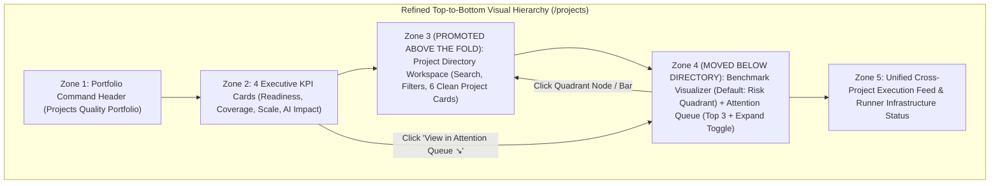

# UX & Layout Refinement Plan: Multi-Project Quality Portfolio Dashboard (`plan_portfolio_dashboard_ux_refinement.md`)

> **Scope & Execution Guardrails:**
> - **100% Frontend-Only (`client/src/`)**: All phases and tasks strictly target Frontend UI/UX layout, visual hierarchy, and component refinements inside `client/src/components/dashboard/portfolio/` and `client/src/services/portfolioDashboard/`.
> - **Design System Preservation**: Preserves all GitHub Primer / Linear industrial theme tokens (`#0d1117`, `#161b22`, `#1f242c`, `#30363d` in Dark Mode; `#f6f8fa`, `#ffffff`, `#f3f4f6`, `#d0d7de` in Light Mode), semantic status colors (`--ud-pass`, `--ud-warn`, `--ud-fail`, `--ud-neutral`), 3-pillar accents (`--ud-unit`, `--ud-integration`, `--ud-system`), `tabular-nums` monospace alignment, and existing modals/drawers.
> - **Approval Gate**: Execution of code changes begins only after explicit user review and approval of this plan.

---

## 1. UX AUDIT & PROBLEM STATEMENT

While the initial **Multi-Project Quality Portfolio Dashboard (`/projects`)** is functionally complete and 100% mathematically reconciled, an ergonomic and visual inspection identified **4 UX friction points** that hinder the **"5-Second Comprehension Rule"**:

1. **Inverted Visual Hierarchy (Below-the-Fold Project Cards)**:
   - When users open `CovAI / Projects`, their primary intent is to find, inspect, or launch a Project Workspace. Currently, the tall `Cross-Project Quality Benchmark` and `Cross-Project Attention Queue` occupy the middle of the viewport, pushing the Search Toolbar and Project Quality Cards below the fold.
2. **Visual Redundancy ("Wall of Horizontal Bars")**:
   - Both the `Cross-Project Quality Benchmark` (defaulting to the `3-Layer Bars` tab) and the `Project Quality Cards` directly below it render the exact same 3 horizontal progress bars (`Unit`, `Integration`, `System E2E`) for the same projects, creating visual repetition.
3. **Micro-Text Clutter & Truncated Diagnostics in Project Quality Cards**:
   - `PillarMiniProgressRow.jsx` repeats framework names already shown in header badges (e.g., `Unit (Vitest)`) and crowds narrow rows with dense inline pass/fail strings (`92.8% 210/210P`, `96% 24P / 0F`).
   - Meanwhile, Layer 4 (the diagnostic callout box in `ProjectQualityCard.jsx`) uses single-line `.truncate` (`white-space: nowrap`), cutting off critical failure context mid-sentence (e.g., `5 API failures in Database/Middleware • 6 broken E2...`).
4. **Awkward Vertical Clipping in `Cross-Project Attention Queue`**:
   - In `PortfolioBenchmarkAndRiskZone.jsx`, a fixed `max-h` container slices the 4th alert card in half at the bottom edge of the panel instead of displaying a clean top-3 list with an expand/collapse toggle (`Show all (5 action items) ⌄` / `Show less ⌃`).



---

## 2. TARGET FILES TO BE MODIFIED IN `client/src/`

```text
client/src/
├── services/
│   └── portfolioDashboard/
│       └── portfolioDashboard.config.js                          # Optional threshold/cutoff reference alignment (80% target)
└── components/
    └── dashboard/
        └── portfolio/
            ├── ProjectsPortfolioDashboard.jsx                    # Phase 1: Swap Zone 3 & Zone 4 order + scroll/focus handlers
            ├── zones/
            │   ├── PortfolioExecutiveKpiRow.jsx                  # Phase 1: Update KPI Card #4 link icon/scroll target
            │   ├── ProjectDirectoryWorkspaceZone.jsx             # Phase 1: Add scroll anchor id & active focus banner
            │   └── PortfolioBenchmarkAndRiskZone.jsx             # Phase 2 & 4: Default tab = 'quadrant' + Top-3 Expand/Collapse toggle
            ├── charts/
            │   └── RiskQuadrantScatterPlot.jsx                   # Phase 2: Polish 4-quadrant labels, 80% guide lines, & rich tooltip
            ├── cards/
            │   └── ProjectQualityCard.jsx                        # Phase 3: Declutter pillar props, add tooltip, & 2-line diagnostic clamp
            └── primitives/
                └── PillarMiniProgressRow.jsx                     # Phase 3: Clean left label, tabular-nums % only on right, hover tooltip
```

---

## 3. SEQUENTIAL PHASES & GRANULAR IMPLEMENTATION TASKS

### PHASE 1: REORDER DASHBOARD ZONES FOR IMMEDIATE 5-SECOND PROJECT ACCESS
*Goal: Promote `ProjectDirectoryWorkspaceZone` directly below the Executive KPI Row so users immediately see the Search Bar, Filter Pills, and Project Quality Cards above the fold without scrolling.*

#### Task 1.1: Swap Zone 3 and Zone 4 Vertical Order (`ProjectsPortfolioDashboard.jsx`)
- [x] **1.1.1.** In `client/src/components/dashboard/portfolio/ProjectsPortfolioDashboard.jsx`, reorder the main vertical stack inside the `max-w-[1440px]` container to follow the 5-zone ergonomic sequence:
  1. **Zone 1**: `PortfolioCommandHeader` (`Projects Quality Portfolio` header, mode switcher, gate popover, compare, batch run, export).
  2. **Zone 2**: `PortfolioExecutiveKpiRow` (4 Executive KPI Cards: `Release Readiness`, `Unified Coverage Index`, `Execution & Scale`, `AI Impact & Gaps`).
  3. **Zone 3 (Promoted Up)**: `ProjectDirectoryWorkspaceZone` (Search input, Deficit/Sort dropdowns, Status filter pills, `Grid` | `Table` view toggle, and the Project Quality Cards immediately visible above the fold).
  4. **Zone 4 (Moved Below Directory)**: `PortfolioBenchmarkAndRiskZone` (`Cross-Project Quality Benchmark` 7 cols + `Cross-Project Attention Queue` 5 cols).
  5. **Zone 5**: `PortfolioActivityAndInfraZone` (`Unified Cross-Project Execution Feed` 8 cols + `Runner Infrastructure Status` 4 cols).

#### Task 1.2: Update Anchor Scroll & Cross-Filter Navigation (`ProjectsPortfolioDashboard.jsx` & `PortfolioExecutiveKpiRow.jsx`)
- [x] **1.2.1.** **KPI Card #4 (`AI Impact & Gaps`) → Attention Queue Scroll**:
  - In `PortfolioExecutiveKpiRow.jsx`, ensure the action link `View in Attention Queue ↘` calls `onFocusAttentionQueue()`, which smoothly scrolls to `#portfolio-attention-queue` in Zone 4 (`el.scrollIntoView({ behavior: "smooth", block: "center" })`).
- [x] **1.2.2.** **Zone 4 Benchmark / Quadrant Node → Zone 3 Project Card Scroll & Highlight**:
  - In `ProjectsPortfolioDashboard.jsx`, create a handler `handleSelectBenchmarkProject(projectId)` passed to `PortfolioBenchmarkAndRiskZone`:
    - Toggles `highlightedProjectId` state.
    - When a `projectId` is selected from either the `Risk Quadrant` scatter plot or `3-Layer Bars` chart, smoothly scrolls the matching `#project-card-${projectId}` (or `#project-directory-workspace-zone` if in Table view) into view (`behavior: "smooth", block: "center"`) so the user immediately sees the highlighted Project Card in Zone 3.
- [x] **1.2.3.** Add a subtle `Focused Project` clear pill in `ProjectDirectoryWorkspaceZone.jsx` toolbar when `highlightedProjectId` is active so users can clear the highlight directly from Zone 3 as well as Zone 4.

---

### PHASE 2: ELIMINATE BAR-CHART REDUNDANCY IN `CROSS-PROJECT QUALITY BENCHMARK`
*Goal: Eliminate the "Wall of Horizontal Bars" redundancy by defaulting `Cross-Project Quality Benchmark` to the `Risk Quadrant` scatter matrix while keeping `3-Layer Bars` as the secondary on-demand tab.*

#### Task 2.1: Set `Risk Quadrant` as Default Active Tab (`PortfolioBenchmarkAndRiskZone.jsx`)
- [x] **2.1.1.** In `client/src/components/dashboard/portfolio/zones/PortfolioBenchmarkAndRiskZone.jsx`:
  - Change initial state from `useState("benchmark")` to `useState("quadrant")`.
  - Reorder the tab buttons in the header switcher so **`Risk Quadrant`** (`ScatterChart` icon) appears first (leftmost primary tab) and **`3-Layer Bars`** (`BarChart3` icon) appears second (secondary tab).

#### Task 2.2: Polish 4-Quadrant Visual Clarity & Hover Tooltips (`RiskQuadrantScatterPlot.jsx`)
- [x] **2.2.1.** Refine the 4 quadrant labels and subtle corner watermarks inside `client/src/components/dashboard/portfolio/charts/RiskQuadrantScatterPlot.jsx`:
  - **Top-Right**: `★ Healthy Stars` (`High Coverage & High Pass Rate` — `--ud-pass`)
  - **Top-Left**: `▲ Blind Spot / Low Coverage` (`High Pass Rate, Low Coverage` — `--ud-warn`)
  - **Bottom-Right**: `▼ Active Regressions` (`High Coverage, Failing Tests` — `#fb8500` / `--ud-warn`)
  - **Bottom-Left**: `✖ Critical Risk` (`Low Coverage & Failing Tests` — `--ud-fail`)
- [x] **2.2.2.** Render clear dashed threshold reference lines (including the `80%` quality target guide line and quadrant cutoffs) with legible `tabular-nums` axis labels.
- [x] **2.2.3.** Enhance the interactive project node hover tooltip in `RiskQuadrantScatterPlot.jsx` to display:
  - **Project Name** & **Gate Status Badge**
  - **Health Score**: `e.g., 82 / 100 (Grade B)`
  - **Unified Coverage %**: `e.g., 79.0%` (`tabular-nums`)
  - **Execution Pass Rate %**: `e.g., 97.2%` (`tabular-nums`)
  - Prompt hint: `Click to highlight project card ↑`

---

### PHASE 3: DECLUTTER `PROJECT QUALITY CARDS` & FIX DIAGNOSTIC TEXT TRUNCATION
*Goal: Remove repetitive framework labels and cramped inline pass/fail counts from the 3-pillar progress rows, move detailed pass/fail counts into a clean hover tooltip, and allow the diagnostic callout box to wrap up to 2 lines (`line-clamp-2`) with uniform card heights.*

#### Task 3.1: Simplify 3-Pillar Mini Progress Rows (`PillarMiniProgressRow.jsx` & `ProjectQualityCard.jsx`)
- [x] **3.1.1.** Update `client/src/components/dashboard/portfolio/primitives/PillarMiniProgressRow.jsx`:
  - **Left Side**: Render the colored pillar dot (`w-1.5 h-1.5 rounded-full`), the primary `label` (`font-semibold text-[var(--ud-text)]`), and an optional concise `subLabel` separated by a middle dot (`·`) in muted text (`· 24/25 APIs` or `· 8/9 Flows`) — **without** parentheses around framework names.
  - **Right Side**: Render **ONLY** the high-contrast percentage (`{clampedPct}%`) in `font-mono font-bold tabular-nums text-[var(--ud-text)]`. Remove the inline `detailRight` text (`310/310P`, `24P / 0F`) from the visible row.
  - **Clean Hover Tooltip**: Attach a native `title` and/or styled hover tooltip on the row displaying the exact execution breakdown (e.g., `Unit (Vitest): 92.8% coverage • 210/210 passed (0 failed)` or `Integration (Supertest): 96.0% API coverage (24/25 endpoints) • 24 passed, 0 failed`).
- [x] **3.1.2.** Update the 3 `<PillarMiniProgressRow />` invocations in `client/src/components/dashboard/portfolio/cards/ProjectQualityCard.jsx` (lines 275–301):
  - **Row 1 (Unit)**: `label="Unit"`, `subLabel=""` (framework is already shown in the card header tags), `coveragePct={unit.coveragePct ?? 0}`, `tooltipText={`${unit.framework || "Jest"}: ${unit.coveragePct ?? 0}% line coverage • ${unit.passedTests ?? 0}/${unit.totalTests ?? 0} passed`}`.
  - **Row 2 (Integration)**: `label="Integration"`, `subLabel={`${int.coveredApis ?? 0}/${int.totalApis ?? 0} APIs`}`, `coveragePct={int.coveragePct ?? 0}`, `tooltipText={`Integration APIs: ${int.coveredApis ?? 0}/${int.totalApis ?? 0} covered (${int.coveragePct ?? 0}%) • ${int.passedTests ?? 0} passed, ${int.failedTests ?? 0} failed`}`.
  - **Row 3 (System E2E)**: `label="System E2E"`, `subLabel={`${sys.coveredJourneys ?? 0}/${sys.totalJourneys ?? 0} Flows`}`, `coveragePct={sys.coveragePct ?? 0}`, `tooltipText={`System E2E: ${sys.coveredJourneys ?? 0}/${sys.totalJourneys ?? 0} flows verified (${sys.coveragePct ?? 0}%) • ${sys.passedTests ?? 0} passed, ${sys.failedTests ?? 0} failed`}`.

#### Task 3.2: Fix Truncated Diagnostic Callout Box with 2-Line Clamp (`ProjectQualityCard.jsx`)
- [x] **3.2.1.** In `client/src/components/dashboard/portfolio/cards/ProjectQualityCard.jsx` (Layer 4: Quick Diagnostics Callout, lines 304–318):
  - Replace the single-line `<div className="truncate">` with a 2-line clamped container:
    - Apply `line-clamp-2` (`display: -webkit-box; -webkit-line-clamp: 2; -webkit-box-orient: vertical; overflow: hidden`) and `min-h-[2.25rem] leading-snug` (`min-height: 2.25rem` / `36px`) so both 1-line and 2-line diagnostic messages occupy a consistent vertical footprint across all 3 cards in a desktop row.
  - Ensure complete root-cause messages like `"5 API failures in Database/Middleware • 6 broken E2E checkout journeys"` and `"Missing supertest dependency: 12 discovered APIs have 0% integration coverage"` are immediately legible without premature single-line ellipsis truncation.

---

### PHASE 4: FIX CLIPPED OVERFLOW IN `CROSS-PROJECT ATTENTION QUEUE`
*Goal: Replace the hard scroll container clipping in `Cross-Project Attention Queue` with a clean Top-3 priority view and an interactive `Show all (N action items) ⌄` / `Show less ⌃` toggle button.*

#### Task 4.1: Implement Top-3 Default View & Expand/Collapse Toggle (`PortfolioBenchmarkAndRiskZone.jsx`)
- [x] **4.1.1.** In `client/src/components/dashboard/portfolio/zones/PortfolioBenchmarkAndRiskZone.jsx`:
  - Add state `const [isAttentionExpanded, setIsAttentionExpanded] = useState(false);` (and reset `isAttentionExpanded` to `false` when switching `attentionCategory` pills).
  - Define `const VISIBLE_ATTENTION_LIMIT = 3;`.
  - Compute `const displayedAttention = isAttentionExpanded ? filteredAttention : filteredAttention.slice(0, VISIBLE_ATTENTION_LIMIT);` and `const hiddenCount = Math.max(0, filteredAttention.length - VISIBLE_ATTENTION_LIMIT);`.
- [x] **4.1.2.** Remove the artificial `max-h-[380px]` / `max-h-[620px] overflow-y-auto` clipping container that was slicing the 4th card in half. Render `displayedAttention` cleanly with natural card heights so zero items are ever clipped mid-card.
- [x] **4.1.3.** Render an interactive Expand/Collapse footer toggle button at the bottom of the `Cross-Project Attention Queue` list whenever `filteredAttention.length > VISIBLE_ATTENTION_LIMIT`:
  - When collapsed (`!isAttentionExpanded`): Display **`Show all (${filteredAttention.length} action items)`** with a `ChevronDown` (`⌄`) icon.
  - When expanded (`isAttentionExpanded`): Display **`Show less`** with a `ChevronUp` (`⌃`) icon.
  - Style the toggle button using crisp GitHub Primer surface tokens (`w-full py-2 px-3 rounded-[var(--radius-md)] border border-[var(--ud-border)] bg-[var(--ud-surface-2)]/60 hover:bg-[var(--ud-surface-2)] text-xs font-mono font-semibold text-[var(--ud-text)] flex items-center justify-center gap-1.5 transition-colors cursor-pointer`).

---

## 4. VERIFICATION & QA CHECKLIST

- [x] **QA 1 — 5-Second Above-the-Fold Hierarchy**: Verify that on `/projects`, Zone 3 (`ProjectDirectoryWorkspaceZone` with Search, Filter Pills, and Project Quality Cards) renders immediately below Zone 2 (Executive KPI Row), above `Cross-Project Quality Benchmark` and `Cross-Project Attention Queue`.
- [x] **QA 2 — Zero Bar-Chart Redundancy by Default**: Verify that `Cross-Project Quality Benchmark` opens on the `Risk Quadrant` scatter plot tab by default, with `3-Layer Bars` available as the secondary tab.
- [x] **QA 3 — Clean Project Quality Cards & 2-Line Diagnostics**:
  - Verify `Unit`, `Integration · X/Y APIs`, and `System E2E · X/Y Flows` rows show only the clean `tabular-nums` coverage percentage on the right, with pass/fail counts available on hover.
  - Verify the diagnostic callout box wraps up to 2 lines (`line-clamp-2`) with uniform card height across each 3-card row.
- [x] **QA 4 — Zero Clipped Cards in Attention Queue**: Verify `Cross-Project Attention Queue` renders the Top 3 items cleanly with zero vertical slicing and toggles smoothly via `Show all (5 action items) ⌄` / `Show less ⌃`.
- [x] **QA 5 — Build & Test Verification**:
  - Run `node --test client/src/services/portfolioDashboard/portfolioDashboard.selectors.test.js` (`0` errors).
  - Run `npm run build` in `client/` (`0` compile or bundle errors).

