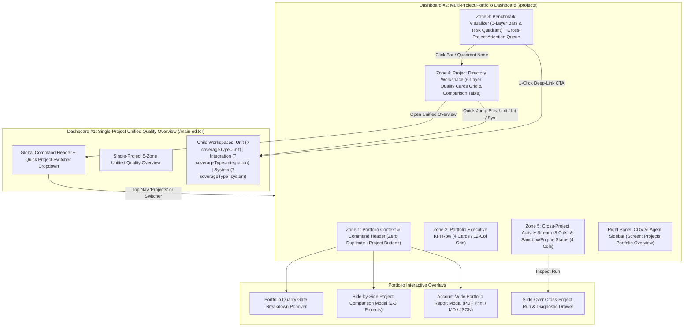

# Implementation Plan: Multi-Project Quality Portfolio Dashboard (Dashboard #2)

> **Scope & Execution Guardrail:**
> - **100% Frontend-Only (`client/src/`)**: All phases, data adapters, selectors, visualizations, modals, drawers, and navigation bridges operate strictly within the React Frontend layer (`client/src/`). No Backend API routes, Prisma schema edits, or database migrations are included.
> - **Approval Gate**: This document serves as the architectural blueprint and task checklist. Execution begins only after explicit user review and approval.

---

## 1. PRODUCT VISION & TWO-TIER DASHBOARD HIERARCHY

CovAI employs a two-tier quality intelligence architecture:
- **Dashboard #2 — Multi-Project Quality Portfolio Dashboard (`/projects` — Planned Here)**:
  The account-level **"Air Traffic Control"** command center managing all projects belonging to the user's account. It aggregates portfolio health scores, multi-layer coverage indices (Unit, Integration, System E2E), testing scale, cross-project risk bottlenecks, and AI test generation/repair impact across the entire project portfolio, while serving as the primary navigation hub into Dashboard #1 and child testing workspaces.
- **Dashboard #1 — Single-Project Unified Quality Overview (`/main-editor?projectId=:id&tab=overview` — Already Built)**:
  Deep-dives into Unit Test, Integration Test, and System Test (E2E) execution, traceability matrix, and trends for a single selected project.



---

## 2. STRICT ANTI-"AI SLOP" UI & DESIGN SYSTEM RULES

The Multi-Project Portfolio Dashboard strictly enforces the industrial engineering aesthetic established in Dashboard #1 (inspired by GitHub Primer, Linear, SonarQube, and Datadog):

1. **Zero Neon / Zero Arbitrary Gradients**:
   - Strictly forbid `linear-gradient` or `radial-gradient` backgrounds on cards, buttons, badges, or typography.
   - Forbid glowing neon `box-shadow` effects and excessive glassmorphism (`backdrop-filter: blur`).
   - All surfaces use crisp `1px solid` borders with subtle elevation shifts on hover.
2. **Scoped Theme Tokens (`.unified-dashboard` / `.portfolio-dashboard` in `client/src/index.css`)**:
   - **Dark Mode (`[data-theme="dark"]`, `.dark`)**:
     - Canvas Background (`--ud-bg`): `#0d1117`
     - Card / Primary Surface (`--ud-surface`): `#161b22`
     - Elevated / Secondary Surface (`--ud-surface-2`): `#1f242c`
     - Border (`--ud-border`): `1px solid #30363d`
     - Primary Text (`--ud-text`): `#f0f6fc`
     - Muted Text (`--ud-text-muted`): `#8b949e`
   - **Light Mode (`:root` default)**:
     - Canvas Background (`--ud-bg`): `#f6f8fa`
     - Card / Primary Surface (`--ud-surface`): `#ffffff`
     - Elevated / Secondary Surface (`--ud-surface-2`): `#f3f4f6`
     - Border (`--ud-border`): `1px solid #d0d7de`
     - Primary Text (`--ud-text`): `#1f2328`
     - Muted Text (`--ud-text-muted`): `#656d76`
3. **Semantic Status & 3-Pillar Accent Tokens**:
   - **Passed / Healthy (`--ud-pass`)**: `#3fb950` (Dark) / `#1a7f37` (Light)
   - **Failed / Blocked (`--ud-fail`)**: `#f85149` (Dark) / `#cf222e` (Light)
   - **At Risk / Warning / Uncovered (`--ud-warn`)**: `#d29922` (Dark) / `#9a6700` (Light)
   - **Untested / Neutral (`--ud-neutral`)**: `#6e7681` (Dark) / `#8c959f` (Light)
   - **Unit Test Pillar (`--ud-unit`)**: `#58a6ff` (Dark) / `#0969da` (Light) — *Technical Blue*
   - **Integration Test Pillar (`--ud-integration`)**: `#a371f7` (Dark) / `#8250df` (Light) — *Muted Purple*
   - **System Test E2E Pillar (`--ud-system`)**: `#39c5cf` (Dark) / `#1b7c83` (Light) — *Teal Cyan*
4. **Typography, Grid & Numeric Precision**:
   - **12-Column CSS Grid** (`grid-cols-12`) with `4px`/`8px` spacing multiples (`gap-4` / `16px` or `gap-6` / `24px`) and `6px–8px` border radius (`rounded-[var(--radius-md)]`, `rounded-[var(--radius-lg)]`).
   - **Tabular Monospace Numbers**: Every metric, percentage, delta, test count, latency duration, and snapshot hash must enforce `font-mono` (`JetBrains Mono`) and `tabular-nums` (`font-variant-numeric: tabular-nums`) so columns and progress indicators align with sub-pixel accuracy.
   - **No Truncated Pillar Labels**: Badges and pillar identifiers use `shrink-0 whitespace-nowrap` with proper `flex-wrap` containers so labels never clip into `Su...` or `System (E2...`.

---

## 3. FRONTEND ARCHITECTURE & COMPONENT TREE (`client/src/`)

```text
client/src/
├── pages/
│   └── ProjectSelectionPage.jsx                        # Upgraded to host Portfolio Shell + Top Nav (+ Project) + Right AI Sidebar
├── hooks/
│   └── useProjectsPortfolio.js                         # React Query hook aggregating live projects + per-project layer summaries & Demo Mode
├── services/
│   └── portfolioDashboard/
│       ├── portfolioDashboard.config.js                # Thresholds, weights, quadrant boundaries, & default filter/sort options
│       ├── portfolioDashboard.mock.js                  # 100% mathematically consistent 6-project Demo Showcase dataset
│       ├── portfolioDashboard.selectors.js             # Pure calculators: Portfolio Health, Global Coverage, Risk Quadrants, Attention Queue
│       ├── portfolioDashboard.adapter.js               # Normalizes Live API projects + snapshots or Demo Showcase into PortfolioVM
│       └── portfolioDashboard.selectors.test.js        # Unit tests for portfolio math, quadrant classification, filtering, & sorting
└── components/
    └── dashboard/
        ├── Layout.jsx                                  # Updated Top Bar breadcrumb with Quick Project Switcher & Portfolio bridge
        ├── AIPanel.jsx                                 # Updated screenContext for "Projects Portfolio Overview" + Portfolio Quick Prompts
        ├── AIContextDialog.jsx                         # Updated screen label mapping for "Projects Portfolio Overview"
        ├── unified/
        │   └── zones/
        │       └── GlobalCommandHeader.jsx             # Added Quick Project Switcher Dropdown in Dashboard #1 breadcrumb
        └── portfolio/
            ├── ProjectsPortfolioDashboard.jsx          # Main 5-Zone Portfolio Dashboard container
            ├── primitives/
            │   ├── PortfolioGatePopover.jsx            # Popover for PORTFOLIO GATE: X/Y PASSED badge & threshold rules
            │   ├── ProjectSparkline.jsx                # Compact 5-run SVG trend sparkline for Project Quality Cards
            │   └── PillarMiniProgressRow.jsx           # Reusable 3-pillar horizontal progress bar row (Unit / Int / Sys)
            ├── zones/
            │   ├── PortfolioCommandHeader.jsx          # ZONE 1: Identity, Metadata, Mode Switcher, Gate Badge, Compare, Batch/Export
            │   ├── PortfolioExecutiveKpiRow.jsx        # ZONE 2: 4 Executive KPI Cards across 12-column grid
            │   ├── PortfolioBenchmarkAndRiskZone.jsx   # ZONE 3: 7-col Visualizer (Bars + Quadrant Scatter) + 5-col Attention Queue
            │   ├── ProjectDirectoryWorkspaceZone.jsx   # ZONE 4: Multi-dimensional Toolbar + 6-layer Cards Grid + Comparison Table
            │   └── PortfolioActivityAndInfraZone.jsx   # ZONE 5: 8-col Cross-Project Execution Feed + 4-col Sandbox/Engine Readiness
            ├── cards/
            │   ├── ProjectQualityCard.jsx              # 6-layer high-density engineering card for Grid View
            │   └── AddProjectDashedCard.jsx            # Subtle end-of-grid dashed card & empty state trigger for ImportLayout
            ├── charts/
            │   ├── MultiProjectCoverageChart.jsx       # Tab 1: Grouped horizontal/vertical 3-layer coverage bar benchmark
            │   └── RiskQuadrantScatterPlot.jsx         # Tab 2: Interactive 4-quadrant SVG scatter plot (Coverage vs. Pass Rate)
            └── modals/
                ├── CompareProjectsModal.jsx            # Side-by-Side 2-to-3 Project Comparison Modal/Drawer
                └── ExportPortfolioReportModal.jsx      # Account-wide Portfolio Quality Report Modal (Preview + MD / JSON / Print)
```

---

## 4. SEQUENTIAL PHASES & GRANULAR IMPLEMENTATION TASKS

### PHASE 0: EXISTING SCAFFOLDING & BASELINE AUDIT (ALREADY COMPLETED)
- [x] **0.1.** Scoped GitHub Primer technical color tokens (`--ud-bg`, `--ud-surface`, `--ud-surface-2`, `--ud-border`, `--ud-pass`, `--ud-warn`, `--ud-fail`, `--ud-unit`, `--ud-integration`, `--ud-system`) and `@media print` rules established in `client/src/index.css`.
- [x] **0.2.** Dashboard #1 (`UnifiedDashboard.jsx`) and its reusable primitives (`PillarBadge.jsx`, `StatusPill.jsx`, `SegmentedFilter.jsx`, `ZoneErrorBoundary.jsx`, `SlideOverInspectorDrawer.jsx`) implemented in `client/src/components/dashboard/unified/`.
- [x] **0.3.** Existing project CRUD & import modal (`getProjectsApi`, `deleteProjectApi`, `ImportLayout.jsx`) wired in `client/src/pages/ProjectSelectionPage.jsx`.

---

### PHASE 1: PORTFOLIO DATA ENGINE, SELECTORS & MATHEMATICALLY COHERENT DEMO SHOWCASE
*Goal: Build a deterministic, zero-split-brain data layer in `client/src/services/portfolioDashboard/` that powers both `Live State` (aggregating real user projects and their latest snapshot metrics) and `Demo Showcase` (a rich 6-project showcase dataset where every KPI, chart bar, quadrant node, attention item, and activity row reconciles 100% mathematically).*

#### Task 1.1: Portfolio Configuration & Threshold Rules (`portfolioDashboard.config.js`)
- [x] **1.1.1.** Define portfolio-level quality gate rules and default weights:
  - Project Health Score weights: `Unit (35%)`, `Integration API (35%)`, `System E2E (30%)` (with automatic weight normalization when a project has partial layers).
  - Project Gate Classification:
    - `PASSED` (`Ready to Release`): Health Score $\ge 80$, Pass Rate $\ge 95\%$, $0$ critical E2E/Database failures, all active layers above coverage thresholds.
    - `AT RISK` (`Low Coverage / Warnings`): Pass Rate $\ge 80\%$ but missing a test pillar, uncovered APIs $> 0$, or coverage below threshold (`Unit < 75%`, `API < 80%`, `E2E < 60%`).
    - `BLOCKED` (`Critical Failures`): Pass Rate $< 80\%$ or active high-severity failures in `DATABASE_FAILURE`, `MIDDLEWARE_REJECTED`, or critical E2E user journeys.
    - `UNTESTED`: $0$ executed tests across all 3 pillars.
  - Risk Quadrant thresholds: Coverage cutoff `X = 70%`, Pass Rate cutoff `Y = 85%` dividing the scatter plot into 4 named engineering quadrants:
    1. Top-Right (`Cov >= 70%`, `Pass >= 85%`): **Healthy Stars** (`--ud-pass`)
    2. Top-Left (`Cov < 70%`, `Pass >= 85%`): **Blind Spot / False Security** (`--ud-warn`)
    3. Bottom-Right (`Cov >= 70%`, `Pass < 85%`): **Active Regressions** (`#fb8500` / `--ud-warn`)
    4. Bottom-Left (`Cov < 70%`, `Pass < 85%`): **Critical Risk** (`--ud-fail`)

#### Task 1.2: Mathematically Coherent Multi-Project Demo Dataset (`portfolioDashboard.mock.js`)
- [x] **1.2.1.** Construct a 6-project `DEMO_PORTFOLIO_PROJECTS` dataset covering diverse real-world engineering states so every filter, sort, chart tab, and attention alert is demonstrable:
  1. **`covai-core-engine`** (`main` • `cmvs3749` • `AT RISK` • Grade `B` • Score `82/100` • Delta `+6.4%`):
     - Unit (`Jest`): `83.4%` cov (`142/144` passed) | Integration (`Supertest`): `85.2%` API cov (`23/27` APIs covered, `23/25` passed, `2` failed in Controller/DB, `2` uncovered) | System (`Playwright`): `68.5%` flow cov (`10/13` journeys passed, `3` failed).
  2. **`payment-gateway-service`** (`release/v2.4` • `a12d844` • `PASSED` • Grade `A` • Score `94/100` • Delta `+4.1%`):
     - Unit (`Vitest`): `92.8%` cov (`210/210` passed) | Integration (`Supertest`): `96.0%` API cov (`24/25` APIs covered, `24/24` passed, `0` failed) | System (`Playwright`): `88.9%` flow cov (`8/9` journeys covered, `8/8` passed).
  3. **`order-fulfillment-api`** (`feat/checkout-tx` • `f03b291` • `BLOCKED` • Grade `D` • Score `54/100` • Delta `-11.2%`):
     - Unit (`Jest`): `71.0%` cov (`88/94` passed, `6` failed) | Integration (`Supertest`): `55.6%` API cov (`10/18` APIs covered, `10/15` passed, `5` failed at `DATABASE_FAILURE` & `MIDDLEWARE_REJECTED`, `3` uncovered) | System (`Playwright`): `40.0%` flow cov (`4/10` journeys passed, `4` failed).
  4. **`merchant-admin-portal`** (`main` • `9c4e11b` • `AT RISK` • Grade `C` • Score `68/100` • Delta `+9.5%`):
     - Layer imbalance showcase: Unit (`Vitest`): `88.5%` cov (`115/116` passed) | Integration (`Supertest`): `0.0%` API cov (`0/12` APIs covered — missing `supertest` dependency in `package.json`) | System (`Playwright`): `75.0%` flow cov (`6/8` journeys passed).
  5. **`auth-identity-sso`** (`main` • `7b2a904` • `PASSED` • Grade `A` • Score `91/100` • Delta `+2.8%`):
     - Unit (`Jest`): `90.2%` cov (`164/164` passed) | Integration (`Supertest`): `92.3%` API cov (`12/13` APIs covered, `12/12` passed) | System (`Playwright`): `83.3%` flow cov (`5/6` journeys passed).
  6. **`legacy-inventory-sync`** (`chore/migration` • `3e8f012` • `UNTESTED` • Grade `—` • Score `0/100` • Delta `0.0%`):
     - Newly imported repository with `0` executed tests across Unit, Integration (`9` discovered APIs, `0` covered), and System (`0` journeys), demonstrating the Zero-Test Alert in Zone 3 and Untested filter in Zone 4.
- [x] **1.2.2.** Verify exact mathematical reconciliation across the 6 demo projects:
  - Gate counts: `2 Passed`, `2 At Risk`, `1 Blocked`, `1 Untested` (`Total = 6 Projects`).
  - Portfolio KPI totals (Zone 2) dynamically computed from the exact sum/average of the active projects in `portfolioDashboard.selectors.js` (never hardcoded).

#### Task 1.3: Pure Portfolio Selectors (`portfolioDashboard.selectors.js`)
- [x] **1.3.1.** Implement `computePortfolioExecutiveKpis(projectVMs)`:
  - **Card 1 (Portfolio Release Readiness & Health)**: Weighted/average Health Score across tested projects (`0–100`) + portfolio letter grade (`A`–`D`), total project count, and exact segmented counts & percentages for `Passed`, `At Risk`, `Blocked`, and `Untested`.
  - **Card 2 (Global Unified Coverage Index)**: Portfolio-wide weighted Unified Coverage % plus the 3 layer averages: `Avg Unit Coverage %`, `Avg API/Integration Coverage %`, and `Avg E2E Flow Coverage %`.
  - **Card 3 (Total Testing Scale & Execution Pass Rate)**: Total executed scenarios across all projects, overall Pass Rate %, sub-metrics (`Total Unit Tests Passed/Total`, `Total Covered/Discovered APIs`, `Total Verified E2E Journeys`, and cumulative execution duration formatted via `fmtDuration`).
  - **Card 4 (Global AI Impact & Remaining Coverage Gaps)**: Total AI-Generated & AI-Repaired test cases across the account, count of `AI Repaired Faulty Tests`, and total remaining `Uncovered Gaps` (uncovered functions + uncovered APIs + unverified E2E flows).
- [x] **1.3.2.** Implement `computeBenchmarkAndQuadrantData(projectVMs)`:
  - Generates normalized series for **Tab 1 (`3-Layer Coverage Benchmark`)** with per-project `unitPct`, `integrationPct`, `systemPct`, and imbalance warning flags (e.g., when max layer coverage - min layer coverage $\ge 40\%$).
  - Generates coordinates and quadrant classifications for **Tab 2 (`Risk Quadrant Matrix`)** (`x: unifiedCoveragePct`, `y: passRatePct`, `quadrantId`, `quadrantLabel`, `statusColor`).
- [x] **1.3.3.** Implement `buildCrossProjectAttentionQueue(projectVMs)`:
  - Synthesizes and ranks cross-project issues by severity (`CRITICAL`, `HIGH`, `MEDIUM`):
    - **Missing Dependency Alerts** (e.g., missing `supertest` or `@playwright/test`).
    - **Severe Layer Failures** (e.g., API failures in `DATABASE_FAILURE` or `MIDDLEWARE_REJECTED`, or broken critical E2E flows).
    - **Missing Pillar / Zero-Test Alerts** (e.g., projects with discovered APIs or services at `0%` coverage).
  - Attaches a 1-click deep-link target (`projectId`, `targetRoute`, `ctaLabel`: `Open & Fix ↗`, `Generate Tests ↗`, or `Diagnose ↗`) to every queue item.
- [x] **1.3.4.** Implement `filterAndSortPortfolioProjects(projectVMs, filterState)`:
  - Supports instant search (`name`, `branch`, `snapshotId`, `frameworks`), Status Filter Pills (`all`, `pinned`, `PASSED`, `AT_RISK`, `BLOCKED`, `UNTESTED`), Layer Deficit Filter (`all`, `deficit-unit`, `deficit-integration`, `deficit-system`), and Sort Selector (`health-asc`, `health-desc`, `coverage-desc`, `gaps-desc`, `recent`, `name-asc`).

#### Task 1.4: Live & Demo Portfolio Data Adapter & Hook (`portfolioDashboard.adapter.js` & `useProjectsPortfolio.js`)
- [x] **1.4.1.** Build `adaptPortfolioDashboard({ rawProjects, perProjectSummaries, favorites, dataMode })`:
  - In `Live State`: maps real user projects from `getProjectsApi()` and enriches each project with its latest snapshot coverage/execution summary (using cached React Query data or lightweight concurrent summary fetches from `getCoverageSummary` / `getIntegrationWorkspace` / `getSystemTestSummary`) without inventing fake failures when `totalTests === 0`.
  - In `Demo Showcase`: adapts `DEMO_PORTFOLIO_PROJECTS` while preserving user-toggled pins (`favorites`).
- [x] **1.4.2.** Create `useProjectsPortfolio({ dataMode, favorites })` in `client/src/hooks/useProjectsPortfolio.js` with React Query caching, `refetch`, and live sync timestamp tracking.

---

### PHASE 2: PAGE SHELL, TOP NAVIGATION BAR & ZONE 1 (PORTFOLIO COMMAND HEADER)
*Goal: Upgrade `/projects` (`ProjectSelectionPage.jsx`) to house the global Top Navigation Bar (with the single `+ Project` button and Right AI Sidebar toggle) and build Zone 1 (`PortfolioCommandHeader.jsx`) with zero duplicate project creation buttons.*

#### Task 2.1: Upgrade Top Navigation Bar on `/projects` (`ProjectSelectionPage.jsx`)
- [x] **2.1.1.** Retain and refine the global Top Navigation Bar (`h-11` / `h-12`, matching `Layout.jsx` studio chrome):
  - **Left**: `CovAI Studio / Projects` breadcrumb with terminal icon.
  - **Right**:
    - Single primary **`+ Project`** button (`icon={Plus}`) that opens `ImportLayout` (Upload ZIP / Import GitHub).
    - `ThemeSelector` (Dark / Light mode toggle).
    - `NotificationCenter`.
    - **AI Assistant Sidebar Toggle Button** (`PanelRightClose` / `PanelRightOpen`, `"Toggle COV AI Agent"`).
    - User Avatar initials & Sign Out button (`ConfirmDialog`).
- [x] **2.1.2.** Wrap the main area of `ProjectSelectionPage.jsx` in a flex split layout so the center canvas renders `ProjectsPortfolioDashboard.jsx` (`.unified-dashboard` scoped theme) and the right side renders the collapsible resizable `AIPanel.jsx` sidebar.

#### Task 2.2: Build Zone 1 — `PortfolioCommandHeader.jsx` (Strictly NO Duplicate `+ Project` Buttons)
- [x] **2.2.1.** **Left Side (Portfolio Identity & Metadata)**:
  - Render title `Projects Quality Portfolio` with a technical badge `Account Overview`.
  - Render metadata subtitle strip with `tabular-nums`: `X Active Projects • Y Total Snapshots • Last synced [relative time]`.
  - **UX Constraint Enforcement**: Do **NOT** render `+ New Project`, `+ Upload ZIP`, or `+ Import GitHub` inside Zone 1.
- [x] **2.2.2.** **Right Side (Portfolio-Level Controls & Actions)**:
  1. **Global Data Mode Switcher (`Live State` | `Demo Showcase`)**: Uses `SegmentedFilter` synchronized with URL `?mode=live|demo`.
  2. **Portfolio Quality Gate Summary Badge (`PORTFOLIO GATE: X/Y PASSED ▾`)**:
     - Color-coded by portfolio status (`--ud-pass`, `--ud-warn`, `--ud-fail`).
     - Clicking opens `PortfolioGatePopover.jsx` displaying the breakdown of projects in `Passed (Ready to Release)`, `At Risk (Low Coverage/Warnings)`, `Blocked (Critical Failures)`, and `Untested`, plus the 4 portfolio-wide threshold rules and a 1-click filter trigger for each status.
  3. **`Compare Projects` Button (`⇄ Compare Projects`)**:
     - Opens `CompareProjectsModal.jsx` (pre-selecting up to 3 pinned or top projects, or projects explicitly checked for comparison in Zone 4).
  4. **`Batch Run` & `Export Portfolio` Actions**:
     - `Batch Run Suites`: Opens a confirmation dialog to trigger sequential test execution on pinned/selected projects.
     - `Export Portfolio`: Opens `ExportPortfolioReportModal.jsx` for PDF Print View / Markdown / JSON export.

---

### PHASE 3: ZONE 2 (PORTFOLIO EXECUTIVE KPI ROW) & ZONE 3 (BENCHMARK VISUALIZER & RISK RADAR)
*Goal: Build the 4 Executive KPI Cards in Zone 2 and the 12-column analytical split in Zone 3 (7-col switchable visual benchmark + 5-col prioritized cross-project attention queue).*

#### Task 3.1: Build Zone 2 — `PortfolioExecutiveKpiRow.jsx` (4 Cards across 12-Column Grid)
- [x] **3.1.1.** **Card 1 — Portfolio Release Readiness & Health (`col-span-12 sm:col-span-6 xl:col-span-3`)**:
  - Big metric: Average Portfolio Health Score (`e.g., 78 / 100`) + Grade badge (`A`–`D`) + Total Active Projects count.
  - Multi-segment horizontal breakdown bar and interactive legend counts: `Passed` (`--ud-pass`) • `At Risk` (`--ud-warn`) • `Blocked` (`--ud-fail`) • `Untested` (`--ud-neutral`). Clicking a segment filters Zone 4 by that status.
- [x] **3.1.2.** **Card 2 — Global Unified Coverage Index (`col-span-12 sm:col-span-6 xl:col-span-3`)**:
  - Big metric: Weighted average coverage across all active projects (`e.g., 79.4%`) + portfolio coverage delta badge (`+4.8%`).
  - 3 horizontal mini progress bars with `tabular-nums` percentages:
    - `Avg Unit Coverage %` (`#58a6ff` / `--ud-unit`)
    - `Avg API/Integration Coverage %` (`#a371f7` / `--ud-integration`)
    - `Avg E2E Flow Coverage %` (`#39c5cf` / `--ud-system`)
- [x] **3.1.3.** **Card 3 — Total Testing Scale & Execution Pass Rate (`col-span-12 sm:col-span-6 xl:col-span-3`)**:
  - Big metric: Total executed scenarios across all projects (`e.g., 705 Tests`) + Overall Pass Rate badge (`95.5% Pass`).
  - 4 structured sub-metrics in a 2x2 technical grid:
    - `Unit Tests`: `604/612 Passed`
    - `API Endpoints`: `69/95 Covered`
    - `E2E Journeys`: `33/46 Verified`
    - `Total Runtime`: `3m 42s`
- [x] **3.1.4.** **Card 4 — Global AI Impact & Remaining Coverage Gaps (`col-span-12 sm:col-span-6 xl:col-span-3`)**:
  - Big metric: Total AI-Generated & AI-Repaired test cases across the account (`e.g., 148 AI Tests`).
  - Sub-metrics: `AI Repaired Faulty Tests` count (`34 healed`) + Total remaining `Uncovered Gaps` count (`51 gaps`) with a 1-click link (`View in Attention Queue ↓`) that scrolls/focuses Zone 3's Attention Queue or sorts Zone 4 by `Most Uncovered Gaps`.

#### Task 3.2: Build Zone 3 Left Panel (7 Columns) — Multi-Project Benchmark Visualizer
- [x] **3.2.1.** Create `PortfolioBenchmarkAndRiskZone.jsx` with a 12-column responsive layout (`lg:col-span-7` Left Panel + `lg:col-span-5` Right Panel).
- [x] **3.2.2.** Implement **Tab 1: `3-Layer Coverage Benchmark`** (`MultiProjectCoverageChart.jsx`):
  - Renders each project with its 3 side-by-side / grouped pillar bars (`Unit %` in `#58a6ff`, `Integration API %` in `#a371f7`, `System E2E %` in `#39c5cf`) and an `80% Target` reference line.
  - Highlights layer imbalances with a subtle amber indicator badge (e.g., `merchant-admin-portal: 88.5% Unit vs 0% API`).
  - Clicking any project row/bar toggles cross-filtering for that project in Zone 4 (with a `Clear Selection` pill).
- [x] **3.2.3.** Implement **Tab 2: `Risk Quadrant Matrix (Coverage vs. Pass Rate Scatter Plot)`** (`RiskQuadrantScatterPlot.jsx`):
  - Pure SVG interactive 4-quadrant chart (`X-axis: Unified Coverage 0–100%`, `Y-axis: Pass Rate 0–100%`) with subtle quadrant labels:
    - *Top-Right*: `Healthy Stars` (`--ud-pass`)
    - *Top-Left*: `Blind Spot / False Security` (`--ud-warn`)
    - *Bottom-Right*: `Active Regressions` (`--ud-warn`)
    - *Bottom-Left*: `Critical Risk` (`--ud-fail`)
  - Plots each project as an interactive node with hover tooltip (showing project name, score, 3-layer coverage, and pass rate) and click-to-filter linkage to Zone 4.

#### Task 3.3: Build Zone 3 Right Panel (5 Columns) — Cross-Project Attention Queue (`Prioritized Action Radar`)
- [x] **3.3.1.** Render a high-density prioritized list of the most urgent cross-project bottlenecks ranked by severity (`CRITICAL`, `HIGH`, `MEDIUM`) with category filter pills (`All`, `Failures`, `Missing Deps`, `Zero-Test Gaps`):
  - **Missing Dependency Alert**: e.g., `merchant-admin-portal` lacks `supertest` in `package.json`.
  - **Severe Layer Failure**: e.g., `order-fulfillment-api` has 5 API tests failing at `DATABASE_FAILURE` & `MIDDLEWARE_REJECTED` layers.
  - **Missing Pillar / Zero-Test Alert**: e.g., `legacy-inventory-sync` has 9 discovered APIs with `0%` test coverage.
- [x] **3.3.2.** Equip each queue item with:
  - Project badge, Pillar badge (`Unit` / `Integration` / `System`), severity pill, concise technical description, and a 1-click deep-link CTA (`Open & Fix ↗`, `Generate Tests ↗`, `Diagnose ↗`) that navigates directly to that project's target workspace (`/main-editor?projectId=:id&tab=coverage&coverageType=:pillar...`) or sends the diagnostic prompt to `COV AI Agent`.

---

### PHASE 4: ZONE 4 (PROJECT DIRECTORY WORKSPACE — GRID CARDS, COMPARISON TABLE & SIDE-BY-SIDE MODAL)
*Goal: Build the multi-dimensional filter/sort toolbar, the 6-layer `ProjectQualityCard` (3 per row on desktop), the high-density `Comparison Table View`, and the interactive `CompareProjectsModal`.*

#### Task 4.1: Multi-Dimensional Directory Toolbar (`ProjectDirectoryWorkspaceZone.jsx`)
- [x] **4.1.1.** Implement the unified filter & sort bar:
  - **Instant Search Input**: Filters by project name, branch, snapshot ID, or framework tag (`Express`, `React`, `Jest`, `Vitest`, `Supertest`, `Playwright`) with clear (`×`) button.
  - **Status Filter Pills**: `All (N)` • `★ Pinned (N)` • `Passed` • `At Risk` • `Blocked` • `Untested`.
  - **Layer Deficit Filter (Dropdown)**: `All Layers`, `Missing Unit Tests (<20%)`, `Missing Integration/API Tests (<20%)`, `Missing System E2E Tests (<20%)`.
  - **Sort Selector**: `Health Score (Low → High)`, `Health Score (High → Low)`, `Unified Coverage (High → Low)`, `Most Uncovered Gaps`, `Recently Updated`, `Alphabetical (A–Z)`.
  - **View Mode Toggle**: Switch between **`Grid Cards View`** (`Grid` icon) and **`Comparison Table View`** (`List` / `Table` icon).

#### Task 4.2: Build the 6-Layer `ProjectQualityCard.jsx` (Grid View — 3 Cards per Row on Desktop)
- [x] **4.2.1.** Structure each card in a `grid-cols-1 md:grid-cols-2 xl:grid-cols-3 gap-4` layout with 6 distinct information layers:
  1. **Layer 1 — Card Header**:
     - Pin star toggle (`★`), Project Title (clickable link to Dashboard #1), Source/Branch & Snapshot badge (`main • cmvs3749`), detected framework tags (`Express`, `Jest`, `Supertest`, `Playwright`), and Quality Gate Badge (`PASSED` / `AT RISK` / `BLOCKED` / `UNTESTED`) + Grade badge (`A`–`D`).
  2. **Layer 2 — Core Health & Trend Strip**:
     - Quality Health Score (`82/100`), delta badge (`+6.4%` vs. previous run), Unified Coverage %, and a compact 5-run SVG Trend Sparkline (`ProjectSparkline.jsx`).
  3. **Layer 3 — 3-Pillar Mini Progress Bars (`PillarMiniProgressRow.jsx`)**:
     - **Unit** (`#58a6ff`): Progress bar + Coverage % (`83.4%`) + `142/144 passed`.
     - **Integration** (`#a371f7`): Progress bar + API Coverage % (`85.2%` • `23/27 APIs`) + `23P / 2F`.
     - **System E2E** (`#39c5cf`): Progress bar + Flow Coverage % (`68.5%` • `10/13 Journeys`) + `10P / 3F`.
  4. **Layer 4 — Quick Diagnostics Callout**:
     - 1-line status box with semantic border/icon summarizing the top project bottleneck (e.g., `⚠️ 2 API failures in Controller/DB layer • 2 uncovered endpoints` or `✓ All 3 testing layers healthy and passing`).
  5. **Layer 5 — Direct Deep-Links Footer**:
     - Primary CTA button **`Open Unified Overview →`** (`/main-editor?projectId=:id&tab=overview`) alongside 3 compact quick-jump pills **`[Unit ↗]`**, **`[Int ↗]`**, **`[Sys ↗]`** that jump straight into that project's Unit, Integration, or System test workspace.
  6. **Layer 6 — Card Context Menu (`...`) & Compare Checkbox**:
     - Dropdown menu with actions: `Select for Comparison (⇄)`, `Ask COV AI about Project`, `Export Project Summary`, and `Delete Project Workspace` (wired to existing `ConfirmDialog` + `deleteProjectApi`).
- [x] **4.2.2.** Build `AddProjectDashedCard.jsx` & Empty States:
  - At the end of the project grid, render a subtle dashed card (`+ Import or Upload Project`) that opens `ImportLayout` (satisfying the rule that Zone 1 has no duplicate button while providing an intuitive end-of-grid affordance).
  - When 0 projects match active filters, display a clean Filter Empty State with a `Reset All Filters` button; when the account has 0 projects in `Live State`, provide a clear Empty State with buttons to `Import First Project` or `Switch to Demo Showcase`.

#### Task 4.3: Build `Comparison Table View` (High-Density Engineering Table)
- [x] **4.3.1.** Render a responsive `tabular-nums` engineering table when `viewMode === "table"`:
  - Columns: `Pin (★)` | `Compare (☑)` | `Project & Branch/Snapshot` | `Gate & Health Score` | `Unit Cov %` | `Integration API Cov %` | `System Flow Cov %` | `Total Pass / Fail` | `Uncovered Gaps` | `Last Run` | `Quick Actions (Overview / Unit / Int / Sys / Delete)`.

#### Task 4.4: Build Interactive `CompareProjectsModal.jsx` (Side-by-Side 2–3 Projects Comparison)
- [x] **4.4.1.** Allow users to pick any 2 or 3 projects from dropdown selectors (or via the card/table compare checkboxes) and compare them head-to-head across:
  - Overall Health Score, Grade, and Quality Gate status.
  - Unit Line/Branch Coverage %, Integration API Endpoint Coverage %, and System E2E Flow Coverage % (with visual winner highlights in `--ud-pass`).
  - Execution Pass Rate %, Total Tests, Failed Tests, and Average Execution Duration.
  - Failure Layer Breakdown comparison (Route / Middleware / Controller / Database / E2E UI) and direct launch buttons into each compared project.

---

### PHASE 5: ZONE 5 (CROSS-PROJECT ACTIVITY STREAM & RUNNER INFRASTRUCTURE) & EXPORT MODAL
*Goal: Build Zone 5 (8-column Unified Cross-Project Execution Feed + 4-column Sandbox & Engine Readiness panel) and the Account-Wide Portfolio Report Exporter.*

#### Task 5.1: Build Zone 5 Left Panel (8 Columns) — Unified Cross-Project Execution Feed (`PortfolioActivityAndInfraZone.jsx`)
- [x] **5.1.1.** Implement chronological cross-project feed with filter tabs (`All Events`, `Test Executions`, `AI Generations`, `Failures Only`):
  - Table columns (`tabular-nums`): `Run/Event ID`, `Project Name`, `Suite Pillar Badge (Unit / Int / Sys / AI)`, `Outcome Status`, `Coverage Delta`, `Duration`, `Timestamp`, and `Inspect ↗`.
  - Clicking `Inspect ↗` opens `SlideOverInspectorDrawer.jsx` showing the run's test case breakdown, failure stack trace/layer, and an `Ask COV AI to Diagnose` button.

#### Task 5.2: Build Zone 5 Right Panel (4 Columns) — Workspace Sandbox & Engine Readiness
- [x] **5.2.1.** Render 3 compact engineering status cards:
  1. **Runner Concurrency & Sandbox Queue**: Active workers status (`Engine Ready • 0 Queued Jobs`), isolated execution sandbox indicator.
  2. **Supported Frameworks Matrix**: Status badges for `Jest / Vitest` (Unit), `Supertest` (Integration HTTP/API), and `Playwright` (System E2E & API).
  3. **Account Snapshot & Storage Summary**: Total snapshots tracked, total discovered API endpoints, and quick link to refresh portfolio telemetry.

#### Task 5.3: Build `ExportPortfolioReportModal.jsx`
- [x] **5.3.1.** Allow exporting an Account-Wide Quality Portfolio Summary Report with selectable sections (Portfolio Executive KPIs, Quality Gate Breakdown, Multi-Project Coverage Benchmark, Cross-Project Attention Queue, Project Directory Table):
  - Live Markdown/Summary preview inside the modal.
  - 1-click download as `.md` (Markdown), `.json` (Structured Portfolio Telemetry), or `Print / Save as PDF` (`window.print()`).

---

### PHASE 6: NAVIGATION BRIDGES & AI AGENT SIDEBAR CONTEXT INTEGRATION
*Goal: Seamlessly connect Dashboard #2 (`/projects`) and Dashboard #1 (`/main-editor?tab=overview`), add a Quick Project Switcher Dropdown in Dashboard #1, and synchronize the right-hand `COV AI Agent` sidebar.*

#### Task 6.1: Bidirectional Navigation Bridges between Dashboard #2 and Dashboard #1
- [x] **6.1.1.** **Portfolio → Single-Project Overview & Workspaces**:
  - Clicking a project's title or **`Open Unified Overview →`** in Zone 4 navigates to `/main-editor?projectId=${project.id}&tab=overview` (preserving `&mode=demo` if Demo Showcase is active so the user experiences a seamless demo flow, or defaulting to `live` when in Live State).
  - Clicking **`[Unit ↗]`**, **`[Int ↗]`**, or **`[Sys ↗]`** navigates directly to `/main-editor?projectId=${project.id}&tab=coverage&coverageType=${pillar}`.
- [x] **6.1.2.** **Single-Project Overview → Portfolio + Quick Project Switcher Dropdown**:
  - In `client/src/components/dashboard/Layout.jsx` and `client/src/components/dashboard/unified/zones/GlobalCommandHeader.jsx`:
    - Ensure clicking `Projects` in the top navigation bar or root breadcrumb navigates back to `/projects`.
    - Add a **Quick Project Switcher Dropdown** right next to the Project Name in `GlobalCommandHeader.jsx` (and `Layout.jsx` top breadcrumb) listing all user projects (with their gate status dot) + a `⇄ View All Projects Portfolio` option at the top of the dropdown so users can switch between projects in 1 click without leaving Dashboard #1.

#### Task 6.2: AI Agent Right Sidebar (`AIPanel.jsx` & `AIContextDialog.jsx`) Portfolio Context Sync
- [x] **6.2.1.** Update screen context label resolution in `client/src/components/dashboard/AIPanel.jsx` and `client/src/components/dashboard/AIContextDialog.jsx`:
  - When `screenContext?.activity === "projects-portfolio"` or `screenContext?.testType === "portfolio"`, display strictly:
    `Current screen: Projects Portfolio Overview` (never `undefined Test`).
- [x] **6.2.2.** Add **Portfolio-Level Quick Prompts** in `AIPanel.jsx` when `screenContext?.activity === "projects-portfolio"`:
  1. *"Which project has the highest release risk right now?"*
  2. *"Summarize coverage gaps across all my projects"*
  3. *"Recommend where to run AI test generation first"*
  - Clicking any prompt or clicking `Ask COV AI` on a project card / attention queue item opens the right-hand AI sidebar and pre-fills/sends the rich portfolio context prompt.

---

## 5. VERIFICATION, MATHEMATICAL AUDIT & QA CHECKLIST

- [x] **QA 1 — Zero Duplicate "+ Project" Buttons in Zone 1**: Verify that the `+ Project` button exists only in the global Top Navigation Bar (and the subtle dashed card at the end of the Zone 4 grid), with zero duplicate creation buttons inside Zone 1 (`PortfolioCommandHeader.jsx`).
- [x] **QA 2 — Anti-"AI Slop" & Theme Token Compliance**: Verify both Dark Mode (`#0d1117`, `#161b22`, `#1f242c`, `#30363d`) and Light Mode (`#f6f8fa`, `#ffffff`, `#f3f4f6`, `#d0d7de`) across all 5 zones, modals, and drawers. Confirm zero linear/radial gradients, zero neon glows, and strict `tabular-nums` alignment.
- [x] **QA 3 — 100% Mathematical Consistency in `Demo Showcase` Mode**:
  - Sum of project gate statuses in Zone 1 Popover & Zone 2 Card 1 (`2 Passed + 2 At Risk + 1 Blocked + 1 Untested = 6 Projects`) matches Zone 4 project cards 1-to-1.
  - Portfolio average health score, 3-layer coverage averages, and total executed tests in Zone 2 match the exact aggregation of the projects shown in Zone 3 and Zone 4.
- [x] **QA 4 — Truthful `Live State` Rendering**: Verify that in `Live State`, user projects fetched from `getProjectsApi()` render their real snapshots and metrics without injecting fake failures when `totalTests === 0`.
- [x] **QA 5 — Interactive Cross-Filtering & Modals**:
  - Clicking a bar in Tab 1 (`3-Layer Coverage Benchmark`) or a quadrant node in Tab 2 (`Risk Quadrant Matrix`) highlights/filters that project in Zone 4.
  - Clicking `⇄ Compare Projects` opens the side-by-side comparison modal and accurately compares 2–3 selected projects.
  - Clicking `Inspect ↗` in Zone 5 opens `SlideOverInspectorDrawer`.
- [x] **QA 6 — Navigation Bridges & AI Sidebar Sync**:
  - Verify `Open Unified Overview →`, `[Unit ↗]`, `[Int ↗]`, `[Sys ↗]`, and the Quick Project Switcher Dropdown in Dashboard #1.
  - Verify the right-hand `COV AI Agent` sidebar displays `Current screen: Projects Portfolio Overview` and surfaces portfolio-level quick prompts.
- [x] **QA 7 — Automated Unit Tests & Production Build**:
  - Run unit tests for `portfolioDashboard.selectors.test.js` (`npx vitest run`).
  - Run frontend production build (`npm run build` in `client/`) and verify `0` compile or bundle errors.

